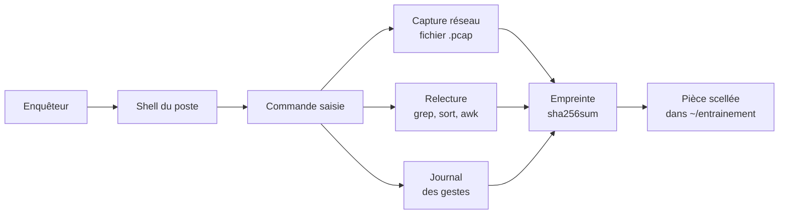
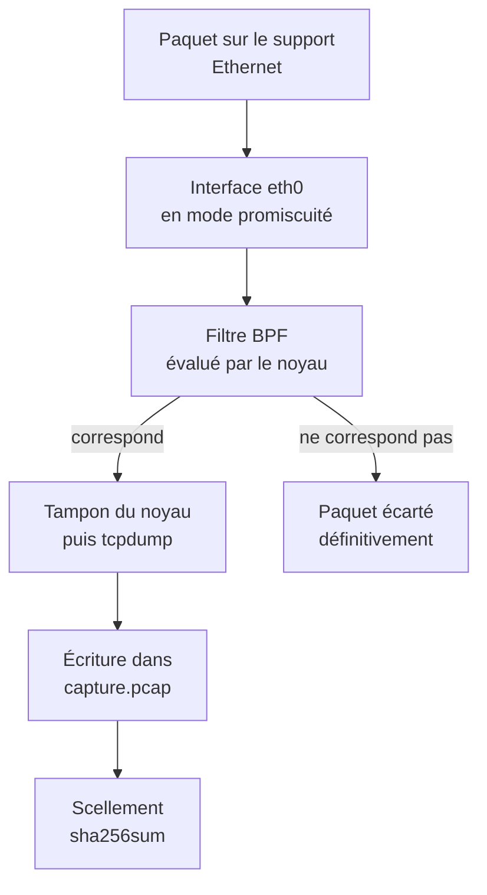
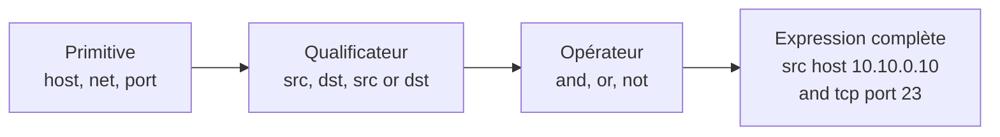
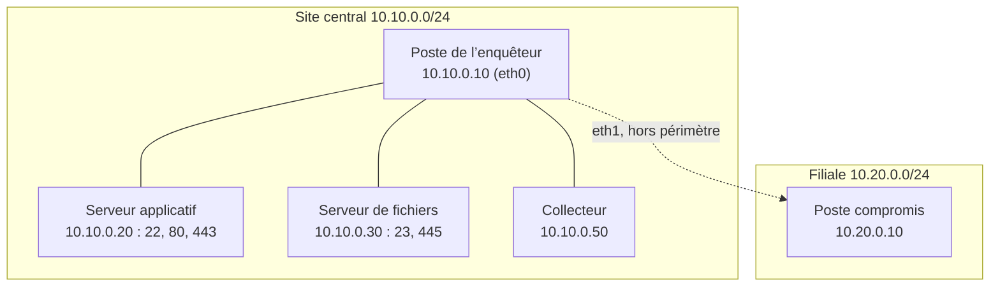

# Forensique réseau — Remise à niveau Linux et tcpdump

## Atelier d’entraînement autonome — lire, capturer et sceller ses premières pièces

---

## À qui s’adresse ce sous-cours

Ce sous-cours s’adresse à l’apprenant qui aborde la formation « Forensique réseau » avec des lacunes sur la ligne de commande. Il ne remplace aucune des trois journées : il les prépare. Un investigateur qui hésite sur `ls`, `grep` ou `tcpdump` passe l’essentiel de son temps à retrouver une syntaxe, au lieu de raisonner sur l’enquête. Ce n’est pas un défaut de compétence, c’est un manque d’entraînement, et l’entraînement se fait ici, sans enjeu et sans preuve à produire.

Le sous-cours se déroule dans exactement le même laboratoire que les trois journées : la même image `forensique-lab:2026`, les mêmes machines, les mêmes adresses. L’apprenant reconnaît donc, dès le premier jour, le poste de l’enquêteur, le serveur applicatif et le serveur de fichiers. Rien de ce qui est montré ici ne sera à réapprendre ensuite, et rien de ce qui est produit ici n’entrera dans le dossier d’enquête.

Un principe gouverne tout l’atelier : **chaque commande est expliquée avant d’être exécutée**. Pour chacune, le texte dit ce qu’elle mesure, donne la commande exacte, précise ce que la sortie prouve, puis précise ce qu’elle ne prouve pas. L’apprenant qui termine ce sous-cours sait lire une sortie d’outil sans la deviner, et il distingue ce qu’un résultat démontre de ce qu’il laisse ouvert.

---

## Objectifs du sous-cours

À l’issue de cet atelier, chaque participant est capable de :

- Se repérer dans un terminal Linux : savoir où il est, sous quel compte, et à quelle heure en temps universel il travaille.
- Naviguer, lire, trier et compter dans un jeu de fichiers, à l’aide des commandes natives du laboratoire.
- Écrire et lire les permissions d’un fichier, et comprendre pourquoi la capture réseau exige un privilège.
- Lancer une commande en arrière-plan, la suivre et l’arrêter proprement, comme le cours le fait pour une capture.
- Construire une chaîne de traitement avec des tubes et des redirections, et en lire le résultat.
- Écrire une petite boucle qui sonde plusieurs hôtes du laboratoire et rend compte de chacun.
- Capturer un trafic connu avec `tcpdump`, écrire une capture, la relire et la filtrer.
- Sceller une pièce par son empreinte et vérifier cette empreinte, en appliquant la règle de conservation du cours.
- Sonder l’état réel du laboratoire avant toute capture : interfaces, routes, ports, heures.

---

## Planning du sous-cours

| Partie | Durée |
|--------|-------|
| Préambule et objectifs généraux | 10 min |
| Chapitre R1 — Les commandes Linux natives de l’enquête | 60 min |
| Chapitre R2 — tcpdump de bout en bout | 50 min |
| LAB — Remise à niveau : capturer un trafic connu et le relire | 50 min |
| Exercices — Sous-cours | 10 min |
| Total | 180 min |

Le sous-cours tient sur trois heures. Il peut être suivi avant les trois journées, ou en parallèle, le soir, à son propre rythme. Les deux chapitres se suivent dans l’ordre : le premier arme la ligne de commande, le second l’applique à la capture. Le LAB met les deux en pratique d’un bout à l’autre.

---

## Le fil du sous-cours

Le sous-cours suit une progression simple : d’abord les outils de la ligne de commande, puis l’outil de capture, puis un atelier qui réunit les deux. Le premier chapitre ne parle pas de réseau ; il apprend à se déplacer, écrire, lire, filtrer et compter. Le second chapitre prend cet outillage et l’applique à `tcpdump`, l’outil de capture du cours. Le LAB produit alors une capture réelle, la relit, la filtre et la scelle.

Tous les fichiers de l’atelier vivent dans `~/entrainement/`, un répertoire créé pour l’occasion. Aucun d’eux ne porte le nom d’un livrable du cours, et aucun n’est écrit dans `~/enquete/`. C’est une règle explicite : le sous-cours ne produit **aucun livrable consommé par les journées**, et il n’écrase jamais un fichier du dossier d’enquête.

| Unité | Apport | Mis en pratique par |
|-------|--------|---------------------|
| Chapitre R1 | Les commandes Linux natives : se repérer, lire, trier, compter, lancer, rediriger, boucler, sceller | Toutes les techniques du LAB |
| Chapitre R2 | `tcpdump` de bout en bout : syntaxe, options, filtres BPF, écriture, relecture, pièges | Les étapes 4 à 7 du LAB |
| LAB | Une capture de trafic connu, relue, filtrée et scellée | Produit `~/entrainement/capture-remise-niveau.pcap` et son empreinte |

---

## Chapitre R1 — Les commandes Linux natives de l’enquête (60 min)

### Préambule — le terminal est le premier instrument de l’enquêteur

Imaginez un enquêteur qui arrive sur les lieux d’un incident. Avant de photographier quoi que ce soit, il se repère : il note où il se trouve, il vérifie qu’il a le droit d’être là, il regarde l’heure. Sur un réseau, le même geste se fait au clavier. Le terminal n’est pas un décor technique : c’est le bureau de l’enquêteur, celui où il range ses pièces, où il les lit, où il les compte et où il les scelle.

La difficulté n’est pas le nombre de commandes. Une poignée de commandes bien comprises suffit à faire l’essentiel du travail de collecte. La difficulté est ailleurs : chaque commande rend une sortie, et cette sortie doit être interprétée sans être devinée. Savoir que `ls -la` affiche des permissions ne sert à rien tant qu’on ne sait pas décider, en lisant la ligne, qui peut lire le fichier et qui peut l’écrire.

Ce chapitre parcourt dix familles de commandes, de l’identité au scellement. Chacune est présentée de la même façon : le problème qu’elle résout en langage courant, un tableau des commandes utiles, puis une ou deux commandes réellement exécutées dans le laboratoire. La figure 1 montre la place du shell dans cette chaîne : c’est de lui que partent toutes les pièces de l’atelier.

### Le vocabulaire en clair

| Terme | En clair | Dans ce chapitre |
|-------|----------|------------------|
| Shell | Le programme qui lit une commande tapée et l’exécute ; dans le laboratoire, c’est `bash` | Famille 1 |
| Terminal | La fenêtre où l’on tape les commandes et où s’affiche leur sortie | Famille 1 |
| Commande | Le nom d’un programme à exécuter, suivi de ses options et de ses arguments | Toutes |
| Option | Un modificateur précédé d’un tiret qui change le comportement de la commande (`-l`, `-a`) | Famille 2 |
| Argument | La donnée sur laquelle la commande travaille, le plus souvent un fichier ou une adresse | Famille 2 |
| Répertoire | Un dossier qui range des fichiers | Famille 2 |
| Chemin | L’adresse d’un fichier ou d’un répertoire dans l’arborescence (`~/entrainement`) | Famille 2 |
| Tube | Le transfert de la sortie d’une commande vers l’entrée de la suivante, noté `\|` | Famille 6 |
| Redirection | Le fait de détourner la sortie ou l’entrée vers un fichier, noté `>`, `>>`, `2>` | Famille 6 |
| Variable d’environnement | Un nom auquel une valeur est associée pour toute la session (`HOME`, `PATH`) | Familles 1 et 7 |
| Processus | Un programme en cours d’exécution, avec son propre numéro d’identification | Famille 5 |
| Permission | Le droit de lire, écrire ou exécuter un fichier | Famille 4 |
| Privilège | Le droit d’agir au-delà de ses permissions ordinaires, obtenu ici par `sudo` | Famille 4 |
| Empreinte | Une valeur de contrôle de 64 caractères qui change si le fichier change d’un seul octet | Famille 9 |

### Objectifs du chapitre

À la fin du chapitre R1, chaque participant est capable de :

- Se situer dans le laboratoire : compte, répertoire courant, horloge en temps universel.
- Construire un répertoire de travail et y ranger ses pièces, en lisant leurs dates et leurs permissions.
- Extraire d’un fichier les lignes utiles, les trier et les compter, à l’aide d’une chaîne de tubes.
- Lire une ligne de permissions et décider qui peut lire, écrire ou exécuter un fichier.
- Lancer une commande en arrière-plan, la mettre en avant, la laisser continuer et l’arrêter proprement.
- Écrire une boucle qui sonde plusieurs hôtes du laboratoire et rend compte de chaque réponse.
- Sceller un fichier par son empreinte et vérifier cette empreinte, comme le cours le fait sur ses livrables.

### Répartition du temps

| Partie | Durée |
|--------|-------|
| Préambule, vocabulaire et objectifs | 8 min |
| Contenu du chapitre — les familles de commandes | 36 min |
| Techniques, pas à pas | 12 min |
| Transitions | 4 min |
| Total | 60 min |

Le schéma suivant se lit de gauche à droite : il part de l’enquêteur devant son clavier et va jusqu’à la pièce scellée rangée dans le répertoire d’entraînement.



**Fig 1 — La place du shell dans le travail d’enquête, de la commande à la pièce scellée.**

Ce que le schéma ne montre pas : le contenu des fichiers produits, ni le résultat des commandes de relecture, que seule leur exécution réelle peut établir.

### Contenu du chapitre — les familles de commandes (36 min)

#### 1. Environnement et identité (4 min)

Avant toute chose, l’enquêteur sait où il est. Sous quel compte travaille-t-il ? Dans quel répertoire ? À quelle heure ? Cette dernière question n’est pas anodine : tout le cours horodate ses pièces en temps universel, et une capture est d’autant plus défendable que l’heure de départ de l’opération est connue d’avance.

| Commande | Rôle |
|----------|------|
| `whoami` | Affiche le nom du compte courant |
| `id` | Affiche l’identité complète : numéro de compte, groupe principal, autres groupes |
| `pwd` | Affiche le répertoire courant |
| `hostname` | Affiche le nom de la machine |
| `uname -a` | Affiche le noyau et l’architecture |
| `date -u` | Affiche la date et l’heure en temps universel |
| `env` | Affiche les variables d’environnement |
| `echo "$HOME"` | Affiche la valeur d’une variable, ici le répertoire personnel |
| `type` et `command -v` | Indiquent si un nom est un programme et où il se trouve |

L’horodatage universel se mesure sur le poste :

```bash
date -u +%Y-%m-%dT%H:%M:%SZ
# -u « universal time » : heure universelle, indépendante du fuseau du poste
# %Y-%m-%dT%H:%M:%SZ : année-mois-jour, lettre T, heures:minutes:secondes, lettre Z
whoami
id | cut -d' ' -f1,2
```

```text
Sur le poste du laboratoire, la première commande rend un instant de la forme
2026-10-13T09:04:11Z : le Z final signifie « heure de Greenwich », et l’instant
est donc comparable d’une machine à l’autre.
La deuxième rend « enqueteur » : le compte est ordinaire, et non administrateur.
La troisième confirme le numéro de compte et le groupe, sans privilège particulier.
```

Ce que cette sortie prouve : à quel instant universel le poste est réglé, sous quel compte ordinaire on travaille, et dans quel groupe on se trouve. Ce qu’elle ne prouve pas : que l’horloge soit exacte. Un poste mal réglé donne une heure fausse mais un format juste ; c’est pourquoi le cours confronte l’horodatage du poste avec celui des journaux des autres machines.

L’existence d’un outil se vérifie sans l’exécuter, ce qui évite un message d’erreur au milieu d’une démonstration :

```bash
command -v tcpdump
command -v traceroute
```

```text
La première commande rend le chemin de tcpdump, par exemple /usr/bin/tcpdump :
l’outil est présent.
La seconde ne rend rien et se termine sur un code de retour non nul : traceroute
n’est pas installé dans l’image du laboratoire.
```

> **Concept clé — l’enquêteur se repère avant de mesurer.**
>
> Le compte, le répertoire courant et l’horloge forment le cadre de tout ce qui suit. Une pièce scellée sous un autre compte, ou horodatée sans fuseau, perd une partie de sa valeur ; ce sont trois commandes à lancer avant toute capture.

> **Bon à savoir — les pages de manuel sont absentes de l’image.**
>
> L’image du laboratoire est minimisée : les pages de manuel ont été retirées pour alléger le conteneur. La commande `man` existe mais ne rend aucun contenu utile. L’aide d’une commande s’obtient donc par ses options d’aide (`tcpdump -h`, `nmap --help`) ou par sa documentation en ligne, citée dans la partie « Ressources ».

#### 2. Fichiers et répertoires (5 min)

L’enquêteur range ses pièces dans un répertoire dédié, et il les décrit avant de les lire. La description d’un fichier — sa taille, ses dates, ses permissions — se lit avec `ls` et `stat`. Le répertoire de l’atelier s’appelle `~/entrainement`, et il est distinct du dossier d’enquête du cours.

| Commande | Rôle |
|----------|------|
| `ls -la` | Liste un répertoire, avec les fichiers cachés, les permissions et les dates |
| `stat` | Décrit un fichier : taille, permissions, dates de modification et de changement |
| `file` | Indique le type d’un fichier d’après son contenu |
| `mkdir -p` | Crée un répertoire, et ses parents s’ils manquent |
| `touch` | Crée un fichier vide ou met à jour sa date, sans écrire dedans |
| `cp`, `mv`, `rm -i` | Copie, déplace ou supprime, la dernière demandant confirmation |
| `ln -s` | Crée un lien symbolique, un raccourci vers un autre chemin |
| `find` | Recherche des fichiers selon un nom, une taille ou une date |
| `du -h`, `df -h` | Mesurent la taille d’un ensemble et l’espace libre d’un système |
| `nano` | Éditeur de texte en mode terminal, pour rédiger ou corriger une pièce |
| `cat`, `less`, `head`, `tail -f`, `wc` | Lisons ci-dessous |

Le répertoire se crée, se remplit et se décrit en quatre commandes :

```bash
mkdir -p ~/entrainement
touch ~/entrainement/notes.txt
printf 'première note de l atelier\n' > ~/entrainement/notes.txt
ls -la ~/entrainement
stat -c '%n | %s octets | modifié %y' ~/entrainement/notes.txt
```

```text
La liste affiche les permissions, le propriétaire, la taille et la date de chaque
entrée du répertoire, ligne par ligne.
La commande stat rend une seule ligne, plus précise : le nom, la taille en octets,
et la date de modification avec les fractions de seconde.
```

Ce que cette sortie prouve : le fichier existe, il appartient au compte `enqueteur`, il pèse quelques dizaines d’octets et il vient d’être modifié. Ce qu’elle ne prouve pas : ce que le fichier contient, ni qu’il n’a pas été modifié auparavant. `stat` décrit un état à l’instant présent ; seule l’empreinte de la famille 9 fige ce contenu.

Pour lire un fichier, l’outil dépend de la longueur. `cat` affiche tout, ce qui noie le lecteur sur un journal de plusieurs milliers de lignes. `less` affiche par écran et permet de remonter ; `head` et `tail` n’en montrent que le début ou la fin ; `tail -f` suit un fichier qui continue de grossir, cas exact du journal d’un collecteur pendant une collecte. Le comptage se fait avec `wc`.

```bash
head -n 3 ~/entrainement/notes.txt
wc -l ~/entrainement/notes.txt
```

> **Bon à savoir — lire un journal vivant se fait avec `tail -f`.**
>
> Pendant une collecte, un journal s’allonge en continu. `cat` le photographie à un instant et rend la main ; `tail -f` reste accroché et affiche chaque nouvelle ligne au fur et à mesure. C’est le geste des journées 2 et 3, quand l’enquêteur surveille l’arrivée des alertes. On en sort par la combinaison `Ctrl` et `C`.

> **Réserve d’environnement — `less` et `file` peuvent manquer.**
>
> L’image du laboratoire est minimisée et ne fournit pas toujours `less` ni `file` en commande autonome. La lecture par écran se fait alors avec `busybox less` ou par `head` et `tail`, et le type d’un fichier se vérifie avec `stat` et les premiers octets lus par `head -c 16`. Le cours signale la dépendance chaque fois qu’il emploie ces deux commandes.

#### 3. Lire, trier, compter (4 min)

Un journal brut n’est pas exploitable : trop de lignes, trop de répétitions. L’enquêteur en extrait les lignes qui l’intéressent, puis il les compte. C’est la chaîne exacte que le cours emploie pour compter les alertes du moteur de détection : sélectionner, trier, compter les identiques, trier par fréquence décroissante.

| Commande | Rôle |
|----------|------|
| `grep -E` | Garde les lignes qui correspondent à une expression étendue |
| `sort` | Trie les lignes par ordre alphabétique ou numérique |
| `uniq -c` | Regroupe les lignes identiques consécutives et les compte |
| `sort -nr` | Trie par nombre, en ordre décroissant |
| `cut` | Extrait une colonne, par caractère ou par séparateur |
| `tr` | Remplace ou supprime des caractères |

La chaîne se construit par ajout successif, et le résultat se lit de la dernière étape vers la première :

```bash
printf '%s\n' entrée sortie entrée sortie entrée erreur | sort | uniq -c | sort -nr
```

```text
Trois lignes, classées par nombre décroissant :
   3 entrée
   2 sortie
   1 erreur
La valeur la plus fréquente vient en tête, ce qui répond à la question
« quel est l’événement dominant ? ».
```

Ce que cette sortie prouve : parmi les six événements écrits, trois sont des entrées, deux des sorties, un est une erreur, et cette répartition est établie sans lire les lignes une à une. Ce qu’elle ne prouve pas : que ces événements se soient produits dans cet ordre, ni à quelles heures. `uniq -c` suppose des lignes déjà triées ; sans le premier `sort`, il compte mal.

> **Piège — `uniq` ne compte que des lignes voisines.**
>
> Si deux lignes identiques sont séparées par une autre, `uniq` les compte séparément. C’est pourquoi la chaîne commence toujours par `sort`, qui rapproche les lignes identiques avant le comptage. `sort -n` trie des nombres, `sort -nr` les trie en ordre décroissant ; `sort` seul trie en ordre alphabétique.

#### 4. Permissions et privilèges (3 min)

Une ligne de `ls -l` commence par dix caractères. Le premier indique le type : `-` pour un fichier, `d` pour un répertoire, `l` pour un lien. Les neuf suivants forment trois groupes de trois : les droits du propriétaire, ceux du groupe, puis ceux des autres. Dans chaque groupe, `r` signifie lire, `w` écrire, `x` exécuter ou parcourir, et un tiret signifie que le droit est absent.

| Commande | Rôle |
|----------|------|
| `ls -l` | Affiche les permissions sous forme symbolique |
| `chmod 640` | Fixe les droits en notation octale : lecture-écriture pour le propriétaire, lecture pour le groupe, rien pour les autres |
| `chown` | Change le propriétaire et le groupe d’un fichier |
| `sudo` | Exécute une commande avec un privilège élevé |
| `umask` | Masque appliqué aux droits par défaut d’un fichier nouvellement créé |

La capture réseau, elle, exige un privilège : ouvrir une interface pour y recopier chaque paquet est une opération réservée à l’administrateur. Le compte `enqueteur` est ordinaire, et il élève ses droits avec `sudo`, accordé sans mot de passe dans l’image du laboratoire.

```bash
ls -l ~/entrainement/notes.txt
umask
```

```text
La ligne de permissions commence par -rw-r--r-- : le propriétaire lit et écrit,
le groupe lit, les autres lisent. C’est un fichier de travail ordinaire.
La commande umask rend le masque par défaut, par exemple 0022, qui retire
le droit d’écriture au groupe et aux autres.
```

Ce que cette sortie prouve : qui peut lire, écrire ou exécuter le fichier, et quelle politique de droits s’applique par défaut. Ce qu’elle ne prouve pas : qui a réellement lu le fichier, ni quand. Les permissions disent ce qui est permis, pas ce qui a eu lieu.

> **Pourquoi — la capture demande un privilège.**
>
> Copier le trafic d’une interface revient à lire tout ce qui passe par elle, y compris ce qui concerne d’autres machines. C’est pourquoi `tcpdump` refuse de s’exécuter sans privilège et répond `You don't have permission to perform this capture on that device`. Le préfixe `sudo` donne ce droit au compte `enqueteur` le temps d’une commande, sans lui accorder un compte d’administrateur permanent.

#### 5. Processus (4 min)

Une capture longue ne se lance pas au premier plan : elle bloquerait le terminal et empêcherait toute autre commande. On la place donc en arrière-plan, avec le caractère `&`, puis on la retrouve avec `jobs`. L’enquêteur peut alors mener d’autres opérations pendant que la capture enregistre.

| Commande | Rôle |
|----------|------|
| `ps aux` | Liste tous les processus, avec leur compte et leur commande |
| `pgrep` | Retrouve le numéro d’un processus à partir de son nom |
| `kill` | Envoie un signal à un processus pour l’arrêter proprement |
| `commande &` | Lance une commande en arrière-plan |
| `jobs` | Liste les tâches lancées depuis le terminal courant |
| `bg`, `fg` | Envoie ou ramène une tâche en arrière-plan ou au premier plan |
| `time` | Mesure la durée d’exécution d’une commande |

Le geste complet du cours se reproduit ici sur une capture courte, bornée à quinze paquets pour ne pas attendre :

```bash
sudo tcpdump -i eth0 -c 15 -n -w ~/entrainement/essai.pcap &
CAP=$!
sleep 2
jobs
ps aux | grep '[t]cpdump'
sudo pkill -INT -x tcpdump
wait "$CAP" 2>/dev/null
```

```text
Le caractère & rend la main aussitôt : la capture tourne en arrière-plan et son
numéro de tâche s’affiche entre crochets.
La variable CAP conserve le numéro du processus, ce qui permet de le viser sans
ambiguïté.
La dernière commande envoie le signal d’interruption, qui fait écrire à tcpdump
le reste du tampon et ferme proprement le fichier.
```

Ce que cette sortie prouve : la capture s’exécute dans un processus distinct, identifié, que l’on peut suivre et arrêter sans fermer le terminal. Ce qu’elle ne prouve pas : que des paquets aient été capturés. Un `tcpdump` lancé sur une interface au repos attend indéfiniment, et la capture peut rester vide.

> **Piège — arrêter une capture par un signal, pas par une fermeture brutale.**
>
> Le signal `INT`, envoyé par `pkill -INT`, laisse `tcpdump` écrire ce qu’il a en mémoire avant de quitter ; le signal `KILL` le coupe net et peut laisser un fichier tronqué au milieu d’un paquet. On arrête donc une capture avec `INT`, puis on attend la fin du processus.

#### 6. Redirections et tubes (4 min)

Une commande produit une sortie ; une redirection la fait aller ailleurs qu’à l’écran. C’est par ce mécanisme que le cours construit ses journaux : il écrit une ligne horodatée dans un fichier à l’aide de `printf` et d’une redirection d’ajout.

| Notation | Effet |
|----------|-------|
| `>` | Écrit la sortie dans un fichier, en écrasant son contenu |
| `>>` | Ajoute la sortie à la fin d’un fichier, sans l’écraser |
| `<` | Lit l’entrée depuis un fichier plutôt que depuis le clavier |
| `2>` | Redirige les erreurs vers un fichier |
| `2>&1` | Réunit les erreurs et la sortie normale dans le même flux |
| `\|` | Envoie la sortie d’une commande vers l’entrée de la suivante |
| `tee` | Écrit dans un fichier tout en affichant à l’écran |
| `;`, `&&`, `\|\|` | Enchaînent deux commandes, sans condition, si la première réussit, si la première échoue |
| `$( )` | Remplace une sous-commande par son résultat |
| `$?` | Contient le code de retour de la dernière commande |

```bash
printf '%s | %s\n' "$(date -u +%Y-%m-%dT%H:%M:%SZ)" "notes de l atelier" >> ~/entrainement/notes.txt
echo "code de retour : $?"
grep -c 'atelier' ~/entrainement/notes.txt
```

```text
La première commande ajoute une ligne de deux champs séparés par une barre
verticale : un instant universel, puis un texte. La redirection >> ajoute la
ligne sans écraser le contenu existant.
La deuxième affiche 0 : la commande précédente a réussi.
La troisième rend le nombre de lignes qui contiennent « atelier ».
```

Ce que cette sortie prouve : la ligne est ajoutée et non substituée, et le code de retour confirme le succès. Ce qu’elle ne prouve pas : que le fichier soit complet. Une redirection `>` exécutée par erreur tronquerait tout le contenu précédent ; c’est `>>` qui convient à un journal.

> **Concept clé — un journal s’écrit avec `>>`, jamais avec `>`.**
>
> `>` écrase, `>>` ajoute. Un journal de gestes qui utiliserait `>` ne conserverait que sa dernière ligne. C’est la même règle qui sécurise la chaîne de responsabilité du cours : chaque acquisition s’ajoute au journal des acquisitions sans jamais effacer les précédentes.

#### 7. Boucles et scripts (4 min)

Répéter la même commande sur plusieurs hôtes se fait avec une boucle. Le cas typique du laboratoire est le sondage de trois machines du site central, pour savoir lesquelles répondent avant d’écrire une capture.

| Élément | Rôle |
|---------|------|
| `for … in …; do …; done` | Répète un bloc pour chaque valeur d’une liste |
| `while …; do …; done` | Répète un bloc tant qu’une condition est vraie |
| `if …; then …; fi` | Exécute un bloc si une condition est vraie |
| `bash -c "…"` | Exécute une courte suite de commandes passée en texte |
| `export` | Place une variable dans l’environnement, visible des commandes filles |

```bash
for h in 10.10.0.20 10.10.0.30 10.10.0.50; do
  if ping -c 1 -W 1 "$h" >/dev/null 2>&1; then
    printf '%s répond\n' "$h"
  else
    printf '%s ne répond pas\n' "$h"
  fi
done
```

```text
Trois lignes, une par adresse sondée, dans l’ordre de la liste : chaque hôte
est annoncé comme joignable ou non.
L’option -c 1 envoie une seule demande d’écho, -W 1 borne l’attente à une seconde,
et la redirection vers /dev/null efface la sortie de ping : seule notre propre
phrase compte.
```

Ce que cette sortie prouve : chacune des trois machines du laboratoire a répondu à une demande d’écho à cet instant. Ce qu’elle ne prouve pas : que les services de ces machines fonctionnent. Une réponse à `ping` démontre que la pile réseau répond, pas qu’un service écoute sur un port donné.

> **Piège — l’apostrophe et les guillemets changent le sens d’une commande.**
>
> Dans `"$h"`, les guillemets droits doubles empêchent le shell de découper la valeur ; dans un texte destiné à l’écran, on écrit l’apostrophe typographique de la langue. Cette distinction n’est pas cosmétique : privé de guillemets, un chemin contenant un espace serait lu comme deux arguments. Le cours écrit ses livrables avec des guillemets français, et ses commandes avec des guillemets droits.

#### 8. Réseau natif (3 min)

Avant de capturer, l’enquêteur constate l’état du réseau : quelles interfaces existent, quelles adresses elles portent, par où sort le trafic, et quels ports les machines du laboratoire écoutent. Ce sont les préalables de toute capture, car une interface mal choisie produit une capture vide.

| Commande | Rôle |
|----------|------|
| `ip addr` | Affiche les interfaces et leurs adresses |
| `ip link` | Affiche l’état des interfaces (active ou non) |
| `ip route` | Affiche la table de routage |
| `ping` | Éprouve la joignabilité d’une machine |
| `ss -tulpn` | Liste les ports en écoute, en TCP et en UDP, avec le programme propriétaire lorsqu’il est accessible au compte |
| `getent hosts` | Résout un nom vers une adresse, à l’aide des sources du système |
| `nc` | Ouvre une connexion ou écoute sur un port, pour un échange simple |

```bash
ip -brief address show
ip route show
ss -tulpn 2>/dev/null | head -n 5
```

```text
Deux interfaces portent une adresse : eth0 en 10.10.0.10/24, sur le site central,
et eth1 en 10.20.0.30/24, sur la filiale ; lo est l’interface de boucle locale.
Les routes désignent la passerelle 10.10.0.1 pour la sortie par défaut, et
atteignent directement chacun des deux segments.
La liste des ports en écoute dépend des services démarrés sur le poste.
```

Ce que cette sortie prouve : le poste est branché sur les deux segments, et le trafic vers chacun passe par la bonne interface. Ce qu’elle ne prouve pas : que les autres machines du segment soient joignables, ni qu’un port réponde. `ss` décrit l’écoute locale du poste, pas celle de ses voisins.

> **Transparence — deux outils classiques manquent dans l’image.**
>
> `traceroute` et `dig` ne sont pas installés. Pour éprouver un chemin, on emploie `ping` ; pour résoudre un nom, on emploie `getent hosts` ou `python3` avec la bibliothèque de noms. Cette limite est annoncée ici parce qu’un lecteur qui la découvrirait seul croirait à une erreur de sa part.

#### 9. Empreintes et conservation (3 min)

Une empreinte est une valeur de contrôle calculée sur le contenu d’un fichier. Si un seul octet change, l’empreinte change. Sceller une pièce consiste à calculer cette empreinte dès sa collecte, puis à la vérifier avant chaque analyse. C’est la règle de conservation du cours, et elle s’applique aussi aux fichiers de l’atelier.

| Commande | Rôle |
|----------|------|
| `sha256sum` | Calcule l’empreinte SHA-256 d’un fichier |
| `sha256sum -c` | Vérifie un fichier contre une empreinte enregistrée |
| `cmp` | Compare deux fichiers octet par octet |
| `diff` | Montre les différences ligne à ligne entre deux fichiers texte |
| `date -u +%Y-%m-%dT%H:%M:%SZ` | Produit l’instant universel qui accompagne l’empreinte |

```bash
sha256sum ~/entrainement/notes.txt > ~/entrainement/notes.txt.sha256
sha256sum -c ~/entrainement/notes.txt.sha256
cp ~/entrainement/notes.txt ~/entrainement/notes-copie.txt
cmp ~/entrainement/notes.txt ~/entrainement/notes-copie.txt && printf 'copie identique\n'
```

```text
La première commande écrit une ligne de 64 caractères, suivie du nom du fichier.
La vérification relit cette ligne, recalcule l’empreinte et répond par le nom du
fichier suivi de « OK ».
La comparaison octet par octet ne dit rien et se termine sur un code nul :
les deux fichiers sont rigoureusement identiques.
```

Ce que cette sortie prouve : le fichier n’a pas changé depuis que son empreinte a été posée, et la copie est fidèle à l’original. Ce qu’elle ne prouve pas : que le contenu soit exact ou véridique. L’empreinte atteste l’intégrité, jamais la véracité.

> **Règle de conservation — l’empreinte se pose sur la copie de travail et sur l’original.**
>
> Le cours scelle le fichier collecté et conserve le fichier d’empreinte : c’est lui, et non le fichier, qui atteste l’intégrité au fil du temps. L’atelier applique la même règle à la capture qu’il produit, à l’étape 7 du LAB.

#### 10. Archivage (2 min)

Exporter une pièce vers un autre poste se fait par une archive, qui rassemble plusieurs fichiers en un seul. L’archive est elle-même scellée par une empreinte, et cette empreinte voyage avec elle.

| Commande | Rôle |
|----------|------|
| `tar czf archive.tgz dossier/` | Crée une archive compressée |
| `tar tzf archive.tgz` | Liste le contenu d’une archive sans l’extraire |
| `tar xzf archive.tgz` | Extrait une archive dans le répertoire courant |

```bash
mkdir -p ~/entrainement/export
tar czf ~/entrainement/export/entrainement.tgz -C ~/entrainement notes.txt
tar tzf ~/entrainement/export/entrainement.tgz
sha256sum ~/entrainement/export/entrainement.tgz
```

```text
L’archive est créée dans le sous-répertoire export, et sa liste contient le
fichier notes.txt. L’empreinte de l’archive tient sur une ligne de 64 caractères :
elle accompagne l’archive lors de son transfert.
```

Ce que cette sortie prouve : l’archive contient bien le fichier visé, et son empreinte est calculable. Ce qu’elle ne prouve pas : que le fichier archivé soit intact au moment de l’extraction. C’est pourquoi l’empreinte du fichier d’origine est conservée séparément, en plus de celle de l’archive.

### Les techniques, pas à pas (12 min)

Les quatre techniques qui suivent condensent l’essentiel du chapitre. Chacune est présentée en quatre temps : ce qu’elle fait, la commande exacte, ce que la sortie prouve, ce qu’elle ne prouve pas.

**Technique 1 — Créer un répertoire de travail et y décrire ses pièces (3 min)**

Ce qu’elle fait : elle prépare le répertoire `~/entrainement`, y dépose un fichier, puis le décrit sans l’ouvrir.

```bash
mkdir -p ~/entrainement
touch ~/entrainement/journal-essai.txt
ls -la ~/entrainement
stat -c '%n | %s octets | %y' ~/entrainement/journal-essai.txt
```

Ce que la sortie prouve : le répertoire existe, le fichier y est rangé, avec ses permissions, sa taille et sa date. Ce qu’elle ne prouve pas : le contenu du fichier, ni qu’aucun autre fichier n’ait porté ce nom avant.

**Technique 2 — Lire la fin d’un fichier et y chercher une ligne (3 min)**

Ce qu’elle fait : elle montre les dernières lignes d’un fichier, puis n’en garde que celles qui correspondent à un motif.

```bash
tail -n 2 ~/entrainement/journal-essai.txt
grep -E 'atelier|entrainement' ~/entrainement/notes.txt
```

Ce que la sortie prouve : les lignes présentes à la fin du fichier, et celles qui contiennent le motif cherché. Ce qu’elle ne prouve pas : que le motif cherché n’existe nulle part ailleurs. Un `grep` qui ne rend rien prouve seulement que la condition écrite ne correspond à rien dans le fichier lu.

**Technique 3 — Compter les événements d’un fichier et les trier par fréquence (3 min)**

Ce qu’elle fait : elle sélectionne, trie, compte les identiques, puis classe du plus fréquent au moins fréquent.

```bash
grep -E '.' ~/entrainement/notes.txt | sort | uniq -c | sort -nr
```

Ce que la sortie prouve : la répartition des lignes par contenu, la plus fréquente en tête. Ce qu’elle ne prouve pas : l’ordre chronologique des événements, ni le moment où ils ont eu lieu.

**Technique 4 — Sceller une pièce et vérifier son sceau (3 min)**

Ce qu’elle fait : elle calcule l’empreinte du fichier, l’enregistre à côté, puis vérifie que le fichier n’a pas bougé. La figure 1 situe cette étape en bout de chaîne : c’est elle qui transforme un fichier de travail en pièce scellée.

```bash
sha256sum ~/entrainement/notes.txt > ~/entrainement/notes.txt.sha256
sha256sum -c ~/entrainement/notes.txt.sha256
diff ~/entrainement/notes.txt ~/entrainement/notes-copie.txt && printf 'aucune différence\n'
```

Ce que la sortie prouve : le fichier est conforme à son sceau, et la copie ne diffère pas de l’original, ligne à ligne. Ce qu’elle ne prouve pas : que le fichier n’ait jamais été différent. L’empreinte atteste l’état actuel, pas l’historique complet du fichier.

### Transitions (4 min)

Avant de passer au chapitre R2, l’apprenant vérifie qu’il dispose de tout l’outillage. Les commandes d’identité, de fichiers, de tri et de comptage serviront telles quelles au LAB. Celles de permissions et de processus expliquent pourquoi la capture demande un privilège et pourquoi elle se lance en arrière-plan. Celles d’empreinte et d’archivage scellent la pièce produite. Le chapitre R2 prend maintenant cet outillage et l’applique à l’outil central du cours, `tcpdump`.

---

## Chapitre R2 — tcpdump de bout en bout (50 min)

### Préambule — recopier ce que l’interface voit

Un poste réseau est comme un guichet : tout ce qui lui est destiné passe devant lui, et rien d’autre. `tcpdump` se place à ce guichet et recopie ce qu’il voit, paquet après paquet, avec l’heure de chaque arrivée. Il ne voit pas « le réseau » : il voit ce qu’une interface donnée, sur une machine donnée, a effectivement reçu ou émis. Cette nuance est la clé de tout le chapitre, et de tout le cours.

Rien dans une capture n’est inventé ni reconstruit : chaque ligne correspond à un paquet réel, arrivé à un instant réel. En revanche, l’absence d’une ligne ne prouve rien. Un paquet échangé entre deux autres machines du segment ne passe jamais devant le poste de l’enquêteur ; une capture prise à un seul endroit laisse donc dans l’ombre tout ce qui ne franchit pas ce point. Savoir ce que l’outil ne montre pas vaut autant que savoir lire ce qu’il montre.

Ce chapitre suit `tcpdump` de bout en bout : ce qu’il mesure, sa syntaxe, ses options, ses filtres, l’écriture et la relecture d’une capture, puis les pièges. Les deux figures du chapitre montrent le trajet d’un paquet jusqu’au fichier, puis la grammaire d’une expression de filtre.

### Le vocabulaire en clair

| Terme | En clair | Dans ce chapitre |
|-------|----------|------------------|
| Paquet | Le morceau de données qu’une machine envoie à une autre, avec son enveloppe d’adresses | Partie 1 |
| Interface réseau | La prise logique par laquelle une machine parle à un segment (`eth0`, `eth1`) | Partie 1 |
| Mode promiscuité | Le réglage qui fait recopier tout ce qui passe sur le segment, et non seulement ce qui est destiné au poste | Partie 1 |
| Capture | La copie du trafic reçue sur une interface | Partie 1 |
| Fichier de capture | Le fichier où sont écrits les paquets recopiés, au format PCAP | Partie 5 |
| Filtre | La condition qui décide quels paquets sont conservés ou montrés | Partie 4 |
| Expression BPF | La phrase écrite dans le langage de filtrage Berkeley Packet Filter | Partie 4 |
| Primitive | Le mot qui désigne l’objet visé : `host`, `net`, `port` | Partie 4 |
| Qualificateur | Le mot qui précise le sens ou l’extrémité : `src`, `dst`, `src or dst` | Partie 4 |
| Opérateur | Le mot qui relie deux conditions : `and`, `or`, `not` | Partie 4 |
| Empreinte | La valeur de contrôle qui scelle la capture une fois fermée | Partie 6 |
| Snaplen | La longueur maximale conservée pour chaque paquet, fixée par l’option `-s` | Partie 3 |
| Horodatage | La date et l’heure, en temps universel, auxquelles un paquet a été vu | Parties 3 et 6 |

### Objectifs du chapitre

À la fin du chapitre R2, chaque participant est capable de :

- Énoncer ce que `tcpdump` mesure et ce qu’il ne mesure pas.
- Écrire la syntaxe d’une commande de capture et borner celle-ci sans bloquer le terminal.
- Choisir les options utiles, en particulier `-i`, `-c`, `-n`, `-s`, `-w` et `-r`.
- Écrire une expression BPF correcte, à l’aide de primitives, de qualificateurs et d’opérateurs.
- Écrire une capture dans un fichier, puis la relire sans la modifier.
- Repérer les pièges classiques : droits insuffisants, filtre trop étroit, horloge non relevée, fichier réécrit.

### Répartition du temps

| Partie | Durée |
|--------|-------|
| Préambule, vocabulaire et objectifs | 5 min |
| Contenu du chapitre | 30 min |
| Techniques, pas à pas | 15 min |
| Total | 50 min |

Le schéma suivant se lit de haut en bas : il suit un paquet depuis le support physique jusqu’au fichier de capture, en montrant où le filtre agit et ce qui est écarté.



**Fig 2 — Le trajet d’un paquet jusqu’au fichier de capture.**

Ce que le schéma ne montre pas : les paquets que l’interface ne voit pas, c’est-à-dire tout le trafic qui ne passe pas devant ce point d’observation.

### Contenu du chapitre (30 min)

#### 1. Ce que tcpdump mesure, et ce qu’il ne mesure pas (5 min)

`tcpdump` mesure une seule chose : le flux de paquets qui arrive à une interface pendant qu’il écoute. La figure 2 le montre : le paquet franchit le support, passe par l’interface en mode promiscuité, traverse le filtre, puis atteint le fichier. Il ne mesure ni le débit nominal d’un lien, ni l’activité des machines qu’il ne voit pas, ni le contenu chiffré qu’il recopie sans pouvoir le lire.

| Ce que tcpdump mesure | Ce qu’il ne mesure pas |
|-----------------------|------------------------|
| Les paquets reçus ou émis par l’interface écoutée | Les paquets échangés entre deux autres machines du segment, hors promiscuité |
| L’heure d’arrivée de chaque paquet, à la microseconde | La cause ni l’intention d’un échange |
| Les adresses, les ports et les indicateurs | Le contenu chiffré des sessions protégées |
| Le volume et le rythme des paquets observés | Le trafic qui n’a jamais atteint ce point d’observation |

> **Concept clé — une capture ne montre pas « le réseau », elle montre un point d’observation.**
>
> Toute conclusion tirée d’une capture vaut pour l’endroit où elle a été prise, et pour lui seul. Une machine qui ne parle plus n’émet plus rien : la capture est alors silencieuse sur son compte, et ce silence n’est pas une preuve d’innocence. Le cours insiste sur ce point dès le chapitre 1, et l’applique à chaque lecture.

#### 2. La syntaxe d’une commande (3 min)

Une commande de capture se lit toujours de la même façon : le nom de l’outil, ses options, puis l’expression de filtre entre guillemets.

```text
tcpdump [options] [expression]
```

Les options commencent par un tiret et modifient le comportement. L’expression vient après, souvent entre guillemets droits, et décrit ce qu’il faut garder. Une première capture se borne toujours : sur une interface active, `tcpdump` sans limite attend indéfiniment et ne rend jamais la main. On pose donc un compteur avec `-c`, comme le montre la figure 2, où le filtre n’est qu’une étape du trajet.

```bash
sudo tcpdump -i eth0 -c 4 -n
```

Le préfixe `sudo` est nécessaire, car ouvrir une interface en mode capture exige un privilège. L’option `-i eth0` choisit l’interface, `-c 4` arrête l’outil après quatre paquets, et `-n` interdit la résolution des noms.

#### 3. Les options essentielles (7 min)

Les options ci-dessous suffisent à mener une capture d’enquête. Toutes sont contenues dans l’image du laboratoire et ont été éprouvées.

| Option | Effet |
|--------|-------|
| `-i eth0` | Choisit l’interface à écouter |
| `-c 10` | S’arrête après dix paquets |
| `-n` | N’interroge pas les serveurs de noms pour les adresses |
| `-nn` | Ne résout ni les adresses ni les numéros de port |
| `-s 0` | Conserve chaque paquet en entier, sans troncature |
| `-w fichier.pcap` | Écrit la capture dans un fichier au lieu de l’afficher |
| `-r fichier.pcap` | Relit une capture à partir d’un fichier |
| `-q` | Affiche une sortie abrégée, une ligne par paquet |
| `-v` | Affiche des détails supplémentaires sur chaque paquet |
| `-e` | Fait apparaître l’en-tête Ethernet, avec les adresses matérielles |
| `-tttt` | Affiche la date et l’heure complètes devant chaque paquet |
| `-U` | Écrit chaque paquet dès sa réception, sans attendre la fin du tampon |
| `-A` | Affiche le contenu des paquets en caractères lisibles |

La relecture d’une capture montre l’effet des options d’affichage. Le fichier relu, `~/entrainement/capture-remise-niveau.pcap`, est produit par l’étape 4 du LAB : ces deux commandes se rejouent donc après le LAB, sur la capture déjà écrite.

```bash
sudo tcpdump -r ~/entrainement/capture-remise-niveau.pcap -tttt -q -c 2
sudo tcpdump -r ~/entrainement/capture-remise-niveau.pcap -e -c 1
```

```text
La première commande affiche deux lignes datées à la seconde et à la fraction,
en forme abrégée : un instant, les deux adresses, le protocole et la longueur.
La seconde ajoute devant chaque ligne les adresses matérielles du support.
```

Ce que cette sortie prouve : la capture relue contient les paquets attendus, avec leur instant complet et, si on le demande, l’en-tête du support. Ce qu’elle ne prouve pas : que la capture soit complète. `tcpdump -r` lit un fichier fermé et n’en connaît pas l’historique de collecte.

> **Bon à savoir — le fichier de capture n’appartient pas à `enqueteur`.**
>
> Une capture écrite par `sudo tcpdump` appartient au compte de la capture, et non à l’enquêteur. Pour la rendre lisible et la sceller sans préfixe, on lui attribue le compte avec `sudo chown enqueteur:enqueteur fichier.pcap`, geste employé par le LAB à l’étape 5.

#### 4. Les filtres BPF (8 min)

Un filtre BPF est une phrase qui décrit les paquets à retenir. Il se compose de trois éléments : une primitive, qui désigne l’objet ; un qualificateur, qui précise le sens ou l’extrémité ; et un opérateur, qui relie deux conditions. La figure 3 se lit de gauche à droite et montre cette grammaire jusqu’à une expression réelle.



**Fig 3 — La grammaire d’un filtre BPF, de la primitive à l’expression complète.**

Ce que le schéma ne montre pas : le résultat de la compilation du filtre par le noyau, ni les paquets qu’il écarte, que seule une commande de compilation peut révéler.

| Élément | Exemple | Ce qu’il retient |
|---------|---------|------------------|
| Primitive `host` | `host 10.10.0.20` | Les paquets émis ou reçus par cette adresse, y compris les échanges de résolution ARP |
| Primitive `net` | `net 10.10.0.0/24` | Les paquets dont une adresse appartient à ce réseau |
| Primitive `port` | `port 23` | Les paquets dont un port est 23, en TCP comme en UDP |
| Primitive de protocole | `tcp`, `udp`, `icmp`, `arp` | Les paquets de ce protocole, quel que soit le port |
| Primitive `ip` | `ip host 10.10.0.50` | Les paquets IP de cette adresse, sans les échanges de résolution ARP |
| Qualificateur `src` | `src host 10.10.0.10` | Les paquets dont l’adresse d’origine est celle-ci |
| Qualificateur `dst` | `dst host 10.10.0.30` | Les paquets dont l’adresse de destination est celle-ci |
| Primitive `portrange` | `portrange 1-1024` | Les paquets dont un port tombe dans cette plage |
| Opérateur `and` | `tcp and port 445` | Les paquets TCP dont un port est 445 |
| Opérateur `or` | `tcp port 22 or tcp port 80` | Les paquets des ports 22 et 80 |
| Opérateur `not` | `not port 22` | Tout sauf les paquets du port 22 |
| Parenthèses | `(host 10.10.0.10 or host 10.10.0.30) and icmp` | Les paquets ICMP des deux adresses groupées |

L’exemple de la figure 3 s’écrit en trois parties : un qualificateur, une primitive et un opérateur de protocole.

```bash
sudo tcpdump -i eth0 -c 6 -n 'src host 10.10.0.10 and tcp port 23'
sudo tcpdump -i eth0 -c 6 -nn 'net 10.10.0.0/24 and icmp'
```

```text
La première expression retient les paquets TCP dont le port 23 et l’adresse
d’origine sont ceux du poste de l’enquêteur : c’est la forme qui isole une
tentative en clair vers le serveur de fichiers.
La deuxième retient les demandes et réponses d’écho échangées à l’intérieur du
site central.
```

Ce que cette sortie prouve : les paquets retenus correspondent bien aux deux conditions écrites, et le filtre laisse passer le reste sans le conserver. Ce qu’elle ne prouve pas : que d’autres paquets de même nature n’existent pas. Un filtre étroit ne rend que ce qu’il accepte ; il ne dit rien de ce qu’il a écarté.

> **Pourquoi — on compile le filtre avant de s’en servir.**
>
> L’option `-d` compile l’expression et affiche le programme sans ouvrir d’interface. Cela permet de vérifier une phrase sur n’importe quelle machine, même sans le privilège de capture, et d’écarter une erreur de syntaxe avant une démonstration. Le cours emploie cette vérification à chaque nouveau filtre.

```bash
tcpdump -d -y EN10MB 'port 23 and tcp'
```

```text
La compilation rend un petit programme d’une vingtaine d’instructions
numérotées, terminé par une instruction qui accepte le paquet et une qui le
rejette. Une phrase invalide ne produit aucun programme et s’accompagne d’un
message d’erreur.
```

#### 5. Écrire une capture, puis la relire (4 min)

Écrire une capture revient à choisir un fichier avec `-w`, à produire du trafic pendant que l’outil écoute, puis à relire le fichier avec `-r`. Le point capital est la fidélité : ce qui s’affiche à la relecture doit être identique à ce qui s’affichait pendant la capture.

```bash
sudo tcpdump -i eth0 -s 0 -n -c 8 -w ~/entrainement/relecture-essai.pcap &
sleep 2
ping -c 4 10.10.0.20
wait
sudo tcpdump -r ~/entrainement/relecture-essai.pcap -nn -c 2
```

```text
Pendant la capture, l’outil affiche un compteur d’état puis le nombre de paquets
retenus. À la relecture, chaque ligne reprend l’instant, les deux adresses, le
protocole, et la longueur, exactement comme à l’écriture.
```

Ce que cette sortie prouve : les mêmes paquets se lisent pendant la capture et après, ce qui garantit que le fichier n’a rien perdu à l’écriture. Ce qu’elle ne prouve pas : que la capture contienne tout le trafic du segment. Elle ne contient que ce qui est passé devant l’interface pendant la fenêtre d’écoute.

#### 6. Pièges et bonnes pratiques (3 min)

Les pièges de `tcpdump` sont peu nombreux, mais chacun coûte une démonstration entière.

| Piège | Symptôme | Parade |
|-------|----------|--------|
| Droits insuffisants | `tcpdump: eth0: You don't have permission to perform this capture on that device` | Préfixer la commande par `sudo` |
| Interface inexistante | `No such device exists` | Vérifier le nom de l’interface avec `ip link` |
| Filtre trop étroit | Aucune ligne, alors que le trafic circule | Compiler le filtre avec `-d`, puis l’élargir |
| Trafic absent | L’outil attend sans rien afficher | Produire le trafic pendant la capture, ou borner avec `-c` |
| Horloge non relevée | L’instant de la capture est inconnu | Relever `date -u` avant et après la capture |
| Fichier réécrit | Un fichier scellé change d’empreinte | Écrire dans un fichier neuf, jamais au-dessus d’une capture scellée |
| Relecture pendant l’écriture | `tcpdump -r` annonce un fichier tronqué | Ne jamais relire une capture ouverte ; attendre l’arrêt propre |

> **Règle de conservation — l’horloge se relève avant la capture.**
>
> Une capture sans heure de départ n’est comparable à aucun journal. Le laboratoire relève donc `date -u` avant d’ouvrir la capture, puis scelle le fichier dès sa fermeture. Ces deux gestes sont ceux des étapes 2 et 7 du LAB.

> **Piège — ne jamais rouvrir une capture pendant qu’elle s’écrit.**
>
> Un fichier de capture est écrit au fur et à mesure. Le relire alors qu’il est encore ouvert fait rencontrer un paquet dont l’en-tête est écrit et le contenu ne l’est pas encore : l’outil affiche un avertissement de fichier tronqué et s’arrête. Le nombre de paquets lu est alors inférieur au nombre réel ; seule la mesure sur une capture fermée est fiable.

### Les techniques, pas à pas (15 min)

**Technique 1 — Capturer un nombre exact de paquets (2 min)**

Ce qu’elle fait : elle ouvre l’interface du site central et s’arrête d’elle-même après un nombre connu de paquets, ce qui rend la fin de la capture prévisible.

```bash
sudo tcpdump -i eth0 -c 5 -nn -s 0
```

Ce que la sortie prouve : l’interface a bien reçu cinq paquets, chacun avec son instant et ses adresses. Ce qu’elle ne prouve pas : que ces cinq paquets représentent l’activité du segment. Le compteur s’arrête au cinquième paquet reçu, quel qu’il soit.

**Technique 2 — Capturer avec un filtre d’hôte (3 min)**

Ce qu’elle fait : elle ne retient que les paquets concernant une adresse précise, ici le serveur applicatif, pour isoler un dialogue.

```bash
sudo tcpdump -i eth0 -c 6 -nn 'host 10.10.0.20'
```

Ce que la sortie prouve : le poste a vu des paquets émis ou reçus par le serveur applicatif pendant la fenêtre d’écoute. Ce qu’elle ne prouve pas : que le serveur applicatif soit la source de ces échanges. Un filtre d’hôte retient les deux sens, sans distinguer qui a parlé le premier.

**Technique 3 — Écrire une capture et la relire (3 min)**

Ce qu’elle fait : elle écrit le trafic dans un fichier, puis le relit à partir de ce fichier, sans rien modifier.

```bash
sudo tcpdump -i eth0 -n -s 0 -U -c 6 -w ~/entrainement/technique3.pcap &
sleep 2
ping -c 3 10.10.0.30
wait
sudo tcpdump -r ~/entrainement/technique3.pcap -nn -c 3
```

Ce que la sortie prouve : le fichier contient des paquets lisibles, écrits dès leur réception grâce à `-U`. Ce qu’elle ne prouve pas : que le fichier contienne tout le trafic du segment, ni qu’il soit encore modifiable sans que l’empreinte le révèle.

**Technique 4 — Sceller une capture (4 min)**

Ce qu’elle fait : elle s’assure que la capture est fermée, lui rend sa propriété au compte ordinaire, puis calcule et vérifie son empreinte.

```bash
sudo pkill -INT -x tcpdump 2>/dev/null || true
sleep 2
sudo chown enqueteur:enqueteur ~/entrainement/technique3.pcap
sha256sum ~/entrainement/technique3.pcap > ~/entrainement/technique3.pcap.sha256
sha256sum -c ~/entrainement/technique3.pcap.sha256
```

Ce que la sortie prouve : la capture est fermée, l’empreinte est calculée et vérifiée, et le fichier est lisible par le compte ordinaire. Ce qu’elle ne prouve pas : que la capture soit complète. L’empreinte atteste l’intégrité d’un fichier donné, à partir de son instant de fermeture.

**Technique 5 — Lire une capture en une ligne avec tshark (3 min)**

Ce qu’elle fait : elle extrait, en une seule ligne par paquet, les champs choisis, sans passer par l’affichage complet de `tcpdump`. Le renvoi à `tshark` est fait ici comme rappel ; l’analyse fine appartient aux journées du cours.

```bash
tshark -r ~/entrainement/technique3.pcap -c 3 -T fields -e frame.time_epoch -e ip.src -e ip.dst -e icmp.type
```

Ce que la sortie prouve : la capture contient bien les champs extraits, un par ligne, exploitables par une chaîne de tri et de comptage. Ce qu’elle ne prouve pas : que ces champs soient complets pour tous les paquets. Un paquet dont le protocole ne porte pas le champ demandé rend une valeur vide.

---

## LAB — Remise à niveau : capturer un trafic connu et le relire (50 min)

### Prérequis

Le laboratoire doit être démarré avant de commencer. Depuis la racine du dépôt, sur la machine hôte, deux commandes suffisent :

```bash
cd lab && ./construire-lab.sh monter
./construire-lab.sh verifier
```

La première construit l’image si elle n’existe pas, crée les réseaux et démarre les conteneurs ; la seconde vérifie que la topologie répond et que les journaux sont écrits. La première construction demande quelques minutes ; les lancements suivants sont immédiats. Une fois monté, on ouvre le poste de l’enquêteur :

```bash
docker exec -it -w /home/enqueteur/enquete flab-enquete bash
```

Toutes les étapes du LAB s’exécutent dans ce terminal. On vérifie que le poste répond, que l’on est sur le site central et que le privilège est disponible :

```bash
whoami
ip -brief address show
sudo -n true && printf 'sudo sans mot de passe disponible\n'
```

```text
Le compte est enqueteur, l’interface eth0 porte l’adresse 10.10.0.10/24, et la
commande sudo sans mot de passe réussit : le poste est prêt.
```

Le compte `enqueteur` est ordinaire et dispose d’un `sudo` sans mot de passe, accordé par l’image du laboratoire. Aucun mot de passe n’est saisi à aucun moment.

### Environnement

| Élément | Valeur |
|---------|--------|
| Poste de l’enquêteur | `enqueteur`@10.10.0.10 (`eth0`) et `enqueteur`@10.20.0.30 (`eth1`) |
| Site central | 10.10.0.0/24 — passerelle 10.10.0.1 |
| Serveur applicatif | 10.10.0.20 — ports 22, 80, 443 ouverts |
| Serveur de fichiers | 10.10.0.30 — ports 23 et 445 ouverts |
| Collecteur de journaux | 10.10.0.50 — réception du syslog sur le port 514 en UDP |
| Filiale | 10.20.0.0/24 — passerelle 10.20.0.1, serveur 10.20.0.20 |
| Outils utilisés | `ip`, `ping`, `nc`, `tcpdump`, `tshark`, `capinfos`, `sha256sum`, `date`, `stat` |
| Répertoire de travail | `~/entrainement` |

Toutes les étapes du LAB se déroulent sur le site central : l’interface écoutée est `eth0`, et aucune commande ne traverse la passerelle. Le trafic de la filiale n’est pas capturé ici.

### Vue d’ensemble du LAB

La figure 4 suivante se lit de haut en bas : elle replace le poste de l’enquêteur sur le site central, au milieu des trois serveurs qu’il va solliciter, et rappelle la filiale en arrière-plan hors du périmètre de capture.



**Fig 4 — Topologie de l’atelier : le poste de l’enquêteur et les trois serveurs du site central.**

Ce que le schéma ne montre pas : le trafic de la filiale, invisible depuis `eth0`, car il ne franchit pas le point d’observation du site central.

Les étapes 3 et 4 du LAB sollicitent les trois serveurs de la figure 4 : le serveur applicatif, le serveur de fichiers et le collecteur. La capture prise sur `eth0` ne verra que ce trafic du site central.

### Étapes du LAB

**Étape 1 — Préparer le répertoire d’entraînement (5 min)**

On crée le répertoire de l’atelier et l’on vérifie qu’il est vide, pour ne jamais mélanger une pièce d’entraînement avec un livrable du cours.

```bash
mkdir -p ~/entrainement
ls -la ~/entrainement
stat -c '%n | %y' ~/entrainement
```

> **Résultat attendu :** le répertoire `~/entrainement` existe, il appartient au compte `enqueteur`, et une première liste montre son contenu, éventuellement vide. Aucun fichier du dossier `~/enquete` n’est touché.

**Étape 2 — Relire son environnement avant de capturer (6 min)**

Avant d’ouvrir une capture, on relève l’état du réseau et l’heure universelle, comme l’impose la règle de conservation.

```bash
ip -brief address show
ip route show
date -u +%Y-%m-%dT%H:%M:%SZ
ping -c 2 -W 1 10.10.0.20
```

> **Résultat attendu :** `eth0` porte 10.10.0.10/24 et `eth1` porte 10.20.0.30/24 ; la route par défaut passe par 10.10.0.1 sur `eth0` ; l’instant universel est affiché ; le serveur applicatif répond à deux demandes d’écho. Heure et joignabilité sont notées, car elles encadreront la capture.

**Étape 3 — Produire un trafic connu (9 min)**

Une capture sur une interface au repos reste vide. On produit donc un trafic dont on connaît l’origine, la destination et le protocole, en sollicitant les trois serveurs de la figure 4.

```bash
ping -c 3 10.10.0.20
ping -c 3 10.10.0.30
printf 'essai\n' | timeout 5 nc 10.10.0.30 445 >/dev/null 2>&1 || true
printf 'essai\n' | timeout 5 nc -u 10.10.0.50 514 >/dev/null 2>&1 || true
```

> **Résultat attendu :** les deux premières commandes affichent trois demandes et trois réponses par serveur ; les deux suivantes s’adressent à un port en écoute du serveur de fichiers et du collecteur, sans exiger de réponse exploitable. Ce trafic est celui que l’on va retrouver à l’étape 5. Ce n’est pas le trafic de la filiale, et aucune de ces commandes ne change la configuration d’une machine.

**Étape 4 — Capturer pendant le trafic (12 min)**

On relève l’instant d’ouverture, on lance la capture en arrière-plan sur `eth0`, on rejoue le trafic, puis on arrête la capture proprement. La figure 2 montre le trajet que suivent les paquets jusqu’au fichier produit.

```bash
date -u +%Y-%m-%dT%H:%M:%SZ
sudo tcpdump -i eth0 -s 0 -n -U -w ~/entrainement/capture-remise-niveau.pcap &
CAP=$!
sleep 2
ping -c 3 10.10.0.20
ping -c 3 10.10.0.30
printf 'essai\n' | timeout 5 nc 10.10.0.30 445 >/dev/null 2>&1 || true
printf 'essai\n' | timeout 5 nc -u 10.10.0.50 514 >/dev/null 2>&1 || true
sleep 1
sudo kill -INT "$CAP"
wait "$CAP" 2>/dev/null
date -u +%Y-%m-%dT%H:%M:%SZ
ls -l ~/entrainement/capture-remise-niveau.pcap
```

> **Résultat attendu :** la capture s’ouvre en arrière-plan, les deux instants universels encadrent l’opération, le fichier `~/entrainement/capture-remise-niveau.pcap` existe et sa taille est non nulle. L’arrêt par le signal `INT` laisse `tcpdump` écrire le reste du tampon : le fichier est fermé proprement. Si la taille reste nulle, le trafic n’a pas franchi `eth0` ; reprendre l’étape en vérifiant l’interface avec `ip link`.

**Étape 5 — Relire la capture (10 min)**

On relit la capture fermée, on compte ses paquets et l’on vérifie que les trois hôtes sollicités y figurent.

```bash
sudo chown enqueteur:enqueteur ~/entrainement/capture-remise-niveau.pcap
capinfos -c -d ~/entrainement/capture-remise-niveau.pcap 2>/dev/null || sudo tcpdump -r ~/entrainement/capture-remise-niveau.pcap -nn -c 4
tcpdump -r ~/entrainement/capture-remise-niveau.pcap -nn 'host 10.10.0.20' -c 2
tcpdump -r ~/entrainement/capture-remise-niveau.pcap -nn 'host 10.10.0.30' -c 2
tcpdump -r ~/entrainement/capture-remise-niveau.pcap -nn 'ip host 10.10.0.50' -c 2
```

> **Résultat attendu :** la commande de métadonnées rend le nombre de paquets, ou une première relecture montre les premières lignes ; les trois filtres d’hôte rendent chacun au moins une ligne, pour 10.10.0.20, pour 10.10.0.30 et pour 10.10.0.50. Le filtre du collecteur emploie `ip host` pour écarter la résolution ARP : la ligne rendue est le datagramme UDP, sur le port 514. Le fichier relu correspond exactement à ce qui a été écrit : la relecture ne modifie pas la capture.

**Étape 6 — Filtrer la capture relue (5 min)**

On éprouve trois filtres, du plus large au plus étroit, en s’appuyant sur la grammaire de la figure 3.

```bash
tcpdump -r ~/entrainement/capture-remise-niveau.pcap -nn 'host 10.10.0.20' -c 2
tcpdump -r ~/entrainement/capture-remise-niveau.pcap -nn 'tcp port 80' -c 2
tcpdump -r ~/entrainement/capture-remise-niveau.pcap -nn 'icmp' -c 2
```

> **Résultat attendu :** le filtre d’hôte rend le dialogue avec le serveur applicatif ; le filtre de port ne rend rien si aucune session HTTP n’a eu lieu, ce qui est un résultat et non un échec ; le filtre `icmp` rend les demandes et réponses d’écho. Un filtre qui ne rend rien prouve seulement que la condition ne correspond à aucun paquet du fichier.

**Étape 7 — Sceller la pièce (3 min)**

On scelle la capture par son empreinte et l’on vérifie le sceau, comme le cours le fait sur ses livrables.

```bash
sha256sum ~/entrainement/capture-remise-niveau.pcap > ~/entrainement/capture-remise-niveau.pcap.sha256
sha256sum -c ~/entrainement/capture-remise-niveau.pcap.sha256
ls -l ~/entrainement/capture-remise-niveau.pcap*
```

> **Résultat attendu :** la vérification répond par le nom du fichier suivi de la mention `OK`. Le répertoire contient la capture et son fichier d’empreinte. À partir de cet instant, la capture ne doit plus être modifiée ; toute nouvelle collecte s’écrit dans un fichier neuf.

### Dépannage

| Symptôme | Cause probable | Correction |
|----------|----------------|------------|
| `tcpdump: eth0: You don't have permission to perform this capture on that device` | La commande a été lancée sans privilège | Préfixer par `sudo` ; le compte `enqueteur` dispose d’un `sudo` sans mot de passe |
| `tcpdump: eth0: No such device exists` | L’interface n’existe pas ou n’est pas active | Vérifier son nom avec `ip link`, puis reprendre |
| Le fichier de capture reste vide | Filtre trop étroit, ou trafic absent pendant la fenêtre d’écoute | Élargir le filtre, compiler avec `-d`, et produire le trafic après le lancement de la capture |
| `tcpdump -r` annonce un fichier tronqué | La capture a été relue pendant qu’elle s’écrivait | Ne jamais relire une capture ouverte ; attendre l’arrêt propre par le signal `INT` |
| La vérification d’empreinte répond `FAILED` | Le fichier a été modifié après son scellement | Conserver les deux versions et consigner la différence ; ne jamais recalculer le sceau pour le faire correspondre |

### Ce que ce LAB produit

Le LAB produit deux pièces dans le répertoire d’entraînement : `~/entrainement/capture-remise-niveau.pcap`, la capture de trafic connu, et `~/entrainement/capture-remise-niveau.pcap.sha256`, son empreinte. Les deux sont scellées à l’étape 7.

Ces pièces restent dans `~/entrainement/`. Elles ne sont reprises par **aucun chapitre des journées**, et elles ne portent pas le nom d’un livrable du cours. Le sous-cours ne produit aucun livrable destiné au dossier `~/enquete` : la capture de référence des journées, `~/enquete/capture-reference.pcap`, est produite par le chapitre C2, et l’atelier ne l’écrase jamais.

| Pièce | Nature | Reprise par |
|-------|--------|-------------|
| `~/entrainement/capture-remise-niveau.pcap` | Capture de trafic connu, écrite à l’étape 4 | Aucune journée ; fichier d’entraînement |
| `~/entrainement/capture-remise-niveau.pcap.sha256` | Empreinte de la capture | Aucune journée ; scellement d’entraînement |

---

## Exercices — Sous-cours (10 min)

**Exercice 1 (2 min) — Compléter un filtre BPF**

Écrivez l’expression qui retient les paquets émis par le poste de l’enquêteur vers le serveur de fichiers sur le port 23, en une seule phrase BPF.

> **Réponse attendue :** `src host 10.10.0.10 and dst host 10.10.0.30 and tcp port 23`. Le qualificateur `src` fixe l’origine, `dst` fixe la destination, et le protocole est écrit avec le port, car la forme abrégée `tcp 23` n’existe pas.

**Exercice 2 (2 min) — Prévoir une sortie**

Que rend la commande suivante, et pourquoi ?

```bash
printf '%s\n' a b a b a | sort | uniq -c | sort -nr
```

> **Réponse attendue :** deux lignes, dans l’ordre `3 a`, puis `2 b`. Le premier `sort` rapproche les lignes identiques, `uniq -c` les compte, et `sort -nr` classe par nombre décroissant. Sans le premier `sort`, le comptage serait faux.

**Exercice 3 (2 min) — Relire une capture et trouver un hôte**

À partir de la pièce de l’atelier, écrivez la commande qui affiche les paquets concernant le collecteur, et dites ce qu’elle ne prouve pas.

> **Réponse attendue :** `tcpdump -r ~/entrainement/capture-remise-niveau.pcap -nn 'host 10.10.0.50'`. La commande prouve que le poste a émis, pendant la capture, un datagramme UDP vers le collecteur sur le port 514. Elle ne prouve pas que le collecteur ait répondu, ni qu’aucun autre échange n’ait eu lieu hors de la fenêtre d’écoute.

**Exercice 4 (2 min) — Compter des événements**

Écrivez la chaîne qui compte combien de fois chaque type ICMP apparaît dans la capture, puis expliquez à quoi sert le tri final.

> **Réponse attendue :** `tshark -r ~/entrainement/capture-remise-niveau.pcap -Y 'icmp' -T fields -e icmp.type | sort | uniq -c | sort -nr`. Le tri final met en tête le type le plus fréquent, ce qui fait ressortir l’événement dominant sans lire toutes les lignes.

**Exercice 5 (1 min) — Écrire une petite boucle**

Écrivez une boucle qui annonce, pour chacune des adresses 10.10.0.20, 10.10.0.30 et 10.10.0.50, si elle répond à une demande d’écho.

> **Réponse attendue :** `for h in 10.10.0.20 10.10.0.30 10.10.0.50; do ping -c 1 -W 1 "$h" >/dev/null 2>&1 && printf '%s répond\n' "$h" || printf '%s ne répond pas\n' "$h"; done`. La sortie de `ping` est redirigée ; seule la phrase de la boucle est affichée.

**Exercice 6 (1 min) — Sceller et vérifier une pièce**

Écrivez les deux commandes qui scellent la capture de l’atelier et vérifient son sceau, puis dites ce que la vérification ne prouve pas.

> **Réponse attendue :** `sha256sum ~/entrainement/capture-remise-niveau.pcap > ~/entrainement/capture-remise-niveau.pcap.sha256` puis `sha256sum -c ~/entrainement/capture-remise-niveau.pcap.sha256`. La vérification prouve que le fichier n’a pas changé depuis le scellement. Elle ne prouve pas que la capture soit complète, ni que son contenu soit exact : elle atteste seulement l’intégrité.

---

## Synthèse

### Couverture du sous-cours

| Unité | Thème | Commandes principales |
|-------|-------|-----------------------|
| Chapitre R1 | Les commandes Linux natives de l’enquête | `whoami`, `id`, `date -u`, `ls`, `stat`, `grep`, `sort`, `uniq`, `chmod`, `ps`, `jobs`, `for`, `ip`, `ping`, `ss`, `sha256sum`, `tar` |
| Chapitre R2 | `tcpdump` de bout en bout | `tcpdump` avec `-i`, `-c`, `-n`, `-nn`, `-s`, `-w`, `-r`, `-e`, `-tttt`, `-U`, `-d` |
| LAB | Capturer un trafic connu, le relire, le filtrer et le sceller | `tcpdump`, `tshark`, `ping`, `nc`, `sha256sum`, `date` |

### Mémo — les commandes essentielles

| Commande | Rôle | Exemple ancré |
|----------|------|---------------|
| `date -u +%Y-%m-%dT%H:%M:%SZ` | Relevé de l’instant universel | Avant et après la capture du LAB |
| `id`, `whoami` | Compte courant et groupes | Vérifier le compte `enqueteur` |
| `mkdir -p ~/entrainement` | Créer le répertoire de l’atelier | Étape 1 du LAB |
| `ls -la`, `stat` | Décrire fichiers et permissions | Décrire la capture produite |
| `grep -E` | Extraire les lignes utiles | `grep -E 'port (23\|445)'` |
| `sort \| uniq -c \| sort -nr` | Compter et classer par fréquence | Compter des événements d’un fichier |
| `chmod`, `chown`, `sudo` | Droits et privilèges | `sudo chown enqueteur:enqueteur capture.pcap` |
| `commande &`, `jobs`, `kill -INT` | Capturer en arrière-plan et arrêter proprement | Étape 4 du LAB |
| `>>`, `2>`, `\|`, `tee` | Rediriger, ajouter, relier | Écrire une ligne de journal horodatée |
| `for … do … done` | Répéter sur plusieurs hôtes | Sonder 10.10.0.20, 10.10.0.30, 10.10.0.50 |
| `ip addr`, `ip route`, `ss -tulpn` | État du réseau avant capture | Étape 2 du LAB |
| `ping`, `nc` | Éprouver la joignabilité, ouvrir une connexion | Produire un trafic connu |
| `tcpdump -i eth0 -s 0 -n -U -w f.pcap` | Capturer sans troncature | Étape 4 du LAB |
| `tcpdump -r f.pcap -nn 'icmp'` | Relire une capture avec filtre | Étape 6 du LAB |
| `tcpdump -d -y EN10MB '…'` | Compiler un filtre sans capturer | Vérifier une expression BPF |
| `sha256sum`, `sha256sum -c` | Sceller et vérifier une pièce | Étape 7 du LAB |
| `cmp`, `diff` | Comparer deux fichiers | Vérifier une copie de travail |
| `tar czf`, `tar tzf`, `tar xzf` | Archiver et extraire | Exporter une pièce d’entraînement |

### Les pièges à retenir

- Un `grep` qui ne rend rien ne prouve pas l’absence du motif : il prouve que la condition écrite ne correspond à rien dans le fichier lu.
- `uniq -c` ne compte que des lignes voisines ; il faut trier avant de compter.
- `>` écrase, `>>` ajoute : un journal s’écrit toujours avec `>>`.
- La capture brute exige un privilège : sans `sudo`, `tcpdump` répond `You don't have permission to perform this capture on that device`.
- Un filtre trop étroit produit une capture vide, sans message d’erreur ; on le compile avec `-d` avant de l’employer.
- Ne jamais relire une capture pendant qu’elle s’écrit ; un avertissement de fichier tronqué signale une lecture interrompue, pas une panne.
- Une capture sans horodatage de départ n’est comparable à aucun journal.
- Une empreinte atteste l’intégrité, jamais la véracité ni la complétude.

---

## Ressources supplémentaires

### Outils utilisés

| Outil | Rôle dans le sous-cours | Présence dans l’image |
|-------|-------------------------|-----------------------|
| `bash` | Shell du laboratoire, boucles et redirections | oui |
| `tcpdump` | Capture et relecture, filtres BPF | oui, version 4.99.6 |
| `tshark` | Lecture d’une capture en ligne de commande | oui |
| `capinfos` | Métadonnées d’un fichier de capture | oui |
| `ping` | Sondage de joignabilité | oui |
| `nc` | Connexion et écoute sur un port | oui, netcat-openbsd |
| `ip`, `ss` | État des interfaces, des routes et des ports | oui |
| `sha256sum` | Calcul et vérification d’empreinte | oui |
| `tar`, `gzip` | Archivage et compression | oui |
| `nano` | Édition d’une pièce rédigée | oui |
| `less` et `file` | Lecture par écran, type d’un fichier | non garantis, réserve signalée |
| `traceroute`, `dig` | Chemin réseau, résolution DNS | non installés |
| `man` | Pages de manuel | binaire présent, pages retirées |

### Références

- Le cours principal : chapitres C1 à C6 des fichiers `jour-1.md`, `jour-2.md` et `jour-3.md`, qui reprennent le cadre, la capture, l’analyse, les journaux, la réponse et le rapport.
- Le laboratoire : `lab/Dockerfile`, `lab/construire-lab.sh`, `lab/regles-detection.rules` et `lab/scenario-incident.sh`.
- Les pages de manuel sont absentes de l’image : la documentation de `tcpdump` et de sa bibliothèque de capture est consultable sur `tcpdump.org`, et la référence du langage de filtrage BPF est décrite dans la documentation de `pcap-filter`.
- La norme des journaux du système est la RFC 5424, citée dans la partie consacrée aux journaux du cours principal.
- Les techniques d’attaque employées plus tard dans le cours sont indexées dans la base MITRE ATT&CK, notamment T1046 pour le balayage de services réseau.

---

## Annexe — Le code de l’atelier

Aucun fichier de code n’est déposé dans `lab/` pour ce sous-cours. Tout l’atelier s’exécute à la main, commande par commande, dans le terminal du poste de l’enquêteur. Les seuls fichiers créés sont ceux de l’apprenant, dans `~/entrainement/` : le répertoire de travail, la capture de trafic connu et son empreinte.

Le laboratoire lui-même est décrit par les fichiers du dépôt, reproduits et commentés dans l’annexe du jour 1 : `lab/telecharger-paquets.sh`, `lab/Dockerfile` et `lab/construire-lab.sh`. Le sous-cours ne les modifie pas et n’en ajoute aucun. Cette absence est volontaire : l’entraînement porte sur les commandes que l’apprenant tape lui-même, et non sur un script qui les jouerait à sa place.
