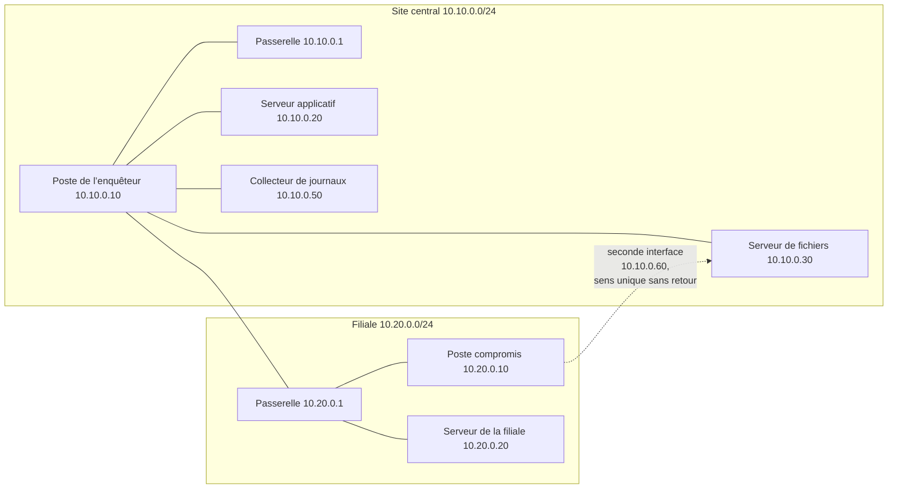
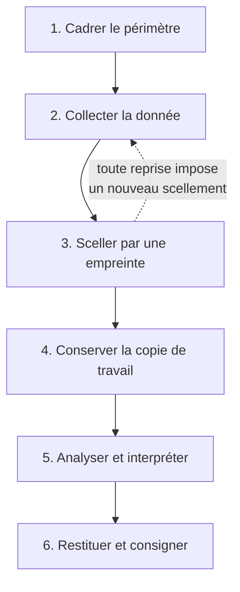
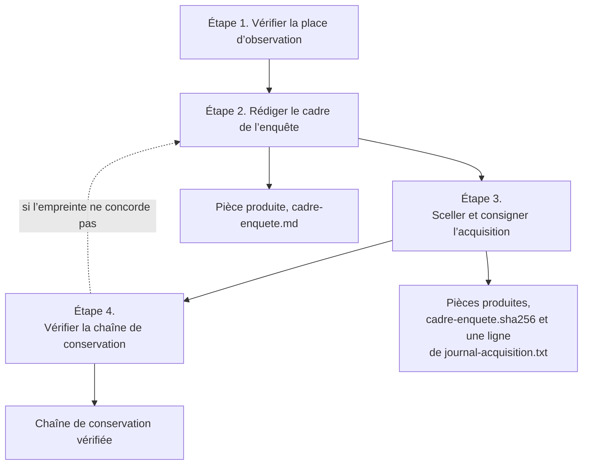
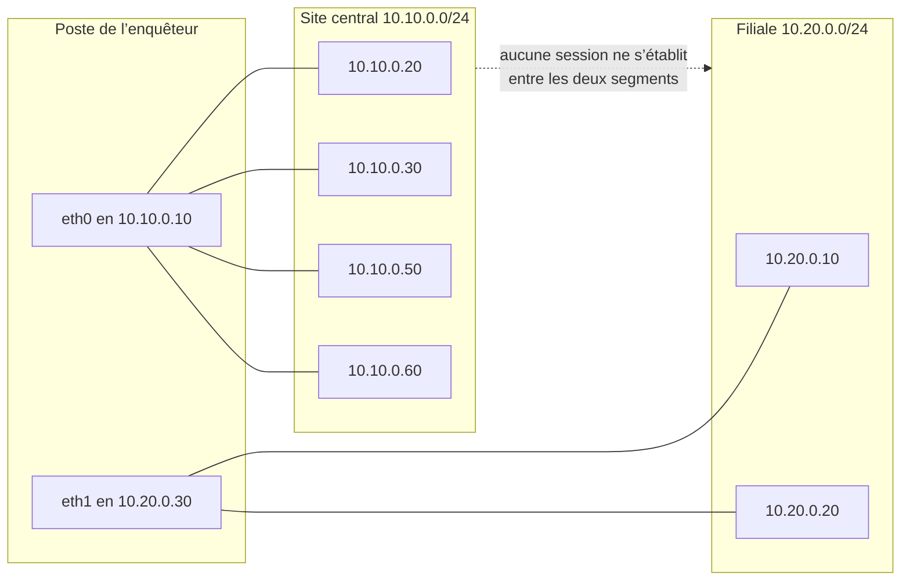
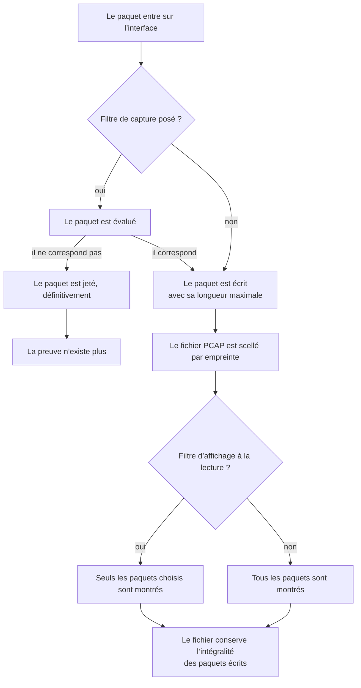
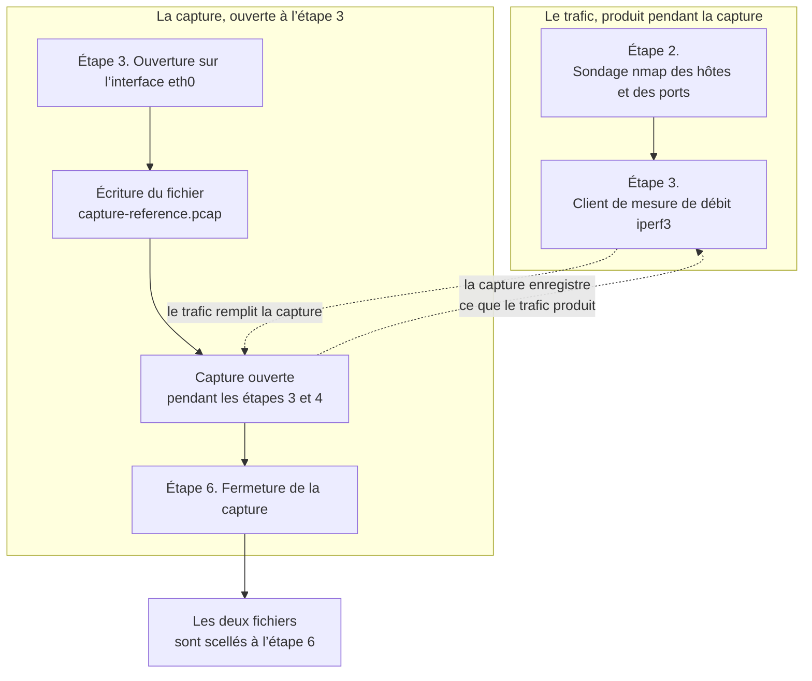

# Forensique réseau — JOUR 1

## Poser le cadre de l’enquête et prendre la première capture (12/10/2026)

---

### Avant la séance — montage du laboratoire

Le laboratoire est un ensemble de machines isolées, que le formateur monte une seule fois, depuis la racine du projet, avant 9h00 :

```bash
lab/construire-lab.sh monter
```

Lors du tout premier lancement, l’image `forensique-lab:2026` n’existe pas encore. La sous-commande `monter` la construit alors automatiquement, après avoir téléchargé sur l’hôte les paquets `.deb` qui la composent : cette préparation demande un accès aux dépôts de la distribution et prend quelques minutes. Les lancements suivants réutilisent l’image déjà construite et démarrent immédiatement. La construction peut aussi être demandée seule, par `lab/construire-lab.sh construire`.

Cette commande recrée le volume du poste de l’enquêteur : elle efface les livrables déjà produits et les empreintes qui les scellent. Une fois la séance commencée, elle ne doit plus être exécutée. Chacun des deux LAB de la journée rappelle cette consigne et donne la commande qui vérifie l’état du laboratoire sans rien détruire.

## Objectifs du Jour

À l’issue de cette journée, chaque participant est capable de :

- Identifier les quatre types de données qu’un réseau produit, et savoir où les trouver dans le laboratoire.
- Établir et consigner par écrit le cadre d’une enquête réseau, avec son périmètre et ses règles de conservation.
- Maîtriser la capture en ligne de commande avec `tcpdump`, ses filtres BPF, et les options qui rendent une capture défendable devant un tiers.
- Lire une capture en ligne de commande avec `tshark`, et en extraire les hôtes, les ports et les protocoles réellement observés.
- Produire une capture de référence et un inventaire horodatés, scellés par empreinte, que les chapitres des jours suivants consommeront.

## Planning du Jour

| Chapitre | Créneaux | Module et thème | Volume |
|----------|----------|-----------------|--------|
| C1 | 9h00–11h00 | M1 — Introduction à la forensique réseau | 2h |
| C2 | 11h00–12h00 et 13h00–16h00 | M2 — Capture et collecte des données réseau | 4h |
| — | 12h00–13h00 | Pause déjeuner | 1h |

Volume pédagogique : 6 h de formation (2 h et 4 h), 1 h de pause déjeuner.

## Le fil du jour

Les deux chapitres de la journée forment une chaîne. Le cadre écrit le matin fixe le périmètre que la capture de l’après-midi matérialise ; la capture et l’inventaire produits l’après-midi sont la matière première des deux chapitres du jour 2, qui les relisent et les recoupent. Chaque livrable est produit par une commande ou par une saisie explicitement décrite dans le LAB : aucun n’est annoncé sans origine.

| Chapitre | Livrable produit | Consommé par |
|----------|------------------|--------------|
| C1 | `~/enquete/cadre-enquete.md`, complété par `~/enquete/cadre-enquete.sha256` et `~/enquete/journal-acquisition.txt` | C2, qui capture sur ce périmètre et qui prolonge le journal d’acquisition |
| C2 | `~/enquete/capture-reference.pcap` et `~/enquete/inventaire-hotes.txt`, complétés par `~/enquete/capture-reference.pcap.sha256` et `~/enquete/inventaire-hotes.txt.sha256` | C3 et C4, qui relisent la capture et l’inventaire le jour 2 |


---

## Chapitre 1 — M1 : Introduction à la forensique réseau (9h00–11h00)

### Préambule — fixer le périmètre avant de toucher aux machines

L’enquêteur arrive sur un réseau qui ne s’arrête pas. Le trafic continue pendant qu’il regarde, les journaux se remplacent, les connexions se referment et ne laissent qu’un souvenir partiel : on ne peut pas demander au réseau de se mettre en pause pour être photographié. Sa première décision n’a rien de technique. Il délimite ce qu’il va examiner, il se place où il peut le voir, et il note ce qu’il a vu.

Ce chapitre ne demande aucune compétence nouvelle. Il donne le vocabulaire de l’enquête numérique et fait écrire à chaque participant le document qui fixe le périmètre, `~/enquete/cadre-enquete.md`, première pièce du dossier. Ce document sera relu à 11h00, et la capture de l’après-midi obéira à ses limites. Un enquêteur qui commence par capturer avant d’avoir écrit son périmètre capture souvent la mauvaise chose, avec beaucoup de rigueur et pour rien.

### Le vocabulaire en clair

| Terme | En clair | Dans ce chapitre |
|-------|----------|------------------|
| Enquête numérique | Une recherche qui établit des faits à partir de traces informatisées, avec une méthode et des faits vérifiables | Partie 1 |
| Forensique réseau | L’enquête appliquée aux échanges qui circulent sur les réseaux, plutôt qu’aux disques ou aux écrans | Partie 1 |
| Preuve numérique | Un élément matériel qui appartient à l’enquête, que l’on peut mesurer et dont on peut démontrer l’intégrité | Partie 4 |
| Collecte | L’opération qui rassemble la donnée sans encore l’interpréter | Partie 1 |
| Préservation | L’ensemble des précautions qui empêchent la donnée de se modifier entre sa collecte et son analyse | Partie 4 |
| Analyse | La lecture de la donnée, qui produit un constat et jamais une simple impression | Partie 1 |
| Paquet | Le petit morceau de données qu’une machine envoie à une autre, avec son enveloppe d’adresses | Partie 2 |
| Flux | L’ensemble des paquets qui vont dans le même sens entre les mêmes deux machines et le même couple de ports | Partie 2 |
| Journal | Le texte qu’un programme écrit, ligne à ligne, pour raconter ce qu’il fait | Partie 2 |
| Configuration réseau | L’état déclaré d’une machine : ses adresses, ses routes, les ports qu’elle écoute | Partie 2 |
| Réseau local (LAN) | Un réseau de voisinage, où chaque machine est branchée sur le même segment que ses voisines | Partie 3 |
| Réseau étendu (WAN) | Un réseau qui relie des sites séparés, où chaque lien franchit un équipement de routage | Partie 3 |
| TCP | Le protocole qui organise les échanges en sessions fiables, avec accusés de réception et reprises sur erreur ; il est détaillé au chapitre 2 | Partie 3 |
| Point d’observation | L’endroit précis où l’on prend la copie du trafic | Partie 3 |
| Empreinte numérique | Une valeur de contrôle calculée sur un fichier, qui change si le fichier change d’un seul octet | Partie 4 |
| Scellement | L’opération qui consiste à calculer l’empreinte d’une preuve dès sa collecte, afin qu’aucune modification ultérieure ne soit possible | Partie 4 |
| Horodatage | La date et l’heure, en temps universel, auxquelles un fait est rattaché | Partie 4 |
| Chaîne de conservation | Le suivi de la pièce elle-même : qui l’a prise en charge, qui l’a reçue ensuite, et où elle a été conservée entre deux manipulations | Partie 4 |
| Chaîne de responsabilité | La trace écrite de qui a touché la preuve, quand, et dans quel ordre | Partie 4 |

### Objectifs du chapitre

À la fin du chapitre 1, chaque participant est capable de :

- Énoncer les trois phases d’une collecte réseau et les distinguer l’une de l’autre.
- Nommer les quatre types de données d’un réseau, et citer pour chacun une source présente dans le laboratoire.
- Expliquer en une phrase ce qui change pour l’enquêteur entre un réseau local et un réseau étendu.
- Appliquer les quatre règles de conservation du laboratoire et produire les commandes qui les mettent en œuvre.
- Rédiger le cadre de l’enquête et le sceller, afin qu’il serve de périmètre à la capture de l’après-midi.

### Répartition du temps

| Partie | Durée |
|---|---|
| Préambule, vocabulaire et objectifs | 10min |
| Contenu du chapitre | 40min |
| Techniques, pas à pas | 25min |
| LAB | 30min |
| Exercices | 15min |

### Contenu du chapitre (40min)

#### 1. Ce qu’est une enquête réseau, et ce qu’elle n’est pas (10min)

Une enquête réseau repose sur trois phases, dans cet ordre. La phase de collecte rassemble la donnée brute sans la juger. La phase de préservation garantit que cette donnée ne changera plus. La phase d’analyse produit des constats, chacun rattaché à une pièce et à une commande qui l’établit.

| Phase | Question à laquelle elle répond | Ce qu’elle produit | Erreur fréquente |
|-------|------------------------------------|-------------------|------------------|
| Collecte | Où est la donnée, et qui l’a vue en premier ? | Un fichier, son horodatage et son emplacement | Collecter large et sans le dire |
| Préservation | Qui a touché le fichier, et quand ? | Une empreinte, un journal d’acquisition, une copie de travail | Travailler directement sur l’original |
| Analyse | Que montre la donnée ? | Un constat, une chronologie, une conclusion | Conclure avant d’avoir vérifié |

L’enquête se distingue de trois activités voisines, avec lesquelles elle est souvent confondue. Un test d’intrusion cherche à obtenir un accès, avec l’accord écrit du titulaire : son but est l’accès, et son résultat est un périmètre d’attaque. Un audit cherche à mesurer un écart entre l’existant et une norme : son résultat est une cartographie et une grille de conformité. Un dépannage cherche à rétablir un service : son résultat est un service rendu. L’enquête, elle, ne cherche ni l’accès, ni l’écart, ni le retour à la normale : elle cherche des faits datés, mesurés et reproductibles. C’est pourquoi elle commence par écrire son périmètre, et pourquoi le document écrit ce matin précède toute commande de capture.

> **Concept clé — une enquête réseau est un travail de mesure avant d’être un travail d’interprétation.**
>
> Tant que la donnée n’est pas scellée, aucune conclusion n’est défendable. Un rapport qui s’appuie sur une capture modifiée après coup n’a plus de valeur probante, quelle que soit la qualité de son analyse.

La position de l’enquêteur se constate avant toute autre chose. La commande suivante liste les adresses configurées sur le poste, sans l’interpréter :

```bash
ip -brief address show
```

```text
Trois lignes, dont deux appartiennent aux segments du laboratoire :
  eth0 porte l’adresse 10.10.0.10/24, celle du site central.
  eth1 porte l’adresse 10.20.0.30/24, celle de la filiale.
  lo porte l’interface de boucle locale, qui n’appartient à aucun segment.
Le poste est donc observé sur les deux segments à la fois.
```

Ce que cette sortie prouve : le poste dispose de trois interfaces, dont deux appartiennent aux segments du laboratoire et sont chacune dans celui que leur masque désigne ; la troisième est l’interface de boucle locale, qui n’appartient à aucun segment. C’est cette double appartenance qui rend le trafic de la filiale visible depuis le site central. Ce qu’elle ne prouve pas : que les deux segments échangent quoi que ce soit. Aucune session ne s’établit de l’un à l’autre, et aucun LAB de la formation ne suppose de trafic qui traverse une passerelle.

#### 2. Les quatre types de données d’un réseau (10min)

Un réseau produit quatre familles de données. Les distinguer n’est pas un exercice de vocabulaire : chacune répond à une question différente, et il en manque toujours une au moment où l’on en a besoin.

| Type de données | En clair | Exemple dans le laboratoire | Ce qu’il prouve | Ce qu’il ne prouve pas |
|-----------------|----------|-----------------------------|----------------|-----------------------|
| Paquets | Les morceaux de données qui circulent, avec leurs adresses et leurs ports | Le flux `iperf3` échangé avec 10.10.0.20 | Qu’un échange a eu lieu, à quel instant, entre quels hôtes et sur quel port | Qui l’a demandé, ni pourquoi |
| Flux | La suite des paquets qui vont dans le même sens entre deux hôtes et deux ports | La session TCP vers le port 5201 de 10.10.0.20 | La durée, le volume et l’ordre des échanges d’un même couple | Le sens de la commande initiale, absente de la capture |
| Journaux | Les textes que les programmes écrivent pour raconter leur activité | Le journal du collecteur de journaux | Ce que le programme a réussi à enregistrer, et à quel instant | Ce qui s’est passé hors du programme, et rien de ce qui n’est pas journalisé |
| Configurations réseau | L’état déclaré des machines : adresses, routes, ports en écoute | Les adresses et les ports des machines du laboratoire | Comment le réseau est censé fonctionner | Ce qui fonctionne réellement, ni quand cela a changé |

Les journaux et les configurations répondent à la question que les paquets ne peuvent pas répondre : que voulaient faire les machines ? Un paquet dit qu’une connexion vers le port 445 a été demandée à 10.10.0.30. Un journal serveur dit si la connexion a abouti. Les deux sont nécessaires, et l’absence de l’un des deux n’est jamais une preuve de l’absence du fait.

> **Bon à savoir — un flux se décrit par cinq nombres, pas par deux.**
>
> L’adresse source, le port source, l’adresse destination, le port destination et le protocole identifient un flux de façon unique : 10.10.0.10 vers 10.10.0.20 sur le port 5201, en TCP, est un autre flux que 10.10.0.10 vers 10.10.0.20 sur le port 80. Ce couple d’adresses, ce couple de ports et ce protocole permettent de regrouper les paquets et de lire leur ordre.

#### 3. Réseau local et réseau étendu : ce qui change pour l’enquêteur (10min)

Un réseau local est un réseau de voisinage. Toutes les machines partagent le même domaine de diffusion, et le trafic entre deux d’entre elles ne franchit aucun équipement de routage. Un réseau étendu relie des sites séparés : le trafic y traverse des équipements de routage, sur des liens qui appartiennent à d’autres.

| Critère | Réseau local | Réseau étendu | Incidence pour l’enquêteur |
|---------|--------------|----------------|---------------------------|
| Point d’observation possible | Chaque machine du segment, sans passer par un routeur | Les extrémités et les équipements traversés seulement | La capture du site central ne dit rien du lien de la filiale |
| Journalisation | Aucune trace sur les équipements de commutation, qui ne journalisent pas | Trace sur les routeurs, quand ils journalisent | Un flux de la filiale peut n’exister que sur le journal du routeur |
| Volume de trafic | Trafic de terminaux, irrégulier mais modeste | Trafic agrégé et permanent | Le bruit de fond est plus fort, et masque davantage |
| Latence aller et retour (RTT) | Faible, quelques dizaines de microsecondes | Variable, de la milliseconde à la seconde | Un délai mesuré ne prouve pas que des paquets se soient perdus, et la perte d’un paquet ne prouve pas un délai mesurable |
| Chiffrement | Rarement employée en local | Fréquemment employé sur les liens intersites | Le contenu peut être illisible même quand le flux est bien observé |

La figure 1 montre la position de l’enquêteur et ce qu’elle permet d’observer. Le laboratoire comporte deux segments, et la passerelle du site central porte une interface sur chacun d’eux. Docker isole cependant le passage d’un pont à l’autre : la passerelle ne relaie aucun trafic d’un segment vers l’autre. Aucun LAB de la formation ne fait donc transiter de trafic de l’un à l’autre.



**Fig 1 — Le laboratoire et la position de l’enquêteur.**

Ce que le schéma ne montre pas : le nombre de paquets réellement échangés entre ces machines, ni l’instant où ils l’ont été, que seule une capture permet de compter et de dater.

La différence entre réseau local et réseau étendu se mesure ici par une seule commande :

```bash
ip route show
```

```text
Trois lignes, une par destination :
  la route par défaut passe par la passerelle 10.10.0.1 sur eth0 ;
  le segment 10.10.0.0/24 est atteint directement par eth0 ;
  le segment 10.20.0.0/24 est atteint directement par eth1.
Le trafic de la filiale passe donc par eth1, et non par la passerelle.
```

Ce que cette sortie prouve : chaque segment dispose de sa propre route, et le segment de la filiale est atteint directement, sans passer par la passerelle. Ce qu’elle ne prouve pas : que les deux segments soient joignables l’un à partir de l’autre. Aucune commande de la journée ne doit le supposer.

> **Piège — une adresse ne suffit pas à caractériser une machine.**
>
> Le poste compromis porte deux adresses : 10.20.0.10 sur le segment de la filiale, et 10.10.0.60 sur le segment du site central. Le même équipement produit donc deux activités différentes selon le segment où on l’observe. Toute analyse qui ne précise pas le segment d’observation se condamne à comparer des choses différentes.

#### 4. Conservation, horodatage et chaîne de responsabilité (10min)

La phase de préservation tient en quatre règles. Elles ne sont pas des recommandations de confort : ce sont les quatre conditions qui rendent une preuve numérique défendable. Le laboratoire les applique et les inscrit dans le livrable du chapitre.

| Règle | Mise en œuvre | Commande | Ce qu’elle garantit |
|-------|---------------|----------|---------------------|
| Horodatage | Chaque événement porte sa date et son heure en temps universel | `date -u` | L’ordre des faits est établi, même si l’horloge du poste est décalée |
| Copie de travail | On n’analyse jamais l’original ; on travaille sur une copie | `cp` vers un second fichier | Une erreur d’analyse n’altère pas la pièce |
| Empreinte | Une valeur de contrôle est calculée dès la collecte, puis vérifiée avant chaque analyse | `sha256sum` et `sha256sum -c` | Toute modification ultérieure est détectable |
| Journal des acquisitions | Chaque acquisition est consignée : quoi, quand, par qui, avec quelle empreinte | `printf` vers un fichier dédié | La chaîne de responsabilité est reconstituable |

L’empreinte numérique mérite un mot. Une empreinte est une valeur de contrôle de 64 caractères, calculée par la commande `sha256sum`. Deux fichiers identiques ont la même empreinte ; un seul octet modifié, une seule ligne changée, une seule date retouchée suffisent à produire une empreinte différente. L’empreinte ne prouve pas que le contenu est juste : elle prouve que le contenu n’a pas bougé depuis qu’elle a été calculée. C’est exactement ce qu’on demande à une preuve numérique.

La figure 2 donne le cycle de vie d’une preuve, de la collecte à la restitution.



**Fig 2 — Le cycle de vie d’une preuve numérique.**

Ce que le schéma ne montre pas : ni la durée de chaque étape, ni le résultat de la vérification d’empreinte, que seule la commande de contrôle d’intégrité peut établir.

> **Règle de conservation — le laboratoire conserve l’empreinte avant la première analyse.**
>
> Le jour 1 écrit l’empreinte d’un document rédigé puis d’une capture. Le jour 2 écrit l’empreinte d’une analyse. Aucune analyse ne commence tant que l’empreinte du fichier qu’elle lit n’a pas été posée, et le fichier d’empreinte est lui-même conservé : c’est lui, et non le fichier, qui atteste l’intégrité au fil du temps.

### Les techniques, pas à pas

#### Technique 1 — Établir sa place d’observation

Ce qu’elle mesure : les interfaces du poste et les routes qui lui permettent d’atteindre les deux segments.

```bash
ip -brief address show
ip route show
```

Ce que la sortie prouve : le poste dispose d’une interface par segment, et chaque segment est atteint directement. Ce qu’elle ne prouve pas : que les deux segments échangent du trafic entre eux. La sortie ne dit rien de l’activité des autres machines : c’est précisément l’objet du chapitre 2.

#### Technique 2 — Constater le trafic sans le conserver

Ce qu’elle mesure : le nombre de paquets que le poste voit réellement sur une interface, en affichage direct, sans conservation.

L’interface observée est `eth0`, et le filtre retient tout ce qui appartient au réseau du site central. La commande s’arrête seule après six paquets : l’option `-c` fixe cette limite. Mais un `tcpdump` lancé sur une interface au repos n’observe rien, et attend indéfiniment. Il faut donc produire le trafic à côté de la capture. Le laboratoire le produit avec `iperf3`, l’outil de mesure de débit décrit au chapitre 2 ; seule la production du trafic compte ici.

```bash
sudo tcpdump -n -c 6 -i eth0 'net 10.10.0.0/24' &
sleep 2
iperf3 -c 10.10.0.20 -t 5 -P 1 -l 1400 -b 10M
wait
```

Les trois lignes se lisent dans l’ordre : la capture est armée en arrière-plan, la pause de deux secondes lui laisse le temps de s’installer, le trafic est ensuite envoyé, et la dernière ligne attend la fin de la capture. Le `&` place la capture en tâche de fond ; `wait` suspend le terminal jusqu’à ce qu’elle se termine. Cet ordre est indispensable : une capture amorcée après l’envoi du trafic manquerait les premiers paquets, et c’est précisément ce que l’essai préalable sur ce laboratoire a mesuré.

Tcpdump affiche d’abord deux lignes d’état, puis un compte final. Une ligne de sortie brute est conservée ici, réduite à son information utile, parce qu’elle sert à la démonstration :

```text
17:53:44.340088 IP 10.10.0.10.32860 > 10.10.0.20.5201: Flags [S], seq 412554973, length 0
```

Ce que la sortie prouve : une ouverture de session arrive vers le port 5201 de 10.10.0.20, depuis l’adresse 10.10.0.10, et le paquet capturé porte l’indicateur d’ouverture de session. Ce qu’elle ne prouve pas : que la session a abouti, ni qui l’a demandée. L’affichage direct n’est pas une preuve : il n’est ni horodaté dans un fichier, ni scellé par une empreinte. Il sert à préparer une capture, pas à la remplacer.

#### Technique 3 — Sceller un fichier par son empreinte

Ce qu’elle mesure : une valeur de contrôle du fichier, calculée par l’algorithme SHA-256. La technique se montre ici sur un fichier d’essai, créé puis scellé dans le même temps : le principe est le même pour un livrable, et la technique 5 produira le livrable du chapitre.

```bash
printf '%s\n' "document d'essai, scellé pour la démonstration" > ~/enquete/essai-empreinte.txt
sha256sum ~/enquete/essai-empreinte.txt > ~/enquete/essai-empreinte.sha256
sha256sum -c ~/enquete/essai-empreinte.sha256
rm -f ~/enquete/essai-empreinte.txt ~/enquete/essai-empreinte.sha256
```

Ce que la sortie prouve : que le fichier est identique à celui qui a été scellé — la ligne `OK` est la preuve. Les deux fichiers d’essai sont supprimés à la fin de la démonstration : le dossier `~/enquete/` ne contient que les pièces de l’enquête, et les décomptes annoncés aux étapes suivantes restent exacts. Ce qu’elle ne prouve pas : que le contenu est exact ou complet ; une empreinte vérifie l’intégrité, jamais la justesse du fond.

#### Technique 4 — Horodater une acquisition

Ce qu’elle mesure : la date et l’heure, en temps universel, de l’opération qui vient d’être menée.

```bash
date -u +%Y-%m-%dT%H:%M:%SZ
```

Ce que la sortie prouve : l’instant de l’opération. Ce qu’elle ne prouve pas : que l’horloge du poste est juste. Une dérive de quelques secondes est sans effet sur une chronologie d’enquête ; une dérive de plusieurs heures en fausse le classement. La règle du laboratoire est donc de noter l’heure à chaque acquisition plutôt que de la supposer.

#### Technique 5 — Produire un livrable rédigé, puis le sceller

Ce qu’elle mesure : rien. Cette technique ne mesure pas : elle crée. Le livrable du chapitre est un document que le participant rédige, et il doit exister avant la capture de l’après-midi.

```bash
cat > ~/enquete/cadre-enquete.md <<'CADRE'
# Cadre de l’enquête — laboratoire Forensique réseau
- Enquêteur : enqueteur (compte ordinaire du laboratoire)
- Périmètre : à compléter
- Point d’observation : à compléter
- Types de données retenus : à compléter
- Règles de conservation appliquées : à compléter
CADRE
```

La redirection à deux chevrons ouvre le fichier et y écrit le texte ; le mot `CADRE`, placé sur la première et sur la dernière ligne, annonce le début et la fin du texte transmis. Dans la redirection `<<'CADRE'`, le mot délimiteur est encadré par deux apostrophes : cet encadrement empêche l’interpréteur de commandes de développer les variables et les commandes que le texte contient, et le squelette est donc écrit tel quel, sans exécution. L’éditeur `nano` complète ensuite les champs laissés à `à compléter`. Cette technique est détaillée à l’étape 2 du LAB.

### LAB — Cadrer l’enquête et sceller son premier livrable (30min)

#### Prérequis

**Démarrer le laboratoire.** Le laboratoire est un ensemble de machines isolées, que le formateur monte une seule fois avant le début de la séance, depuis la racine du projet ; la commande de montage figure dans l’encadré « Avant la séance » de cette journée. Le montage ne doit plus être exécuté ensuite : il recrée le volume du poste de l’enquêteur, il efface donc les livrables déjà produits et les empreintes qui les scellent, et en forensique une preuve qui disparaît ne se récupère pas. Si un conteneur s’est arrêté en cours de séance, on le relance sans rien détruire : `lab/construire-lab.sh relancer`, puis on reprend la vérification ci-dessous.

Pour prouver que le laboratoire est prêt avant de commencer :

```bash
lab/construire-lab.sh verifier
```

Cette commande contrôle la topologie, les journaux et les droits d’écriture ; elle doit se terminer par « Laboratoire conforme aux attentes des trois journées ». Le LAB ne commence pas avant.

Pour travailler, le formateur ouvre le poste de l’enquêteur, et toutes les commandes du LAB se tapent dans le terminal qu’elle ouvre :

```bash
docker exec -it -w /home/enqueteur/enquete flab-enquete bash
```

Cette commande ouvre le poste de l’enquêteur. Le répertoire de travail est `/home/enqueteur/enquete`, c’est-à-dire `~/enquete` pour le compte ordinaire `enqueteur`. Toutes les autres commandes du jour s’exécutent dans ce terminal : le formateur ne les tape pas à votre place, et vous n’avez pas à ouvrir un second terminal. Le compte est ordinaire, et non administrateur : la capture exigera donc le préfixe `sudo`, que l’image du laboratoire accorde sans mot de passe. Aucun mot de passe n’est saisi à aucun moment de la formation.

Avant de commencer, vérifiez que vous êtes bien dans le bon répertoire et avec le bon compte :

```bash
whoami
pwd
```

```text
Le compte ordinaire est enqueteur sur le poste, et le répertoire de travail est
le dossier des livrables. Aucun privilège administrateur n’est actif.
```

Vérification du compte : `whoami` renvoie `enqueteur`, et `pwd` renvoie `/home/enqueteur/enquete`. Le nom du compte ne porte volontairement aucun accent : c’est un identifiant technique, pas un mot du texte.

#### Environnement

| Élément | Valeur |
|---------|--------|
| Poste de l’enquêteur | `enqueteur`@10.10.0.10 et `enqueteur`@10.20.0.30 |
| Interfaces du poste | `eth0` sur 10.10.0.0/24, `eth1` sur 10.20.0.0/24 |
| Site central | 10.10.0.0/24 — passerelle 10.10.0.1 |
| Serveur applicatif | 10.10.0.20 — ports 22, 80, 443 et 5201 |
| Serveur de fichiers | 10.10.0.30 — ports 23, 139 et 445 ouverts, port 3389 fermé |
| Collecteur de journaux | 10.10.0.50 — réception du syslog sur le port 514 en UDP |
| Filiale | 10.20.0.0/24 — passerelle 10.20.0.1, serveur 10.20.0.20 |
| Outils utilisés | `ip`, `tcpdump`, `tshark`, `nmap`, `capinfos`, `sha256sum`, `date`, `cut`, `nano` |
| Dossier de travail | `~/enquete` |

#### Vue d’ensemble du LAB

Le schéma Fig 3 ci-dessous se lit de haut en bas : il montre les quatre étapes dans l’ordre où elles sont exécutées, puis la flèche de retour qui ramène de la vérification au cadre lorsque l’empreinte ne concorde pas. Les deux branches latérales nomment la pièce que chaque étape produit.



**Fig 3 — Les quatre étapes du LAB, et la boucle de contrôle de la chaîne de conservation.**

Ce que le schéma ne montre pas : le contenu du cadre lui-même, qui dépend du périmètre annoncé par le formateur.

#### Étapes du LAB

**Étape 1 — Constater la place d’observation (7min)**

L’enquêteur note d’abord où il se trouve. Les deux commandes suivantes listent les interfaces du poste et ses routes, sans les modifier.

```bash
ip -brief address show
ip route show
```

> **Résultat attendu :** trois interfaces configurées, dont deux appartiennent aux segments du laboratoire — `eth0` en 10.10.0.10/24 pour le site central et `eth1` en 10.20.0.30/24 pour la filiale — et une troisième, l’interface de boucle locale, qui n’appartient à aucun segment ; puis deux routes : la route par défaut par 10.10.0.1 sur `eth0`, et le segment 10.20.0.0/24 directement par `eth1`.

**Étape 2 — Rédiger le cadre de l’enquête (8min)**

Le cadre fixe ce que l’enquête couvre et ce qu’elle ne couvre pas. La commande suivante crée le fichier et y dépose un squelette ; le compte est ordinaire, la création ne demande donc aucun privilège.

```bash
cat > ~/enquete/cadre-enquete.md <<'CADRE'
# Cadre de l’enquête — laboratoire Forensique réseau

## Périmètre couvert

- Segments observés : site central 10.10.0.0/24, puis filiale 10.20.0.0/24
- Point d’observation : poste de l’enquêteur, interfaces eth0 et eth1
- Horodatage de référence : à compléter avec la sortie de date -u

## Types de données retenus

- Paquets : trafic observé depuis le poste, capture écrite sur fichier
- Flux : couples adresse, port et protocole relevés dans la capture
- Journaux : journaux des hôtes et du collecteur, lus au chapitre 4
- Configurations : adresses, routes et ports en écoute des machines

## Règles de conservation appliquées

- Horodatage : chaque acquisition est consignée avec date -u
- Copie de travail : l’original n’est jamais modifié après son scellement
- Empreinte : sha256sum posé dès la collecte, vérifié avant chaque analyse
- Chaîne de responsabilité : journal des acquisitions tenu à jour

## Ce que l’enquête ne couvre pas

- Le trafic des machines tierces du segment, invisible depuis le poste
- Le contenu chiffré des sessions protégées, illisible dans une capture
- À compléter
CADRE
```

Le fichier existe maintenant, avec ses sections et ses champs. Ouvrez-le dans l’éditeur de texte pour compléter les deux champs restés ouverts :

```bash
nano ~/enquete/cadre-enquete.md
```

Dans `nano`, la touche `Ctrl` combinée à la lettre `O` enregistre le fichier, et la même touche combinée à la lettre `X` quitte l’éditeur. Complétez au minimum l’horodatage de référence et la dernière section, puis enregistrez.

> **Résultat attendu :** le fichier existe dans `~/enquete`, il contient les cinq sections du squelette, et les champs laissés ouverts sont remplis par vos propres mots. Une commande d’affichage confirme ensuite sa présence et sa taille.

**Étape 3 — Sceller le cadre et consigner l’acquisition (8min)**

Un document rédigé sans empreinte ne prouve rien par lui-même. Les deux commandes calculent l’empreinte du fichier et inscrivent l’acquisition au journal. Le schéma Fig 3 signale cette étape comme celle qui produit deux pièces à la fois, le fichier d’empreinte et une ligne du journal des acquisitions.

```bash
sha256sum ~/enquete/cadre-enquete.md > ~/enquete/cadre-enquete.sha256
printf '%s | %s | %s | %s\n' "$(date -u +%Y-%m-%dT%H:%M:%SZ)" "enqueteur" "cadre-enquete.md" "$(cut -c1-64 ~/enquete/cadre-enquete.sha256)" >> ~/enquete/journal-acquisition.txt
```

La première commande écrit une ligne contenant la valeur de contrôle de 64 caractères et le chemin du fichier. La seconde ajoute une ligne au journal d’acquisitions : quatre champs séparés par une barre verticale, soit l’horodatage, l’auteur, l’objet et l’empreinte. La commande `cut` extrait les 64 premiers caractères de la ligne d’empreinte, c’est-à-dire la valeur elle-même.

> **Résultat attendu :** deux fichiers nouveaux, `~/enquete/cadre-enquete.sha256` et `~/enquete/journal-acquisition.txt`. Le premier tient sur une ligne de 64 caractères et un chemin ; le second tient sur une ligne unique qui commence par une date en temps universel et se termine par une empreinte. Une seconde exécution de ces deux commandes n’ajoute pas de fichier : elle ajoute une seconde ligne au journal, sans jamais écraser la première.

**Étape 4 — Vérifier la chaîne de conservation (7min)**

Une empreinte qui n’est jamais vérifiée n’est qu’une chaîne de caractères. La commande de contrôle relit le fichier d’empreinte et recalcule la valeur. Le schéma Fig 3 situe cette vérification au bout de la boucle du LAB : si le fichier d’empreinte signale un écart, c’est le cadre rédigé à l’étape 2 qu’il faut corriger, puis sceller de nouveau.

```bash
sha256sum -c ~/enquete/cadre-enquete.sha256
cat ~/enquete/journal-acquisition.txt
ls -l ~/enquete
```

> **Résultat attendu :** la première commande affiche le chemin du fichier suivi de deux points et de la mention `OK`, ce qui prouve que le document n’a pas changé depuis son scellement. Le journal tient sur une ligne, et sur une ligne de plus par réexécution. Le dossier contient trois fichiers : le cadre, son fichier d’empreinte et le journal d’acquisitions.

#### Dépannage

| Symptôme | Cause probable | Correction |
|----------|----------------|------------|
| `bash: nano: command not found` | L’éditeur n’est pas installé dans l’image du laboratoire | Compléter le fichier avec `cat >> ~/enquete/cadre-enquete.md` puis une redirection |
| `bash: cat: ~/enquete/cadre-enquete.md: Permission denied` | Le fichier a été créé par une commande `sudo` lors d’une exécution antérieure | Le supprimer avec `sudo rm -f ~/enquete/cadre-enquete.md`, puis relancer la création. Aucun fichier de ce dossier ne doit être produit par `sudo` : seul `tcpdump` l’exige, parce que la capture brute demande un privilège |
| `sha256sum: ~/enquete/cadre-enquete.sha256: No such file` | Le fichier d’empreinte n’existe pas encore, parce que l’étape 3 n’a pas été exécutée ; ou il a été produit par une commande `sudo` et porte un nom différent de celui attendu | Rejouer l’étape 3 pour produire `~/enquete/cadre-enquete.sha256`, puis contrôler son nom avec `ls -l ~/enquete` avant de relancer la vérification |
| Le fichier d’empreinte annonce `FAILED` | Le document a été modifié après son scellement | Recalculer l’empreinte si la modification est voulue, et le consigner au journal |

### Ce que ce LAB produit

Trois fichiers sont produits dans le dossier de travail, et les trois sont vérifiés avant la fin du LAB : `~/enquete/cadre-enquete.md`, le cadre de l’enquête saisi au clavier ; `~/enquete/cadre-enquete.sha256`, son empreinte ; et `~/enquete/journal-acquisition.txt`, le journal des acquisitions.

| Livrable | Nature | Consommé par |
|----------|--------|--------------|
| `~/enquete/cadre-enquete.md` | Document rédigé au clavier, périmètre et règles de conservation | C2, qui capture sur ce périmètre |
| `~/enquete/cadre-enquete.sha256` | Empreinte de contrôle du cadre | Toute vérification ultérieure du cadre |
| `~/enquete/journal-acquisition.txt` | Journal horodaté des acquisitions | C2, qui l’enrichit, puis C5, qui le complète |

Le fichier `~/enquete/cadre-enquete.md` est le premier livrable de la formation. Le chapitre 2 ne le relit pas pour le commenter : il l’exécute, en capturant exactement ce qu’il annonce.

### Exercices — Chapitre 1

**Exercice 1 (5min) — Classer quatre traces dans les quatre types de données**

Pour chacune des traces suivantes, indiquez à quel type de données elle appartient, et dites ce qu’elle ne prouve pas.

1. La ligne d’un paquet capturé entre 10.10.0.10 et 10.10.0.20 sur le port 5201.
2. La suite ordonnée des paquets échangés entre ces deux hôtes pendant dix secondes.
3. Le journal du serveur de fichiers après une ouverture de session sur le port 445.
4. La liste des adresses et des ports en écoute de la machine 10.10.0.30.

> **Résolution.** Le premier élément est un paquet : il prouve qu’un échange a eu lieu à un instant donné, et ne prouve ni l’auteur de la demande ni sa raison. Le deuxième est un flux : il prouve l’ordre et le volume d’une conversation, et ne prouve pas ce qui a déclenché la conversation. Le troisième est un journal : il prouve ce que le programme a enregistré, et ne prouve pas ce qui s’est passé ailleurs, ni ce qui n’a pas été journalisé. Le quatrième élément est une configuration réseau : il prouve comment la machine est censée répondre, et ne prouve pas qu’elle répond effectivement.

**Exercice 2 (5min) — Dire ce que prouve une empreinte**

Un enquêteur calcule l’empreinte d’une capture, travaille six heures dessus, puis la modifie pour corriger une explication dans un commentaire. Il ne recalcule pas l’empreinte. Que dire de la capture au moment de la restitution ?

> **Résolution.** La capture est disqualifiée dans son état. L’empreinte calculée au départ ne correspond plus au fichier, et la commande `sha256sum -c` le signale immédiatement : c’est exactement le but de l’empreinte. Le remède n’est pas de recalculer l’empreinte pour la faire correspondre, ce qui détruirait la trace de la modification, mais de conserver les deux versions : la version initiale, scellée, et la version modifiée, scellée à son tour, avec une ligne de journal qui explique la différence. La règle s’applique à toutes les acquisitions de la formation.

**Exercice 3 (5min) — Raisonner sur la segmentation**

Le poste compromis porte l’adresse 10.20.0.10 sur le segment de la filiale et l’adresse 10.10.0.60 sur le segment du site central. Un rapport indique que 10.10.0.60 a attaqué le serveur 10.10.0.30. Quelle critique formuler, et quelle expérience la confirmerait ?

> **Résolution.** Le rapport attribue à une machine un comportement observé sur un segment, sans dire comment l’observation a été faite. L’adresse seule ne caractérise pas un équipement : la même adresse ne présente pas la même activité selon le segment d’observation. L’expérience est une capture sur l’interface du site central, depuis le poste de l’enquêteur, où l’on vérifiera quel trafic porte effectivement cette adresse, à quelles heures et vers quels ports. Le chapitre 2 construit cette capture ; le chapitre 3 l’analysera.

### Et ensuite

Le chapitre 2 applique le cadre. La capture qui suit ne couvre que les deux segments et les deux interfaces décrits dans `~/enquete/cadre-enquete.md`, et toute acquisition qui en sort sera inscrite au journal avec son motif.

---

## Chapitre 2 — M2 : Capture et collecte des données réseau (11h00–12h00 et 13h00–16h00)

Le chapitre occupe deux créneaux séparés par la pause déjeuner : une heure de 11h00 à 12h00, puis trois heures de 13h00 à 16h00. C’est le plus long de la formation. Le matin, le travail porte sur le point d’observation et sur la lecture d’un en-tête de paquet ; l’après-midi, sur les techniques de capture puis sur le laboratoire qui produit la capture de référence et l’inventaire des hôtes. Après la pause, le contexte tient en une ligne : la capture qui suit se fait là où l’enquêteur est branché, c’est-à-dire sur le segment du site central 10.10.0.0/24, et toute acquisition qui sortirait de ce cadre serait inscrite au journal avec son motif.

### Préambule — produire une copie datée et fidèle du trafic

Un enquêteur ne peut pas emporter le réseau : il n’en garde qu’une copie, prise à un instant précis, et cette copie se décide en trois choix — où se placer, quand commencer, combien conserver. Chacun peut faire perdre la preuve. Se placer du mauvais côté ne montre pas le dialogue entre deux machines, commencer trop tard perd l’ouverture d’une session, conserver trop de données ne laisse que le début de chaque message. Aucune de ces erreurs n’est visible au moment où on la commet : elles se découvrent le lendemain, quand la question à laquelle la capture devait répondre a changé de forme.

Ce chapitre exécute le cadre écrit ce matin, commande par commande, et il ne parle encore ni d’incident, ni d’attaque, ni de responsable. Il produit la copie datée du trafic, puis dit précisément ce qu’elle contient et ce qu’elle ne contient pas. Au terme de l’après-midi, le dossier `~/enquete` contient la capture de référence, l’inventaire des hôtes, et les empreintes qui prouvent que ni l’un ni l’autre n’a bougé depuis sa création.

### Le vocabulaire en clair

| Terme | En clair | Dans ce chapitre |
|-------|----------|------------------|
| Point d’observation | L’endroit précis où l’enquêteur se place pour voir passer le trafic | Partie 1 |
| Interface | La carte réseau du poste de travail, nommée `eth0` et `eth1` dans le laboratoire | Partie 1 |
| Paquet | Le morceau de données qui voyage sur le réseau, avec l’enveloppe d’adresses qui l’accompagne | Partie 2 |
| Trame | Le paquet une fois posé sur le lien physique, avec l’adresse matérielle de la carte | Partie 1 |
| En-tête | Les premières lignes d’un paquet, qui disent vers qui il va et dans quelle langue | Partie 2 |
| Port | Le numéro de la porte logique sur laquelle un service attend, compris entre 0 et 65535 | Partie 2 |
| Protocole | La langue commune à deux machines : l’une des deux pose la question, l’autre répond | Partie 2 |
| TCP | Le protocole qui ouvre un dialogue, le contrôle, puis le referme proprement | Partie 2 |
| UDP | Le protocole qui envoie sans attendre de réponse, et dont rien ne garantit l’arrivée | Partie 2 |
| Indicateur de segment TCP | Un marqueur posé dans l’en-tête, qui note l’ouverture, la fermeture ou une rupture | Partie 2 |
| Quintuplet | L’ensemble des cinq valeurs — adresse source, port source, adresse de destination, port de destination, protocole — qui identifie un dialogue de façon unique | Partie 2 |
| TLS | Le protocole qui chiffre le dialogue web, de sorte que la capture n’en montre que les adresses et le volume | Partie 2 |
| PCAP | Le format de fichier dans lequel une capture est conservée, que tous les outils du cours savent lire | Partie 3 |
| Longueur de capture | Le nombre d’octets gardés pour chaque paquet ; au-delà, le paquet est tronqué | Partie 3 |
| Instantané | La photographie d’un paquet à un instant précis, et non le paquet lui-même | Partie 3 |
| BPF | Le langage de filtre de `tcpdump`, qui décrit en une ligne le trafic à garder | Partie 4 |
| Filtre d’affichage | Le filtre appliqué au moment de la lecture, qui ne retire rien au fichier conservé | Partie 4 |
| Empreinte numérique | Une valeur de contrôle calculée sur un fichier, qui change si le fichier change d’un seul octet | Partie 4 |
| Scellement | Le calcul de cette valeur dès la fin de la collecte, qui interdit toute modification ultérieure du fichier | Partie 5 et LAB |
| Conversation | Le regroupement des paquets échangés entre deux machines sur un même couple de ports | Partie 5 |
| Inventaire | La liste des hôtes, des ports et des protocoles réellement observés dans la capture | Partie 5 |

### Objectifs du chapitre

À la fin du chapitre 2, chaque participant est capable de :

- Choisir un point d’observation, et énoncer ce qu’il montre comme ce qu’il laisse hors de champ.
- Décrire les éléments critiques d’un paquet — adresses, ports, protocole — et dire ce que chacun permet d’établir.
- Expliquer ce qu’une capture au format PCAP conserve, et ce qu’elle perd ou ignore.
- Écrire un filtre BPF, le vérifier par compilation, et dire ce que son application fait disparaître de la capture.
- Produire une capture de référence et un inventaire d’hôtes, tous deux scellés par empreinte et réutilisables le lendemain.

### Répartition du temps

| Partie | Durée |
|---|---|
| Préambule, vocabulaire et objectifs | 15min |
| Contenu du chapitre | 70min |
| Techniques, pas à pas | 55min |
| LAB | 75min |
| Exercices | 25min |

### Contenu du chapitre (70min)

#### 1. Choisir le point d’observation (14min)

Avant toute commande, il faut savoir d’où l’on regarde. Dans le laboratoire, le poste de l’enquêteur possède deux interfaces : `eth0` en 10.10.0.10/24 sur le site central, et `eth1` en 10.20.0.30/24 sur la filiale. Cette double appartenance n’est pas un détail d’installation : c’est la raison pour laquelle le trafic de la filiale est observable depuis ce poste, alors qu’un poste du site central seul ne verrait rien du segment 10.20.0.0/24.

```bash
ip -brief address show
ip -brief link show
```

```text
Trois interfaces sont listées, dont les deux du poste de l’enquêteur :
  eth0 est reliée au site central, avec l’adresse 10.10.0.10 ;
  eth1 est reliée à la filiale, avec l’adresse 10.20.0.30 ;
  la troisième est la boucle locale, qui n’appartient à aucun segment.
Les deux interfaces du poste portent l’état UP, c’est-à-dire actif ; la boucle
locale porte l’état UNKNOWN, ce qui est normal et sans incidence.
```

Une interface ne voit pas tout le réseau. Elle voit trois catégories de trafic, et trois seulement : ce que le poste émet lui-même, ce que le poste reçoit, et les trames diffusées à l’ensemble du segment, telles que les requêtes d’adresse. Le trafic échangé entre deux autres machines du même segment ne lui parvient pas, sauf si l’équipement de commutation le lui recopie volontairement. Un segment commuté se comporte donc, pour l’observateur, comme une conversation dont on n’entend qu’un fragment, par une porte latérale.

| Ce que l’interface voit | Ce qu’elle ne voit pas |
|--------------------------|------------------------|
| Les paquets émis par le poste de l’enquêteur | Les paquets échangés entre deux autres machines du segment |
| Les paquets reçus en réponse, en requête, ou dont l’adresse de destination est la sienne | Le trafic d’un autre segment ; le sens réel du trafic par rapport à un port physique |
| Les trames diffusées, dont les requêtes d’adresse | Le contenu chiffré d’une session protégée |

Ce tableau est le premier document de travail de l’enquêteur, parce qu’il borne ce qu’une capture pourra jamais établir. Le poste compromis illustre immédiatement la difficulté : il porte l’adresse 10.20.0.10 sur la filiale et l’adresse 10.10.0.60 sur le site central. Observé depuis `eth1`, il s’appelle 10.20.0.10 ; observé depuis `eth0`, la même machine s’appelle 10.10.0.60. Une même activité peut donc porter deux identités différentes selon l’endroit où l’on se place, et une même adresse peut désigner deux machines différentes selon le segment. Tout constat qui ne nomme pas son point d’observation est un constat incomplet.



**Fig 4 — Les deux points d’observation du poste de l’enquêteur, et l’absence de dialogue entre les segments.**

Ce que le schéma ne montre pas : le trafic échangé entre deux machines d’un même segment, qui ne traverse pas l’interface de l’enquêteur et qu’aucune capture prise sur cette interface ne pourra donc établir.

Le trait en pointillé entre les deux segments n’est pas un lien : il rappelle au contraire qu’aucun dialogue ne s’établit entre les deux réseaux. Une passerelle, dans le laboratoire, sait router un paquet d’un segment à l’autre, et une demande peut donc franchir la frontière ; mais la réponse ne revient pas, faute de chemin de retour, et aucune session ne s’ouvre. Une commande du laboratoire ne peut donc faire établir aucune connexion entre 10.10.0.0/24 et 10.20.0.0/24. Ce qui est observable sur `eth0` ne l’est pas sur `eth1`, et la capture de référence devra être organisée en deux fichiers si l’enquête porte sur les deux segments.

#### 2. Ce qu’est un paquet, et ce que ses éléments établissent (14min)

Un paquet est une structure emboîtée. De l’extérieur vers l’intérieur, on trouve la couche liaison, qui porte les adresses matérielles ; la couche réseau, qui porte les adresses IP ; la couche transport, qui porte les ports et l’état du dialogue ; puis les données de l’application, qui portent le message lui-même. L’enquêteur lit les trois premières couches sans effort, parce que leur format est public et fixe. La quatrième reste souvent illisible, non pas parce que la capture est mauvaise, mais parce que le contenu est chiffré sur le réseau.

Cinq éléments suffisent à identifier un dialogue. Ce sont l’adresse IP source, l’adresse IP de destination, le protocole, le port source et le port de destination. Cet ensemble de cinq valeurs porte un nom dans la littérature : le quintuplet. Deux machines, un protocole et deux ports suffisent à distinguer deux conversations, même lorsque tout le reste du segment est bruité.

| Élément critique | Ce qu’il permet d’établir | Ce qu’il ne permet pas d’établir |
|------------------|----------------------------|----------------------------------|
| Adresse IP source | La machine qui a émis le paquet, telle qu’elle est vue sur ce segment | Que cette machine est bien l’auteur de la demande |
| Adresse IP de destination | La machine visée | Que le paquet est arrivé à destination |
| Protocole TCP ou UDP | La façon dont le dialogue est conduit | Ce que les deux machines se disent ensuite |
| Port de destination | Le service sollicité, par convention | Que ce service a répondu favorablement |
| Indicateurs TCP | L’ouverture, la fermeture ou une rupture du dialogue | La raison de cette rupture |
| Données de l’application | Le message lui-même, s’il n’est pas chiffré | Le sens du message, qui demande une interprétation |

Les ports du laboratoire sont résumés dans le tableau suivant. Un numéro de port n’est pas une preuve d’activité : c’est une adresse de service, et ce chapitre ne fait que le constat.

| Port | Protocole | Service attendu | Nature |
|------|-----------|------------------|--------|
| 22 | TCP | Session sécurisée sur un serveur distant | Chiffré |
| 23 | TCP | Session distante en clair, sans aucune protection | En clair |
| 80 | TCP | Service web | En clair |
| 443 | TCP | Service web protégé par TLS | Chiffré |
| 445 | TCP | Partage de fichiers SMB, ou Server Message Block, dialogue porté par le service de session de NetBIOS | Selon la configuration |
| 514 | UDP | Réception des journaux du collecteur | En clair |
| 5201 | TCP | Serveur de mesure de débit iperf3 | Outil de mesure |

Le tableau doit se lire avec une prudence particulière. Le port 23 est un service en clair : tout ce qui y circule se lit dans la capture, mot de passe compris. Le port 443 fait l’inverse : la capture montre une adresse et un volume, jamais le contenu. Le port 514 est le seul du tableau en UDP : il n’existe aucune notion d’ouverture de session ni d’accusé de réception, et une recherche qui n’interroge que TCP ne le verra jamais. Le chapitre 3 reviendra sur cette différence, qui est aussi une différence de visibilité pour la détection.

Une ligne de capture suffit à illustrer la lecture d’un en-tête. Elle est obtenue pendant que le serveur de débit travaille, comme le fera l’étape 3 du LAB. La capture doit être armée avant l’envoi du trafic, sinon elle manque l’ouverture de session — c’est le premier écart entre la commande écrite et la commande qui produit le résultat annoncé :

```bash
sudo tcpdump -n -c 4 -tttt -i eth0 'tcp port 5201' &
sleep 2
iperf3 -c 10.10.0.20 -t 5 -P 1 -l 1400 -b 10M
wait
```

```text
Quatre lignes, dont la première est reproduite réduite à ses éléments utiles :
  13 h 04 min 11 s, IP 10.10.0.10.41822 vers 10.10.0.20.5201 :
  ouverture de session, sans charge utile ;
  puis l’accusé d’ouverture renvoyé par le serveur ;
  puis l’accusé de réception renvoyé par le poste ;
  puis le premier échange du canal de contrôle de la mesure.
```

La session, elle, ne se fermera qu’à la fin des cinq secondes de mesure : c’est pourquoi les quatre premières lignes ne montrent aucune fermeture. Ce que ces lignes prouvent : qu’une session TCP a été ouverte depuis 10.10.0.10 vers le port 5201 de 10.10.0.20, à cette heure précise. Ce qu’elles ne prouvent pas : qui a demandé cette session, ni ce qu’elle avait pour objet. Un identifiant de port et une direction de flux ne disent pas ce que l’on a transporté ; c’est le rôle de l’interprétation, qui appartient au jour 2.

#### 3. Le format PCAP, et ce qu’il perd au passage (14min)

Une capture n’est pas un fichier texte : c’est un fichier binaire, structuré, que l’on ne peut pas relire dans un éditeur de texte. Le format de référence s’appelle PCAP. Un fichier de ce format commence par un en-tête global de vingt-quatre octets, puis répète, pour chaque paquet, un en-tête de seize octets suivi des octets du paquet lui-même.

L’en-tête global décrit les conditions de la capture. Il contient un nombre magique qui identifie le format et l’ordre des octets, un numéro de version, une zone temporelle, une indication de précision des horodatages, la longueur maximale retenue pour chaque paquet, et le type de liaison. Le laboratoire utilise le type Ethernet, noté 1. L’en-tête de seize octets qui précède chaque paquet contient l’heure en secondes, la fraction de seconde, la longueur effectivement conservée, et la longueur du paquet sur le réseau.

La différence entre ces deux dernières valeurs est le fait technique le plus utile de ce format. Si elles sont égales, le paquet est conservé en entier. Si la seconde est supérieure à la première, le paquet a été tronqué : la capture n’en garde qu’un instantané, et le message complet ne pourra jamais être reconstitué. C’est exactement ce que produit une longueur de capture trop courte.

La lecture de ces six métadonnées se fait sur la capture de référence, qui n’existe qu’à partir de l’étape 3 du LAB de ce chapitre. La commande ci-dessous est donc exécutée à ce moment-là, et non avant : sur un fichier absent, elle ne rendrait rien et laisserait croire à un défaut de l’outil.

```bash
test -f ~/enquete/capture-reference.pcap && capinfos -c -s -d -l -a -e ~/enquete/capture-reference.pcap || echo "Capture de référence absente : elle sera produite à l'étape 3 du LAB, et cette lecture sera exécutée à cette étape."
```

```text
Six métadonnées utiles, lues dans l’en-tête du fichier ; les valeurs varient d’un poste à l’autre :
  le nombre de paquets, de l’ordre de quelques centaines ;
  la taille du fichier, qui suit le nombre de paquets ;
  le volume total des paquets, légèrement inférieur à la taille du fichier ;
  la longueur maximale conservée par paquet, lue dans l’en-tête du fichier et fixée par l’option `-s` lors de la capture ;
  l’instant du premier paquet, puis celui du dernier.
```

| Information | Conserve-t-on la donnée | Que se passe-t-il dans le laboratoire |
|-------------|------------------------|----------------------------------------|
| Adresses IP et ports | Oui | Ils sont lisibles sur chaque paquet |
| Indicateurs TCP | Oui | L’ouverture et la fermeture restent visibles |
| Heure de réception | Oui, à la microseconde près | Elle permet d’établir une chronologie |
| Longueur du paquet | Oui, avant et après troncature | La troncature devient visible |
| Contenu chiffré | Non | Il reste illisible, quelle que soit la capture |
| Port physique d’origine | Non | Il faut le connaître par ailleurs |
| Sens par rapport à un port | Non | Seule la comparaison des conversations le donne |
| Files d’attente du noyau | Non | Les paquets perdus avant l’outil ne sont pas comptés |
| Noms d’hôtes résolus | Non | Seules les adresses numériques sont conservées |

> **Bon à savoir — un fichier PCAP n’est ni protégé ni anonyme.**
>
> Il s’ouvre avec n’importe quel lecteur, sans mot de passe, et il peut contenir des noms d’utilisateur, des noms de fichiers et des adresses, puisque le protocole les transporte en clair. Un fichier PCAP est donc une donnée sensible : il se conserve dans le dossier de l’enquête, avec les mêmes précautions que les autres pièces, et il ne sort pas du périmètre écrit dans `~/enquete/cadre-enquete.md`. Le format PCAPNG, successeur du PCAP, sait en outre porter plusieurs interfaces et des commentaires ; le laboratoire lui préfère le format PCAP, que tous les outils du cours lisent.

> **Piège — une capture tronquée n’est pas une capture incomplète, c’est une capture inexploitable pour certains besoins.**
>
> Une longueur de capture de 96 octets suffit à lire les adresses, les ports et les indicateurs d’un en-tête, mais elle coupe toute charge utile. Pour les besoins du jour 2, qui portent sur l’origine d’une intrusion, la commande de capture sera donc donnée avec `-s 0`, c’est-à-dire sans aucune troncature.

#### 4. Les filtres de capture, et le risque de masquer la preuve (14min)

Un filtre de capture est une phrase écrite dans le langage BPF, qui décrit le trafic que l’outil doit conserver. Le noyau compile cette phrase en un petit programme, puis n’exécute que ce programme : tout ce qui ne correspond pas n’est jamais recopié dans le fichier. Le gain est réel — le fichier est plus petit, et le rapport entre le signal et le bruit s’améliore — mais le prix est définitif, car ce qui n’a pas été écrit ne sera jamais récupérable.

Le langage se compose de deux familles. Les primitives désignent un objet : `host` pour une adresse, `net` pour un réseau, `port` pour un numéro de port, et le nom d’un protocole pour le transport. Les combinateurs relient les primitives : `and` exige les deux conditions, `or` en accepte une seule, `not` exclut. Les parenthèses groupent les conditions, et la primitive seule signifie « n’importe quelle valeur », donc `tcp` seul retient tous les paquets TCP sans distinction de port.

| Primitive ou combinateur | Exemple accepté | Ce que la phrase conserve |
|--------------------------|-----------------|---------------------------|
| `host` | `host 10.20.0.10` | Les paquets émis ou reçus par cette adresse |
| `net` | `net 10.10.0.0/24` | Les paquets dont une adresse appartient à ce réseau |
| `port` | `port 445` | Les paquets dont un port est 445, en TCP comme en UDP |
| Protocole seul | `tcp` | Tous les paquets TCP, quel que soit le port |
| `and` | `port 445 and tcp` | Les paquets TCP dont un port est 445 |
| `or` | `tcp port 22 or tcp port 80` | Les paquets des ports 22 et 80 |
| `not` | `not arp` | Tout le trafic sauf les requêtes d’adresse |

> **Piège — la forme abrégée `tcp 5201` n’existe pas.**
>
> Un nombre placé seul après le nom d’un protocole est refusé par l’outil, qui répond par un message d’erreur de syntaxe. La forme correcte est `tcp port 5201`, et c’est elle qui est publiée dans ce cours. De même, `port 445` seul accepte aussi le port 445 en UDP : dès qu’un port est utilisé, le protocole doit être écrit, sinon le filtre est plus large que prévu.

Un filtre ne doit jamais être écrit de mémoire. L’option `-d` de `tcpdump` compile la phrase et affiche le résultat sans ouvrir la moindre interface, ce qui permet de la vérifier sur n’importe quelle machine, y compris sur le poste du formateur. L’option `-y` fixe le type de liaison utilisé pour la compilation, et doit être réglée sur `EN10MB` pour du trafic Ethernet.

```bash
tcpdump -d -y EN10MB 'port 445 and tcp'
tcpdump -d -y EN10MB 'host 10.20.0.10'
tcpdump -d -y EN10MB 'tcp port 5201'
tcpdump -d -y EN10MB 'net 10.10.0.0/24 and tcp port 22'
```

```text
Pour la première phrase, la compilation produit un programme de vingt-deux instructions,
numérotées de 000 à 021, dont la structure est la suivante :
  on lit l’en-tête Ethernet, on écarte ce qui n’est pas de l’IP,
  puis on compare le protocole à TCP, puis on compare le port,
  puis on accepte à l’instruction 020 et rejette à l’instruction 021.
Le nombre exact d’instructions dépend de la version de la bibliothèque de capture :
c’est l’instruction `ret #262144`, qui ne retire rien du paquet, qui marque l’acceptation.
Une phrase invalide ne produit aucun programme et s’accompagne d’un message d’erreur.
```

Le laboratoire applique une règle simple, qui vaut pour toutes les formations : **la capture de référence ne porte aucun filtre**, et le filtrage se fait au moment de la lecture. Un filtre d’affichage, employé par `tshark` ou par Wireshark, ne modifie pas le fichier : il ne fait que choisir ce que l’on montre. Un filtre de capture, lui, décide à jamais de ce qui sera conservé. Dans une enquête, cette différence décide de la valeur de la pièce : l’une se complète le lendemain, l’autre est perdue.



**Fig 5 — Deux filtres, deux effets : le filtre de capture détruit l’information, le filtre d’affichage ne fait que la masquer.**

Ce que le schéma ne montre pas : le nombre de paquets écartés par un filtre de capture, ni leur contenu, qui ne pourra plus jamais être consulté une fois le fichier fermé.

#### 5. De la capture à l’inventaire des hôtes, ports et protocoles (14min)

Une capture produit des milliers de lignes. L’enquêteur ne peut pas les lire une à une, et il n’en a pas le dessein : il lui faut une liste. Cette liste s’appelle un inventaire. Elle répond à trois questions seulement : quelles machines ont été vues, sur quels ports, avec quels protocoles. Elle ne répond ni à l’intention, ni à l’effet obtenu, ni à la responsabilité.

Deux sources alimentent cet inventaire, et elles n’ont pas les mêmes limites. Le sondage par `nmap` interroge directement les ports d’une machine et en rend l’état : c’est une observation datée, mais une observation quand même, faite par un tiers et non par la cible. La lecture d’une capture par `tshark` ne demande rien à personne : elle décrit ce que le point d’observation a réellement vu, et elle est donc plus modeste, mais elle est scellée.

| Source | Ce qu’elle apporte | Ce qu’elle laisse de côté |
|--------|--------------------|---------------------------|
| Sondage `nmap` en TCP | L’état d’un port à l’instant du sondage | Les services en UDP, sauf si le sondage le prévoit |
| Sondage `nmap` en UDP | Les services en UDP, avec une incertitude forte | La plupart du trafic ordinaire, trop bruité |
| Lecture `tshark` d’une capture | Ce qui a réellement traversé le point d’observation | Le trafic des autres machines du segment |
| Métadonnées `capinfos` | Le volume, la durée et la qualité de la capture | Le contenu même des conversations |

```bash
nmap -n -Pn -sT --top-ports 20 10.10.0.30
test -f ~/enquete/capture-reference.pcap && tshark -r ~/enquete/capture-reference.pcap -q -z conv,tcp || echo "Capture de référence absente : elle sera produite à l'étape 3 du LAB, et cette lecture sera exécutée à cette étape."
```

```text
Le sondage annonce, sur le serveur de fichiers :
  les ports 23, 139 et 445 comme ouverts, et le port 3389 comme fermé ;
  il ne dit rien des autres ports, qu’aucune liste de ports courants ne couvre ;
  la lecture de la capture confirme, pour sa part, que les conversations
  observées depuis le poste portent toutes sur des ports de la liste.
```

> **Règle de conservation — l’inventaire se rédige après la capture, jamais pendant.**
>
> L’inventaire est un document d’interprétation, au même titre que le cadre de l’enquête. Il doit donc être rédigé une fois la capture terminée et scellée, porter l’heure à laquelle chaque observation a été faite, et être lui-même scellé par une empreinte. Un inventaire rédigé au fur et à mesure du sondage n’est pas contestable, car on ne sait plus quelle version correspond à quelle heure. Le laboratoire suit donc cet ordre : sonder, capturer, sceller, puis rédiger l’inventaire.

> **Piège — un inventaire décrit un instant, pas une période.**
>
> Le fichier porte la date et l’heure de son observation. Un port ouvert à 14 h 20 et fermé à 14 h 25 donne deux informations vraies et contradictoires : seule la première répond à la question posée à 14 h 20. C’est pourquoi l’inventaire du laboratoire comporte une colonne d’heure pour chaque ligne, et non une seule date en tête de page.

De cette partie se dégage la méthode du chapitre, en cinq temps : choisir où l’on observe, savoir ce que l’on cherche dans un en-tête, écrire dans un format qui conserve l’essentiel, filtrer avec prudence, puis réduire la capture à une liste que l’on pourra contester. Le LAB qui suit met cette méthode en œuvre dans le laboratoire.

### Les techniques, pas à pas

Les sept techniques de cette partie mobilisent les six outils de capture et d’analyse du jour : `tcpdump` y revient deux fois, une fois pour produire le fichier et une fois pour vérifier une phrase de filtre. Elles s’enchaînent dans l’ordre où elles seront employées : la première produit le fichier, les six autres le lisent ou l’observent autrement. Chacune est présentée comme au chapitre 1, en quatre temps : ce qu’elle mesure, la commande, ce que la sortie prouve, ce qu’elle ne prouve pas.

#### Technique 1 — Capturer en ligne de commande avec `tcpdump`

Ce qu’elle mesure : rien. Cette technique ne mesure pas, elle produit. Elle ouvre l’interface `eth0`, écrit chaque paquet reçu dans un fichier au format PCAP, et s’arrête d’elle-même au bout de trois cents paquets. Le fichier produit est `~/enquete/capture-reference.pcap`, premier livrable du chapitre, que l’étape 3 du LAB produira et que l’étape 6 du LAB scellera.

Une capture ne se remplit pas toute seule. Le compteur s’arrête au trois centième paquet, et non à l’expiration d’un délai : lancée seule, la commande attendrait indéfiniment qu’un trafic passe sur l’interface. Il faut donc produire ce trafic pendant que la capture est ouverte. C’est ce que fait le client de mesure de débit, lancé en parallèle.

```bash
sudo tcpdump -i eth0 -w ~/enquete/capture-reference.pcap -s 0 -n -U -c 300 &
sleep 2
iperf3 -c 10.10.0.20 -t 8 -P 4 -l 1400 -b 10M
wait
sudo chown enqueteur:enqueteur ~/enquete/capture-reference.pcap
capinfos -c ~/enquete/capture-reference.pcap
```

Chaque option a sa raison d’être, et aucune n’est décorative. L’option `-i eth0` désigne l’interface réseau à écouter. L’option `-w` écrit la capture dans un fichier binaire au lieu de l’afficher à l’écran. L’option `-c 300` fixe un terme à l’opération : un fichier de capture doit avoir une taille connue et une fin connue. L’option `-s 0` supprime toute troncature, car le nombre qui suit cette option est la longueur maximale conservée pour chaque paquet, et zéro signifie « longueur totale ». L’option `-n` interdit la résolution des noms : sans elle, l’outil interroge les serveurs de noms pour traduire les adresses, ce qui ralentit la capture et ajoute du trafic parasite au fichier. L’option `-U` demande l’écriture de chaque paquet dans le fichier dès sa réception, de sorte qu’une interruption brutale laisse malgré tout une capture exploitable.

Le préfixe `sudo` est nécessaire, car la capture brute exige des privilèges administrateur. L’image du laboratoire accorde ces privilèges sans mot de passe au compte `enqueteur`, qui reste un compte ordinaire : aucun privilège permanent n’est ouvert, et aucun mot de passe n’est saisi à aucun moment.

L’option `-tttt`, qui impose l’affichage de la date et de l’heure complètes, n’apparaît pas dans cette commande, et la raison mérite d’être signalée. Dès que l’option `-w` est employée, l’outil n’affiche rien, et il inscrit dans le fichier un horodatage déjà absolu, exprimé en secondes écoulées depuis le premier janvier 1970. L’horodatage absolu est donc conservé nativement par le format PCAP, et aucune option supplémentaire n’est nécessaire pour l’obtenir.

Ce que la commande prouve : qu’un fichier de capture existe, qu’il est daté, et qu’il contient exactement le nombre de paquets demandé — la dernière ligne l’annonce, et elle doit afficher trois cents. Ce qu’elle ne prouve pas : que ce trafic est tout le trafic du segment. L’absence de filtre est délibérée — la capture ne retient rien, et le filtrage se fera à la lecture. Le fichier produit est `~/enquete/capture-reference.pcap`, premier livrable du chapitre, que l’étape 6 du LAB scellera.

> **Piège — le compteur commande, l’horloge non.**
>
> Une capture s’arrête sur un compte de paquets, jamais sur une horloge. C’est pourquoi le trafic doit être produit pendant que la capture est ouverte : sans le `sleep 2`, la mesure démarrerait trop tôt et la capture ne contiendrait aucune ouverture de session. Une commande de capture ne se relance pas pour autant sur un fichier déjà scellé : elle le réécrit depuis la première ligne, sans laisser de trace. C’est pourquoi l’étape 6 du LAB scelle la capture et en vérifie l’empreinte avant de rendre le fichier.

> **Piège — le fichier appartient à `tcpdump`, et `sudo` l’écrase sans demander son avis.**
>
> La capture exige des privilèges administrateur, mais `tcpdump` n’en garde pas : il abandonne ses privilèges dès l’ouverture du fichier, et le fichier appartient donc au compte `tcpdump`. L’enquêteur le lit sans difficulté. Ce qui est réellement dangereux, c’est le contraire de ce que l’on imagine : une seconde exécution de la même commande ne s’arrête pas sur un message de permission refusée, elle réussit et réécrit le fichier depuis sa première ligne. Une capture scellée peut ainsi être écrasée en silence, sans laisser de trace. C’est le risque que l’étape 6 du LAB neutralise, en scellant la capture et en vérifiant son empreinte avant de rendre le fichier à l’enquêteur.

#### Technique 2 — Vérifier un filtre par compilation

Ce qu’elle mesure : la validité d’une phrase de filtre, avant toute capture.

```bash
tcpdump -d -y EN10MB 'port 445 and tcp'
tcpdump -d -y EN10MB 'host 10.20.0.10'
tcpdump -d -y EN10MB 'tcp port 5201'
tcpdump -d -y EN10MB 'udp port 514'
```

L’option `-d` compile la phrase et imprime le résultat sans ouvrir la moindre interface et sans exiger de privilèges. L’option `-y` fixe le type de liaison retenu pour la compilation, et doit être réglée sur `EN10MB` pour du trafic Ethernet. Une phrase acceptée produit un petit programme ; une phrase refusée produit un message d’erreur de syntaxe, ce qui est exactement le comportement recherché.

Ce que la sortie prouve : que la phrase est acceptée par l’outil, et qu’elle porte sur le bon type de liaison. Ce qu’elle ne prouve pas : que la phrase est pertinente, ni qu’elle n’est pas trop étroite. La compilation vérifie la syntaxe, jamais l’intelligence du filtre.

#### Technique 3 — Lire la capture avec `tshark`

Ce qu’elle mesure : le contenu de la capture, sans jamais le modifier.

```bash
tshark -r ~/enquete/capture-reference.pcap -q -z io,phs
tshark -r ~/enquete/capture-reference.pcap -q -z conv,tcp
tshark -r ~/enquete/capture-reference.pcap -q -z endpoints,ip
tshark -r ~/enquete/capture-reference.pcap -Y 'tcp.flags.syn == 1' -T fields -e ip.src -e ip.dst -e tcp.dstport
```

L’option `-r` désigne le fichier à lire. L’option `-q` supprime l’affichage paquet par paquet, et l’option `-z` demande une synthèse : hiérarchie des protocoles, conversations TCP, points de terminaison IP. L’option `-Y` pose un filtre d’affichage, qui ne touche pas au fichier : elle ne fait que choisir les paquets affichés. L’option `-T fields` compose un tableau, et chaque option `-e` nomme une colonne à extraire.

Ce que ces commandes prouvent : quels protocoles sont présents dans le fichier, quelles machines y ont parlé, sur quels ports et pendant combien de temps. Elles montrent aussi que l’outil nomme le protocole le plus précis qu’il connaît, par exemple le service de session de NetBIOS lorsque le port est 445, sans jamais l’interpréter : cette ligne n’apparaît que si un dialogue de ce type a réellement traversé le point d’observation. Ce qu’elles ne prouvent pas : ce qui se passe sur les autres machines du segment, ni ce qui existait avant la première seconde de la capture.

#### Technique 4 — Découvrir les hôtes et les ports avec `nmap`

Ce qu’elle mesure : l’état des ports d’une machine, à l’instant précis du sondage.

```bash
nmap -n -Pn -sT --top-ports 20 10.10.0.20
nmap -n -Pn -sT -p 22,23,80,443,445,5201,3389 10.10.0.30
sudo nmap -n -Pn -sU -p 514 10.10.0.50
```

L’option `-n` interdit la résolution des noms, comme pour `tcpdump`. L’option `-Pn` dispense de tester l’activité de la machine avant de sonder ses ports. L’option `-sT` réalise un sondage TCP par connexion complète, qui aboutit à une observation sans exiger de privilège ; l’option `-sU` pose la même question en UDP, et exige les privilèges administrateur parce que les sockets ordinaires ne permettent pas ce genre de sonde. L’option `--top-ports` limite la question aux ports les plus courants, et l’option `-p` énumère les ports à sonder.

Ce que la sortie prouve : qu’une machine a répondu sur un port donné, à l’heure donnée. Ce qu’elle ne prouve pas : que ce port était ouvert avant le sondage, ni qu’il le sera après. Un sondage est une observation datée et reproductible ; il n’est pas une preuve scellée, et il se distingue en cela de la capture, dont le fichier porte une empreinte. La différence n’est pas de nature : un sondage fait partie des données de l’enquête, et doit être consigné comme telle.

Un dernier détail mérite l’attention, parce qu’il produit une erreur d’interprétation fréquente. En face d’un port, l’outil affiche un nom de service : `telnet` pour le port 23, `microsoft-ds` pour le port 445, `ms-wbt-server` pour le port 3389, `targus-getdata1` pour le port 5201. Ces noms proviennent d’une table de correspondance statique, celle du registre public des numéros de port, et non de la machine interrogée. Un nom ne prouve donc pas qu’un service tourne, et le service réellement en écoute peut porter un autre nom.

> **Piège — le nom d’un port n’est pas l’identité du service.**
>
> L’outil nommera le port 445 `microsoft-ds`, ce qui ne dit rien de ce que le serveur de fichiers fait réellement de ce port. Seule l’observation du dialogue, ou la lecture du service par l’intermédiaire d’une connexion, permet d’en dire davantage. C’est pourquoi l’inventaire du laboratoire ne recopie aucun de ces noms : il n’y inscrit que le port, le protocole, l’état observé et la source de l’observation. Un port ouvert est un fait ; le nom du port est une convention.

#### Technique 5 — Générer un trafic connu avec `iperf3`

Ce qu’elle mesure : le débit atteint entre deux machines, et elle fournit surtout un contenu de référence pour la capture.

```bash
iperf3 -c 10.10.0.20 -t 10 -P 4 -l 1400 -b 10M
```

L’option `-c` désigne le serveur, l’option `-t` fixe la durée en secondes, et l’option `-P` ouvre plusieurs connexions parallèles afin de remplir la capture. Les deux dernières options ne servent pas au débit mais à la capture : `-l 1400` fixe la taille des blocs de données à 1 400 octets, et `-b 10M` limite le débit à 10 Mbit/s. L’option `-l 1400` fait tenir chaque segment dans un cadre Ethernet ordinaire, de 1 500 octets : la capture se lit alors paquet par paquet, sans dépendre d’un reassemblage. L’option `-b 10M` borne le débit, et la capture de référence en retient trois cents paquets — un volume que l’enquêteur peut survoler, et non un flot qu’il doit filtrer. L’outil mesure le débit et l’affiche à la fin de l’essai.

Ce que la sortie prouve : qu’une session a été ouverte vers le port 5201 de 10.10.0.20, et qu’un volume connu y a circulé pendant dix secondes. Ce qu’elle ne prouve pas : rien du tout sur l’incident étudié. Cet usage est purement méthodologique : il donne à la capture un repère identifiable, sans lequel il serait impossible de vérifier que l’outil de capture écrit bien ce qu’il annonce.

#### Technique 6 — Lire les métadonnées avec `capinfos`

Ce qu’elle mesure : les propriétés du fichier lui-même, indépendantes de son contenu.

```bash
capinfos -t -c -s -d -l -a -e ~/enquete/capture-reference.pcap
```

L’option `-t` affiche le type du fichier, l’option `-c` le nombre de paquets, l’option `-s` la taille du fichier, l’option `-d` le volume total des paquets, l’option `-l` la longueur maximale de capture inscrite dans l’en-tête, et les options `-a` et `-e` l’instant du premier et du dernier paquet. L’outil dispose en outre d’une option qui calcule l’empreinte du fichier, mais le laboratoire lui préfère `sha256sum`, qui sert déjà pour toutes les autres pièces.

Ce que la sortie prouve : le volume de la capture, sa durée, et l’absence de troncature. Ce qu’elle ne prouve pas : que la capture est complète, ni qu’elle couvre le segment entier.

#### Technique 7 — Observer la capture graphiquement avec Wireshark

Ce qu’elle mesure : la même capture, présentée sous forme visuelle.

```bash
wireshark ~/enquete/capture-reference.pcap
```

Cette technique a une condition d’emploi que les six précédentes n’ont pas : Wireshark est un programme graphique, et le terminal du laboratoire n’a pas d’écran. Sur le poste de l’enquêteur, cette commande s’interrompt sur un message d’erreur qui annonce qu’aucun affichage n’est disponible. Elle n’est donc pas exécutable dans le laboratoire, et il ne faut pas l’annoncer comme étape d’un LAB.

Elle reste instructive, et c’est pourquoi elle est décrite. Sur une machine dotée d’un affichage graphique, Wireshark ouvre le fichier en lecture seule et n’en modifie rien. Le filtre d’affichage se pose dans la barre située sous les menus ; il s’écrit comme le filtre passé par l’option `-Y` de `tshark`, et ne retire rien au fichier. Suivre une conversation revient à choisir l’un des dialogues listés par `tshark`, puis à demander l’assemblage complet de ses segments.

Deux équivalents s’exécutent dans le laboratoire et donnent la même connaissance. La technique 3, avec `tshark`, restitue tout ce que l’écran de Wireshark affiche sur un paquet : les couches, les champs et leurs valeurs. L’option `-z conv,tcp`, qui produit la table des conversations, restitue la liste des dialogues que l’écran de Wireshark propose dans sa fenêtre de suivi. Dans ce laboratoire, `tshark` n’est donc pas un remplaçant de fortune : c’est la même bibliothèque d’analyse, appelée sans interface.

Ce que l’affichage prouve : exactement ce que la ligne de commande prouve, avec un confort de lecture supérieur. Ce qu’il ne prouve pas : rien de plus, et surtout pas davantage de trafic. L’intérêt de l’outil est pédagogique : il montre l’en-tête champ par champ, et il permet de vérifier à l’œil ce que les tableaux de synthèse affirment.

### LAB — Capturer, puis inventorier ce qui a été capturé (75min)

#### Prérequis

Le laboratoire suppose que le chapitre 1 a été suivi. Le fichier `~/enquete/cadre-enquete.md` existe, il a été complété au clavier puis scellé, et le fichier `~/enquete/cadre-enquete.sha256` permet d’en vérifier l’intégrité à tout instant. Ce cadre est la référence du présent LAB : la capture qui suit se fait sur `eth0`, c’est-à-dire sur le seul segment du site central 10.10.0.0/24, et toute acquisition qui en sortirait devrait être inscrite au journal avec son motif. Une capture ne voit que ce qui passe devant elle : c’est pourquoi ce point d’observation ne montre pas tout, et c’est pourquoi la partie 1 de ce chapitre justifie ce placement plutôt qu’un autre. Le chapitre suivant élargira l’observation, en rapprochant cette capture unique des journaux que d’autres machines ont écrits. Le journal `~/enquete/journal-acquisition.txt`, créé lui aussi par le chapitre 1, est repris ici et complété à l’étape 6.

**Démarrer le laboratoire.** Le laboratoire est un ensemble de machines isolées, que le formateur monte une seule fois avant le début de la séance, depuis la racine du projet ; la commande de montage figure dans l’encadré « Avant la séance » de cette journée. Le montage ne doit plus être exécuté ensuite : il recrée le volume du poste de l’enquêteur, il efface donc les livrables déjà produits et les empreintes qui les scellent, et en forensique une preuve qui disparaît ne se récupère pas. Si un conteneur s’est arrêté en cours de séance, on le relance sans rien détruire : `lab/construire-lab.sh relancer`, puis on reprend la vérification ci-dessous.

Pour prouver que le laboratoire est prêt avant de commencer :

```bash
lab/construire-lab.sh verifier
```

Cette commande contrôle la topologie, les journaux et les droits d’écriture ; elle doit se terminer par « Laboratoire conforme aux attentes des trois journées ». Le LAB ne commence pas avant.

Pour travailler, le formateur ouvre le poste de l’enquêteur, et toutes les commandes du LAB se tapent dans le terminal qu’elle ouvre :

```bash
docker exec -it -w /home/enqueteur/enquete flab-enquete bash
```

Cette commande ouvre le poste de l’enquêteur. Le répertoire de travail est `/home/enqueteur/enquete`, c’est-à-dire `~/enquete` pour le compte ordinaire `enqueteur`.

Avant de commencer la capture, l’enquêteur vérifie que la pièce produite ce matin est intacte, et que le journal contient déjà une ligne.

```bash
sha256sum -c ~/enquete/cadre-enquete.sha256
cat ~/enquete/journal-acquisition.txt
```

> **Résultat attendu :** la première commande répond par `OK` suivi du nom du fichier. La seconde affiche une ligne unique, commençant par une date en temps universel et se terminant par une empreinte. Si le cadre ne se vérifie plus, le LAB ne doit pas commencer : il faut d’abord restaurer le fichier, ou consigner la modification.

#### Environnement

| Élément | Valeur |
|---------|--------|
| Poste de l’enquêteur | `enqueteur`@10.10.0.10 et `enqueteur`@10.20.0.30 |
| Interfaces | `eth0` sur 10.10.0.0/24, `eth1` sur 10.20.0.0/24 |
| Site central | 10.10.0.0/24 — passerelle 10.10.0.1 |
| Serveur applicatif | 10.10.0.20 — ports 22, 80, 443 et 5201 |
| Serveur de fichiers | 10.10.0.30 — ports 23 et 445 ouverts, port 3389 fermé. Le port 139 est lui aussi ouvert, et il apparaît déjà dans le sondage automatique des ports courants ; il manque à l’étape 5, dont la commande énumère les ports un à un au lieu de demander la liste des ports courants |
| Collecteur de journaux | 10.10.0.50 — réception du syslog sur le port 514 en UDP |
| Filiale | 10.20.0.0/24 — serveur 10.20.0.20, ports 22 et 80 ouverts |
| Poste compromis | 10.20.0.10 sur la filiale, 10.10.0.60 sur le site central |
| Outils utilisés | `ip`, `tcpdump`, `tshark`, `nmap`, `iperf3`, `capinfos`, `sha256sum`, `date`, `cut`, `nano`. Wireshark est installé mais n’est pas exécutable ici, faute d’affichage : c’est `tshark` qui assure la lecture des captures dans ce LAB |
| Dossier de travail | `~/enquete` |

#### Vue d’ensemble du LAB

Le schéma Fig 6 ci-dessous se lit de gauche à droite et par deux couloirs : à gauche le trafic que les étapes produisent, à droite la capture qui s’ouvre, se remplit et se ferme. Les deux flèches en pointillés disent dans quel sens le trafic et la capture s’alimentent l’un l’autre.



**Fig 6 — Les deux couloirs du LAB, et ce qui se passe en même temps pendant la capture.**

Ce que le schéma ne montre pas : ni le contenu des paquets, ni l’ordre exact des commandes, qui figure dans les étapes.

#### Étapes du LAB

**Étape 1 — Préparer le dossier de travail et le lieu de la capture (12min)**

L’enquêteur se place d’abord dans le dossier de l’enquête, note l’heure en temps universel, vérifie ce qui s’y trouve déjà, et confirme que l’interface de capture est active. Cette étape paraît modeste ; elle est celle qui évite les deux erreurs les plus coûteuses : écrire au mauvais endroit, et capturer avec une interface éteinte.

La figure 4 justifie le choix de cette interface : elle montre les deux points d’observation du poste, un par segment, et rappelle que le trafic échangé entre deux autres machines d’un même segment ne lui parvient pas. La capture ne verra donc que ce que le poste émet lui-même, ce qu’il reçoit, et les trames qui lui sont diffusées.

```bash
cd ~/enquete
date -u +%Y-%m-%dT%H:%M:%SZ
ls -l
ip -brief link show
```

L’option `+%Y-%m-%dT%H:%M:%SZ` impose le format de sortie de la commande `date` : quatre chiffres pour l’année, deux pour le mois, deux pour le jour, puis l’heure en temps universel suivie de la lettre Z, qui est la notation conventionnelle de cette échelle de temps. La commande `ls -l` liste le contenu du dossier avec les tailles et les dates. La commande `ip -brief link show` donne l’état de chaque interface ; l’état attendu est `UP`, c’est-à-dire actif.

> **Résultat attendu :** la commande `date` affiche une heure en temps universel de la forme `2026-10-12T13:04:11Z`, la liste fait apparaître `cadre-enquete.md`, `cadre-enquete.sha256` et `journal-acquisition.txt`, et les deux interfaces du poste apparaissent avec l’état actif. Le dossier de travail est prêt.

**Étape 2 — Découvrir les hôtes et les ports (13min)**

Avant de capturer, l’enquêteur demande aux machines ce qu’elles ont de montrer. Le sondage porte sur les trois machines du site central, puis sur le serveur de la filiale, observé depuis sa propre interface.

```bash
nmap -n -Pn -sT --top-ports 20 10.10.0.20
nmap -n -Pn -sT -p 22,23,80,443,445,5201,3389 10.10.0.30
nmap -n -Pn -sT -p 22,80 10.20.0.20
sudo nmap -n -Pn -sU -p 514 10.10.0.50
```

Les trois premières commandes interrogent des ports TCP. L’option `-sT` fait ouvrir une connexion complète vers chaque port, ce qui aboutit à une observation sans exiger de privilèges. La quatrième commande interroge le port 514 en UDP, ce qui exige les privilèges administrateur : en UDP, aucune connexion n’est établie, et l’outil doit produire lui-même le paquet sondé.

Ce que ces quatre commandes produisent : un état de port, par machine et par port, à l’heure où elles sont lancées. Ce qu’elles ne produisent pas : une preuve scellée. Un sondage n’est ni horodaté dans un fichier, ni protégé par une empreinte. Il a valeur d’observation datée et reproductible, ce qui est très différent d’une capture. La distinction est essentielle : si un port se referme dans la minute qui suit le sondage, l’état annoncé reste vrai pour l’instant et devient faux après la fermeture, et seule une capture continue est en mesure de montrer cette évolution.

Deux limites du sondage doivent être comprises avant de l’interpréter. Un sondage TCP ne voit aucun service en UDP : le port 514 du collecteur n’apparaît que grâce à la quatrième commande, et l’absence de réponse en UDP se traduit le plus souvent par la mention que l’outil ne peut pas distinguer un port fermé d’un port filtré. C’est une incertitude, et non un constat. Un port fermé n’est pas davantage un port absent : le port 3389 du serveur de fichiers est fermé, ce qui constitue déjà une observation.

> **Résultat attendu :** le premier sondage annonce des ports ouverts sur le serveur applicatif : 22, 80 et 443. Il n’annonce pas 5201, et ce point est important : un balayage des ports les plus courants laisse forcément de côté les ports inhabituels. Le port 5201 sera donc découvert par la capture, à l’étape 4, et non par le sondage ; l’inventaire de l’étape 5 portera alors la mention `capture` comme source, et non `sonde`. Le deuxième sondage annonce 23 et 445 ouverts, et 3389 fermé. Le troisième annonce 22 et 80 ouverts sur le serveur de la filiale. La quatrième commande interroge le port 514 en UDP et ne conclut pas à un port fermé : elle affiche l’état `open|filtered`, c’est-à-dire ouvert ou filtré, parce qu’en UDP l’absence de réponse ne distingue pas un service actif d’un port écarté par un pare-feu. Ajouter l’option `-sV` pour reconnaître le service ne lève pas l’incertitude, et allonge l’attente de plus d’une minute pour un résultat identique. Le port 514 sera donc inscrit `incertain` à l’étape 5, et sa confirmation viendra du journal du collecteur, au chapitre 4. Aucune de ces machines n’a été sondée par l’intermédiaire d’un autre segment.

**Étape 3 — Produire la capture de référence (13min)**

Le cœur du LAB. La capture s’ouvre sans aucun filtre, et un trafic connu est produit en parallèle pour que le fichier contienne un repère identifiable. Les commandes qui suivent sont saisies ensemble, dans cet ordre. Le schéma Fig 6 montre ces deux mouvements côte à côte, le trafic produit par le client de mesure de débit et la capture qui l’enregistre ; la capture reste ouverte pendant les étapes 3 et 4, et n’est fermée qu’à l’étape 6.

```bash
sudo tcpdump -i eth0 -w ~/enquete/capture-reference.pcap -s 0 -n -U -c 300 &
sleep 2
iperf3 -c 10.10.0.20 -t 10 -P 4 -l 1400 -b 10M
wait
sudo chown enqueteur:enqueteur ~/enquete/capture-reference.pcap
ls -l ~/enquete/capture-reference.pcap
```

Le signe `&` place la première commande en arrière-plan : la capture commence, et le terminal reste disponible pour la commande suivante. La pause de deux secondes est indispensable : elle laisse à la capture le temps de s’installer avant que le trafic ne parte. Sans elle, la mesure démarre trop tôt et la capture ne contient aucune ouverture de session, alors que l’étape 4 en cherche précisément. Ce défaut a été constaté lors d’un essai préalable sur ce laboratoire : le fichier ne contenait alors aucun segment d’ouverture, et la quatrième commande de l’étape 4 ne renvoyait aucune ligne. Le client de mesure de débit est ensuite lancé pendant dix secondes, sur quatre connexions parallèles, ce qui remplit la capture d’un volume connu. Les options `-l 1400` et `-b 10M` y figurent pour deux raisons : la première fait tenir chaque segment dans un cadre Ethernet ordinaire, donc la capture se lit paquet par paquet ; la seconde borne le débit, donc la capture n’en retient qu’un volume de trois cents paquets. La commande `wait` attend la fin des deux processus.

Un point mérite d’être compris ici, car il revient dans tout travail d’enquête. C’est le compteur de trois cents paquets, et non l’horloge, qui fixe la fin du fichier : sur un lien local, les trois cents paquets sont reçus en quelques fractions de seconde, et la capture s’arrête donc bien avant la dixième seconde de la mesure. Une capture a ainsi toujours une fin connue à l’avance et vérifiable après coup, ce qui est la règle. Le fichier ne contient donc pas toute la mesure de débit, mais son début, ce qui suffit largement à fournir un contenu de référence identifiable.

La quatrième commande rend le fichier au compte de l’enquêteur, et la dernière vérifie le résultat. Ce changement de propriétaire est délibéré : la capture est écrite par le compte `tcpdump`, et l’enquêteur doit pouvoir copier, déplacer et sceller son livrable sans avoir à demander un privilège. Aucun fichier du dossier de l’enquête n’appartient ainsi à un compte d’outil.

Aucun filtre n’est posé sur cette capture, et c’est un choix délibéré. Un filtre de capture écarte définitivement ce qu’il ne retient pas ; une preuve prise sous filtre n’est pas une preuve incomplète, c’est une preuve qui ne dit plus ce qu’elle couvre. Le laboratoire capture donc large, et filtre à la lecture, où l’opération reste réversible.

La figure 5 rend ce contraste visible : le paquet écarté par un filtre de capture disparaît du fichier et ne peut plus être relu, tandis qu’un filtre d’affichage, comme ceux de l’étape 4, ne retire rien au fichier et ne fait que choisir ce qu’il montre.

> **Résultat attendu :** le fichier `~/enquete/capture-reference.pcap` existe, il appartient au compte `enqueteur`, et il pèse de l’ordre de deux cent dix mille octets : les trois cents paquets capturés se composent de segments de données d’environ 1 500 octets et d’accusés de réception d’environ 70 octets, ce qui donne ce volume. Les métadonnées annoncent trois cents paquets, aucun paquet perdu par le noyau, et un intervalle de quelques centièmes de seconde entre le premier et le dernier. Un intervalle aussi court est normal ici : la capture s’arrête au compteur, pas au bout des dix secondes de mesure. Le fichier contient le début des échanges de mesure de débit vers le port 5201, reconnaissables à leur volume, ainsi que leurs ouvertures de session.

**Étape 4 — Lire la capture et la confronter au sondage (13min)**

La capture existe ; l’enquêteur ne la modifie pas, il la lit. Quatre lectures successives donnent successivement l’identité du fichier, la répartition des protocoles, les conversations, puis le détail des ouvertures de session.

```bash
capinfos -t -c -s -d -l -a -e ~/enquete/capture-reference.pcap
tshark -r ~/enquete/capture-reference.pcap -q -z io,phs
tshark -r ~/enquete/capture-reference.pcap -q -z conv,tcp
tshark -r ~/enquete/capture-reference.pcap -Y 'tcp.flags.syn == 1' -T fields -e frame.number -e frame.time_epoch -e ip.src -e ip.dst -e tcp.dstport
```

La première lecture donne les métadonnées et l’intervalle de temps couvert. La deuxième range les paquets par protocole, du plus général au plus précis, et fait apparaître les couches réellement présentes : la couche réseau, la couche transport, puis le protocole le plus précis que l’outil connaît pour le port utilisé, qu’il nomme `iperf3` lorsque le trafic vient du serveur de débit. La troisième regroupe les paquets par conversation, c’est-à-dire par couple de machines et de ports, avec une colonne de durée qui donne le temps écoulé entre le premier et le dernier segment. La quatrième extrait, pour chaque segment d’ouverture de session, son numéro d’ordre, son heure absolue, son origine, sa destination et le port visé : deux segments par session, puisque l’ouverture est acquittée par le serveur.

Vient alors la comparaison, qui est le véritable travail de cette étape. Le sondage de l’étape 2 annonçait des ports ouverts sur des machines du segment ; la capture ne montre que ce qui a traversé le point d’observation, c’est-à-dire principalement les échanges du poste de l’enquêteur. Les deux informations ne se contredisent pas : elles ne répondent pas à la même question. L’une décrit ce que les machines déclarent, l’autre décrit ce que le poste a vu. Un rapport d’enquête qui les confond commet l’erreur la plus fréquente du métier.

> **Résultat attendu :** quatre sorties cohérentes entre elles. Les métadonnées annoncent un fichier de type PCAP, trois cents paquets, et un intervalle de quelques centièmes de seconde entre le premier et le dernier, bien plus court que la mesure elle-même. La hiérarchie des protocoles fait apparaître la couche réseau, la couche transport, et le protocole `iperf3` pour le trafic du port 5201. La liste des conversations contient cinq dialogues vers le port 5201, un de contrôle et quatre de mesure, avec leur durée. La quatrième sortie contient dix lignes : cinq sessions, deux segments par session puisque l’ouverture est acquittée par le serveur, chacune avec une heure absolue.

**Étape 5 — Rédiger l’inventaire des hôtes, ports et protocoles (12min)**

L’inventaire est le document qui survivra à la lecture de la capture. Il est rédigé au clavier, à partir des sorties de l’étape 2 et de l’étape 4, et il est daté ligne par ligne.

```bash
cat > ~/enquete/inventaire-hotes.txt <<'INVENTAIRE'
Inventaire des hôtes, ports et protocoles observés
Rédigé après la capture, jamais pendant la sonde.
Colonne source : sonde pour un état de port, capture pour un dialogue observé.

Hôte                Adresse      Port  Proto  État      Source   Heure UTC
serveur applicatif   10.10.0.20   22    TCP    observe   sonde    A_COMPLETER
serveur applicatif   10.10.0.20   80    TCP    observe   sonde    A_COMPLETER
serveur applicatif   10.10.0.20   443   TCP    observe   sonde    A_COMPLETER
serveur applicatif   10.10.0.20   5201  TCP    observe   capture  A_COMPLETER
serveur de fichiers  10.10.0.30   23    TCP    observe   sonde    A_COMPLETER
serveur de fichiers  10.10.0.30   445   TCP    observe   sonde    A_COMPLETER
serveur de fichiers  10.10.0.30   3389  TCP    ferme     sonde    A_COMPLETER
collecteur           10.10.0.50   514   UDP    incertain sonde    A_COMPLETER
serveur de filiale   10.20.0.20   22    TCP    observe   sonde    A_COMPLETER
serveur de filiale   10.20.0.20   80    TCP    observe   sonde    A_COMPLETER

Observations à compléter par l'enquêteur, une par ligne :
- Interprétation du port 23 : réservée au jour 2, ne rien écrire ici.
- Port 514 en UDP : la sonde ne peut pas le confirmer, elle ne distingue pas un port ouvert d'un port filtré.
- Le poste compromis n'a pas été sondé : quelle raison l'explique ?
INVENTAIRE
```

Le mot `INVENTAIRE`, écrit en tête et en fin du bloc, annonce le début et la fin du texte transmis ; l’interprétation des symboles est désactivée entre ces deux lignes, et le texte est écrit tel quel. Le fichier produit s’appelle `~/enquete/inventaire-hotes.txt`. Ouvrez-le ensuite dans l’éditeur de texte pour remplacer les dix mentions `A_COMPLETER` par l’heure réelle de chaque observation, puis pour compléter les trois observations laissées ouvertes.

L’honnêteté de l’inventaire se joue ici. Le port 23 du serveur de fichiers y figure comme observé, sans interprétation : un inventaire constate, il n’explique pas. Le jour 2 demandera pourquoi un service en clair est ouvert alors que le port 443 existe, et cette question n’a pas de réponse aujourd’hui. De même, le port 514 est inscrit avec l’état `incertain`, et non `observe` : le sondage en UDP ne peut pas distinguer un port ouvert d’un port filtré, et aucune capture de ce laboratoire ne peut trancher, puisque le point d’observation ne voit pas le trafic envoyé par une autre machine du segment vers le collecteur. Inscrire `observe` serait une affirmation que rien ne prouve ; inscrire `incertain` est un constat exact. La colonne source est donc indispensable, car elle distingue ce que la machine a déclaré de ce que l’enquêteur a vu, et l’état `incertain` rappelle qu’un sondage n’est pas une preuve. Enfin, l’inventaire ne porte que sur les ports énumérés par la commande de l’étape 2. Le port 139 du serveur de fichiers est bien ouvert, et il apparaît déjà dans le sondage automatique des ports courants : personne ne l’a demandé, il s’est présenté tout seul. Il ne figure pourtant pas dans les dix lignes, parce que la commande de l’étape 2 nomme ses ports un à un au lieu de demander la liste des ports courants. C’est là qu’un port ouvert peut disparaître d’un inventaire : non parce qu’il était fermé, mais parce que personne ne l’a demandé. Un inventaire se lit donc toujours avec la commande de sondage sous les yeux.

> **Résultat attendu :** le fichier `~/enquete/inventaire-hotes.txt` existe, il comporte dix lignes d’observation, plus trois observations rédactionnelles. Aucune mention `A_COMPLETER` ne subsiste. Le port 23 est présent, décrit, et non interprété. Le port 514 porte l’état `incertain`, et aucune ligne ne prétend avoir observé un dialogue.

**Étape 6 — Sceller les deux fichiers et compléter le journal (12min)**

Un fichier d’enquête sans empreinte ne prouve rien. Les quatre commandes qui suivent scellent les deux livrables, les inscrivent au journal des acquisitions, puis relisent les empreintes. C’est au même endroit que le schéma Fig 6 place le scellement, après la fermeture de la capture et non pendant.

```bash
sha256sum ~/enquete/capture-reference.pcap > ~/enquete/capture-reference.pcap.sha256
sha256sum ~/enquete/inventaire-hotes.txt > ~/enquete/inventaire-hotes.txt.sha256
printf '%s | %s | %s | %s\n' "$(date -u +%Y-%m-%dT%H:%M:%SZ)" "enqueteur" "capture-reference.pcap" "$(cut -c1-64 ~/enquete/capture-reference.pcap.sha256)" >> ~/enquete/journal-acquisition.txt
printf '%s | %s | %s | %s\n' "$(date -u +%Y-%m-%dT%H:%M:%SZ)" "enqueteur" "inventaire-hotes.txt" "$(cut -c1-64 ~/enquete/inventaire-hotes.txt.sha256)" >> ~/enquete/journal-acquisition.txt
sha256sum -c ~/enquete/capture-reference.pcap.sha256
sha256sum -c ~/enquete/inventaire-hotes.txt.sha256
cat ~/enquete/journal-acquisition.txt
```

Les deux premières commandes écrivent l’empreinte de chaque livrable dans un fichier de contrôle dédié. Les deux suivantes ajoutent une ligne au journal, composée de quatre champs séparés par une barre verticale : l’horodatage en temps universel, l’auteur, l’objet, et l’empreinte. La commande `cut` extrait les soixante-quatre premiers caractères de la ligne d’empreinte, c’est-à-dire la valeur elle-même, sans le chemin du fichier. Les deux dernières lectures vérifient immédiatement que rien n’a bougé depuis le scellement.

> **Résultat attendu :** quatre fichiers nouveaux ou complétés, et un journal qui passe d’une à trois lignes. Les deux commandes de vérification répondent par le chemin du fichier suivi de deux points et de la mention `OK`. Le dossier `~/enquete` contient alors sept fichiers : les trois du chapitre 1, et les quatre de ce LAB.

#### Dépannage

| Symptôme | Cause probable | Correction |
|----------|----------------|------------|
| `tcpdump: eth0: You don't have permission` | Le préfixe `sudo` a été omis sur la commande de capture | Reprendre la commande avec `sudo` au début |
| Le fichier de capture a été réécrit sans aucun message, alors qu’il était scellé | `tcpdump` abandonne ses privilèges, donc `sudo` n’empêche pas l’écrasement d’un fichier qui appartient au compte `tcpdump` | Reprendre la capture vers un fichier neuf, puis vérifier l’empreinte avec `sha256sum -c ~/enquete/capture-reference.pcap.sha256` |
| La capture ne s’arrête pas et le terminal semble figé | L’option `-c` a été omise, donc aucun terme n’a été fixé | Interrompre par la combinaison `Ctrl` et `C`, puis relancer avec `-c 300` |
| La capture ne contient aucun segment d’ouverture de session | La mesure de débit a été lancée avant que la capture soit armée | Placer `sleep 2` entre les deux commandes, puis relancer l’étape 3 |
| Le fichier de capture pèse plusieurs mégaoctets | L’option `-b 10M` a été omise : la mesure de débit se poursuit sans plafond, et le volume capturé dépasse alors largement les trois cents paquets attendus | Ajouter `-b 10M` à la commande `iperf3`, puis relancer l’étape 3 |
| La mesure de débit échoue sur la connexion refusée | Le serveur `iperf3` ne répond pas sur le port 5201 | Vérifier l’adressage, puis relancer la mesure seule |
| Le fichier de capture est vide après une interruption brutale | L’écriture immédiate n’a pas été demandée | Ajouter l’option `-U` à la commande de capture |
| `sha256sum: ~/enquete/capture-reference.pcap.sha256: No such file` | Le fichier d’empreinte n’existe pas encore, parce que l’étape 6 n’a pas été exécutée ; ou il a été produit par une commande `sudo` et porte un nom différent de celui attendu | Rejouer l’étape 6 pour produire `~/enquete/capture-reference.pcap.sha256`, puis contrôler son nom avec `ls -l ~/enquete` avant de relancer la vérification |
| Le journal contient cinq lignes au lieu de trois | Une exécution antérieure du LAB a déjà ajouté deux lignes | Ne rien corriger : le journal est un historique, il ne se réécrit pas |

### Ce que ce LAB produit

Quatre fichiers sont produits dans le dossier `~/enquete`, et les quatre sont vérifiés avant la fin du LAB. Le premier est `~/enquete/capture-reference.pcap`, la capture de référence horodatée, obtenue par `sudo tcpdump` sans aucun filtre. Le deuxième est son empreinte, `~/enquete/capture-reference.pcap.sha256`. Le troisième est `~/enquete/inventaire-hotes.txt`, l’inventaire des hôtes, ports et protocoles observés, rédigé à partir des sorties de `nmap` et de `tshark`. Le quatrième est son empreinte, `~/enquete/inventaire-hotes.txt.sha256`. Le fichier `~/enquete/journal-acquisition.txt`, créé au chapitre 1, passe de une à trois lignes.

| Livrable | Nature | Consommé par |
|----------|--------|--------------|
| `~/enquete/capture-reference.pcap` | Capture de référence, sans filtre, horodatée, 300 paquets | C3 et C4, qui la relisent le jour 2 |
| `~/enquete/capture-reference.pcap.sha256` | Empreinte de contrôle de la capture | Toute vérification ultérieure de la capture |
| `~/enquete/inventaire-hotes.txt` | Inventaire rédigé, une ligne par hôte et par port | C3, base du repérage des anomalies |
| `~/enquete/inventaire-hotes.txt.sha256` | Empreinte de contrôle de l’inventaire | C3, avant lecture de l’inventaire |
| `~/enquete/journal-acquisition.txt` | Journal des acquisitions, complété de deux lignes | C4 et C5, qui le prolongent |

Le jour 2 consomme ces fichiers sans rien leur demander de nouveau. Le chapitre 3 relit `~/enquete/capture-reference.pcap` et `~/enquete/inventaire-hotes.txt` pour y repérer ce qui s’écarte du fonctionnement attendu, et le chapitre 4 les rapproche des journaux du collecteur. C’est pourquoi les deux empreintes sont posées ici : aucun des deux chapitres ne commence sa lecture avant d’avoir vérifié que les fichiers n’ont pas changé depuis la fin de cet après-midi.

### Exercices — Chapitre 2

**Exercice 1 (5min) — Dire ce que prouve un en-tête, et ce qu’il ne prouve pas**

Un paquet capturé porte l’adresse 10.20.0.10 comme source, l’adresse 10.10.0.60 comme destination, le port 445 comme port de destination, et l’indicateur d’ouverture de session. Que ce paquet prouve-t-il ? Trois choses qu’il ne prouve pas.

> **Résolution.** Il prouve qu’un paquet a été émis depuis l’adresse 10.20.0.10 vers l’adresse 10.10.0.60, sur le port 445, et qu’il ouvre un dialogue sur le service de partage de fichiers : l’indicateur d’ouverture de session est la marque d’une demande de connexion. Il ne prouve pas que la machine 10.20.0.10 est à l’origine de la demande — cette adresse peut appartenir à un autre équipement, ou à la même machine observée sur un autre segment. Il ne prouve pas que la connexion a abouti : un paquet d’ouverture n’a, par définition, pas encore de réponse. Il ne prouve enfin pas que l’ouverture était légitime, car un balayage de ports produit exactement la même trace qu’une connexion de travail.

**Exercice 2 (5min) — Justifier une capture sans filtre**

Un collègue conseille de capturer uniquement le trafic des deux machines que cette enquête met en cause, avec le filtre `host`. Quelle objection pédagogique lui adresser, et quelle règle de conservation invoquer ?

> **Résolution.** L’objection est qu’un filtre de capture décide à jamais de ce qui sera conservé, et que l’on ignore encore ce que l’on cherche. Un filtre `host` aurait écarté le trafic entre l’intru et une tierce machine, le trafic de cette tierce machine vers le serveur de fichiers, et toute activité de reconnaissance entreprise depuis une autre adresse. Or ces éléments sont précisément ceux qui permettent d’établir le périmètre, que le chapitre 3 cherchera. La règle de conservation à invoquer est celle du laboratoire : la capture de référence ne porte aucun filtre, l’empreinte est posée dès la fin de la capture, et tout filtrage ultérieur s’applique à la lecture, où il reste réversible.

**Exercice 3 (5min) — Expliquer un service en clair dans un inventaire**

Le port 23 du serveur de fichiers apparaît dans l’inventaire avec la mention « observé ». Quelle critique formuler sur cet état de port, et que faut-il écrire dans l’inventaire pour être exact ?

> **Résolution.** L’état « observé » est exact mais incomplet : il décrit ce que le sondage a constaté, sans dire ni quand, ni par quelle source, ni ce que cet état implique. Il faut donc trois précisions. L’heure de l’observation, au format du laboratoire. La source, qui est ici le sondage et non la capture. Et une ligne d’interprétation laissée délibérément vide, avec la mention que l’explication est réservée au jour suivant. Un inventaire qui se contente de recopier un état de port n’est pas un document d’enquête : c’est une liste de tâches.

**Exercice 4 (5min) — Expliquer l’absence du port 514 dans la capture**

Un rapport affirme que le collecteur 10.10.0.50 « n’a émis aucun trafic pendant la capture ». Cette affirmation est-elle exacte ? Quelle expérience permettrait de trancher ?

> **Résolution.** L’affirmation n’est pas exacte, elle est invérifiable. La capture porte sur l’interface du poste de l’enquêteur, et elle ne voit ni le trafic que le collecteur envoie à autrui, ni celui qu’il reçoit d’une autre machine du segment. Elle ne voit donc pas le journal que le collecteur reçoit sur le port 514, et son silence ne prouve rien. L’expérience qui trancherait consiste à interroger le port 514 en UDP depuis le poste, puis à lire le journal du collecteur lui-même : c’est exactement ce que fera le chapitre 4. La règle générale est celle du premier chapitre : ce qu’une donnée ne contient pas ne prouve pas que le fait n’a pas eu lieu.

**Exercice 5 (5min) — Diagnostiquer la disparition d’une capture scellée**

Le lendemain, l’enquêteur veut relire sa capture de référence. Il relance par réflexe la commande de capture, puis s’aperçoit que le fichier a changé : la capture scellée a disparu, remplacée par une capture neuve de la veille. Aucun message d’erreur n’est apparu. Que s’est-il passé, et comment l’enquêteur aurait-il pu le détecter ?

> **Résolution.** Le fichier appartenait au compte `tcpdump`, qui abandonne ses privilèges dès son ouverture ; le préfixe `sudo` donne les droits de capturer, pas une protection sur le fichier. Une seconde exécution de la même commande s’est donc exécutée sans obstacle et a réécrit le fichier depuis sa première ligne, sans rien demander. Le message de permission refusée que l’on attendait ne se produit pas : c’est ce silence qui fait le danger, parce qu’il ne laisse aucune trace dans le journal du terminal. La parade n’est pas une option de la commande de capture, c’est la chaîne de conservation du chapitre 1 : l’empreinte posée à l’étape 6 du LAB, relue par `sha256sum -c ~/enquete/capture-reference.pcap.sha256`, révèle immédiatement la différence. La seconde parade est la règle de nommage : une nouvelle capture s’écrit dans un fichier neuf, jamais au-dessus d’une capture scellée, et l’empreinte ne se pose qu’une fois la capture achevée.

### Et ensuite

La journée est terminée. Le dossier `~/enquete` contient sept fichiers : le cadre de l’enquête et son empreinte, la capture de référence et son empreinte, l’inventaire et son empreinte, le journal des acquisitions. Le jour 2 ouvrira ces fichiers sans les modifier : le chapitre 3 y cherchera ce qui s’écarte du fonctionnement attendu, le chapitre 4 les rapprochera des journaux que le collecteur reçoit sur le port 514.

---

## Synthèse

Cette journée a établi deux choses. Le chapitre 1 a écrit le cadre et les règles de conservation qui gouvernent toute la formation. Le chapitre 2 a exécuté ce cadre : il a choisi un point d’observation, produit une capture sans filtre, réduit cette capture à un inventaire, et scellé les deux fichiers par empreinte. Aucun livrable n’a été annoncé sans commande qui le produise, et aucun livrable n’a été analysé avant d’être scellé.

### Couverture Jour

| Chapitre | Module | Thème |
|----------|--------|-------|
| C1 | M1 | Poser le cadre de l’enquête, nommer les types de données, écrire les règles de conservation |
| C2 | M2 | Choisir le point d’observation, capturer sans filtre, inventorier les hôtes et les ports |

### Mémo — commandes essentielles

#### Chapitre 1 — M1

- `ip -brief address show` — liste les interfaces du poste et leurs adresses.
- `ip route show` — montre les routes, et prouve que le segment de la filiale est atteint directement, sans passer par la passerelle.
- `sudo tcpdump -n -c 6 -i eth0 'net 10.10.0.0/24'` — affiche six paquets sans rien conserver.
- `sha256sum fichier > fichier.sha256` — calcule l’empreinte du fichier et l’écrit sur disque.
- `sha256sum -c fichier.sha256` — vérifie que le fichier n’a pas changé depuis son scellement.
- `date -u +%Y-%m-%dT%H:%M:%SZ` — donne l’heure en temps universel, au format du laboratoire.
- `cat > fichier.md <<'CADRE'` — écrit un document saisi à la clavier, sans interprétation des symboles.
- `printf '%s | %s | %s | %s\n' "$(date -u +%Y-%m-%dT%H:%M:%SZ)" "enqueteur" "fichier.md" "$(cut -c1-64 fichier.md.sha256)" >> ~/enquete/journal-acquisition.txt` — ajoute au journal une ligne d’acquisition horodatée.

#### Chapitre 2 — M2

- `sudo tcpdump -i eth0 -w capture.pcap -s 0 -n -U -c 300` — produit la capture de référence, sans filtre et sans troncature.
- `tcpdump -d -y EN10MB 'port 445 and tcp'` — compile un filtre et vérifie sa syntaxe avant toute capture.
- `tshark -r capture.pcap -q -z conv,tcp` — liste les conversations contenues dans la capture.
- `tshark -r capture.pcap -Y 'tcp.flags.syn == 1' -T fields -e ip.src -e ip.dst` — extrait des champs d’un filtre d’affichage.
- `nmap -n -Pn -sT --top-ports 20 adresse` — sonde les ports courants d’une machine en TCP.
- `sudo nmap -n -Pn -sU -p 514 adresse` — sonde un port en UDP, ce qui exige les privilèges administrateur.
- `iperf3 -c adresse -t 10 -P 4 -l 1400 -b 10M` — produit un trafic connu vers le port 5201, utile pour vérifier la capture, et assez borné pour qu’aucun paquet ne soit perdu.
- `capinfos -t -c -s -d -l -a -e capture.pcap` — lit les métadonnées du fichier de capture.
- `wireshark capture.pcap` — ouvre la même capture en lecture visuelle. Exige un affichage graphique, dont le terminal du laboratoire ne dispose pas : sur le poste de l’enquêteur, cette commande s’interrompt, et c’est `tshark` qui tient le rôle.

## Ressources supplémentaires

### Outils utilisés

Ces outils sont tous présents dans l’image du laboratoire du jour 1, et tous ont été employés au moins une fois dans les deux chapitres, à une exception près : Wireshark est installé, mais le terminal du laboratoire n’a pas d’écran, et le programme ne peut pas y être exécuté. Sa lecture est donc décrite, et remplacée dans les LAB par `tshark`, qui emploie la même bibliothèque d’analyse.

| Outil | Rôle dans la formation | Chapitres |
|-------|------------------------|-----------|
| `tcpdump` | Capture en ligne de commande et compilation de filtres BPF | C1 et C2 |
| `tshark` | Lecture d’une capture en ligne de commande, synthèses et extraction de champs | C2 |
| `Wireshark` | Lecture visuelle de la même capture, avec filtre d’affichage. Programme graphique : non exécutable dans le terminal du laboratoire, remplacé par `tshark` dans les LAB | C2 |
| `nmap` | Découverte des hôtes et des états de ports, en TCP et en UDP | C2 |
| `iperf3` | Génération d’un trafic connu vers le port 5201 | C2 |
| `capinfos` | Lecture des métadonnées d’un fichier de capture | C2 |
| `ip` | Constate les interfaces et les routes du poste | C1 et C2 |
| `sha256sum` | Calcule et vérifie l’empreinte des preuves | C1 et C2 |
| `date` | Donne l’heure en temps universel de chaque acquisition | C1 et C2 |
| `cut` | Extrait d’une ligne d’empreinte la valeur destinée au journal | C1 et C2 |
| `nano` | Éditeur de texte des livrables rédigés au clavier | C1 et C2 |

### Références

Chaque lien ci-dessous a été ouvert et vérifié au jour de la rédaction du support. Les manuels donnent l’explication complète d’une option ; les deux liens consacrés au format PCAP en décrivent la structure octet par octet, ce qui est la référence utile quand une capture doit être contestée.

| Ressource | Adresse |
|---|---|
| Manuel de tcpdump | https://www.tcpdump.org/manpages/tcpdump.1.html |
| Format de fichier pcap | https://www.tcpdump.org/manpages/pcap.3pcap.html |
| Format pcap d’enregistrement de flux | https://www.tcpdump.org/manpages/pcap-savefile.5.html |
| Type média de la capture, à l’IANA | https://www.iana.org/assignments/media-types/application/vnd.tcpdump.pcap |
| Manuel de nmap | https://nmap.org/book/man.html |
| Guide d’emploi de Wireshark | https://www.wireshark.org/docs/wsdg_html_chunked/ |
| Téléchargement de Wireshark | https://www.wireshark.org/download.html |
| Code source de Wireshark | https://github.com/wireshark/wireshark |
| Manuel de tcpdump sous Linux | https://man7.org/linux/man-pages/man8/tcpdump.8.html |
| RFC 1157, format des messages de journal réseau | https://www.rfc-editor.org/rfc/rfc1157.html |


## Annexe — Le code du laboratoire

Cette annexe donne le code du laboratoire fichier par fichier, tel que l’apprenant
l’exploite pendant les trois journées. Le code est reproduit intégralement : il
n’est ni abrégé, ni simplifié, ni corrigé. Chaque fichier est précédé de son rôle et
suivi d’une lecture commentée.

Pourquoi cette annexe existe : un laboratoire dont on ne lit pas le code est une
boîte noire. L’apprenant qui lit le script qui monte son poste comprend d’où
viennent les machines, les adresses et les journaux qu’il analyse ensuite. Il peut
alors contester une adresse, corriger une règle, refaire une capture : il agit sur
un objet qu’il a lu.

Ce que cette annexe ne montre pas : lire le code ne remplace pas l’exécution. Une
ligne commentée reste une ligne non vérifiée tant que la commande correspondante
n’a pas été lancée sur le poste de l’enquêteur.

### Fichier 1 — `lab/telecharger-paquets.sh` : télécharger les paquets qui construisent l’image

Ce script s’exécute sur la machine de construction, une seule fois, avant le montage du laboratoire. Les conteneurs n’ont pas accès à Internet : c’est donc l’hôte qui résout et télécharge les paquets, et l’image les installe ensuite hors ligne.

La commande `apt-get install --download-only`, qui ferait le même travail, est écartée volontairement : elle verrouille `/var/lib/dpkg`, échoue si une autre opération de paquets est en cours et exige les droits de superutilisateur. Le script passe donc par une résolution en lecture seule, puis par un téléchargement paquet par paquet. Il fonctionne avec un compte ordinaire et sans toucher à l’état du système.

**Ce que le cours en fait.** Le laboratoire n’utilise pas cette commande pendant les LAB : elle est lancée une fois par le formateur, avant 9h00, pour préparer `lab/debs`.

**Le code, en entier.**

```bash
#!/usr/bin/env bash
# Télécharge, sur l'hôte, tous les paquets .deb dont l'image du laboratoire a
# besoin. Les conteneurs n'ont pas accès à Internet sur cette machine : c'est
# donc l'hôte qui résout et télécharge, et l'image s'installe ensuite hors ligne.
#
# `apt-get install --download-only` est écarté volontairement : cette commande
# verrouille /var/lib/dpkg, échoue si une autre opération de paquets est en
# cours, et exige les droits de superutilisateur. On passe donc par la
# résolution en lecture seule suivie d'un téléchargement paquet par paquet, ce
# qui fonctionne avec un compte ordinaire et sans toucher à l'état du système.
#
# Usage : ./telecharger-paquets.sh [répertoire-de-sortie]
set -euo pipefail

DEST="${1:-$(cd "$(dirname "$0")" && pwd)/debs}"
mkdir -p "$DEST"

# Liste des outils du programme, plus les services des hôtes simulés.
PAQUETS=(
  # outillage réseau
  iproute2 iputils-ping nmap iperf3 tcpdump tshark wireshark
  # moteurs de détection et collecte des journaux
  suricata rsyslog jq python3
  # services des hôtes du laboratoire
  openssh-server openssl samba smbclient
  # utilitaires
  procps netcat-openbsd busybox sudo nano inetutils-telnet
)

LISTE="$(mktemp)"
FILTRE="$(mktemp)"
TMP="$(mktemp -d)"
# shellcheck disable=SC2064
trap 'rm -f "$LISTE" "$FILTRE"; rm -rf "$TMP"' EXIT

echo "Résolution des dépendances sur l'hôte"

# apt-cache travaille en lecture seule : aucune clé n'est demandée, aucun
# verrou n'est posé sur la base de paquets.
apt-cache depends --recurse --no-recommends --no-suggests --no-conflicts \
  --no-breaks --no-replaces --no-enhances "${PAQUETS[@]}" 2>/dev/null \
  | grep -E '^[a-zA-Z0-9]' \
  | sed 's/:amd64$//' \
  | sort -u > "$LISTE"

# Seules les architectures natives sont retenues. La résolution récursive
# propose aussi les paquets i386 d'interopérabilité, qu'une installation globale
# fait échouer sur une machine amd64 : ils sont donc écartés explicitement.
ARCH="$(dpkg --print-architecture)"
grep -E "^[^:]+(:$ARCH)?$" "$LISTE" > "$FILTRE" || true

NB_ATTENDU=$(wc -l < "$FILTRE")
echo "$NB_ATTENDU paquets à télécharger dans $DEST"

MANQUANTS=0
cd "$TMP"

while read -r paquet; do
  [ -z "$paquet" ] && continue
  # Un paquet déjà présent est ignoré : le téléchargement est reprenable.
  if [ -f "$DEST/${paquet}_${ARCH}.deb" ] || [ -f "$DEST/${paquet}_all.deb" ]; then
    continue
  fi
  if ! apt-get download "$paquet" >/dev/null 2>&1; then
    echo "  impossible à télécharger $paquet" >&2
    MANQUANTS=$((MANQUANTS+1))
  fi
done < "$FILTRE"

find "$TMP" -maxdepth 1 -name '*.deb' -exec mv -t "$DEST" {} + 2>/dev/null || true

NB=$(find "$DEST" -maxdepth 1 -name '*.deb' | wc -l)
TAILLE=$(du -sh "$DEST" | cut -f1)
echo "$NB paquets présents dans $DEST, $TAILLE au total"

if [ "$MANQUANTS" -gt 0 ]; then
  echo "$MANQUANTS paquet(s) non téléchargés : vérifier l'accès aux dépôts" >&2
  exit 1
fi
```

**Lecture commentée.** Ce script s’exécute sur la machine de construction, jamais
dans l’image. Il télécharge sur le poste les paquets dont l’image aura besoin, puis il
ne produit qu’une seule chose : le dossier `lab/debs`, que le fichier suivant recopie
dans l’image. Le dossier de sortie se choisit en premier argument.

La décision la plus importante est une absence. La commande d’installation avec
téléchargement est écartée volontairement : elle pose un verrou sur la base des
paquets, échoue si une autre opération est en cours, et exige les droits de
superutilisateur. Le script passe donc par la résolution en lecture seule, suivie
d’un téléchargement paquet par paquet. Cela permet de travailler en compte ordinaire
sans toucher à l’état du système.

La liste des paquets est un tableau unique, commenté par métier : outillage réseau,
moteurs de détection, services des hôtes simulés, utilitaires. La résolution est
récursive, et six options écartent les paquets optionnels, les conflits et les
suggestions. Leur rôle est moins visible que celui de la liste, mais il est décisif :
sans elles, la résolution laisserait de côté des dépendances, et l’installation
échouerait plus tard, dans l’image, sans que la cause soit évidente.

Le tri de la liste fait le reste. Seules les architectures natives sont retenues,
car la résolution propose aussi des paquets qu’une installation globale refuse. Les
lignes qui ne sont pas des noms de paquets sont écartées, les doublons supprimés, et
le téléchargement est reprenable. En cas d’échec, le script compte ce qui manque
et se termine par un code de sortie 1 : un dossier incomplet se voit ainsi
immédiatement, au lieu de se révéler au premier lancement.

Ce que le script garantit, c’est une liste de dépendances complète, obtenue sans
droit privilégié. Ce qu’il ne garantit pas : que les paquets soient sûrs.

### Fichier 2 — `lab/Dockerfile` : l’image unique du laboratoire

Ce fichier décrit l’image commune à tous les conteneurs. Elle installe exactement les outils annoncés dans le cours : `tcpdump`, `tshark`, Wireshark, `nmap`, `iperf3`, Suricata, `rsyslog`, `jq`, le serveur Samba, le serveur SSH et les outils de dépouillement.

L’installation se fait hors ligne avec `dpkg`, à partir des paquets téléchargés par le script précédent. L’image crée aussi le compte `enqueteur`, qui est le compte ordinaire du poste de l’enquêteur.

Le certificat installé plus bas est un artefact de laboratoire : il sert à produire une session TLS lisible dans une capture. Ce n’est jamais un secret d’un système réel, et il ne doit pas être réutilisé ailleurs.

**Ce que le cours en fait.** L’apprenant n’emploie pas ce fichier directement : l’image est construite une fois, avant la séance, puis tous les LAB se déroulent dans les conteneurs déjà démarrés.

**Le code, en entier.**

```dockerfile
# Image du laboratoire « Forensique réseau »
#
# Les conteneurs n'ont pas accès à Internet sur la machine de construction :
# tous les paquets sont téléchargés au préalable sur l'hôte par
# telecharger-paquets.sh, puis installés ici hors ligne avec dpkg.
#
# Contient exactement les outils annoncés dans CONTEXT.md :
#   iproute2               ip, ss, tc
#   iputils-ping           ping
#   nmap                   découverte d'hôtes et sondage des ports
#   iperf3                 génération d'un trafic connu pour une capture propre
#   tcpdump                capture et filtres BPF
#   tshark                 analyse d'une capture en ligne de commande
#   wireshark              analyse visuelle
#   suricata               moteur de détection, journaux au format EVE JSON
#   rsyslog                collecte des journaux du réseau
#   jq                     lecture des journaux JSON de Suricata
#   python3                scripts de dépouillement des journaux
#   samba, smbclient       serveur de fichiers et client, port 445 en clair
#   openssh-server         service de gestion sur le port 22
#   openssl                session TLS de démonstration sur le port 443
#
# Zeek et Splunk ne sont pas dans les dépôts de distribution : ils ne sont pas
# installés ici. Le support les présente comme des outils optionnels et fournit
# les journaux EVE de Suricata comme repli exécutable.
FROM ubuntu:26.04

ENV DEBIAN_FRONTEND=noninteractive
ENV DEBCONF_NONINTERACTIVE_SEEN=true

# Neutralisation du démarrage automatique des services : ces paquets lancent un
# service au premier démarrage, ce qui n'a pas lieu dans une image de laboratoire.
# Les services sont démarrés à la main par le constructeur, un par un, pour que
# chaque port annoncé dans le support corresponde exactement à un service réel.
RUN printf '#!/bin/sh\nexit 101\n' > /usr/sbin/policy-rc.d && chmod +x /usr/sbin/policy-rc.d

COPY debs /tmp/debs

# Installation hors ligne. dpkg traite les paquets dans l'ordre alphabétique et
# ne réessaie pas, dans le même appel, ceux dont une dépendance arrive plus loin
# dans la liste : trois passages suffisent à lever l'ordre, puis
# « dpkg --configure -a » termine la configuration.
RUN set -eu; \
   for essai in 1 2 3; do \
       dpkg -i /tmp/debs/*.deb >> /tmp/dpkg.log 2>&1 || true; \
   done; \
   dpkg --configure -a >> /tmp/dpkg.log 2>&1 || true; \
   rm -rf /tmp/debs /var/lib/apt/lists/* /tmp/dpkg.log

# Nettoyage : ni documentation ni traductions, l'image sert à exécuter des
# commandes, pas à consulter des pages de manuel.
RUN find /usr/share/doc /usr/share/man /usr/share/info /usr/share/locale \
       -mindepth 1 -maxdepth 1 -exec rm -rf {} + 2>/dev/null || true \
 && apt-get clean

# Certificat de démonstration du serveur applicatif. Il est généré ici, dans
# l'image, et n'existe dans aucun fichier du dépôt : la clé privée qui accompagne
# ce certificat est un artefact de laboratoire, jamais un secret d'un système
# réel. Le support ne la montre pas et ne demande pas de la lire.
RUN set -eu; \
   mkdir -p /etc/lab \
 && openssl req -x509 -newkey rsa:2048 -nodes -days 3650 \
        -keyout /etc/lab/cle-filiale.pem -out /etc/lab/cert-filiale.pem \
        -subj "/CN=serveur-filiale.laboratoire.invalid" >/dev/null 2>&1 \
 && chmod 600 /etc/lab/cle-filiale.pem

# Compte de l'enquêteur. Le support suppose un utilisateur ordinaire qui élève
# ses droits quand la capture l'exige : sans ce compte, les commandes écrites
# avec « sudo » ne seraient jamais exécutées dans les conditions réelles, et la
# différence entre compte ordinaire et compte privilégié resterait invisible.
#
# Le mot de passe n'est jamais stocké : l'accès à « sudo » est accordé par une
# règle sudoers explicite, valable uniquement dans cette image de laboratoire.
RUN useradd --create-home --shell /bin/bash --user-group enqueteur
RUN mkdir -p /home/enqueteur/enquete && chown -R enqueteur:enqueteur /home/enqueteur
RUN printf 'enqueteur ALL=(ALL) NOPASSWD:ALL\n' > /etc/sudoers.d/enqueteur \
 && chmod 0440 /etc/sudoers.d/enqueteur

# L'apprenant travaille en compte ordinaire et lance ses captures par « sudo ».
# Aucune capacité n'est posée sur le binaire tcpdump : cela ne fonctionnerait
# pas. Un fichier de capacités n'accorde ses droits que dans la mesure du jeu de
# droits déjà hérité par le processus, et ce jeu est vide pour un utilisateur non
# privilégié. Poser des capabilities sur un binaire donne donc l'illusion que la
# commande fonctionne sans privilège, alors qu'elle échoue avec « operation not
# permitted ». Le compte enqueteur dispose d'un sudo sans mot de passe, ce qui est
# la pratique normale d'un poste d'enquête, et ce que le support annonce.
RUN set -eu; \
    if getcap /usr/bin/tcpdump | grep -q .; then \
        echo "CAPACITE INATTENDUE SUR TCPDUMP"; exit 1; \
    fi; \
    grep -q '^enqueteur ALL=(ALL) NOPASSWD:ALL' /etc/sudoers.d/enqueteur \
      || { echo "SUDO SANS MOT DE PASSE ABSENT"; exit 1; }

# Règles de détection de l'incident du laboratoire. Les règles installées avec
# Suricata ne couvrent que des événements techniques : elles surveillent la
# correction du moteur, pas l'activité du réseau. Le fichier fournit donc les
# règles qui produisent les alertes attendues par le chapitre consacré aux
# journaux. Il est vérifié à la construction : une règle invalide ferait
# échouer le démarrage du moteur en silence.
COPY regles-detection.rules /etc/suricata/rules/laboratoire.rules
RUN suricata -T -c /etc/suricata/suricata.yaml \
      -S /etc/suricata/rules/laboratoire.rules -l /tmp \
   || { echo "REGLE DE DETECTION INVALIDE"; exit 1; }

# Vérification : chaque outil annoncé doit être présent, sinon la construction
# échoue. Le compte de l'enquêteur est vérifié lui aussi, car le cours lui fait
# utiliser les mêmes commandes : un outil visible seulement par root masquerait
# un défaut du laboratoire.
RUN set -eu; \
    for outil in ip ss ping nmap iperf3 tcpdump tshark suricata rsyslogd jq \
                 python3 sha256sum openssl smbd smbclient sshd busybox nc telnet \
                 nano; do \
        command -v "$outil" >/dev/null || { echo "OUTIL MANQUANT : $outil"; exit 1; }; \
    done; \
    id enqueteur >/dev/null 2>&1 || { echo "COMPTE enqueteur ABSENT"; exit 1; }; \
    command -v wireshark >/dev/null || { echo "OUTIL MANQUANT : wireshark"; exit 1; }; \
    echo "Tous les outils annoncés dans le programme sont présents"

WORKDIR /home/enqueteur/enquete
CMD ["sleep", "infinity"]
```

**Lecture commentée.** Une seule image sert à tous les conteneurs : le rôle de chacun
vient de son nom d’hôte et de son adresse, jamais de son contenu. Le fichier installe
les outils annoncés, puis il échoue si l’un d’eux manque, si une règle de détection
est invalide, ou si le compte de l’enquêteur est absent. Il termine par une invite
inerte, parce que les services ne sont pas lancés par le conteneur.

Le premier travail est une neutralisation. Un petit fichier remplace le mécanisme de
démarrage automatique et renvoie toujours le même code de refus : sans lui, un paquet
installé lancerait un service dès la construction, et chaque port annoncé ne
correspondrait plus à un service démarré par le constructeur.

L’installation se fait hors ligne, et elle est répétée trois fois. La commande dépose
les paquets dans l’ordre alphabétique et ne retente pas, dans le même appel, ceux
dont une dépendance arrive plus loin : trois passages lèvent cet ordre, puis une
commande de finalisation termine la configuration. Les pages de manuel sont effacées
ensuite, car l’image sert à exécuter des commandes, non à consulter une documentation.

Le compte de l’enquêteur est ordinaire, et c’est délibéré. Le support écrit « sudo »
devant les captures : sans ce compte, elles ne seraient jamais exécutées dans les
conditions réelles. Le mot de passe n’est jamais stocké ; l’élévation vient d’une règle
`sudoers` explicite, valable uniquement dans cette image. Le fichier refuse aussi
toute capacité (`capability`) posée sur le binaire de capture : un fichier de capacités
n’accorde ses droits que dans la mesure du jeu de droits hérité par le processus, et
ce jeu est vide pour un utilisateur ordinaire. La capacité donnerait l’illusion que
la commande fonctionne sans élévation, alors qu’elle échoue.

Un certificat de démonstration est généré dans l’image, sa clé privée protégée par
ses permissions. Le support ne le montre pas et ne demande pas de le lire.

Ce que le fichier garantit, c’est un poste où les commandes du cours s’exécutent
dans les conditions annoncées. Ce qu’il ne fait pas : créer un réseau ni démarrer un
service.

### Fichier 3 — `lab/construire-lab.sh` : monter, vérifier et relancer le laboratoire

C’est le fichier que l’apprenant utilise le plus. Il construit l’image du laboratoire si elle manque, crée les deux réseaux, démarre les conteneurs et sait les arrêter sans tout détruire.

Les sous-commandes utilisées pendant la formation sont `construire`, `monter`, `verifier`, `relancer`, `scenario`, `enquete` et `arrêter`. La sous-commande `construire` prépare seule l’image du laboratoire ; `monter` l’appelle d’elle-même lorsque l’image manque, ce qui permet un premier montage sans commande préalable. La distinction entre `monter` et `relancer` est une règle de forensique, pas une commodité : `monter` recrée le volume du poste et efface donc les livrables déjà produits ainsi que les empreintes qui les scellent, alors que `relancer` rétablit les services sans toucher au volume.

**Ce que le cours en fait.** C’est le fichier que l’apprenant manipule le plus : `lab/construire-lab.sh monter` avant la séance, puis `lab/construire-lab.sh verifier` et `lab/construire-lab.sh relancer` au début de chaque LAB.

**Le code, en entier.**

```bash
#!/usr/bin/env bash
# Constructeur du laboratoire « Forensique réseau ».
#
# Topologie cible, conforme à CONTEXT.md et aux trois supports :
#
#   Réseau 10.10.0.0/24 — site central
#   .1   lab-passerelle   passerelle du segment
#   .10  lab-enquete      poste de l'enquêteur, première interface
#   .20  lab-app          serveur applicatif : 22 SSH, 80 HTTP, 443 TLS, 5201 iperf3
#   .30  lab-fichiers     serveur de fichiers : 23 Telnet et 445 SMB en clair
#   .50  lab-collecteur   collecteur de journaux : syslog 514
#   .60  lab-compromis    seconde interface du poste compromis
#
#   Réseau 10.20.0.0/24 — filiale
#   .1   lab-passerelle   seconde interface de la même passerelle
#   .10  lab-compromis    poste compromis, à l'origine de l'incident
#   .20  lab-filiale      serveur de la filiale : 22 SSH et 80 HTTP
#   .30  lab-enquete      seconde interface du poste de l'enquêteur
#
#   Sonde de détection, sans adresse propre
#   lab-sonde   partage l'espace réseau de lab-compromis et y exécute Suricata
#
# Deux décisions structurantes, et leur raison :
#
#   1. Le poste de l'enquêteur possède une interface sur chacun des deux
#      segments. C'est la position de l'enquêteur : il est branché là où les
#      traces se forment. Sans cette seconde interface, le trafic de la filiale
#      lui serait inaccessible et le chapitre sur la collecte n'aurait rien à
#      capturer.
#
#   2. Le poste compromis possède lui aussi une interface sur le segment du site
#      central, en 10.10.0.60. Cette double appartenance est un défaut de
#      segmentation, et c'est exactement ce que le chapitre sur la réponse à
#      l'incident doit faire remarquer : une machine de la filiale ne devrait pas
#     joindre directement les serveurs du site central.
#
#   3. Le moteur de détection tourne dans un conteneur qui partage l'espace
#      réseau du poste compromis, et non dans le collecteur. Ce n'est pas un
#      détail d'implémentation : c'est la seule position d'observation possible
#      ici. Un pont Docker ne livre le trafic unicast qu'au port destinataire, et
#      n'honore pas le mode promiscuë : un conteneur du segment central ne voit
#      jamais le trafic échangé entre deux autres machines de ce segment. C'est
#      mesuré : trois tentatives de capture depuis le collecteur, dont deux en
#      mode promiscuë forcé, n'ont enregistré aucun paquet, alors que le trafic
#      circulait. Partager l'espace réseau du poste suspect rend en revanche tout
#      son trafic visible, ce qui suffit aux quatre comportements de l'incident,
#      puisque tous en partent.
#
#   4. Les journaux sont produits dans le volume de l'enquêteur. Le volume
#      « flab-enquete » est monté sous /partage chez le collecteur et chez le
#      serveur de fichiers : un fichier écrit dans /partage/journal y est donc lu
#      par l'enquêteur dans ~/journal, en direct et sans copie. Aucun volume
#      supplémentaire n'est nécessaire, et surtout aucune étape de copie
#      intermédiaire ne peut altérer la preuve : le fichier que l'apprenant lit
#      est exactement celui que le processus privilégié vient d'écrire.
#
# Le relais entre les deux segments est annoncé mais jamais exercé par les LAB.
# Docker isole le trafic qui traverse deux ponts distincts, et lever cette
# isolation suppose des privilèges sur l'hôte : aucun LAB n'en dépend.
#
# Usage :
#   ./construire-lab.sh construire construit l'image forensique-lab:2026
#   ./construire-lab.sh monter     construit l'image si besoin, crée les réseaux
#                                  et démarre les conteneurs
#   ./construire-lab.sh verifier   vérifie la topologie et les journaux
#   ./construire-lab.sh scenario   relance le scénario d'incident
#   ./construire-lab.sh relancer   rétablit les services sans toucher au volume
#   ./construire-lab.sh arrêter    supprime tout
#   ./construire-lab.sh enquete <commande>  exécute une commande dans le poste
set -euo pipefail

cd "$(dirname "$0")"

IMAGE="forensique-lab:2026"
RESEAU_CENTRAL="forensique-net-central"    # 10.10.0.0/24
RESEAU_FILIALE="forensique-net-filiale"    # 10.20.0.0/24
PREFIXE="flab"
# Suffixes des conteneurs, sans le préfixe : le script les supprime tous à l'arrêt.
APPS="passerelle enquete app fichiers collecteur compromis filiale sonde"

# ---------------------------------------------------------------- utilitaires
log()  { printf '\033[1;34m==>\033[0m %s\n' "$*"; }
ok()   { printf '  \033[32mOK\033[0m   %s\n' "$*"; }
err()  { printf '  \033[31mNON\033[0m %s\n' "$*" >&2; }

# Écrire un message horodaté dans le journal d'un hôte. La commande « logger »
# écrit dans le socket local créé par rsyslog : on attend donc que ce socket
# existe avant d'écrire, sinon le message serait perdu sans trace.
ecrire_journal() {
  local hote=$1 etiquette=$2 texte=$3
  local fin=$(( SECONDS + 15 ))
  while [ $SECONDS -lt $fin ]; do
    if docker exec "$hote" test -S /dev/log 2>/dev/null; then
      docker exec "$hote" logger -t "$etiquette" -p daemon.info "$texte" 2>/dev/null || true
      return 0
    fi
    sleep 1
  done
  err "le journal de $hote n'a pas démarré"
  return 1
}

# Message de démarrage d'un hôte du laboratoire.
demarrer_journal() {
  local hote=$1 nom=${1#flab-}
  ecrire_journal "$hote" "laboratoire" \
    "démarrage de $nom : services du laboratoire opérationnels, collecte activée"
}

# Préparer le répertoire des journaux dans le volume partagé.
#
# Le volume de l'enquêteur est monté sous /partage chez le collecteur et chez le
# serveur de fichiers. Le répertoire y est créé en 755 et appartient à root :
# l'enquêteur peut le parcourir et lire les fichiers qu'il contient, il ne peut
# ni les modifier, ni en créer d'autres, ni les supprimer.
#
# Cette contrainte n'est pas un détail. Un journal qu'un compte ordinaire peut
# réécrire ne vaut rien comme preuve : l'apprenant doit être dans la position de
# celui qui consulte, jamais dans celle de celui qui fabrique. C'est aussi ce que
# fait un vrai enquêteur devant un collecteur : il lit, il ne modifie pas.
#
# Les journaux restent donc écrits par des processus privilégiés, et le compte
# de l'apprenant n'acquiert aucun privilège supplémentaire.
preparer_journal_partage() {
  docker exec -u root "$1" sh -c '
    set -e
    mkdir -p /partage/journal
    chmod 0755 /partage/journal
    chown root:root /partage/journal
    ls -ld /partage/journal
  ' >/dev/null
}

# Démarrer la collecte des journaux sur un hôte du laboratoire.
#
# Premier argument : le nom du conteneur. Deuxième et troisième arguments,
# facultatifs : le chemin d'un fichier à relayer au collecteur, et l'étiquette
# sous laquelle ses lignes y apparaîtront.
#
# La configuration est écrite depuis la machine, puis le fichier est relu par
# rsyslog avant le démarrage. Deux raisons à cette manière de faire, toutes deux
# mesurées. La déclaration du socket local contient un signe dollar, qu'une
# chaîne simple transmise au conteneur ne restitue pas fidèlement : le socket ne
# serait pas créé et la commande « logger » n'aurait nulle part où écrire. Et
# rsyslog n'écrit rien sur sa sortie standard quand sa configuration est refusée :
# sans contrôle préalable, un hôte resterait muet sans laisser de trace, et cette
# panne serait elle aussi muette.
demarrer_rsyslog_hote() {
  local hote=$1 fichier=${2:-} etiquette=${3:-} controle
  {
    printf '%s\n' \
      'module(load="imuxsock")' \
      '$AddUnixListenSocket /dev/log' \
      'global(workDirectory="/run/rsyslab")'
    if [ -n "$fichier" ]; then
      # Le module n'est chargé que lorsqu'il a un fichier à suivre. Cette
      # condition est nécessaire, et elle a été mesurée : un module imfile
      # chargé sans entrée refuse la configuration, son avertissement
      # « no files configured to be monitored » valant refus. Un hôte qui n'a
      # rien à relayer n'a pas à le charger.
      printf '%s\n' \
        'module(load="imfile" PollingInterval="2")' \
        "input(type=\"imfile\" File=\"$fichier\" Tag=\"$etiquette\" Severity=\"info\" freshStartTail=\"off\")"
    fi
    printf '%s\n' \
      '*.* /var/log/journal-hote.log' \
      '*.* @10.10.0.50'
  } | docker exec -i -u root "$hote" sh -c \
      'mkdir -p /run/rsyslab && cat > /etc/rsyslab.conf'
  # rsyslog écrit son diagnostic de contrôle sur sa sortie d'erreur, y compris
  # quand la configuration est valide : la sortie est donc capturée, et ne
  # remontée que si le contrôle échoue. Une configuration refusée arrête le
  # montage, au lieu de laisser un hôte muet dont la panne serait elle aussi
  # muette.
  if ! controle=$(docker exec -u root "$hote" \
                     rsyslogd -N1 -f /etc/rsyslab.conf 2>&1 >/dev/null); then
    err "la configuration de collecte de $hote est refusée par rsyslog"
    printf '%s\n' "$controle" >&2
    return 1
  fi
  docker exec -d -u root "$hote" rsyslogd -n -i NONE -f /etc/rsyslab.conf
}

# Appliquer la configuration réseau du poste de l'enquêteur.
#
# Les interfaces portent les masques réels des deux segments, et chaque segment a
# sa propre route. Aucun trafic ne traverse la passerelle : Docker isole le
# passage d'un pont à l'autre, et aucun LAB ne repose sur ce relais.
#
# Cette configuration est reprise par « relancer », et elle doit l'être : un
# conteneur arrêté puis redémarré reçoit de nouveau ses interfaces de Docker,
# donc les masques larges du pont et la passerelle technique hors segment, et non
# les masques et la route que le laboratoire annonce. Docker ne restitue pas les
# routes ajoutées à la main. Sans ce rappel, la table de voisinage se remplit
# d'échecs illisibles et la route par défaut affichée n'est plus celle du
# laboratoire.
configurer_enquete() {
  docker exec -u root "$PREFIXE-enquete" sh -c '
    ip addr flush dev eth0
    ip addr add 10.10.0.10/24 dev eth0
    ip addr flush dev eth1
    ip addr add 10.20.0.30/24 dev eth1
    ip route replace default via 10.10.0.1 dev eth0
    ip route replace 10.20.0.0/24 dev eth1 src 10.20.0.30
  '
}

# L'image du laboratoire existe-t-elle déjà localement ?
#
# « docker run » tire une image absente d'un registre public avant de la lancer.
# Sur une machine sans accès à un registre, ou hors ligne, il échoue alors par
# « Unable to find image 'forensique-lab:2026' locally ». « monter » vérifie donc
# la présence de l'image avant tout démarrage, et la construit lorsque nécessaire.
image_presente() {
  docker image inspect "$IMAGE" >/dev/null 2>&1
}

# ----------------------------------------------------------------- construire
# Construire l'image du laboratoire à partir du Dockerfile et des paquets .deb
# téléchargés sur l'hôte.
#
# Le dossier « debs » est exclu du dépôt : il est produit par
# telecharger-paquets.sh, qui interroge les dépôts de la distribution et travaille
# sans privilège. Lorsqu'il manque, il est donc reconstitué ici, afin qu'un dépôt
# fraîchement cloné fonctionne dès la première commande, sans étape manuelle.
#
# L'étape reste disponible seule, sous la sous-commande « construire », et
# « monter » ne l'appelle que lorsque l'image est absente.
construire() {
  if ! command -v docker >/dev/null 2>&1; then
    err "docker n'est pas installé : impossible de construire l'image $IMAGE"
    return 1
  fi

  # Le contexte de construction est le dossier du script, donc le dossier « lab »,
  # qui contient le Dockerfile et le dossier des paquets. Le nom donné à l'image
  # est exactement celui que le cours annonce et que « docker run » emploie.
  local dossier_debs
  dossier_debs="$(pwd)/debs"
  if [ -d "$dossier_debs" ] \
     && [ -n "$(find "$dossier_debs" -maxdepth 1 -name '*.deb' -print -quit 2>/dev/null)" ]; then
    ok "paquets .deb déjà téléchargés"
  else
    log "paquets .deb absents : téléchargement des dépendances sur l'hôte"
    if ! ./telecharger-paquets.sh; then
      err "le téléchargement des paquets a échoué : vérifier l'accès aux dépôts"
      err "l'image $IMAGE ne peut pas être construite sans ces paquets"
      return 1
    fi
  fi

  log "Construction de l'image $IMAGE"
  if docker build -t "$IMAGE" . ; then
    ok "image $IMAGE construite"
  else
    err "la construction de l'image $IMAGE a échoué"
    return 1
  fi
}

# ------------------------------------------------------------------- monter
monter() {
  log "Arrêt d'une éventuelle précédente exécution"
  arrêter >/dev/null 2>&1 || true

  # Le volume du poste de l'enquêteur est recréé à chaque montage. Un volume
  # laissé par la création de l'image, ou par une ancienne version du
  # laboratoire, appartient à root et rendrait le dossier de travail inaccessible
  # à l'enquêteur : les livrables des LAB ne pourraient plus être écrits.
  docker volume rm -f flab-enquete >/dev/null 2>&1 || true

  # L'image doit exister avant le premier « docker run ». Sans ce contrôle, Docker
  # cherche l'image dans un registre public et échoue par « Unable to find image
  # 'forensique-lab:2026' locally » : le formateur aurait alors à lancer
  # « construire » à la main, ce que le cours ne demande pas. La construction
  # automatique ne se déclenche que si l'image manque ; une image déjà construite
  # est réutilisée telle quelle, sans reconstruction.
  if image_presente; then
    ok "image $IMAGE déjà présente"
  else
    log "image $IMAGE absente : construction automatique avant le montage"
    construire
  fi

  # Les réseaux sont créés avec un masque plus large que le segment utile et une
  # passerelle technique hors segment. Le réseau 10.10.0.0/23 englobe le segment
  # 10.10.0.0/24 et laisse le quartier 10.10.1.0/24 au pont, qui n'appartient pas
  # au laboratoire. Sans cette précaution, Docker considère que tout 10.10.0.0 est
  # sur le lien : chaque adresse de la plage provoke une demande de résolution
  # d'adresse, la table de voisinage se remplit de centaines d'échecs illisibles,
  # et la route par défaut affichée par « ip route show » n'est pas celle du
  # laboratoire. Les interfaces sont remises en conformité après le démarrage.
  log "Création du réseau $RESEAU_CENTRAL (10.10.0.0/24)"
  docker network create --subnet 10.10.0.0/23 --gateway 10.10.1.253 \
      "$RESEAU_CENTRAL" >/dev/null
  ok "10.10.0.0/24 disponible ; passerelle technique du pont hors segment"

  log "Création du réseau $RESEAU_FILIALE (10.20.0.0/24)"
  docker network create --subnet 10.20.0.0/23 --gateway 10.20.1.253 \
      "$RESEAU_FILIALE" >/dev/null
  ok "10.20.0.0/24 disponible ; passerelle technique du pont hors segment"

  log "Démarrage des conteneurs"

  # La passerelle relie les deux segments.
  docker run -d --name "$PREFIXE-passerelle" --hostname lab-passerelle \
    --network "$RESEAU_CENTRAL" --ip 10.10.0.1 \
    --cap-add NET_ADMIN --cap-add NET_RAW \
    --sysctl net.ipv4.ip_forward=1 \
    "$IMAGE" sleep infinity >/dev/null
  docker network connect --ip 10.20.0.1 "$RESEAU_FILIALE" "$PREFIXE-passerelle" >/dev/null
  ok "lab-passerelle : 10.10.0.1 et 10.20.0.1"

  # Le poste de l'enquêteur est le poste de travail de l'apprenant : il travaille
  # en compte ordinaire, et non en root. C'est indispensable pour que les
  # commandes « sudo » du support soient exécutées dans les conditions réelles.
  # Il est branché sur les deux segments : c'est la position de l'enquêteur, et
  # c'est la seule façon d'observer le trafic de la filiale depuis le site.
  docker run -d --name "$PREFIXE-enquete" --hostname lab-enquete \
    --network "$RESEAU_CENTRAL" --ip 10.10.0.10 \
    --cap-add NET_RAW --cap-add NET_ADMIN \
    --user enqueteur \
    -v flab-enquete:/home/enqueteur \
    -w /home/enqueteur/enquete \
    "$IMAGE" sleep infinity >/dev/null
  docker network connect --ip 10.20.0.30 "$RESEAU_FILIALE" "$PREFIXE-enquete" >/dev/null
  ok "lab-enquete : 10.10.0.10 et 10.20.0.30, compte enqueteur"

  # Les interfaces du poste de l'enquêteur portent les masques réels des deux
  # segments, et chaque segment a sa propre route. Aucun trafic ne traverse la
  # passerelle : Docker isole le passage d'un pont à l'autre, et aucun LAB ne
  # repose sur ce relais.
  configurer_enquete
  ok "lab-enquete : 10.10.0.0/24 et 10.20.0.0/24, une route par segment"

  docker run -d --name "$PREFIXE-app" --hostname lab-app \
    --network "$RESEAU_CENTRAL" --ip 10.10.0.20 --cap-add NET_RAW \
    "$IMAGE" sleep infinity >/dev/null
  ok "lab-app : 10.10.0.20"

  # Le serveur de fichiers participe au volume de l'enquêteur : son journal
  # d'accès au partage y est écrit, donc l'enquêteur le lit dans
  # ~/journal/journal-samba.log, sans copie ni export intermédiaire.
  docker run -d --name "$PREFIXE-fichiers" --hostname lab-fichiers \
    --network "$RESEAU_CENTRAL" --ip 10.10.0.30 --cap-add NET_RAW --cap-add NET_ADMIN \
    -v flab-enquete:/partage \
    "$IMAGE" sleep infinity >/dev/null
  ok "lab-fichiers : 10.10.0.30, journal du partage dans le volume partagé"

  # Le collecteur participe au même volume : le journal qu'il rassemble est donc
  # lu par l'enquêteur dans ~/journal/journal-reseau.log.
  docker run -d --name "$PREFIXE-collecteur" --hostname lab-collecteur \
    --network "$RESEAU_CENTRAL" --ip 10.10.0.50 \
    --cap-add NET_RAW --cap-add NET_ADMIN \
    -v flab-enquete:/partage \
    "$IMAGE" sleep infinity >/dev/null
  ok "lab-collecteur : 10.10.0.50, journal de collecte dans le volume partagé"

  # Le répertoire des journaux dans le volume partagé est créé une fois pour
  # toutes, avant tout service qui écrit dedans, et par les deux hôtes qui y
  # écrivent : la création est idempotente, et le laboratoire n'a pas à
  # dépendre de l'ordre de démarrage des deux.
  for hote in "$PREFIXE-fichiers" "$PREFIXE-collecteur"; do
    preparer_journal_partage "$hote"
  done
  ok "répertoire ~/journal créé dans le volume, lisible et non modifiable par l'enquêteur"

  docker run -d --name "$PREFIXE-compromis" --hostname lab-compromis \
    --network "$RESEAU_FILIALE" --ip 10.20.0.10 --cap-add NET_RAW \
    "$IMAGE" sleep infinity >/dev/null
  # Seconde interface du poste compromis, sur le segment du site central. C'est
  # le défaut de segmentation que le chapitre sur la réponse à l'incident doit
  # faire remarquer, et c'est aussi ce qui rend le trafic d'attaque observable
  # depuis le site central, sans dépendre d'un relais entre les deux segments.
  docker network connect --ip 10.10.0.60 "$RESEAU_CENTRAL" "$PREFIXE-compromis" >/dev/null
  ok "lab-compromis : 10.20.0.10 et 10.10.0.60"

  docker run -d --name "$PREFIXE-filiale" --hostname lab-filiale \
    --network "$RESEAU_FILIALE" --ip 10.20.0.20 --cap-add NET_RAW \
    "$IMAGE" sleep infinity >/dev/null
  ok "lab-filiale : 10.20.0.20"

  # La sonde de détection partage l'espace réseau du poste compromis. Elle n'a
  # donc aucune adresse propre : elle voit le trafic des deux interfaces du poste
  # suspect, parce qu'elles sont les siennes. Elle ne peut pas non plus porter un
  # nom d'hôte propre, Docker l'interdisant dès lors qu'un espace réseau est
  # partagé. Le volume du poste de l'enquêteur est monté chez elle pour que le
  # journal EVE soit lisible par l'enquêteur dans ~/suricata/eve.json, sans copie
  # ni export intermédiaire.
  docker run -d --name "$PREFIXE-sonde" \
    --network "container:$PREFIXE-compromis" \
    --user root \
    --cap-add NET_RAW --cap-add NET_ADMIN \
    -v flab-enquete:/sortie \
    "$IMAGE" sleep infinity >/dev/null
  ok "lab-sonde : moteur de détection dans l'espace réseau de lab-compromis"

  log "Démarrage des services annoncés dans le support"
  demarrer_services

  log "Activation du relais entre les deux segments"
  if [ "$(docker exec "$PREFIXE-passerelle" cat /proc/sys/net/ipv4/ip_forward 2>/dev/null)" = "1" ]; then
    ok "relais 10.10.0.0/24 vers 10.20.0.0/24 actif sur lab-passerelle"
  else
    err "le relais entre les deux segments n'est pas actif"
    return 1
  fi

  log "Lancement du scénario d'incident"
  # Une boucle déjà en cours est arrêtée avant d'en lancer une nouvelle. Deux
  # tours superposés doubleraient le trafic observé et les journaux, et
  # l'apprenant lirait des répétitions qu'il ne saurait pas expliquer.
  docker exec "$PREFIXE-compromis" pkill -f 'scenario-incident' 2>/dev/null || true
  docker cp scenario-incident.sh "$PREFIXE-compromis":/tmp/scenario-incident.sh
  docker exec -d "$PREFIXE-compromis" bash /tmp/scenario-incident.sh
  ok "scénario d'incident lancé sur lab-compromis"

  log "Attente de la disponibilité des services"
  attendre 30
  attendre_services

  log "Laboratoire monté"
}

# Les services sont démarrés un par un, et seulement ceux dont le port est
# annoncé dans le tableau d'environnement du support. Aucun port n'est ouvert
# « pour complétude » : un port ouvert que le support ne mentionne pas devient
# une anomalie que l'apprenant doit expliquer, et le support perd sa cohérence.
#
# Le seul rôle de cet argument est le journal d'accès du partage. « reinitialiser »,
# le comportement par défaut, le vide avant le démarrage du serveur de fichiers, et
# « conserver » le laisse intact : c'est le mode qu'emploie « relancer », qui ne
# doit pas toucher aux journaux déjà produits.
demarrer_services() {
  local journal_partage=${1:-reinitialiser}
  # HTTP sur le port 80. busybox httpd est présent dans l'image et ne demande
  # aucune dépendance supplémentaire.
  for hote in "$PREFIXE-app" "$PREFIXE-filiale"; do
    docker exec -d "$hote" sh -c \
      'mkdir -p /var/www/html; printf "hote simule du laboratoire\n" > /var/www/html/index.html; exec busybox httpd -f -p 80 -h /var/www/html'
  done
  ok "HTTP sur le port 80 de lab-app et lab-filiale"

  # iperf3 sur le serveur applicatif. Le chapitre sur la collecte a besoin d'un
  # trafic connu et maîtrisé : sans lui, la capture ne contiendrait que des
  # services de gestion, et rien ne permettrait de distinguer le trafic légitime du
  # trafic à caractériser.
  docker exec -d "$PREFIXE-app" iperf3 -s
  ok "iperf3 en écoute sur 10.10.0.20:5201"

  # TLS sur le port 443 du serveur applicatif. Le certificat est celui généré à
  # la construction de l'image. La session est réelle : un client qui s'y connecte
  # obtient une négociation TLS complète, que tshark sait détailler, ce qui permet
  # d'enseigner la différence entre un protocole en clair et un protocole protégé
  # sur la même capture.
  docker exec -d "$PREFIXE-app" sh -c \
    'exec openssl s_server -quiet -www -accept 443 -cert /etc/lab/cert-filiale.pem -key /etc/lab/cle-filiale.pem'
  ok "TLS sur le port 443 de lab-app"

  # SSH : service de gestion exposé sur le port 22.
  for hote in "$PREFIXE-app" "$PREFIXE-filiale"; do
    docker exec -d "$hote" sh -c 'mkdir -p /run/sshd; exec /usr/sbin/sshd -D'
  done
  ok "SSH sur le port 22 de lab-app et lab-filiale"

  # Le partage de fichiers du serveur 10.10.0.30. Le compte et le mot de passe
  # sont ceux du laboratoire, décrits dans le tableau d'environnement du support.
  # Samba journalise chaque connexion dans le volume partagé, ce qui donne au
  # chapitre consacré aux journaux une trace à rapprocher de la capture.
  # Cette préparation est exécutée en avant-plan, et non en arrière-plan comme
  # les autres services : c'est la seule étape qui doive échouer de façon visible.
  # Le partage, le compte et la configuration sont trois dépendances l'une de
  # l'autre, et chacune peut échouer sans que le port 445 cesse de répondre. Un
  # échec ici resterait donc invisible jusqu'au premier essai d'authentification
  # par un apprenant, en pleine séance.
  docker exec "$PREFIXE-fichiers" sh -c '
    set -e
    mkdir -p /srv/partage /var/log/samba /var/lib/samba/private /run/samba
    printf "partage du laboratoire\n" > /srv/partage/lisezmoi.txt
    # Le fichier de journal est créé ici, et non par Samba à son premier
    # démarrage. Le mode est posé avant la première écriture, et non après :
    # Samba créait déjà ce fichier en 644, mais laisser la création au serveur
    # ferait dépendre la lisibilité par l enquêteur d une valeur par défaut que
    # rien dans le laboratoire ne contrôle. Le compte enqueteur n est pas root :
    # il ne peut ni écrire dans ce fichier, ni le déplacer, ni le supprimer.
    # Le contenu n est vidé que pour un montage, donc au début d une journée de
    # formation. Une réparation conserve ce qui a déjà été journalisé, et le mode
    # est posé dans les deux cas pour que l enquêteur puisse toujours le lire.
    if [ "$1" = "reinitialiser" ]; then
      : > /partage/journal/journal-samba.log
    fi
    chmod 0644 /partage/journal/journal-samba.log
    cat > /etc/samba/smb.conf.lab <<CONF
[global]
    # Sans ce niveau de détail, le serveur ne note que son propre démarrage :
    # aucune ligne ne correspond à une connexion, et le chapitre consacré aux
    # journaux n’a rien à rapprocher de la capture. Le niveau 1 suffit pour
    # journaliser les sessions, sans remplir le fichier de messages inutiles.
    #
    # Le module « auth » est monté au niveau 3 parce qu’il produit la preuve
    # utile : les échanges d’authentification NTLM qui correspondent à la lecture
    # du partage. Un niveau supérieur a été essayé pour obtenir en plus la ligne
    # d’ouverture de service ; sur cette version de Samba, cette ligne ne figure
    # dans aucun des journaux accessibles et n’a donc pas été retenue. Ce qui
    # manque ici est compensé ailleurs : la règle 9000003 du laboratoire journalise
    # la négociation SMB en clair, et c’est cette alerte qui atteste la lecture.
    log level = 1 auth:3
    # Le journal est écrit dans le volume partagé : c’est ce même fichier, et non
    # une copie, que l enquêteur lit dans ~/journal/journal-samba.log. Le serveur
    # de fichiers n héberge pas de second journal : un seul fichier, une seule
    # source, et le chapitre peut donc rapprocher une ligne de ce journal d’un
    # paquet de la capture sans avoir à choisir entre deux versions.
    log file = /partage/journal/journal-samba.log
    max log size = 5000

[partage]
    comment = Partage du laboratoire
    path = /srv/partage
    read only = yes
    guest ok = no
    valid users = enquete
CONF
    # La configuration du laboratoire doit remplacer la configuration par défaut
    # de la distribution : sans cette copie, smbd démarre, le port 445 répond,
    # et le partage annoncé dans le support reste introuvable.
    cp /etc/samba/smb.conf.lab /etc/samba/smb.conf
    testparm -s >/dev/null
    # Le compte Unix doit exister avant l inscription dans la base Samba : la
    # commande « pdbedit » refuse l entrée si l utilisateur est absent, et son
    # échec est silencieux. Le port 445 répondrait pourtant, et
    # l authentification échouerait sans raison visible.
    id enquete >/dev/null 2>&1 || useradd --create-home --shell /bin/bash enquete
    printf "lab-2026\nlab-2026\n" | pdbedit -a -u enquete -t >/dev/null
    pdbedit -L | grep -q "^enquete:"
    smbd -D --configfile=/etc/samba/smb.conf --no-process-group
  ' _ "$journal_partage" >/dev/null
  ok "SMB sur le port 445 de lab-fichiers, journal dans le volume partagé"

  # Le port 23 en clair du serveur de fichiers. Le démon Telnet d'Ubuntu ne
  # démarre pas sans inetd et busybox n'en fournit pas : le port est donc tenu par
  # un émetteur d'invite de connexion qui relit ce que le client envoie. C'est de
  # cette lecture que le mot de passe en clair se trouve dans la capture, et sans
  # elle le chapitre sur la conservation des preuves n'aurait aucune trace à
  # montrer.
  docker exec -d "$PREFIXE-fichiers" sh -c \
    'while true; do printf "Ubuntu 26.04 LTS\r\nlab-fichiers login: " | timeout 30 busybox nc -l -p 23 >/dev/null 2>&1; done'
  ok "Telnet en clair sur le port 23 de lab-fichiers"

  # Détection. Suricata s'exécute dans la sonde, qui partage l'espace réseau du
  # poste compromis, et surveille l'interface par laquelle ce poste atteint le
  # site central : c'est l'incident qui part de cette machine, donc c'est son
  # trafic qui doit être analysé. Zeek et Splunk ne sont pas installés : ils ne
  # figurent pas dans les dépôts de la distribution, et le support les présente
  # comme des outils optionnels, avec ce journal comme repli.
  #
  # Seules les règles du laboratoire sont chargées. Les règles livrées avec la
  # distribution ne sont pas actives ici, pour trois raisons mesurées : quinze
  # d'entre elles référencent des événements de protocoles que la configuration
  # désactive et refusent donc de se charger, une règle signale des sommes de
  # contrôle invalides qui ne correspondent à aucun incident — le moteur
  # observant le poste suspect, il capte ses propres émissions avant que le
  # noyau n'ait calculé la somme — et, mêlées aux nôtres, elles empechaient les
  # règles de l'incident de se déclencher. Un moteur qui ne surveille que ce
  # qu'il doit alerter est plus lisible, et c'est celui que le cours enseigne.
  #
  # Le chemin du fichier est donné en entier. La forme relative a été observée
  # comme ignorée de façon intermitente par cette version du moteur, sans raison
  # apparente : le fichier n'est chargé qu'une fois sur deux.
  #
  # Ce bloc et le suivant transmettent leur contenu au shell du conteneur dans
  # une chaîne simple. Aucun commentaire contenant une apostrophe droite ne doit
  # y figurer : cette apostrophe fermerait la chaîne, et le shell de la machine
  # exécuterait la suite du script au lieu du conteneur. Les commentaires sont
  # donc placés avant l'ouverture de la chaîne ou après sa fermeture.
  docker exec -d "$PREFIXE-sonde" sh -c '
    mkdir -p /sortie/suricata
    cat > /etc/suricata/laboratoire.yaml <<CONF
%YAML 1.1
---
default-log-dir: /sortie/suricata
outputs:
  - eve-log:
      enabled: yes
      filetype: regular
      filename: eve.json
      types:
        - alert:
            payload: yes
            payload-printable: yes
            http-body: yes
        - dns
        - http
        - tls
        - flow
        - netflow
app-layer:
  protocols:
    http:
      enabled: yes
    tls:
      enabled: yes
    smb:
      enabled: yes
    dns:
      enabled: yes
default-rule-path: /etc/suricata/rules
rule-files:
  - /etc/suricata/rules/laboratoire.rules
classification-file: /etc/suricata/classification.config
reference-config-file: /etc/suricata/reference.config
CONF
    exec suricata -c /etc/suricata/laboratoire.yaml -i eth1 -l /sortie/suricata --set unix-command.enabled=no
  '
  # La sonde surveille l'interface par laquelle le poste compromis atteint le site
  # central : c'est par là que part l'incident, et c'est le seul trafic qu'elle
  # voit. L'interface est nommée explicitement, deux raisons ayant été mesurées :
  # la capture sur « any » est refusée par cette version du moteur, et la
  # déclaration des deux interfaces du poste fait échouer la mise en grappe de la
  # couche de capture. Le journal est écrit dans le volume du poste de
  # l'enquêteur : il y est lisible sous ~/suricata/eve.json.
  ok "Suricata analyse le trafic du poste compromis et écrit ~/suricata/eve.json"

  # Collecte des journaux. rsyslog écoute le port 514 en réception réseau et
  # rassemble les journaux de tous les hôtes du laboratoire.
  #
  # Le journal rassemblé est écrit dans le volume partagé, donc lu par
  # l'enquêteur dans ~/journal/journal-reseau.log. Il n'est écrit nulle part
  # ailleurs : deux copies du même journal seraient deux sources, et
  # l'apprenant ne saurait pas laquelle fait foi. Le fichier est créé en 644 par
  # le collecteur, qui est root : l'enquêteur le lit, il ne le réécrit pas.
  printf '%s\n' \
    'module(load="imudp")' \
    'input(type="imudp" port="514")' \
    'global(workDirectory="/run/rsyslab")' \
    '$FileCreateMode 0644' \
    '$FileOwner root' \
    '$FileGroup root' \
    '*.* /partage/journal/journal-reseau.log' \
  | docker exec -i -u root "$PREFIXE-collecteur" sh -c \
      'mkdir -p /run/rsyslab && cat > /etc/rsyslab.conf'
  if ! controle=$(docker exec -u root "$PREFIXE-collecteur" \
                     rsyslogd -N1 -f /etc/rsyslab.conf 2>&1 >/dev/null); then
    err "la configuration de collecte du collecteur est refusée par rsyslog"
    printf '%s\n' "$controle" >&2
    return 1
  fi
  docker exec -d -u root "$PREFIXE-collecteur" \
    rsyslogd -n -i NONE -f /etc/rsyslab.conf
  ok "rsyslog en réception sur le port 514, journal lu par l'enquêteur dans ~/journal/journal-reseau.log"

  # Les journaux du site central sont envoyés au collecteur : chaque hôte écrit
  # d'abord son journal local, comme le fait toute machine, puis le transmet.
  #
  # Deux hôtes transmettent en plus un fichier que leur produit n'écrit pas dans
  # le journal système. Un serveur de fichiers ne fait pas syslog de ses
  # ouvertures de session : son serveur Samba écrit dans son propre fichier. Un
  # poste compromis ne déclare pas non plus les gestes qu'il commet. Sans ces
  # deux entrées, le journal du collecteur ne contiendrait que des messages de
  # démarrage, et le chapitre consacré aux journaux n'aurait rien à analyser.
  #
  # La transmission se fait par « imfile », qui suit un fichier déjà existant et
  # en relaie chaque ligne au collecteur, étiquette par étiquette. Aucun second
  # journal n'est créé de ce côté : le serveur de fichiers garde exactement le
  # fichier que sa configuration Samba désigne déjà, et c'est ce fichier-là qui
  # est lu par l'enquêteur et par le collecteur.
  #
  # L'intervalle de lecture est ramené à deux secondes. C'est le délai maximal
  # qui borne la précision d'une chronologie fondée sur les journaux : un
  # événement produit par un hôte n'apparaît au collecteur qu'au tour de lecture
  # suivant. Une valeur de dix secondes, celle par défaut, ajouterait une part
  # d'attente arbitraire à chaque événement sans rien gagner sur un laboratoire.
  #
  # Ce plafond n'est pas atteint dans la pratique, et la raison vaut d'être notée.
  # Cette version de rsyslog surveille les fichiers par notify : la lecture
  # intervient à l'écriture, et non au tour de sondage. Le délai mesuré sur ce
  # laboratoire est de l'ordre de centièmes de seconde, très en deçà du plafond.
  # C'est donc l'horodatage des lignes reçues, au dixième de seconde près, qui
  # fixe la résolution d'une chronologie, et non le transport.
  demarrer_rsyslog_hote "$PREFIXE-app"
  demarrer_rsyslog_hote "$PREFIXE-passerelle"
  demarrer_rsyslog_hote "$PREFIXE-filiale"
  demarrer_rsyslog_hote "$PREFIXE-fichiers" \
    /partage/journal/journal-samba.log samba-fichiers
  demarrer_rsyslog_hote "$PREFIXE-compromis" \
    /var/log/journal-scenario.log poste-compromis
  ok "journaux du site central et de la filiale envoyés à 10.10.0.50:514"

  # Le journal d'actions du poste compromis est créé ici, vide, avant que la
  # collecte ne se mette à le lire : le scénario d'incident l'écrit ensuite, et
  # le relais n'a ainsi jamais à attendre l'apparition d'un fichier. La création
  # ne change rien au scénario, qui continue d'écrire dans ce même chemin.
  docker exec -u root "$PREFIXE-compromis" sh -c \
    'mkdir -p /var/log && : > /var/log/journal-scenario.log && chmod 0644 /var/log/journal-scenario.log'
  ok "journal d'actions du poste compromis prêt pour la transmission"

  # La collecte ne produit de preuve que si les hôtes journalisent réellement.
  # Un message de démarrage horodaté est écrit sur chaque hôte : il rend le
  # collecteur non vide dès le montage, et le chapitre sur les journaux peut
  # s'appuyer dessus pour expliquer le format d'une ligne et son horodatage.
  for hote in "$PREFIXE-app" "$PREFIXE-fichiers" "$PREFIXE-passerelle" "$PREFIXE-compromis" "$PREFIXE-filiale"; do
    demarrer_journal "$hote"
  done
  ok "messages de démarrage horodatés écrits dans les journaux des hôtes"
}

# Attendre que la passerelle du segment réponde.
attendre() {
  local fin=$(( SECONDS + ${1:-30} ))
  while [ $SECONDS -lt $fin ]; do
    if docker exec "$PREFIXE-enquete" ping -c1 -W1 10.10.0.1 >/dev/null 2>&1 \
       && docker exec "$PREFIXE-enquete" ping -c1 -W1 10.20.0.1 >/dev/null 2>&1; then
      return 0
    fi
    sleep 2
  done
  err "le poste de l'enquêteur n'atteint pas les deux passerelles dans le délai imparti"
  return 1
}

# Attendre que les ports attendus répondent tous. Sans cette attente, la
# vérification démarrerait avant que les services n'aient démarré et conclurait à
# tort que le laboratoire est absent.
attendre_services() {
  local limite=${1:-120}
  local fin=$(( SECONDS + limite ))
  local cibles="10.10.0.20:22 10.10.0.20:80 10.10.0.20:443 10.10.0.30:23 10.10.0.30:445 10.20.0.20:22 10.20.0.20:80"
  while [ $SECONDS -lt $fin ]; do
    local manques=0
    for cible in $cibles; do
      local ip=${cible%:*} port=${cible#*:}
      if ! docker exec "$PREFIXE-enquete" nmap -sT -n -Pn -p "$port" "$ip" 2>/dev/null \
           | grep -q "$port/tcp *open"; then
        manques=$((manques+1))
      fi
    done
    if [ "$manques" -eq 0 ]; then
      ok "les 7 services attendus répondent"
      return 0
    fi
    sleep 3
  done
  err "des services ne répondent pas après $limite secondes"
  return 1
}

# ----------------------------------------------------------------- vérifier
verifier() {
  local echecs=0
  log "Vérification depuis le poste de l'enquêteur (10.10.0.10)"

  # 1. Joignabilité de toutes les machines
  for ip in 10.10.0.1 10.10.0.20 10.10.0.30 10.10.0.50 10.20.0.1 10.20.0.10 10.20.0.20; do
    if docker exec "$PREFIXE-enquete" ping -c2 -W1 "$ip" >/dev/null 2>&1; then
      ok "ping $ip"
    else
      err "ping $ip ne répond pas"; echecs=$((echecs+1))
    fi
  done

  # 2. Découverte : cinq hôtes sur le site central, trois sur la filiale
 nb_hotes() {
    docker exec "$PREFIXE-enquete" nmap -sn -n "$1" 2>/dev/null \
      | grep -c "Nmap scan report" || true
  }
  local central filiale
  central=$(nb_hotes 10.10.0.0/24)
  filiale=$(nb_hotes 10.20.0.0/24)
  if [ "$central" -ge 6 ]; then
    ok "nmap -sn renvoie $central hôtes sur 10.10.0.0/24"
  else
    err "nmap -sn renvoie $central hôtes sur 10.10.0.0/24, moins que les 6 attendus"
    echecs=$((echecs+1))
  fi
  if [ "$filiale" -ge 3 ]; then
    ok "nmap -sn renvoie $filiale hôtes sur 10.20.0.0/24"
  else
    err "nmap -sn renvoie $filiale hôtes sur 10.20.0.0/24, moins que les 3 attendus"
    echecs=$((echecs+1))
  fi

  # 3. États de port annoncés par le support
  #
  #    Chaque état de port est interrogé jusqu'à trois fois. Cette répétition
  #    compense une propriété réelle du démon Telnet du laboratoire, et elle ne
  #    masque aucun défaut : un service réellement arrêté échoue aux trois
  #    tentatives. Le seul démon Telnet installable hors ligne sur cette image
  #    est celui de busybox, et il n'accepte qu'une seule connexion en attente.
  #    Pendant que le scénario d'incident ouvre et ferme ses sessions Telnet, une
  #    sonde qui se présente au même instant est refusée : nmap rapporte alors le
  #    port 23 fermé alors qu'il est ouvert. Ce faux négatif a été observé sur ce
  #    laboratoire ; deux secondes d'écart suffisent à le lever.
  attendre_etat() {
    local ip=$1 port=$2 etat=$3
    local essai constant=0
    for essai in 1 2 3; do
      if docker exec "$PREFIXE-enquete" \
          nmap -sT -n -p "$port" "$ip" 2>/dev/null | grep -q "$port/tcp *$etat"; then
        constant=1
        break
      fi
      sleep 2
    done
    if [ "$constant" -eq 1 ]; then
      ok "$ip port $port = $etat"
    else
      err "$ip port $port n'est pas $etat"; echecs=$((echecs+1))
    fi
  }
  attendre_etat 10.10.0.20 22 open
  attendre_etat 10.10.0.20 80 open
  attendre_etat 10.10.0.20 443 open
  attendre_etat 10.10.0.30 23 open
  attendre_etat 10.10.0.30 445 open
  attendre_etat 10.20.0.20 22 open
  attendre_etat 10.20.0.20 80 open
  # Aucun autre port ne doit être ouvert sur le serveur de fichiers : le
  # chapitre sur l'analyse des paquets doit y trouver exactement les deux
  # services annoncés, et rien d'autre à expliquer.
  attendre_etat 10.10.0.30 3389 closed

  # 4. Chaque segment est joignable depuis l'interface qui lui appartient. Le
  #    relais entre les deux segments n'est pas exercé : Docker isole le passage
  #    d'un pont à l'autre, et aucun LAB n'en dépend.
  if docker exec "$PREFIXE-enquete" ping -c2 -W1 10.20.0.10 >/dev/null 2>&1; then
    ok "le poste de l'enquêteur atteint la filiale par son interface 10.20.0.30"
  else
    err "l'interface 10.20.0.30 n'atteint pas la filiale"; echecs=$((echecs+1))
  fi
  if docker exec "$PREFIXE-enquete" ping -c2 -W1 10.10.0.60 >/dev/null 2>&1; then
    ok "le poste de l'enquêteur atteint le poste compromis sur le site central"
  else
    err "le poste compromis n'est pas joignable depuis le site central"
    echecs=$((echecs+1))
  fi

  # 5. Une capture est possible, et le trafic à capturer est généré en même temps
  #    que la capture : sinon tcpdump attend indéfiniment les deux paquets annoncés.
  #    La capture se fait par « sudo » : le compte enqueteur n'a pas les droits
  #    nécessaires sur l'interface, et les capacités posées sur le binaire ne
  #    peuvent pas les lui donner, car le jeu de droits hérité d'un processus non
  #    privilégié est vide. Le mot de passe n'est pas demandé, l'image l'accorde.
  if docker exec "$PREFIXE-enquete" sh -c \
      'sudo timeout 20 sh -c "tcpdump -c4 -w /tmp/verif.pcap icmp & sleep 2; ping -c4 -W1 10.10.0.20 >/dev/null 2>&1; wait"' \
      >/dev/null 2>&1 \
     && docker exec "$PREFIXE-enquete" sudo capinfos -c /tmp/verif.pcap >/dev/null 2>&1; then
    ok "sudo tcpdump capture le trafic et la capture est exploitable"
  else
    err "tcpdump ne produit pas de capture exploitable"; echecs=$((echecs+1))
  fi

  # 6. Suricata produit un journal EVE exploitable, et ce journal contient bien
  #    au moins une alerte issue des règles du laboratoire. Un journal rempli de
  #    simples entrées de flux prouverait que le moteur tourne, pas qu'il
  #    détecte l'incident : c'est la seconde propriété qui rend le livrable possible.
  #
  #    Le contrôle ne se contente pas de lire le journal : il provoque d'abord
  #    l'incident qu'il veut vérifier. Exiger une alerte déjà présente rendrait le
  #    résultat dépendant de l'heure à laquelle la vérification est lancée, puisque
  #    le scénario d'incident ne joue ses comportements que toutes les huit
  #    minutes. Le contrôle déclenche donc un balayage bref depuis le poste
  #    compromis, puis attend l'alerte. Le balayage est exactement celui du
  #    scénario : huit ports inhabituels suffisent à franchir le seuil de cinq
  #    segments SYN en trente secondes.
  eve_valide() {
    docker exec "$PREFIXE-enquete" sh -c \
      'tail -n 400 /home/enqueteur/suricata/eve.json 2>/dev/null | jq -e -c . >/dev/null' 2>/dev/null
  }

  alerte_labo() {
    docker exec "$PREFIXE-enquete" sh -c \
      'jq -r "select(.event_type==\"alert\") | .alert.signature_id" \
         /home/enqueteur/suricata/eve.json 2>/dev/null | grep -q "^90000"' 2>/dev/null
  }

  if ! alerte_labo; then
    log "Aucune alerte des règles du laboratoire : déclenchement d'un balayage de contrôle"
    docker exec "$PREFIXE-compromis" \
      nmap -sT -n -Pn -p 21,25,53,110,139,143,3306,3389 10.10.0.30 >/dev/null 2>&1 || true
    attente=0
    while [ "$attente" -lt 60 ] && ! alerte_labo; do
      sleep 3
      attente=$((attente+3))
    done
  fi

  if docker exec "$PREFIXE-enquete" test -s /home/enqueteur/suricata/eve.json 2>/dev/null; then
    if eve_valide; then
      ok "le journal EVE de Suricata est produit et se lit avec jq"
    else
      err "le journal EVE de Suricata n'est pas du JSON valide"
      echecs=$((echecs+1))
    fi
    if alerte_labo; then
      ok "au moins une alerte des règles du laboratoire est présente"
    else
      err "aucune alerte des règles du laboratoire dans le journal EVE"
      echecs=$((echecs+1))
    fi
  else
    err "Suricata n'a produit aucun journal dans ~/suricata/eve.json"
    echecs=$((echecs+1))
  fi

  # 7. Les journaux sont lisibles par l'enquêteur, en compte ordinaire
  #
  #    Tous les contrôles de ce point passent par le poste de l'enquêteur et
  #    par le compte « enqueteur ». C'est délibéré : la question que le support
  #    doit pouvoir voir affirmée n'est pas « le fichier existe », mais
  #    « l'apprenant peut-il le lire, et ne peut-il pas le réécrire ». Un contrôle
  #    effectué en root dans le conteneur du collecteur ne répondrait à aucune
  #    des deux.
  #
  #    Deux journaux sont vérifiés à ce point, tous deux dans le volume partagé ;
  #    le journal du moteur de détection, qui vit dans le même volume, a fait
  #    l'objet du point 6.
  #      ~/journal/journal-reseau.log   le journal rassemblé par le collecteur
  #      ~/journal/journal-samba.log    le journal d'accès du serveur de fichiers
  journal_lisible() {
    docker exec "$PREFIXE-enquete" sh -c \
      "test -r '$1' && test -s '$1'" 2>/dev/null
  }

  #    Ces chemins sont affichés avec le tild du dossier personnel, comme le fera
  #    le support. La substitution est écrite « ~ » avec une barre oblique
  #    inversée devant elle : dans la partie droite d'une substitution de
  #    paramètre, bash applique l'expansion du tild, et un tild nu y vaudrait le
  #    dossier personnel de la machine qui lance le script. Le contrôleur
  #    afficherait alors un chemin de laboratoire absent et l'apprenant chercherait
  #    au mauvais endroit.
  for fichier in /home/enqueteur/journal/journal-reseau.log \
                 /home/enqueteur/journal/journal-samba.log; do
    if journal_lisible "$fichier"; then
      ok "l'enquêteur lit ${fichier/#\/home\/enqueteur\//\~/}"
    else
      err "${fichier/#\/home\/enqueteur\//\~/} est absent, vide ou illisible par l'enquêteur"
      echecs=$((echecs+1))
    fi
  done

  # 8. La collecte rassemble réellement les journaux des autres hôtes
  #
  #    Le contrôle ne se contente pas de lire un fichier : il provoque les
  #    événements qu'il veut vérifier. Exiger une trace déjà présente rendrait le
  #    résultat dépendant de l'heure de lancement, alors que le scénario
  #    d'incident ne joue qu'un tour toutes les neuf minutes environ.
  attendre_dans_journal() {
    local motif=$1 secondes=${2:-40}
    local fin=$(( SECONDS + secondes ))
    while [ $SECONDS -lt $fin ]; do
      if docker exec "$PREFIXE-enquete" \
           grep -q "$motif" /home/enqueteur/journal/journal-reseau.log 2>/dev/null; then
        return 0
      fi
      sleep 2
    done
    return 1
  }

  # Une lecture du partage, jouée depuis le poste compromis : c'est exactement
  # le geste du scénario d'incident, et c'est ce geste qui produit les traces
  # d'accès du serveur de fichiers.
  if ! attendre_dans_journal samba-fichiers 5; then
    docker exec "$PREFIXE-compromis" timeout 30 smbclient "//10.10.0.30/partage" \
      -U "enquete%lab-2026" -c ls >/dev/null 2>&1 || true
  fi
  if attendre_dans_journal samba-fichiers 40; then
    ok "le collecteur reçoit les événements d'accès du serveur de fichiers"
  else
    err "les événements d'accès du serveur de fichiers n'atteignent pas le collecteur"
    echecs=$((echecs+1))
  fi

  if attendre_dans_journal poste-compromis 20; then
    ok "le collecteur reçoit le journal d'actions du poste compromis"
  else
    err "le journal d'actions du poste compromis n'atteint pas le collecteur"
    echecs=$((echecs+1))
  fi

  # Un message écrit à l'instant sur un hôte doit ressortir dans le journal
  # rassemblé. La marque porte l'heure d'émission : une trace laissée par une
  # vérification précédente ne peut donc pas faire passer celle-ci, et le contrôle
  # mesure bien le délai de collecte au lieu de lire une relève antérieure.
  marque="controleur-$(date -u +%H%M%S)-$$"
  docker exec "$PREFIXE-passerelle" logger -t controleur "$marque" 2>/dev/null || true
  if attendre_dans_journal "$marque" 30; then
    ok "un message écrit sur un hôte du site central est rassemblé par le collecteur"
  else
    err "le collecteur ne rassemble pas les messages du site central"
    echecs=$((echecs+1))
  fi

  # 9. L'enquêteur ne peut pas modifier les journaux
  #
  #    C'est la contrepartie obligatoire de la lecture. Un journal qu'un compte
  #    ordinaire peut réécrire cesse d'être une preuve, et le chapitre qui apprend
  #    à en tirer une chronologie serait faux. Le contrôle tente donc d écrire,
  #    et exige que l'écriture échoue.
  for fichier in /home/enqueteur/journal/journal-reseau.log \
                 /home/enqueteur/journal/journal-samba.log; do
    if docker exec "$PREFIXE-enquete" sh -c \
         "printf 'essai' >> '$fichier'" 2>/dev/null; then
      err "l'enquêteur a pu écrire dans ${fichier/#\/home\/enqueteur\//\~/}"
      echecs=$((echecs+1))
    else
      ok "${fichier/#\/home\/enqueteur\//\~/} est en écriture refusée pour l'enquêteur"
    fi
  done
  if docker exec "$PREFIXE-enquete" sh -c \
       'touch ~/journal/journal-injecte.log' 2>/dev/null; then
    err "l'enquêteur a pu créer un fichier dans ~/journal"
    echecs=$((echecs+1))
  else
    ok "l'enquêteur ne peut pas créer de fichier dans ~/journal"
  fi

  # 10. Le scénario d'incident tourne
  if docker exec "$PREFIXE-compromis" pgrep -f scenario-incident >/dev/null 2>&1; then
    ok "le scénario d'incident tourne sur 10.20.0.10"
  else
    err "le scénario d'incident ne tourne pas sur 10.20.0.10"
    echecs=$((echecs+1))
  fi

  # 11. Le dossier de livrables est accessible en écriture par l'enquêteur
  #     Contradiction apparente avec le point 9, et il n'y en a pas : le compte
  #     ordinaire écrit ses livrables dans son dossier de travail et dans aucun
  #     autre. Cette distinction entre le dossier de travail et le dossier des
  #     journaux est précisément ce que le chapitre sur la conservation des
  #     preuves enseigne.
  if docker exec "$PREFIXE-enquete" sh -c \
      'mkdir -p ~/enquete && touch ~/enquete/.essai && test -w ~/enquete'; then
    ok "le dossier ~/enquete du poste de l'enquêteur est accessible en écriture"
  else
    err "~/enquete n'est pas accessible en écriture"; echecs=$((echecs+1))
  fi

  echo
  if [ "$echecs" -eq 0 ]; then
    ok "Laboratoire conforme aux attentes des trois journées"
    return 0
  fi
  err "$echecs vérification(s) en échec"
  return 1
}

# ----------------------------------------------------------------- scénario
# Relance du scénario d'incident. Utile quand la boucle s'est arrêtée, par
# exemple après un redémarrage du conteneur du poste compromis.
scenario() {
  log "Relance du scénario d'incident sur lab-compromis"
  docker exec "$PREFIXE-compromis" pkill -f 'scenario-incident' 2>/dev/null || true
  docker cp scenario-incident.sh "$PREFIXE-compromis":/tmp/scenario-incident.sh
  docker exec -d "$PREFIXE-compromis" bash /tmp/scenario-incident.sh
  ok "scénario d'incident relancé"
}

# ----------------------------------------------------------------- relancer
# Réparer un laboratoire déjà monté, sans détruire les livrables.
#
# Les services des machines du laboratoire sont des processus enfants lancés par
# « docker exec -d » depuis demarrer_services. Un conteneur arrêté puis redémarré
# les perd tous, et « docker start » seul ne les relance pas : il ne rend que le
# conteneur lui-même. La seule commande qui les rétablissait jusqu'ici est
# « monter », qui supprime le volume du poste de l'enquêteur et efface donc les
# livrables et les empreintes des trois journées. En séance, une panne de service
# sans remède non destructif n'est pas acceptable : cette sous-commande est ce
# remède.
#
# Ce qui n'est jamais fait, et qui doit rester vrai après chaque exécution :
#   - le volume flab-enquete n'est ni supprimé, ni recréé, ni vidé ;
#   - le répertoire ~/enquete n'est ni vidé, ni recréé ;
#   - les répertoires ~/journal et ~/suricata ne perdent aucun de leurs fichiers,
#     et le journal d'accès du partage n'est pas vidé : « demarrer_services » est
#     appelée dans le mode « conserver », qui laisse le fichier intact.
#
# demarrer_services n'est appelée que lorsqu'un service manque, et après que
# arreter_services a arrêté ceux qui tournaient déjà. C'est une condition
# mesurée, et elle n'est pas facultative : rappelée sur un laboratoire sain, elle
# ajoute un second rsyslogd sur chaque hôte, un second moteur de détection dans
# la sonde et une seconde invite Telnet sur le serveur de fichiers. Le second
# rsyslogd relaie une seconde fois le journal du partage, et le journal rassemblé
# se met alors à contenir des lignes en double. Un remède qui dégrade la preuve
# n'est pas un remède.

# Arrêter les services du laboratoire, et eux seuls.
#
# Chaque service est arrêté par le nom de processus sous lequel demarrer_services
# l'a lancé, hôte par hôte. Le poste de l'enquêteur n'est jamais touché : il ne
# porte aucun service. Le scénario d'incident n'est jamais arrêté non plus : il
# ne fait pas partie de cette liste, il fait partie de la preuve, et le laisser
# tourner conserve la phase en cours de la boucle.
#
# L'arrêt se fait en deux temps : un signal terminateur d'abord, pour que le
# service ait le temps de fermer proprement ses fichiers, puis un signal qui ne
# peut pas être refusé pour ce qui refuserait de s'arrêter. Un service bloqué qui
# garderait son port empêcherait le rétablissement, et la commande n'aurait plus
# de remède à proposer en séance.
#
# Un service arrêté peut rester affiché dans la liste des processus avec la
# mention « defunct » : le premier processus du conteneur ne ramasse pas ses
# enfants, et il s'agit d'un processus arrêté, qui ne tient aucun port.
arreter_services() {
  local hote motifs signal tour

  # L'invite de connexion en clair tient le port 23 par une boucle qui en rouvre
  # l'écoute après chaque client. La boucle est arrêtée avant l'écoute elle-même,
  # faute de quoi elle en rouvrirait une à l'instant où le service repart, et le
  # port resterait tenu par l'ancienne. Le motif « while true » ne désigne que
  # cette boucle dans ce conteneur.
  docker exec "$PREFIXE-fichiers" pkill -f 'while true' 2>/dev/null || true

  for tour in 1 2; do
    if [ "$tour" -eq 1 ]; then signal=-15; else signal=-9; fi
    for hote in "$PREFIXE-app" "$PREFIXE-filiale" "$PREFIXE-fichiers" \
                "$PREFIXE-sonde" "$PREFIXE-passerelle" "$PREFIXE-compromis" \
                "$PREFIXE-collecteur"; do
      case "$hote" in
        "$PREFIXE-app")      motifs="busybox sshd iperf3 openssl rsyslogd" ;;
        "$PREFIXE-filiale")  motifs="busybox sshd rsyslogd" ;;
        "$PREFIXE-fichiers") motifs="busybox timeout smbd smbd-notifyd smbd-cleanupd rsyslogd" ;;
        "$PREFIXE-sonde")    motifs="Suricata-Main" ;;
        *)                   motifs="rsyslogd" ;;
      esac
      for motif in $motifs; do
        docker exec "$hote" pkill "$signal" -x "$motif" 2>/dev/null || true
      done
    done
    sleep 1
  done

  ok "services du laboratoire arrêtés"
}

# Dire si l'adressage du poste de l'enquêteur est celui du laboratoire.
#
# Les deux critères sont ceux que le support présente à l'apprenant : une route
# par segment, et une route par défaut vers la passerelle du site central. Ni
# l'un ni l'autre n'est rendu par Docker après un redémarrage du conteneur.
route_enquete_conforme() {
  docker exec "$PREFIXE-enquete" sh -c \
    'ip route show default | grep -q "via 10.10.0.1 dev eth0"' 2>/dev/null
}

# Constater ce qui manque, sans rien réparer.
#
# Renvoie 0 lorsque le laboratoire est complet, et 1 dès qu'un service annoncé
# par le support ne répond pas ou ne tourne pas. Les ports sont interrogés avec
# la même attente et les mêmes reprises que le montage, ce qui évite de conclure
# à une panne sur le port 23 alors que le scénario y tient une session.
services_manquants() {
  local hote manques=0

  if ! attendre_services 20 >/dev/null 2>&1; then
    err "au moins un service annoncé par le support ne répond pas"
    manques=$((manques+1))
  fi

  # La collecte, sur chacun des hôtes qui journalisent. Le relayage se joue
  # autant sur ces hôtes que sur le collecteur : un seul d'entre eux muet suffit
  # à priver le chapitre consacré aux journaux de sa matière.
  for hote in "$PREFIXE-app" "$PREFIXE-passerelle" "$PREFIXE-filiale" \
              "$PREFIXE-fichiers" "$PREFIXE-compromis" "$PREFIXE-collecteur"; do
    if ! docker exec "$hote" pgrep -x rsyslogd >/dev/null 2>&1; then
      err "la collecte de journaux ne tourne pas sur ${hote#"$PREFIXE"-}"
      manques=$((manques+1))
    fi
  done

  # Le service de débit, que le chapitre sur la collecte utilise pour produire un
  # trafic connu. Il ne figure pas parmi les sept ports vérifiés ci-dessus, qui
  # testent l'accessibilité des hôtes et non les outils du laboratoire.
  if ! docker exec "$PREFIXE-app" pgrep -x iperf3 >/dev/null 2>&1; then
    err "le service de débit ne tourne pas sur le serveur applicatif"
    manques=$((manques+1))
  fi

  # Le moteur de détection, puis le scénario d'incident.
  if ! docker exec "$PREFIXE-sonde" pgrep -x Suricata-Main >/dev/null 2>&1; then
    err "le moteur de détection ne tourne pas dans la sonde"
    manques=$((manques+1))
  fi
  if ! docker exec "$PREFIXE-compromis" pgrep -f scenario-incident >/dev/null 2>&1; then
    err "le scénario d'incident ne tourne pas sur le poste compromis"
    manques=$((manques+1))
  fi

  return "$manques"
}

relancer() {
  log "Vérification de la présence des conteneurs du laboratoire"
  local nom hote absents=0 redemarres=0 repares=0
  for nom in $APPS; do
    if ! docker inspect "$PREFIXE-$nom" >/dev/null 2>&1; then
      err "$PREFIXE-$nom n'existe pas"
      absents=$((absents+1))
    fi
  done
  if [ "$absents" -gt 0 ]; then
    err "le laboratoire n'est pas monté : « relancer » n'a rien à réparer"
    err "exécutez d'abord « monter », qui est la seule commande qui le crée"
    return 1
  fi
  ok "les huit conteneurs du laboratoire sont présents"

  # Seuls les conteneurs arrêtés sont redémarrés. Un conteneur déjà actif n'est
  # pas touché : son redémarrage tuerait ses services pour rien, et les
  # conteneurs du laboratoire portent tous leurs services en processus enfants.
  for nom in $APPS; do
    hote="$PREFIXE-$nom"
    if [ "$(docker inspect -f '{{.State.Running}}' "$hote")" = "true" ]; then
      continue
    fi
    docker start "$hote" >/dev/null
    ok "$hote redémarré"
    redemarres=$((redemarres+1))
    # Le poste de l'enquêteur est le seul conteneur dont la configuration réseau
    # n'est pas rendue par Docker : un redémarrage lui rend les masques larges du
    # pont et la passerelle technique, et lui perd les routes du laboratoire. Sa
    # configuration est contrôlée juste après, pour tous les conteneurs et quelle
    # que soit l'origine du redémarrage.
  done
  if [ "$redemarres" -eq 0 ]; then
    ok "les huit conteneurs tournaient déjà : aucun n'a été redémarré"
  fi

  # L'adressage du poste de l'enquêteur se contrôle et se corrige à part. C'est
  # mesuré : après un « docker start », Docker lui rend ses interfaces en 10.10.0.10/23
  # et 10.20.0.30/23, et sa route par défaut vers 10.10.1.253, la passerelle
  # technique du pont. Aucun service n'est arrêté pour cette correction, et rien
  # n'est fait lorsque la configuration est déjà celle du laboratoire.
  if ! route_enquete_conforme; then
    log "Rétablissement de la configuration réseau du poste de l'enquêteur"
    configurer_enquete
    ok "10.10.0.10/24 et 10.20.0.30/24 rétablis, une route par segment"
  fi

  # Le répertoire des journaux du volume partagé n'est préparé que s'il a
  # disparu, car demarrer_services en a besoin pour écrire le journal du
  # partage. Cette préparation ne supprime rien : elle crée le répertoire absent
  # et en rétablit le mode et le propriétaire.
  for hote in "$PREFIXE-fichiers" "$PREFIXE-collecteur"; do
    if ! docker exec -u root "$hote" test -d /partage/journal 2>/dev/null; then
      preparer_journal_partage "$hote"
      ok "répertoire ~/journal rétabli dans le volume partagé"
    fi
  done

  # Un laboratoire complet n'est pas touché. C'est le cas le plus fréquent, celui
  # d'un formateur qui vérifie son laboratoire avant la séance : il doit pouvoir
  # le faire sans interrompre un service, sans dupliquer un journal et sans
  # toucher au volume.
  log "Vérification des services annoncés dans le support"
  if ! services_manquants; then
    log "Arrêt des services en cours, avant leur rétablissement"
    arreter_services

    log "Rétablissement des services annoncés dans le support"
    demarrer_services conserver

    # Le scénario d'incident est lui aussi un processus enfant, et il est perdu si
    # le poste compromis a été arrêté. Il n'est relancé que s'il ne tourne plus :
    # le laisser en place conserve la phase en cours de la boucle, ses journaux
    # et le fil de ses alertes.
    if ! docker exec "$PREFIXE-compromis" pgrep -f scenario-incident >/dev/null 2>&1; then
      scenario
    else
      ok "scénario d'incident toujours en cours : il n'a pas été relancé"
    fi

    log "Attente de la disponibilité des services"
    attendre 30

    # La réparation est contrôlée, et non supposée : le même constat que celui qui
    # a décidé de réparer est refait ici. Un laboratoire que la réparation n'a pas
    # rétabli doit le dire, et non se déclarer réparé.
    log "Contrôle des services après réparation"
    if ! services_manquants; then
      err "la réparation n'a pas rétabli tous les services du laboratoire"
      return 1
    fi
    repares=1
  fi

  # Le compte rendu dit ce que la commande a réellement fait, et non ce qu'elle
  # fait d'ordinaire : un laboratoire déjà sain n'a vu ni service interrompu, ni
  # journal rouvert, et l'annoncer serait faux.
  log "Réparation terminée"
  ok "conteneurs redémarrés : $redemarres sur 8"
  if [ "$repares" -eq 1 ]; then
    ok "services absents rétablis, un seul exemplaire de chacun"
    ok "les journaux déjà écrits ont été conservés : aucun n'a été vidé"
  else
    ok "aucun service n'était arrêté : aucun n'a été interrompu"
  fi
  ok "le volume flab-enquete est conservé : aucun livrable de ~/enquete n'a été effacé"
}

# ------------------------------------------------------------------ arrêter
arrêter() {
  for hote in $APPS; do
    docker rm -f "$PREFIXE-$hote" >/dev/null 2>&1 || true
  done
  docker network rm "$RESEAU_CENTRAL" "$RESEAU_FILIALE" >/dev/null 2>&1 || true
  ok "conteneurs et réseaux supprimés"
}

# Exécuter une commande dans le poste de l'enquêteur, avec le chemin déjà réglé.
enquete() {
  docker exec -w /home/enqueteur/enquete "$PREFIXE-enquete" "$@"
}

# Aucun sous-commande ne vaut « monter » par défaut : « monter » détruit le
# volume du poste de l'enquêteur, donc les livrables et les empreintes déjà
# produits. Exiger une action explicite évite qu'une simple faute de frappe
# ou un appel sans argument détruise le travail de la journée.
#
# « relancer » est le remède non destructif : il rétablit les services d'un
# laboratoire déjà monté sans toucher au volume, donc sans effacer les livrables.
if [ $# -eq 0 ]; then
  echo "Usage : $0 {construire|monter|verifier|scenario|relancer|arrêter|enquete <commande>}" >&2
  echo "Attention : « monter » recrée le volume du poste de l'enquêteur et" >&2
  echo "efface les livrables. Ne l'employez qu'avant le début de la séance." >&2
  echo "Pour réparer le laboratoire sans les effacer, employez « relancer »." >&2
  exit 2
fi

# « enquete » sans commande n'a rien à exécuter : « docker exec » exige au moins
# deux arguments et renverrait son propre message d'erreur, qui masque le
# contrat d'usage du script. Le refus est donc explicite, comme pour un
# sous-commande inconnu.
if [ $# -eq 1 ] && [ "$1" = "enquete" ]; then
  echo "Usage : $0 enquete <commande>" >&2
  exit 2
fi

case "$1" in
  construire) construire ;;
  monter)     monter ;;
  verifier)   verifier ;;
  scenario)   scenario ;;
  relancer)   relancer ;;
  arrêter)    arrêter ;;
  enquete)    shift; enquete "$@" ;;
  *)          echo "Usage : $0 {construire|monter|verifier|scenario|relancer|arrêter|enquete <commande>}" >&2; exit 2 ;;
esac
```

**Lecture commentée.** Ce fichier est le point d’entrée du laboratoire. Il offre sept
sous-commandes et aucune valeur par défaut : appelé sans argument, il affiche son usage
et se termine par un code de sortie 2. La raison est une règle de forensique : `monter`
supprime le volume du poste de l’enquêteur, donc les livrables et les empreintes des
trois journées. Les fonctions d’appui posent les garde-fous : `ecrire_journal` attend que
le socket `/dev/log` existe avant d’écrire, et `demarrer_rsyslog_hote` fait relire la
configuration par rsyslog avant le démarrage, sans quoi un hôte resterait muet sans
laisser de trace.

**Le volume et la position de l’enquêteur.** Le volume `flab-enquete` est monté comme
dossier personnel chez l’enquêteur, et comme `/partage` chez le serveur de fichiers et
chez le collecteur : un fichier écrit par un processus privilégié dans
`/partage/journal` est donc lu par l’apprenant dans `~/journal`, en direct et sans copie
intermédiaire. `preparer_journal_partage` crée ce répertoire avec le mode 755 et le
propriétaire root : l’enquêteur le parcourt et le lit, il ne le modifie pas et n’y crée
rien. Un journal qu’un compte ordinaire peut réécrire cesse d’être une preuve : il doit
consulter, jamais fabriquer. Les livrables vont dans `~/enquete`, accessible en
écriture. Cette distinction entre le dossier de travail et le dossier des journaux est
ce que le chapitre sur le cadre de l’enquête enseigne comme conservation des preuves.

**`monter`.** La sous-commande arrête une exécution précédente, puis vérifie la présence
de l’image du laboratoire. Si elle manque, elle la construit d’abord en appelant
`construire` : c’est ce qui rend le premier montage possible sans commande préalable, et
c’est aussi ce qui évite l’erreur `Unable to find image 'forensique-lab:2026' locally`
que produirait un `docker run` sur une image absente. Elle recrée ensuite le volume, crée
les deux réseaux, démarre les huit conteneurs, lance les services annoncés, démarre le
scénario d’incident, puis attend que tout réponde. Les réseaux sont créés avec un masque
plus large que le segment utile et une passerelle technique hors segment : sans cette
précaution, Docker considère que tout le quartier `10.10.0.0` est sur le lien, la table
de voisinage se remplit d’échecs illisibles, et la route par défaut affichée cesse d’être
celle du laboratoire. `configurer_enquete` remet les interfaces en conformité et donne
une route par segment, et aucun trafic ne traverse la passerelle. `demarrer_services`
n’ouvre que les ports annoncés dans le support : un port qui ne le mentionne pas
deviendrait une anomalie à expliquer. Le service de débit y figure parce que, sans un
trafic connu, la capture ne contiendrait que des services de gestion. La sous-commande
active et contrôle aussi le relais IP entre les deux segments : elle vérifie que le noyau
de la passerelle est bien réglé pour transmettre les paquets, et échoue sinon ; aucun
LAB n’exerce pourtant ce relais, puisque Docker isole le trafic qui traverse deux ponts
distincts.

**Les trois positions d’observation.** D’abord, le poste de l’enquêteur possède une
interface sur chacun des deux segments : c’est la position de l’enquêteur, et la seule
façon d’observer le trafic de la filiale depuis le site. Ensuite, le poste compromis
possède lui aussi une interface sur le segment du site central, en `10.10.0.60`. Cette
double appartenance est un défaut de segmentation, et c’est précisément ce que le
chapitre sur la réponse à l’incident doit faire remarquer : une machine de la filiale ne
devrait pas atteindre directement les serveurs du site central. C’est aussi ce qui rend
le trafic d’attaque observable depuis le site central, sans dépendre du relais entre les
deux segments. Enfin, le moteur de détection ne tourne pas dans le collecteur, mais dans
un conteneur qui partage l’espace réseau du poste compromis, et c’est la seule position
possible ici. Un pont Docker ne livre le trafic qu’au port destinataire et n’honore pas
le mode promiscuë, donc un conteneur du site central ne voit jamais le trafic échangé
entre deux autres machines de ce segment : trois tentatives de capture depuis le
collecteur n’ont enregistré aucun paquet alors que le trafic circulait. En partageant
l’espace réseau du poste suspect, la sonde voit tout son trafic, ce qui suffit aux
quatre comportements de l’incident puisque tous en partent : elle n’a donc ni adresse
propre, ni nom d’hôte propre. Son journal est écrit dans le volume de l’enquêteur,
c’est le fichier `~/suricata/eve.json`, que le chapitre sur les journaux dépouille pour
produire `~/enquete/alertes-suricata.txt`.

**`verifier`.** Cette sous-commande, que chaque LAB lance en premier, ne se contente pas
de lire : elle provoque. Le sixième point exige qu’une alerte des règles du laboratoire
figure dans le journal du moteur, et la déclenche lui-même par un balayage bref quand le
journal n’en contient pas ; exiger une alerte déjà écrite rendrait le résultat dépendant
de l’heure de lancement, puisque le scénario attend huit minutes entre deux tours, et
qu’un tour complet dure environ neuf minutes et sept secondes. Le neuvième point tente
d’écrire dans les journaux et exige que l’écriture échoue. Le onzième vérifie que le
dossier des livrables reste accessible en écriture, ce qui ne contredit pas le neuvième.

**`relancer`.** Les services sont des processus enfants lancés par le constructeur. Un
conteneur arrêté puis redémarré les perd tous, et le redémarrage seul ne les relance
pas. La seule commande qui le faisait supprimait le volume, donc les livrables : en
séance, une panne sans remède non destructif n’est pas acceptable. Le principe est qu’un
laboratoire complet n’est pas touché. `services_manquants` constate sans réparer et
renvoie succès lorsque tout va bien, afin que le formateur puisse vérifier son
laboratoire avant la séance sans interrompre un service ni doubler un journal. Lorsqu’une
réparation a lieu, `arreter_services` arrête les services hôte par hôte, en deux temps :
un signal terminateur pour que le service ferme ses fichiers, puis un signal qui ne peut
pas être refusé. Elle ne touche jamais le poste de l’enquêteur, ni le scénario
d’incident : celui-ci fait partie de la preuve. La réparation est ensuite contrôlée, et
non supposée. Réparer un outil est légitime ; modifier une preuve ne l’est pas.

**Les quatre sous-commandes restantes.** `construire` prépare l’image du laboratoire :
elle télécharge au besoin les paquets `.deb` sur l’hôte, puis construit l’image
`forensique-lab:2026`. Elle est appelée par `monter` lorsque l’image manque, et reste
disponible seule pour reconstruire l’image. `scenario` arrête une boucle déjà en cours
avant d’en lancer une nouvelle, car deux tours superposés doubleraient le trafic et les
journaux. `arrêter` supprime les conteneurs et les réseaux, mais laisse le volume.
`enquete` exécute une commande dans le poste de l’enquêteur, avec le dossier de travail
déjà réglé.

**Ce que le fichier garantit.** Après `monter`, les huit conteneurs existent et les
ports annoncés répondent. Après `relancer`, aucun livrable n’a été effacé et aucun
journal n’a été vidé. Ce que le fichier ne garantit pas : que la capture de
l’enquêteur soit complète, ni que le moteur de détection voie tout le réseau. Son angle
mort sur la filiale est une question de position, et non de règle.
