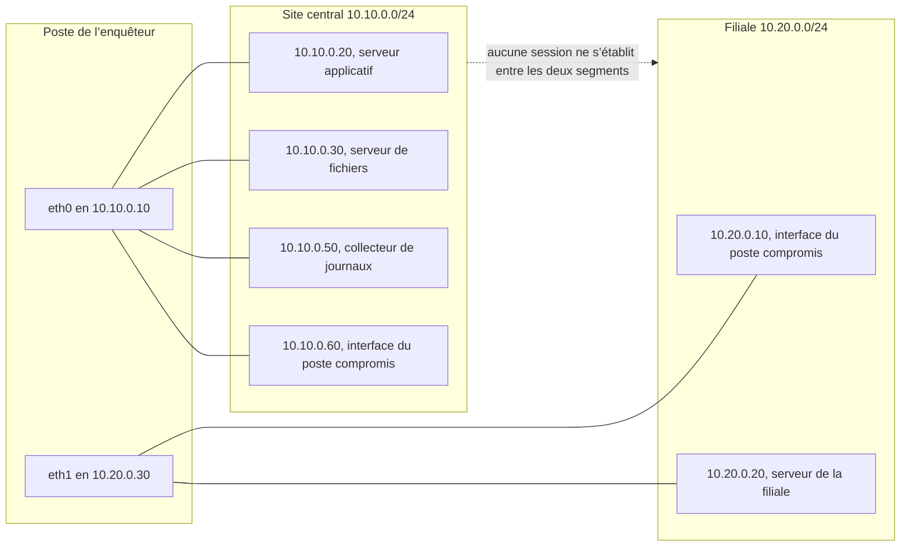
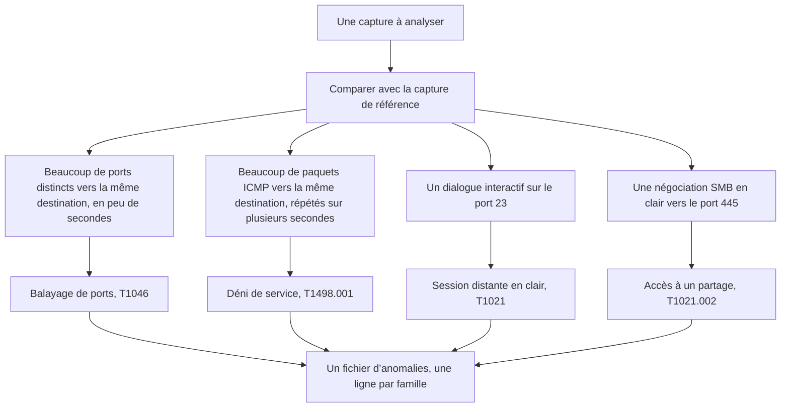

# Forensique réseau — JOUR 2

## Les traces de l’incident (13/10/2026)

---

## Comment lire ce support

Chaque chapitre se lit dans le même ordre, et cet ordre n’est jamais modifié : le préambule pose d’abord le problème en langage courant, sans aucune notion technique.
Le vocabulaire en clair traduit ensuite chaque terme avant son premier emploi, afin qu’aucun mot du cours ne reste nu.
Le contenu du chapitre expose les notions et les démontre par une commande, un tableau ou un résultat de laboratoire.
Les techniques, pas à pas expliquent chaque commande avant de la donner, en précisant ce qu’elle mesure, ce que sa sortie prouve et ce qu’elle ne prouve pas.
Le LAB et ses exercices produisent enfin un livrable nommé, que le chapitre suivant consomme.

Cette journée comporte deux chapitres de trois heures, l’un le matin et l’autre l’après-midi. La pause déjeuner de 12h00 à 13h00 les sépare.
Les deux chapitres forment une chaîne : le premier lit les preuves produites la veille et en extrait un fichier d’anomalies, le second rapproche ce fichier des journaux que le collecteur reçoit sur le port 514.

## Objectifs du Jour

À l’issue de cette journée, chaque participant est capable de :

- Établir une ligne de base à partir d’une capture de référence, et expliquer pourquoi elle conditionne toute conclusion ultérieure.
- Isoler une anomalie par un filtre BPF, puis la compter par `tshark` et en citer la preuve.
- Reconnaître quatre familles d’anomalies : le balayage de ports, le déni de service par flot de paquets, la session distante en clair et l’accès à un partage.
- Mesurer un volume de trafic par unité de temps, et le comparer à la ligne de base sans confondre volume et débit.
- Sceller une capture par son empreinte, puis rédiger le fichier d’anomalies que le chapitre suivant consomme.

## Planning du Jour

| Chapitre | Créneaux | Module et thème | Volume |
|----------|----------|-----------------|--------|
| C3 | 9h00–12h00 | M3 — Analyse des paquets et détection des anomalies | 3h |
| C4 | 13h00–16h00 | M4 — Utilisation des journaux et des outils d’analyse réseau | 3h |
| — | 12h00–13h00 | Pause déjeuner | 1h |

Volume pédagogique : 6 h de formation (3 h et 3 h), 1 h de pause déjeuner.

## Le fil du jour

Les deux chapitres de la journée se relient sans rupture. Le chapitre 3 ne produit rien de nouveau sur le plan matériel : il relit les preuves du premier jour, en produit une seconde à partir d’un trafic maîtrisé, et en extrait un fichier rédigé. Le chapitre 4 reprend ce fichier tel quel et le rapproche des journaux écrits par les machines, qui voient le trafic depuis leur propre point de vue. Un constat établi par une capture et un constat établi par un journal se confortent mutuellement, et c’est leur concordance qui fera la démonstration au chapitre 5.

| Chapitre | Livrable produit | Consommé par |
|----------|------------------|--------------|
| C3 | `~/enquete/anomalies.pcap`, son empreinte `~/enquete/anomalies.pcap.sha256`, et le fichier rédigé `~/enquete/anomalies.md` | C4, qui le relit et le rapproche des journaux du collecteur |
| C4 | `~/enquete/alertes-suricata.txt`, complété par le journal des acquisitions | C5, qui en tire la chronologie de l’incident |

---

## Chapitre 3 — M3 : Analyse des paquets et détection des anomalies (9h00–12h00)

Ce chapitre couvre le module 3 du programme imposé par le client. Le module se présente dans cet ordre : le flux légitime confronté à l’anomalie, puis le balayage de ports, l’attaque par déni de service et l’intrusion. Le chapitre suit exactement cet ordre. La première partie construit la ligne de base, les parties 2 et 3 traitent le balayage et le déni de service, la quatrième traite les intrusions.

### Préambule — reconnaître un intrus dans le bruit d’un réseau

Un médecin de garde reçoit un appel à trois heures du matin : un patient a de la fièvre. Il ne se lève pas pour annoncer une fièvre. Il mesure d’abord la température ordinaire du patient, il la compare à ce qu’il trouve, et il vérifie que l’écart ne vient pas du thermomètre. Sans cette première mesure, le mot fièvre ne veut rien dire : sur un patient qui court, la température de trente-huit degrés est normale.

Un réseau fonctionne de la même manière. Le laboratoire ressemble à un service hospitalier qui n’a tenu aucun dossier. L’un de ses postes se met, à intervalles réguliers, à faire des choses qu’il ne faisait pas la veille : il interroge des ports que personne ne lui a demandé d’interroger, il engage une conversation avec un serveur distant en tapant ses identifiants sans aucune protection, il lit un partage, il envoie de petits paquets en rafale vers un serveur qui n’a rien demandé. Personne n’a rien vu, parce que personne ne savait à quoi ressemblait le fonctionnement normal de ces machines.

Le premier jour a produit ce dossier. La capture de référence montre le trafic obtenu à la demande, la mesure de débit vers le port 5201 du serveur applicatif ; l’inventaire montre les ports que chaque machine a acceptés de déclarer. Ces deux documents ne sont pas une distraction : ce sont les constantes du problème. Sans eux, la capture de ce matin serait une suite de paquets sans signification, comme une photo d’une chambre prise dans le noir.

Reste une difficulté, et elle est la plus importante du métier. L’enquêteur ne peut pas attendre, matin après matin, qu’un incident se produise sous ses yeux. Il provoque donc lui-même, depuis son propre poste, chacune des anomalies qu’il prétend reconnaître. Il balaye les ports, il ouvre une session en clair, il lit le partage, il produit un flot de paquets. Il recommence, et cette fois la capture contient exactement ce qu’il cherchait, avec une heure connue et une signature que n’importe quel autre enquêteur retrouvera le même jour.

La différence entre ce trafic et le trafic de l’incident est l’adresse qui l’émet. La reproduction vient du poste de l’enquêteur, et l’incident vient d’une autre machine. La nature des paquets, leur ordre et leur signature sont les mêmes : seule l’origine change, et cette différence se dit en toutes lettres dans le constat.

### Le vocabulaire en clair

| Terme | En clair | Dans ce chapitre |
|-------|----------|------------------|
| Flux légitime | Un dialogue qui correspond à l’usage prévu d’un service, et qui se répète de la même façon d’une fois à l’autre | Partie 1 |
| Ligne de base | La mesure du fonctionnement ordinaire, prise avant que l’anomalie n’apparaisse, et qui sert de point de comparaison | Partie 1 |
| Anomalie | Un écart mesurable entre le trafic observé et la ligne de base | Partie 1 |
| Balayage de ports | Une machine qui essaie un grand nombre de ports de la même destination en quelques secondes, sans aucun service légitime à lui rendre | Partie 2 |
| Reconnaissance | Le travail qui consiste à cartographier un réseau avant de l’attaquer ; la base de données MITRE ATT&CK le nomme Network Service Scanning, identifiant T1046 | Partie 2 |
| Segment d’ouverture | Le premier paquet d’une connexion TCP, qui porte l’indicateur SYN ; il demande l’ouverture et attend un accusé | Partie 2 |
| Déni de service | Une attaque dont le but est de rendre un service indisponible en consommant une ressource ; le sigle DDoS, pour Distributed Denial of Service, en désigne la variante où plusieurs machines frappent ensemble | Partie 3 |
| ICMP | Le protocole de contrôle des messages Internet, décrit par la RFC 792, qui transporte notamment les demandes d’écho utilisées pour vérifier qu’une machine répond | Partie 3 |
| Flot de paquets | Un grand nombre de paquets du même type, envoyés vers la même destination en très peu de temps | Partie 3 |
| Intrusion | L’usage d’un accès réel par quelqu’un qui n’y était pas autorisé | Partie 4 |
| Telnet | Un protocole de session distante qui ne chiffre rien : ni l’identifiant ni le mot de passe ne sont protégés sur le réseau | Partie 4 |
| SMB | Le protocole de partage de fichiers de Microsoft, identifié par les ports 139 et 445 ; il porte les dialogues d’établissement et les échanges de noms de fichiers | Partie 4 |
| NetBIOS | La couche de session du partage de fichiers, qui préfixe chaque message SMB d’un en-tête de quatre octets | Partie 4 |
| BPF | Le langage de filtre de `tcpdump`, qui ne retient que les paquets conformes à une condition écrite en une ligne | Technique 4 et LAB |
| `tshark` | L’outil qui relit une capture en ligne de commande et en extrait des champs, des filtres ou des comptages | Techniques 1, 4 et 5 |
| `capinfos` | L’outil qui donne les métadonnées d’un fichier de capture : nombre de paquets, taille, durée, première et dernière heure | Technique 6 |
| PCAP | Le format de fichier dans lequel une capture est enregistrée, que tous les outils du cours savent lire | LAB |
| Empreinte | Une valeur de contrôle calculée sur un fichier ; elle change dès qu’un seul octet du fichier change | Technique 6 et LAB |

### Objectifs du chapitre

À la fin du chapitre 3, chaque participant est capable de :

- Expliquer pourquoi une anomalie ne peut être établie sans une ligne de base mesurée auparavant.
- Citer les éléments qui distinguent un flux légitime d’une connexion anormale, et les vérifier dans une capture.
- Reconnaître un balayage de ports dans une capture et écrire le filtre BPF qui l’isole.
- Mesurer un flot de paquets par unité de temps et le comparer à la ligne de base.
- Identifier une session Telnet et un accès à un partage dans une capture, et nommer ce qu’ils révèlent.
- Sceller une capture par son empreinte et rédiger le fichier d’anomalies que le chapitre 4 consomme.

### Répartition du temps

| Partie | Durée |
|---|---|
| Préambule, vocabulaire et objectifs | 12min |
| Contenu du chapitre | 58min |
| Techniques, pas à pas | 40min |
| LAB | 50min |
| Exercices | 20min |

### Contenu du chapitre (58min)

#### 1. La ligne de base, et ce qui rend un flux anormal (15min)

Une anomalie n’est pas un objet que l’on rencontre : c’est un écart entre deux mesures. Le trafic qui suit est suspect, le trafic d’hier ne l’était pas, et seule la comparaison des deux permet de dire ce qui a changé. Une capture sans point de comparaison se lit comme une liste de noms propres : elle est exacte et elle est muette.

Le premier jour a produit le point de comparaison. La capture `~/enquete/capture-reference.pcap` contient trois cents paquets de mesure de débit vers le port 5201 du serveur applicatif, et l’inventaire `~/enquete/inventaire-hotes.txt` décrit ce que chaque machine a accepté de déclarer. Les deux fichiers sont des mesures, pas des intentions, et c’est cette différence qui les rend utilisables.

| Ce que la capture de référence établit | Ce qu’elle n’établit pas |
|--------------------------------------|------------------------|
| Le fonctionnement ordinaire du segment du site central, à l’heure où la capture a été prise | Le fonctionnement ordinaire à toute autre heure, ni celui du segment de la filiale |
| Un volume connu, une destination connue et un intervalle connu | Que ce volume était le maximum possible, ni qu’il était courant |
| Une absence de trafic ICMP, de session Telnet et de dialogue SMB pendant la durée de la capture | Qu’aucune de ces activités n’a jamais eu lieu, ni qu’elles ne se produisent pas ailleurs |
| Qu’aucun paquet ne porte l’adresse 10.10.0.60, celle du poste compromis sur le segment du site central | Ce que ce poste fait lorsqu’il parle : ce qu’il a fait le premier jour ne renseigne pas sur son activité présente |

L’absence constatée ici est une absence de mesure, non une absence de fait. Elle s’explique par une raison connue et vérifiable : la capture a été obtenue le premier jour, à la demande, par une production de trafic volontaire et maîtrisée, donc en dehors du cycle de l’incident. C’est ce qui rend la capture de référence utilisable comme ligne de base : elle a été prise dans des conditions connues.

Le point d’observation décide de ce qui est comparable. La capture du premier jour a été prise sur `eth0`, l’interface du site central. Depuis cette interface, l’enquêteur voit ce que le poste compromis adresse au site central, parce que ce poste porte une seconde adresse sur ce segment. Il ne voit pas ce que ce poste adresse à ses voisins de la filiale.



**Fig 1 — Le point d’observation du chapitre 3, et la double appartenance du poste compromis.**

Le trait en pointillé entre les deux segments n’est pas un lien : il rappelle qu’aucune session ne s’établit de l’un à l’autre. La capture de ce chapitre ne portera donc que sur `eth0`, et elle verra le trafic que le poste compromis adresse au site central, jamais celui qu’il adresse à sa propre filiale.

> **Concept clé — une anomalie se mesure contre une référence ; sans référence, il n’y a qu’une impression.**
>
> La capture de référence n’est pas une politesse de méthode : c’est la seule chose qui permette de distinguer, dans le même fichier, un volume qui a toujours existé d’un volume qui vient d’apparaître.

#### 2. Le balayage de ports : une main qui compte les portes (15min)

Un balayage de ports consiste à essayer, sur une même machine, un grand nombre de ports en quelques secondes. Aucun service légitime ne le fait : un serveur reçoit des connexions sur les ports qu’il a ouverts, par exemple le port 22 ou le port 80, et il ne demande pas au client d’essayer quinze autres numéros avant de répondre. Le balayage n’a donc aucune fonction utile : il sert à dresser la liste de ce qui est ouvert chez une cible, et cette liste précède presque toujours une intrusion. La base de données MITRE ATT&CK en fait une technique à part entière, Network Service Scanning, identifiant T1046.

Il existe trois familles de balayage, et chacune laisse une trace différente dans une capture.

| Famille | Ce que l’outil fait | Ce que la capture montre | Ce que la trace ne prouve pas |
|---------|----------------------|--------------------------|-----------------------------|
| Balayage SYN | Il envoie un segment d’ouverture sur chaque port et ne poursuit pas | Un segment d’ouverture par port, et une absence de suite du dialogue pour les ports fermés | Que la tentative a abouti, ni qu’un service répond |
| Balayage connecté | Il ouvre une connexion complète sur chaque port, puis la referme | Un segment d’ouverture, un accusé du serveur et un acquittement du client, par port | Que le port est réellement exploitable, et encore moins que la cible est vulnérable |
| Balayage en UDP | Il envoie un datagramme et attend une réponse qui peut ne jamais venir | Un datagramme par port, et presque toujours aucune réponse | Qu’un port est fermé : en UDP, le silence ne distingue pas un port fermé d’un port filtré |

Le laboratoire produit la deuxième famille, le balayage connecté, parce qu’elle est la plus parlante à lire dans une capture. Le port 3389 du serveur de fichiers est fermé : une tentative de connexion y produit un segment d’ouverture, puis un acquittement négatif immédiat du serveur. Un segment d’ouverture vers un port fermé est donc une trace d’essai, pas la preuve d’un service.

Trois éléments font la signature d’un balayage, et il faut les réunir tous les trois. Le nombre de ports distincts visés sur une même destination, qui n’a pas de précédent sur un segment ordinaire. Le délai pendant lequel ces ports sont visés, qui n’a rien à voir avec la distance entre deux machines d’un même segment. Et l’absence de raison métier : aucun logiciel du laboratoire n’a besoin d’interroger quinze ports d’un serveur de fichiers, et aucun ne le fait de façon méthodique pour vérifier que la machine répond.

L’indicateur qui porte la demande d’ouverture est l’indicateur SYN. Un segment qui porte cet indicateur, sans porter l’indicateur d’acquittement, demande l’ouverture d’un dialogue ; un segment qui porte les deux est un acquittement. Cette distinction se décrit en une ligne de filtre, et c’est la ligne que le LAB fera compiler :

```bash
tcpdump -d -y EN10MB 'src host 10.10.0.10 and dst host 10.10.0.30 and tcp[tcpflags] & (tcp-syn) != 0 and tcp[tcpflags] & (tcp-ack) == 0'
```

Chaque terme de cette ligne a un rôle. Le mot `src host` et le mot `dst host` désignent les deux extrémités du dialogue. Le mot `and` exige que les deux conditions soient vraies. L’expression `tcp[tcpflags]` désigne l’octet du segment TCP qui réunit les indicateurs. Le mot `tcp-syn` isole l’indicateur d’ouverture, et le mot `tcp-ack` isole l’indicateur d’acquittement. La fin de la ligne exige un segment qui porte le premier indicateur et pas le second, c’est-à-dire une demande d’ouverture.

La liste des ports sondés n’est pas arbitraire. Elle réunit les cinq ports de service que l’inventaire du jour 1 a déclarés ouverts sur le site central, 22, 23, 80, 443 et 445, et les dix autres ports que la règle de détection du chapitre 4 surveille parce qu’ils ne correspondent à aucun service déclaré de cet inventaire : 21, 25, 53, 110, 139, 143, 3306, 3389, 993 et 995. Le port 139 demande une précision : il est le port classique du partage de fichiers, et le fait de figurer dans la liste surveillée ne dit rien de son état sur la machine visée. Un inventaire honnête se lit toujours avec la commande qui l’a produit sous les yeux, et cette liste de quinze ports est celle que le LAB exécutera.

> **Piège — le nombre de segments d’ouverture ne dit pas le nombre de machines.**
>
> Une machine qui balaie quinze ports produit quinze segments d’ouverture vers la même adresse. Une machine qui ouvre deux sessions de travail produit deux segments d’ouverture. Inversement, un port fermé produit lui aussi un segment d’ouverture, avec un acquittement négatif en retour. Le compte seul ne prouve rien : il faut la variété des ports et la répétabilité du rythme.

#### 3. Le déni de service : le volume qui écrase le temps (14min)

Une attaque par déni de service ne cherche pas à lire une donnée ni à obtenir un accès. Elle cherche à épuiser une ressource : la bande passante d’un lien, la capacité de traitement d’un serveur, la file d’attente d’un équipement. La variante volumétrique, que la base de données MITRE ATT&CK nomme Direct Network Flood, sous l’identifiant T1498.001, envoie un grand nombre de paquets vers une même destination ; le coût du traitement retombe sur la cible, et non sur l’expéditeur.

Le laboratoire produit cette variante avec le paquet le plus simple qui soit : des demandes d’écho ICMP, envoyées l’une après l’autre vers le serveur applicatif, à raison de vingt par seconde pendant dix secondes. Le protocole est décrit par la RFC 792, et il a un avantage pédagogique décisif : une demande d’écho n’a aucun contenu utile, elle ne demande qu’une réponse, et elle est donc facile à produire, à compter et à reconnaître.

Le scénario qui rejoue l’incident en boucle ne produit pas toujours le même nombre de paquets : d’un tour à l’autre, le volume varie. Cette variation est un avertissement utile, car elle oblige à juger une anomalie sur sa signature et non sur un total. Un nombre exact n’est pas une signature ; une répétition vers la même destination, elle, en est une.

Une difficulté mérite d’être traitée de front, parce qu’elle invalide le raccourci habituel. Le débit brut ne suffit pas à caractériser un flot. La capture de référence contient trois cents paquets de plus d’un millier d’octets reçus en quelques centièmes de seconde, et ce volume est parfaitement légitime : c’est une mesure de débit demandée, non une attaque. Un comptage naïf classerait cette capture comme l’anomalie la plus violente du réseau.

La même ambiguïté apparaît sur l’incident, et elle est la raison pour laquelle le chapitre 4 exige des journaux en plus des captures : deux sources qui disent la même chose valent mieux qu’une source qui dit beaucoup de choses.

| Mesure | Ce qu’elle compte | Ce qu’elle ne dit pas |
|--------|-------------------|----------------------|
| Total des paquets | Combien de paquets la capture contient pour cette condition | Combien de temps cela a duré, donc si le volume était concentré ou étalé |
| Total des paquets ICMP | Combien de paquets ICMP la capture contient | Si le flot visait la même destination, ou si la capture est restée muette pendant dix minutes |
| Paquets par seconde | Combien de paquets la capture a vus dans chaque tranche d’une seconde | Ce qui rend ces paquets anormaux : un segment peut être demandé par un service légitime |
| Destination et ports visés | La machine visée et les services sollicités | Si la machine visée était ou non hors d’atteinte de la demande |
| Présence dans la ligne de base | Ce que le même comptage rend dans la capture de référence | Rien par elle-même : une capture de référence muette ne prouve pas l’absence |

Le volume par unité de temps est la mesure qui décide, et elle n’a de sens que comparée à la ligne de base. Sur la capture de référence, le comptage des paquets ICMP rend zéro, sur toute la durée de la capture. Sur la capture de ce chapitre, le même comptage rend près de quatre cents paquets ICMP, répartis sur une dizaine de tranches consécutives d’une seconde. Ce n’est pas le nombre qui est anormal : c’est l’existence d’un volume répété là où la ligne de base n’en contient aucun, et la répétition sur plusieurs secondes.

Un détail de comptage mérite d’être annoncé ici, car il change le résultat affiché et qu’il n’est pas une erreur. Chaque demande d’écho reçoit une réponse, et les deux paquets sont capturés sur la même interface : le compteur voit donc deux paquets pour une seule demande. Deux cents demandes et leurs réponses donnent près de quatre cents paquets comptés, et environ quarante paquets par tranche d’une seconde au lieu des vingt attendues. Ce facteur deux se retrouve dans toutes les mesures de ce type, et il faut l’avoir compris avant de comparer deux chiffres.

> **Bon à savoir — un laboratoire n’abat pas un service pour le démontrer.**
>
> Près de quatre cents paquets, dont deux cents demandes d’écho et leurs réponses, ne saturent aucun lien et n’ont jamais interrompu le serveur applicatif. Le cours étudie la signature du flot et la manière de le mesurer ; il ne simule pas une coupure de service, et un enquêteur qui interromprait le service qu’il analyse perdrait sa preuve.

#### 4. Les intrusions : une session en clair et un partage en clair (14min)

Une intrusion ne se distingue pas du trafic légitime par la quantité, mais par l’usage : c’est un accès réel, ouvert et parfaitement fonctionnel, employé par quelqu’un qui n’y était pas autorisé. Les deux intrusions du laboratoire passent par des services qui fonctionnent exactement comme prévu, et c’est ce qui les rend difficiles à voir.

La première utilise le port 23, qui porte le protocole Telnet. Ce protocole, dont la spécification date de 1981 sous la référence RFC 854, ne chiffre rien : ce qui est tapé au clavier part en clair, et ce qui est affiché revient en clair. La référence correspondante dans la base de données MITRE ATT&CK est la technique T1021, Services distants, qui couvre l’emploi de Telnet ; le référentiel ne consacre aucune sous-technique à ce protocole.

Un détail de cette intrusion a été mesuré sur ce laboratoire, et il explique pourquoi une règle de détection peut être correctement écrite et rester muette. Sur un dialogue Telnet, l’invite est émise par le serveur : elle part du port 23 vers un port élevé attribué au client. Le texte de l’invite ne porte donc jamais le port 23 en destination. Une règle qui attend une arrivée sur le port 23 ne le verra jamais passer ; en revanche, elle verra l’identifiant et le mot de passe que le client envoie vers ce port, ce qui est un autre contenu, dans l’autre sens. La règle du chapitre 4 est donc écrite à l’endroit exact où le fait se produit : elle surveille les paquets dont le port d’origine est 23 et qui contiennent le mot de l’invite. C’est le genre de détail qui se décide en lisant une capture, et non dans une documentation.

Un second détail sépare deux faits que l’on confond souvent. Le laboratoire produit deux tentatives de session, l’une après l’autre, séparées de quelques dizaines de secondes : ce n’est pas une attaque par force brute, que la base de données ATT&CK identifie par T1110, et qui suppose de nombreuses tentatives sur une même cible dans un délai court. Deux tentatives rapprochées mais peu nombreuses sont deux traces d’un accès qui échoue, et l’enquêteur doit les décrire comme telles.

La seconde intrusion utilise les ports 139 et 445, qui portent le protocole SMB. Chaque message SMB est précédé d’un en-tête de service de session NetBIOS de quatre octets, puis commence par une marque de quatre octets, `FE 53 4D 42`, c’est-à-dire l’octet de valeur 253 suivi des trois lettres de SMB. Cette marque se lit dans la charge utile d’une capture, en clair, et sa présence prouve qu’une négociation de protocole est en train de se faire. La référence correspondante dans la base de données ATT&CK est Remote Services: SMB/Windows Admin Shares, identifiant T1021.002.

| Élément observé dans la capture | Ce qu’il prouve | Ce qu’il ne prouve pas |
|--------------------------------|------------------|------------------------|
| Un segment d’ouverture vers le port 23 | Qu’une session distante a été demandée vers ce port | Qu’un compte a été ouvert, ni que le mot de passe a été accepté |
| L’invite émise depuis le port 23 vers un port élevé | Qu’un service en clair attend un identifiant | Que le client qui parle est le poste qui a ouvert la session |
| Un nom d’utilisateur et un mot de passe en clair dans la charge utile | Qu’un compte a été soumis sur ce lien, et que le protocole ne protège rien | Que le compte existe, ni que la tentative a réussi |
| Une marque `FE 53 4D 42` dans une charge utile vers le port 445 | Qu’une négociation SMB est engagée en clair | Que l’accès au partage a été accordé |
| Une liste de fichiers après la négociation | Qu’un accès en lecture a abouti, et sur quels fichiers | Ni que les fichiers lus aient été modifiés, ni ce que le dossier contient par ailleurs |

Les quatre familles se tiennent côte à côte, et chacune possède son filtre. C’est ce tableau de correspondance qui constitue le résultat central du chapitre.

| Famille | Ce qui la caractérise dans la capture | Référence ATT&CK | Filtre qui l’isole |
|---------|--------------------------------------|------------------|--------------------|
| Balayage de ports | Plusieurs segments d’ouverture vers des ports distincts de la même destination, en quelques secondes | T1046 | `src host A and dst host B and tcp[tcpflags] & (tcp-syn) != 0 and tcp[tcpflags] & (tcp-ack) == 0` |
| Déni de service | Un volume de paquets ICMP répété pendant plusieurs secondes vers la même destination, là où la ligne de base n’en contient aucun | T1498 et T1498.001 | `icmp and dst host 10.10.0.20` |
| Session en clair | Un dialogue interactif sur le port 23, dont la charge utile porte l’identifiant et le mot de passe | T1021 | `tcp port 23` |
| Accès à un partage | Une négociation SMB en clair vers le port 445, puis un dialogue d’établissement | T1021.002 | `tcp port 445 or tcp port 139` |



**Fig 2 — Les quatre familles d’anomalies du laboratoire, et le chemin qui mène de la capture au livrable.**

> **Règle de conservation — une capture qui contient un mot de passe en clair est une preuve sensible.**
>
> Dès que la capture de ce chapitre existe, elle contient des identifiants en clair. Elle reste dans le dossier `~/enquete`, elle ne sort pas du périmètre écrit dans `~/enquete/cadre-enquete.md`, et son empreinte est posée dès la fin de la capture. Aucun extrait brut d’identifiant ne figure dans un rapport : seul le fait qu’il y en ait un, et l’heure à laquelle il a été observé, sont consignés.

### Les techniques, pas à pas

Sept techniques composent le travail de ce chapitre. Aucune ne se suffit à elle-même : les trois premières produisent la matière, les quatre suivantes la rendent lisible et vérifiable.

| Technique | Ce qu’elle fait | Durée |
|-----------|------------------|-------|
| 1 — Reprendre la capture de référence | Établir la ligne de base et mesurer ce que le trafic ordinaire contient | 8min |
| 2 — Ouvrir une capture d’anomalies | Produire un fichier sans filtre, en arrière-plan, avant toute action | 6min |
| 3 — Provoquer les quatre anomalies | Recréer sur son poste le balayage, la session en clair, le partage et le flot de paquets | 8min |
| 4 — Isoler chaque famille | Écrire un filtre par famille et le relire dans la capture | 8min |
| 5 — Compter par unité de temps | Mesurer un volume de paquets par tranche d’une seconde, puis comparer | 4min |
| 6 — Sceller la capture | Poser l’empreinte et relever les métadonnées du fichier | 3min |
| 7 — Comparer avec l’inventaire | Opposer les constats du jour aux ports déclarés la veille | 3min |

**Technique 1 — Reprendre la capture de référence et établir la ligne de base**

Ce qu’elle mesure : le contenu de la capture obtenue le premier jour, et la quantité d’activité de chaque famille d’anomalie qu’elle contient.

```bash
capinfos -t -c -s -d -l -a -e ~/enquete/capture-reference.pcap
tshark -r ~/enquete/capture-reference.pcap -q -z io,phs
tshark -r ~/enquete/capture-reference.pcap -Y 'icmp or tcp.port == 23 or tcp.port == 445' -T fields -e frame.number | wc -l
tshark -r ~/enquete/capture-reference.pcap -Y 'ip.addr == 10.10.0.60' -T fields -e frame.number | wc -l
```

La première commande lit les métadonnées du fichier. La deuxième range les paquets par protocole, du plus général au plus précis, et l’option `-q` lui demande de n’afficher que cette synthèse au lieu du détail des paquets. Les deux dernières comptent des paquets. L’option `-Y` pose un filtre d’affichage, qui ne retire rien au fichier et ne s’applique qu’à la lecture ; l’option `-T fields` demande une extraction de champs, l’option `-e frame.number` désigne le champ numéro de paquet parmi ceux retenus, et la commande `wc -l` compte les lignes rendues.

Ce que la sortie prouve : que la capture de référence ne contient aucun paquet ICMP, aucune session sur le port 23 et aucun dialogue sur le port 445, et qu’aucun de ses paquets ne porte l’adresse 10.10.0.60. Elle fixe donc une ligne de base chiffrée, sur toute la durée du fichier, pour les trois familles que le chapitre cherche ensuite.

Ce qu’elle ne prouve pas : que ces activités n’aient jamais eu lieu sur ce segment. Une capture ne couvre que l’intervalle qu’elle enregistre, et elle ne voit que ce qui passe devant son point d’observation. La raison de l’absence constatée ici est connue et vérifiable : la capture a été obtenue le premier jour, par une production de trafic volontaire, donc en dehors du cycle de l’incident.

**Technique 2 — Ouvrir une capture d’anomalies, sans filtre, en arrière-plan**

Ce qu’elle produit : un fichier qui enregistre tout le trafic de l’interface choisie. Cette technique ne mesure rien ; elle crée la matière des cinq suivantes.

```bash
sudo tcpdump -i eth0 -w ~/enquete/anomalies.pcap -s 0 -n -U &
sleep 2
ip -brief address show
```

Les options sont celles de la capture de référence, avec une différence volontaire et importante : le compteur de paquets a disparu. La capture de référence s’arrêtait à trois cents paquets, donc à un instant connu d’avance ; ici personne ne sait à l’avance combien de paquets seront capturés, et c’est l’enquêteur qui décide de l’arrêter. Une capture dont la fin est imprévisible doit être arrêtée à la main, et c’est un motif supplémentaire de la sceller sans tarder.

La pause de deux secondes laisse à la capture le temps de s’installer avant que le trafic ne parte, et la dernière commande vérifie que l’interface porte bien l’adresse attendue. Cette capture s’ouvre avant toute action : une anomalie produite avant l’ouverture de la capture est une anomalie perdue, et cette perte ne se rattrape pas.

Ce que la sortie prouve : que la capture est ouverte et que l’interface est active. Ce qu’elle ne prouve pas : rien sur le contenu du fichier, qui est encore vide. Le fichier produit s’appelle `~/enquete/anomalies.pcap`.

**Technique 3 — Provoquer soi-même chaque anomalie, depuis le poste de l’enquêteur**

Ce qu’elle produit : les quatre familles d’anomalies, avec une heure connue, une origine connue et une signature que l’on peut comparer à celle de l’incident.

```bash
nmap -n -Pn -sT --max-retries 1 --host-timeout 20s -p 21,22,23,25,53,80,110,139,143,443,445,993,995,3306,3389 10.10.0.30
printf 'root\r\nadmin2026\r\n' | timeout 8 nc 10.10.0.30 23 > /dev/null
smbclient //10.10.0.30/partage -U 'enquete%lab-2026' -c 'ls'
sudo ping -c 200 -i 0.05 10.10.0.20
```

Quatre commandes, quatre familles, dans l’ordre du programme du module. Chacune se lit ainsi.

La première produit le balayage de ports. L’option `-n` interdit la résolution des noms, l’option `-Pn` dispense de tester d’abord si la machine répond, et l’option `-sT` impose une connexion complète sur chaque port : c’est le balayage connecté, seule famille qui laisse dans la capture des segments d’ouverture, des accusés de serveur et des acquittements de client. Les deux options de temporisation limitent le temps d’attente, pour qu’aucune reprise ne vienne gonfler le compte. La liste de ports est celle de la partie 2.

La deuxième produit la session en clair. La commande `printf` écrit deux lignes terminées par les deux caractères de fin de ligne du réseau, un retour chariot suivi d’une fin de ligne ; la commande `nc` envoie cette suite au port 23 et lit ce que le serveur renvoie ; la commande `timeout` met fin à l’opération au bout de huit secondes, car le service en clair du laboratoire ne ferme pas la session de lui-même. La redirection vers `/dev/null` évite d’afficher l’invite à l’écran : l’invite est dans la capture, et c’est là qu’elle doit être observée. Cette commande est exécutée deux fois de suite, comme le fait le scénario de l’incident, et les deux valeurs envoyées sont des valeurs de laboratoire, jamais celles d’un système réel.

La troisième produit l’accès à un partage. L’option `-U` transmet le compte et le mot de passe du partage, séparés par un caractère pourcent ; l’option `-c` donne la commande à exécuter sur le partage, ici une simple liste. Le compte et le mot de passe sont ceux du laboratoire, décrits dans le tableau d’environnement.

La quatrième produit le flot de paquets. L’option `-c` fixe le nombre de demandes d’écho, l’option `-i` l’intervalle entre deux demandes, et le préfixe `sudo` accorde les privilèges que certaines versions de l’outil exigent pour un intervalle inférieur à un cinquième de seconde. Deux cents demandes à vingt par seconde pendant dix secondes donnent un volume que l’on peut compter sans approximation.

Ce que ces commandes produisent : quatre familles d’anomalies, toutes horodatées et toutes issues de la même adresse, 10.10.0.10, celle du poste de l’enquêteur. Ce qu’elles ne prouvent pas : que l’incident vienne de ce poste. Il n’en vient pas. La différence porte sur la seule adresse source, et elle est réelle mais secondaire : le nombre de ports visés, leur ordre, les ports concernés, les protocoles employés et le rythme sont identiques. C’est ce qui permet d’apprendre la signature aujourd’hui et de la retrouver demain sur une autre adresse.

**Technique 4 — Isoler chaque famille par un filtre BPF**

Ce qu’elle mesure : les paquets qui appartiennent à une famille, et les ports sur lesquels portent les segments d’ouverture.

```bash
tcpdump -d -y EN10MB 'src host 10.10.0.10 and dst host 10.10.0.30 and tcp[tcpflags] & (tcp-syn) != 0 and tcp[tcpflags] & (tcp-ack) == 0'
tcpdump -r ~/enquete/anomalies.pcap -n -c 4 'src host 10.10.0.10 and dst host 10.10.0.30 and tcp[tcpflags] & (tcp-syn) != 0 and tcp[tcpflags] & (tcp-ack) == 0'
tshark -r ~/enquete/anomalies.pcap -Y 'ip.src == 10.10.0.10 and ip.dst == 10.10.0.30 and tcp.flags.syn == 1 and tcp.flags.ack == 0' -T fields -e tcp.dstport | sort -n | uniq -c | sort -rn
tcpdump -r ~/enquete/anomalies.pcap -n -c 4 'tcp port 23'
tshark -r ~/enquete/anomalies.pcap -Y 'icmp and ip.dst == 10.10.0.20' -T fields -e frame.time -e ip.src | head -3
```

La première commande ne lit aucun fichier : elle compile le filtre et affiche le petit programme que la machine exécute ensuite pour trier les paquets. Les commandes suivantes relisent la capture. La troisième mérite une attention particulière : elle ne compte pas des paquets mais des ports de destination, et c’est la seule mesure qui caractérise un balayage.

Les filtres des deux outils ne s’écrivent pas de la même façon, et la différence se paie cher quand on l’oublie. Un filtre BPF, compris par `tcpdump`, compare des champs par leur nom court : `dst host 10.10.0.30`. Un filtre d’affichage, celui que `tshark` attend derrière l’option `-Y`, compare des champs par leur nom complet et impose l’égalité : `ip.dst == 10.10.0.30`. Donner `dst host` à l’option `-Y` fait échouer la commande, qui s’interrompt sur un message d’erreur de syntaxe avant même d’ouvrir le fichier.

Ce que la sortie prouve : que la capture contient des paquets de chacune des familles, que quinze ports distincts ont été visés par des segments d’ouverture, et que le dialogue sur le port 23 est émis par le serveur : le port 23 y apparaît comme port d’origine, et le client y porte un port élevé. Un filtre qui ne rend aucun paquet sur une capture de plusieurs centaines de paquets ne prouve pas que l’activité est absente : il prouve que la condition écrite ne correspond à rien dans le fichier, et l’erreur est souvent dans le filtre lui-même.

**Technique 5 — Mesurer le volume de trafic par unité de temps**

Ce qu’elle mesure : combien de paquets la capture contient par tranche d’une seconde.

```bash
tshark -r ~/enquete/anomalies.pcap -Y 'icmp' -T fields -e frame.time_epoch | cut -d. -f1 | uniq -c
tshark -r ~/enquete/anomalies.pcap -q -z io,stat,1,'icmp'
```

La première commande extrait le nombre de secondes écoulées depuis 1970 que chaque paquet porte dans son en-tête, ne garde que la partie entière, puis regroupe les valeurs identiques. Elle rend une ligne par tranche d’une seconde, avec le nombre de paquets observés sur cette tranche. La seconde demande la même répartition à `tshark`, mais sous forme de tableau : l’option `-z` demande un rapport et l’intervalle `1` fixe la durée de chaque ligne du tableau. Les deux rendus doivent montrer la même concentration.

Ce que la sortie prouve : que le flot n’est pas un pic isolé, mais une répétition sur plusieurs tranches consécutives, de l’ordre de quarante paquets par seconde là où la ligne de base ne contenait aucun paquet ICMP. C’est le débit, et non le total, qui caractérise le flot. Le tableau rend aussi des tranches vides avant le début de l’activité : c’est normal, et c’est même utile, car ces trous donnent la limite exacte du début de la fenêtre. La dernière ligne, elle, n’est pas vide : c’est une tranche partielle, arrêtée par la fin de la capture, et son volume est forcément inférieur à celui des tranches complètes.

**Technique 6 — Sceller la capture par son empreinte**

Ce qu’elle mesure : l’identité numérique du fichier, qui garantit qu’il ne sera plus modifié.

```bash
sha256sum ~/enquete/anomalies.pcap
capinfos ~/enquete/anomalies.pcap
```

Ce que la sortie prouve : qu’une empreinte existe et que le fichier est complet. Ce qu’elle ne prouve pas : que le fichier est authentique. Une empreinte atteste qu’un fichier est identique à celui qui a été scellé ; elle ne dit pas d’où il vient. Cette nuance est réservée au chapitre 6.

**Technique 7 — Comparer avec l’inventaire du premier jour**

Ce qu’elle mesure : l’écart entre ce que le réseau faisait hier et ce qu’il fait aujourd’hui.

```bash
cat ~/enquete/inventaire-hotes.txt
```

Un écart entre l’inventaire et la capture est un constat d’enquête, pas une erreur de l’outil. Le tableau de l’étape 10 en donne trois exemples : le port 23 est déclaré en clair et la capture montre une session interactive avec des identifiants en clair ; le port 3389 n’est pas déclaré et la tentative d’ouverture y reçoit un acquittement négatif, ce qui n’est pas une intrusion ; le port 445 est déclaré et la capture montre une négociation SMB suivie d’une liste de fichiers, ce qui reste à expliquer.

### LAB — Mesurer, isoler et consigner les quatre anomalies du laboratoire (50min)

#### Prérequis

Ce LAB ne se lance pas tout seul. Il consomme trois fichiers produits le premier jour, et il est important de comprendre pourquoi il en a besoin : ces trois fichiers ne sont pas des données de confort, ce sont les trois sources de vérité du laboratoire. La capture de référence donne la mesure ordinaire, l’inventaire donne la déclaration de service, le cadre d’enquête donne le périmètre.

```bash
ls -l ~/enquete/
sha256sum -c ~/enquete/capture-reference.pcap.sha256
```

Si l’un des trois fichiers manque, ou si l’empreinte ne correspond plus, il faut suspendre le LAB. Le chapitre commence à comparer, et une comparaison sans référence ne produit qu’une impression.

#### Environnement

| Élément | Valeur |
|---------|--------|
| Poste de l’enquêteur | `10.10.0.10` (site central), `10.20.0.30` (filiale) |
| Interface d’observation | `eth0`, segment `10.10.0.0/24` |
| Serveur de fichiers | `10.10.0.30` — port 23 en clair, ports 139 et 445 ouverts |
| Serveur applicatif | `10.10.0.20` — ports 22, 80, 443 |
| Collecteur de journaux | `10.10.0.50` — syslog sur 514 |
| Poste compromis | `10.20.0.10` (filiale), `10.10.0.60` (site central) |
| Serveur de la filiale | `10.20.0.20` — ports 22 et 80 |
| Outil de capture | `tcpdump`, compte ordinaire `enqueteur` avec `sudo` |
| Outil de lecture | `tshark` et `capinfos` |
| Dossier de travail | `~/enquete/` |
| Durée totale | 50 minutes |

#### Étapes du LAB

| Étape | Intitulé | Durée |
|-------|-----------|-------|
| 1 | Vérifier les livrables du premier jour | 6min |
| 2 | Établir la ligne de base sur la capture de référence | 7min |
| 3 | Ouvrir la capture d’anomalies | 4min |
| 4 | Reproduire le balayage de ports | 4min |
| 5 | Reproduire la session en clair sur le port 23 | 3min |
| 6 | Reproduire l’accès au partage SMB | 3min |
| 7 | Reproduire le flot de paquets ICMP | 3min |
| 8 | Arrêter la capture et isoler le balayage | 4min |
| 9 | Isoler la session en clair, le partage et le flot | 5min |
| 10 | Sceller la capture et comparer avec l’inventaire | 5min |
| 11 | Rédiger le fichier d’anomalies | 6min |

**Étape 1 — Vérifier les livrables du premier jour (6min)**

Ce que cette étape vérifie : que les trois fichiers de référence existent, que l’empreinte de la capture correspond, et que le périmètre de l’enquête couvre le site central.

```bash
ls -l ~/enquete/
sha256sum -c ~/enquete/capture-reference.pcap.sha256
cat ~/enquete/cadre-enquete.md
```

> **Résultat attendu :** la première commande rend la liste des fichiers du dossier de travail, dont `capture-reference.pcap`, `inventaire-hotes.txt` et `cadre-enquete.md`, les trois produits la veille. La commande de vérification rend ensuite une ligne d’empreinte — une valeur de contrôle calculée par l’algorithme SHA-256 — qui se termine par `OK` : l’empreinte recalculée correspond à celle qui a été enregistrée au moment du scellement. La lecture du cadre d’enquête nomme les deux segments qui ont été observés, le site central `10.10.0.0/24` et la filiale `10.20.0.0/24`, et désigne le poste de l’enquêteur comme point d’observation. C’est ce document qui fixe le périmètre : la capture de ce chapitre ne portera que sur `eth0`, donc que sur le site central, alors que le cadre annonce les deux segments.

Ce que la sortie prouve : que le point de comparaison est intact. Si l’empreinte ne correspond pas, la capture a été modifiée depuis sa création, et le LAB s’arrête là.

**Étape 2 — Établir la ligne de base sur la capture de référence (7min)**

Ce que cette étape mesure : ce que contient la capture de référence pour les trois familles cherchées.

```bash
capinfos -t -c -s -d -l -a -e ~/enquete/capture-reference.pcap
tshark -r ~/enquete/capture-reference.pcap -q -z io,phs
tshark -r ~/enquete/capture-reference.pcap -Y 'icmp or tcp.port == 23 or tcp.port == 445' -T fields -e frame.number | wc -l
tshark -r ~/enquete/capture-reference.pcap -Y 'ip.addr == 10.10.0.60' -T fields -e frame.number | wc -l
```

> **Résultat attendu :** la première commande rend le nombre de paquets de la capture de référence, sa taille et sa durée d’enregistrement : trois cents paquets, deux cent onze kilo-octets, et un intervalle de quelques centièmes de seconde entre le premier et le dernier. La hiérarchie de protocoles montre un trafic composé uniquement de TCP, et l’ICMP, c’est-à-dire le protocole de contrôle des messages Internet qui porte les demandes d’écho, n’y figure pas. Les deux dénombrements rendent `0`. Ce zéro est le résultat le plus important de l’étape : la capture de référence ne contient ni paquet ICMP, ni segment portant le port 23 ou le port 445, ni aucun paquet du poste compromis `10.10.0.60`. Elle est donc bien une ligne de base, la mesure ordinaire à laquelle les anomalies seront comparées.

Une valeur différente de zéro n’est pas une erreur : c’est un constat. Il faut alors relire le fichier cadre-enquête et vérifier ce qui a été produit le premier jour.

**Étape 3 — Ouvrir la capture d’anomalies (4min)**

Ce que cette étape produit : le fichier `~/enquete/anomalies.pcap`, qui enregistrera tout le trafic des étapes suivantes.

```bash
sudo tcpdump -i eth0 -w ~/enquete/anomalies.pcap -s 0 -n -U &
sleep 2
ip -brief address show
```

> **Résultat attendu :** la commande `ip -brief address show` rend une ligne par interface, et celle de `eth0` porte l’adresse `10.10.0.10/24` du site central. Le fichier `~/enquete/anomalies.pcap` existe déjà : il ne contient pour l’instant que son en-tête, et sa taille croît à mesure que le trafic arrive. Une taille qui reste figée, ou un fichier absent de l’inventaire du dossier, signifie que rien n’est enregistré : les quatre anomalies des étapes suivantes ne seront alors consignées dans aucun fichier de preuve.

Si le fichier n’apparaît pas, l’interface est peut-être nommée autrement. La commande `ip -brief link` liste les noms réels des interfaces.

**Étape 4 — Reproduire le balayage de ports (4min)**

Ce que cette étape produit : quinze segments d’ouverture vers `10.10.0.30`, dont douze vers des ports fermés.

```bash
nmap -n -Pn -sT --max-retries 1 --host-timeout 20s -p 21,22,23,25,53,80,110,139,143,443,445,993,995,3306,3389 10.10.0.30
```

> **Résultat attendu :** la sortie rend une liste de quinze ports pour l’adresse `10.10.0.30` : `23/tcp`, `139/tcp` et `445/tcp` en `open`, ce qui signifie que le service répond, et les douze autres en `closed`, dont `3389/tcp`. Le port 23 est le point à retenir : il correspond à Telnet, un protocole de session distante qui ne chiffre rien, et il n’a aucune raison d’être ouvert sur un serveur de fichiers.

Ce que la sortie prouve : que le serveur de fichiers expose le port 23 en clair, et que douze des quinze ports sondés ne répondent pas. Ce qu’elle ne prouve pas : que quiconque s’en soit servi. La capture va le dire.

**Étape 5 — Reproduire la session en clair sur le port 23 (3min)**

Ce que cette étape produit : deux tentatives de session, avec un identifiant et un mot de passe en clair dans la charge utile.

```bash
printf 'root\r\nadmin2026\r\n' | timeout 8 nc 10.10.0.30 23 > /dev/null
printf 'root\r\nadmin2026\r\n' | timeout 8 nc 10.10.0.30 23 > /dev/null
```

> **Résultat attendu :** aucune des deux commandes n’affiche quoi que ce soit au terminal : chacune rend la main presque aussitôt, dès que le service en clair a reçu les deux lignes et referme la session, et les deux tentatives ont bien eu lieu. L’option `timeout 8` n’est pas une durée d’attente, mais une borne de sécurité : elle empêche la session de rester ouverte indéfiniment si le service ne répond plus. Cette absence d’affichage est un résultat, et non un échec. Les deux commandes reproduisent le nombre de tentatives que le chapitre 4 retrouvera dans les journaux du poste compromis, qui est de deux. Tout ce qui a été échangé — l’invite du service, l’identifiant saisi, le mot de passe — circule dans la capture et non à l’écran, précisément parce que le canal est en clair.

Si une commande ne rend pas la main, vérifier que l’option `timeout 8` est bien présente : sans elle, la session en clair resterait ouverte indéfiniment. Un service qui ne répond jamais n’est pas un indice, c’est un outil mal écrit.

**Étape 6 — Reproduire l’accès au partage SMB (3min)**

Ce que cette étape produit : une négociation SMB suivie d’une liste de fichiers.

```bash
smbclient //10.10.0.30/partage -U 'enquete%lab-2026' -c 'ls'
```

> **Résultat attendu :** la commande rend la liste des fichiers du partage, dont `lisezmoi.txt`, avec pour chacun une taille et une date. Le protocole SMB, celui qui porte les partages de fichiers, est employé ici en clair : la liste obtenue prouve que l’authentification a réussi. Un partage accessible en clair ne demande aucun déchiffrement pour être consulté, et c’est ce qui le rend inacceptable sur un segment d’enquête.

Si le partage est refusé, vérifier que le compte du tableau d’environnement est bien `enquete` et que le mot de passe est `lab-2026`. Un refus d’authentification est un constat d’enquête, pas un échec du LAB : il se note et se poursuit.

**Étape 7 — Reproduire le flot de paquets ICMP (3min)**

Ce que cette étape produit : deux cents demandes d’écho vers le serveur applicatif, à raison de vingt par seconde.

```bash
sudo ping -c 200 -i 0.05 10.10.0.20
```

> **Résultat attendu :** la commande rend deux cents demandes envoyées et deux cents réponses reçues, avec un taux de perte nul et un temps aller-retour moyen inférieur à une milliseconde, les deux machines étant sur le même segment. Le temps aller-retour, c’est-à-dire la durée mesurée entre l’envoi d’une demande d’écho et la réception de sa réponse, reste faible parce qu’aucun routeur ne s’intercale. Ce débit de vingt paquets par seconde n’a rien d’anormal en soi : il ne le devient que comparé à la ligne de base, ce qui se fera à l’étape 9.

Ce que la sortie prouve : que le serveur applicatif répond. Ce qu’elle ne prouve pas : que le flot est anormal. Il ne l’est que comparé à la ligne de base, ce qui se fera à l’étape 9.

**Étape 8 — Arrêter la capture et isoler le balayage (4min)**

Ce que cette étape produit : la capture fermée proprement, puis la liste des ports visés par des segments d’ouverture.

```bash
sudo pkill -INT -x tcpdump
sleep 3
sudo chown enqueteur:enqueteur ~/enquete/anomalies.pcap
ls -l ~/enquete/anomalies.pcap
capinfos -c ~/enquete/anomalies.pcap
tcpdump -d -y EN10MB 'src host 10.10.0.10 and dst host 10.10.0.30 and tcp[tcpflags] & (tcp-syn) != 0 and tcp[tcpflags] & (tcp-ack) == 0'
tcpdump -r ~/enquete/anomalies.pcap -n -c 4 'src host 10.10.0.10 and dst host 10.10.0.30 and tcp[tcpflags] & (tcp-syn) != 0 and tcp[tcpflags] & (tcp-ack) == 0'
tshark -r ~/enquete/anomalies.pcap -Y 'ip.src == 10.10.0.10 and ip.dst == 10.10.0.30 and tcp.flags.syn == 1 and tcp.flags.ack == 0' -T fields -e tcp.dstport | sort -n | uniq -c | sort -rn
```

> **Résultat attendu :** le fichier `~/enquete/anomalies.pcap` existe et pèse quelques dizaines de kilo-octets, et la commande de métadonnées rend le nombre total de paquets enregistrés. Le filtre compilé s’affiche sur seize instructions numérotées de 000 à 015. La relecture rend ensuite des segments d’ouverture émis par `10.10.0.10` vers `10.10.0.30`, et le décompte par port rend quinze valeurs distinctes pour dix-huit segments d’ouverture au total : le port 23 y apparaît trois fois et le port 445 deux fois.

L’option `-INT` de la commande `pkill` envoie le signal d’interruption, que `tcpdump` traite comme une demande d’arrêt propre : le fichier est fermé et son compteur est écrit. L’option `-x` impose la correspondance exacte du nom de processus, pour ne pas arrêter un autre outil qui contiendrait la même chaîne. Un arrêt brutal, obtenu par exemple en tuant le processus sans attendre, peut laisser un fichier dont le dernier paquet est tronqué ; les outils de lecture peuvent alors refuser de l’ouvrir, et le fichier doit être vérifié avant d’être utilisé. La remise de propriété vient après l’arrêt, jamais avant : le fichier est alors fermé, et l’enquêteur peut le déplacer, le renommer et l’archiver sans demander un privilège, comme il l’a fait pour la capture de référence du premier jour.

Le filtre BPF est d’abord compilé par `-d`, puis relu dans le fichier par `-r`. La dernière commande, elle, ne compte pas des paquets mais des ports : elle range les ports de destination par ordre, puis en affiche le nombre d’occurrences.

Il vaut la peine de lire les seize instructions que le filtre compilé produit, car elles disent exactement ce que le filtre accepte : l’instruction 000 charge les deux octets qui suivent l’adresse du matériel, l’instruction 001 les compare à `0x800`, la valeur qui annonce le protocole IP ; les instructions 003 et 005 comparent ensuite les deux adresses, écrites `0xa0a000a` et `0xa0a001e`, c’est-à-dire 10.10.0.10 et 10.10.0.30 rangées à l’envers, comme le veut la lecture réseau ; l’instruction 007 exige le protocole `0x6`, qui est TCP ; l’instruction 012 teste la valeur `0x2`, le bit d’ouverture ; l’instruction 013 rejette le paquet si le bit d’acquittement est présent. La dernière instruction acceptée rend `262144`, la valeur que le noyau attend lorsqu’un paquet passe le filtre.

Ce triple comptage du port 23 n’est pas une anomalie du décompte, c’est le rappel d’un fait établi plus haut : les étapes 5 et 6 ont elles aussi ouvert des connexions vers ce serveur, deux sur le port 23 et une sur le port 445. Un compte global de segments d’ouverture n’aurait donc aucun sens ; c’est la variété des ports qui porte la signature, et c’est elle que la dernière commande mesure.

**Étape 9 — Isoler la session en clair, le partage et le flot (5min)**

Ce que cette étape mesure : le sens du dialogue sur le port 23, la présence d’une négociation SMB, et la répartition du flot ICMP par tranche d’une seconde.

```bash
tcpdump -r ~/enquete/anomalies.pcap -n -c 4 'tcp port 23'
tshark -r ~/enquete/anomalies.pcap -Y 'tcp.port == 23' -T fields -e frame.time -e ip.src -e ip.dst -e tcp.srcport -e tcp.dstport | head -6
tcpdump -r ~/enquete/anomalies.pcap -n -c 4 'tcp port 445 or tcp port 139'
tshark -r ~/enquete/anomalies.pcap -Y 'icmp' -T fields -e frame.time_epoch | cut -d. -f1 | uniq -c
```

> **Résultat attendu :** la relecture du port 23 montre les trois paquets successifs d’une connexion — l’ouverture du client, l’accusé du serveur, l’acquittement du client — et l’extraction de champs montre une ligne où le serveur `10.10.0.30` porte le port 23 en port d’origine, tandis que le client porte un port élevé. La relecture du port 445 montre la phase de négociation du partage. Le comptage par tranche d’une seconde rend enfin une dizaine de lignes consécutives, chacune de l’ordre de quarante paquets, pour un total proche de quatre cents paquets, demandes et réponses réunies.

Un détail de cette lecture sert dès le chapitre suivant : c’est le serveur qui parle le premier. Une règle de détection qui cherche le texte de l’invite doit donc surveiller le port 23 comme port d’origine, et non comme port de destination, faute de quoi elle ne verra jamais la session en clair.

Un comptage qui rendrait une seule tranche de plusieurs centaines de paquets signifierait que le regroupement par seconde n’a pas fonctionné. Vérifier alors que la commande `cut` porte bien un point décimal et non un autre séparateur.

**Étape 10 — Sceller la capture et comparer avec l’inventaire (5min)**

Ce que cette étape produit : l’empreinte du fichier, ses métadonnées, et le tableau de comparaison.

```bash
sha256sum ~/enquete/anomalies.pcap | tee ~/enquete/anomalies.pcap.sha256
capinfos ~/enquete/anomalies.pcap
cat ~/enquete/inventaire-hotes.txt
```

> **Résultat attendu :** le fichier `~/enquete/anomalies.pcap.sha256` contient une ligne d’empreinte de soixante-quatre caractères suivie du nom du fichier, et la commande de métadonnées rend l’heure de création, la taille et le nombre de paquets de la capture. La relecture de l’inventaire fournit la déclaration des ports du serveur de fichiers, que le tableau suivant confronte au constat du jour : trois écarts, dont deux anomalies confirmées, le port 23 et le port 445, et une simple trace d’essai, le port 3389.

| Port | Ce que l’inventaire déclare | Ce que la capture montre | Conclusion |
|------|---------------------------|--------------------------|------------|
| 23 | Service en clair déclaré, aucun usage attendu | Session interactive avec identifiants en clair | Anomalie confirmée |
| 3389 | Port non déclaré | Segment d’ouverture, acquittement négatif | Trace d’essai, pas une intrusion |
| 445 | Port déclaré, protocole attendu en clair | Négociation SMB en clair, puis liste de fichiers | Anomalie confirmée |

**Étape 11 — Rédiger le fichier d’anomalies (6min)**

Ce que cette étape produit : `~/enquete/anomalies.md`, le livrable que le chapitre 4 consommera.

Ouvrir un éditeur et produire le fichier selon le gabarit suivant, en reprenant les horaires réels des étapes 4 à 7 et les nombres réellement comptés aux étapes 8 et 9. Les valeurs ne doivent pas être reprises d’un exemple : elles doivent venir des sorties obtenues.

```markdown
# Anomalies observées — laboratoire Forensique réseau

Capturé sur : eth0 (10.10.0.10)
Fenêtre : <heure de début> à <heure de fin>, heure locale
Référence : capture-reference.pcap, <nombre de paquets> paquets

## A1 — Balayage de ports (T1046)
Ports distincts visés sur 10.10.0.30 : <liste>
Ports sans réponse parmi eux : 21, 22, 25, 53, 80, 110, 143, 443, 993, 995, 3306, 3389
Filtre : src host 10.10.0.10 and dst host 10.10.0.30 and tcp[tcpflags] & (tcp-syn) != 0 and tcp[tcpflags] & (tcp-ack) == 0

## A2 — Session en clair sur le port 23 (T1021)
Nombre de tentatives : 2
Port 23 observé en port d'origine : oui
Identifiant en clair observé : oui
Mot de passe en clair observé : oui
Filtre : tcp port 23

## A3 — Accès au partage SMB (T1021.002)
Port : 445
Négociation en clair : oui
Fichier listé : lisezmoi.txt
Filtre : tcp port 445 or tcp port 139

## A4 — Flot de paquets ICMP (T1498.001)
Destination : 10.10.0.20
Paquets ICMP comptés, demandes et réponses : <nombre>
Tranches d'une seconde concernées : <nombre>
Paquets ICMP dans la capture de référence : 0
Filtre : icmp and dst host 10.10.0.20

## Limites de ces constats
- Les anomalies ont été produites depuis 10.10.0.10, et non depuis 10.10.0.60.
- Une capture ne couvre que sa fenêtre de temps.
- Le port 23 est en clair : les identifiants figurent dans la capture et ne doivent pas être reproduits dans un rapport.
```

Puis sceller le fichier rédigé lui-même, puisqu’il fait partie de la chaîne de conservation :

```bash
sha256sum ~/enquete/anomalies.md | tee ~/enquete/anomalies.md.sha256
cat ~/enquete/anomalies.md.sha256 ~/enquete/anomalies.pcap.sha256
```

> **Résultat attendu :** les deux fichiers d’empreinte s’affichent côte à côte : deux lignes de soixante-quatre caractères, suivies respectivement des noms `anomalies.md` et `anomalies.pcap`. Le fichier rédigé contient les quatre anomalies, chacune avec son identifiant de technique, ses valeurs et le filtre qui la reproduit ; aucun champ entre chevrons n’a subsisté, et aucune valeur n’a été reprise d’un exemple.

> **Règle de conservation — l’empreinte se pose sur les deux objets.**
>
> La capture `anomalies.pcap` est la donnée brute ; le fichier `anomalies.md` est l’interprétation qui sera lue au chapitre 4. Sceller les deux, et dans cet ordre, garantit que l’interprétation n’a pas pu être réécrite après coup sans que l’écart soit visible.

### Ce que ce LAB produit

Quatre fichiers sont produits dans le dossier de travail, et les quatre sont vérifiés avant la fin du LAB : `~/enquete/anomalies.pcap`, la capture brute des quatre anomalies ; `~/enquete/anomalies.pcap.sha256`, son empreinte ; `~/enquete/anomalies.md`, le fichier rédigé qui isole chaque anomalie ; et `~/enquete/anomalies.md.sha256`, l’empreinte de ce fichier rédigé.

| Fichier | Nature | Consommé par |
|---------|--------|--------------|
| `~/enquete/anomalies.pcap` | Capture brute des quatre anomalies, scellée | Chapitre 4, puis chapitre 5 |
| `~/enquete/anomalies.pcap.sha256` | Empreinte de la capture | Chapitre 4, pour vérifier l’intégrité |
| `~/enquete/anomalies.md` | Fichier rédigé des quatre anomalies, avec filtres et identifiants ATT&CK | Chapitre 4, qui le rapproche des journaux du collecteur |
| `~/enquete/anomalies.md.sha256` | Empreinte du fichier rédigé | Chapitre 4 |

### Exercices — Chapitre 3

Quatre exercices de cinq minutes chacun, soit les vingt minutes prévues par la répartition du temps. Chacun se répond par écrit, en quelques lignes, sans nouvelle capture.

**Exercice 1 — Expliquer une absence (5min)**

Sur la capture de référence, le comptage des paquets ICMP rend zéro. En quatre lignes, expliquer pourquoi ce résultat ne prouve pas qu’aucun flot de paquets n’a jamais circulé sur le segment, et citer deux raisons qui rendent cette absence attendue.

**Exercice 2 — Réécrire un filtre (5min)**

Le filtre du balayage est écrit du point de vue du poste qui sonde. Le réécrire du point de vue de la cible, c’est-à-dire en ne gardant que les segments qui vont vers `10.10.0.30`, puis vérifier que le filtre recompilé reste valide :

```bash
tcpdump -d -y EN10MB 'dst host 10.10.0.30 and src host 10.10.0.10 and tcp[tcpflags] & (tcp-syn) != 0 and tcp[tcpflags] & (tcp-ack) == 0'
```

En une phrase, dire ce que ce changement apporte à l’enquêteur qui travaille sur la machine visée plutôt que sur la machine qui sonde.

**Exercice 3 — Séparer volume et débit (5min)**

La capture d’anomalies contient près de quatre cents paquets ICMP ; la capture de référence contient trois cents paquets de plus d’un millier d’octets reçus en quelques centièmes de seconde. En quatre lignes, dire lequel des deux volumes est le plus grand, lequel des deux est le plus dangereux, et quelle mesure tranche entre les deux.

**Exercice 4 — Qualifier un constat (5min)**

Le fichier `anomalies.md` consigne qu’une session a été ouverte sur le port 23, avec un mot de passe circulant en clair. Rédiger la formulation exacte qu’un rapport devrait employer pour dire la même chose sans reproduire le mot de passe, puis justifier ce choix en une phrase.

---

## Chapitre 4 — M4 : Utilisation des journaux et des outils d’analyse réseau (13h00–16h00)

Ce chapitre couvre le module 4 du programme imposé par le client. Le module énonce trois families de journaux, puis trois outils : les journaux de pare-feu, de routeur et de serveur ; puis Zeek, Suricata et Splunk. Le chapitre suit cet ordre. Les deux premières parties posent la méthode de lecture des journaux, la troisième traite le moteur de détection présent dans l’image, et la quatrième traite les deux outils absents.

### Préambule — ce que les machines ont écrit pendant que le réseau travaillait

Au chapitre 3, l’enquêteur a regardé le trafic. Il a vu passer des demandes de connexion, une session en clair, un dialogue sur un partage, un flot de paquets. Sa capture lui dit ce qui a circulé, mais pas qui a décidé, ni ce que les machines ont pensé de ce qu’elles ont reçu.

Une machine qui refuse une connexion, un routeur qui change d’état, un serveur de fichiers qui accepte une session : chacun de ces actes laisse une ligne datée quelque part. Cette ligne s’appelle une entrée de journal. Un journal se lit comme un registre : chaque ligne dit qu’à telle heure, telle machine, tel programme a consigné telle chose.

L’analogie qui aide le plus : la capture est une caméra de surveillance, elle enregistre des images. Le journal est un registre de présence, il enregistre des passages. Une caméra montre ce qui s’est passé sans dire qui était là. Un registre dit qui est passé, mais ne montre pas le contenu. Ce qui fait la preuve, ce n’est ni l’un ni l’autre seul : c’est le moment où les deux concordent.

L’enjeu du chapitre est donc concret. L’enquêteur doit apprendre à lire trois sources qu’il n’a jamais ouvertes, à en extraire l’essentiel sans noyer le dossier, à écrire lui-même une règle de détection pour vérifier qu’il sait ce qu’une détection peut et ne peut pas voir, puis à produire un fichier d’alertes qui tiendra lieu de pièce au dossier du troisième jour.

### Le vocabulaire en clair

| Terme | En clair | Dans ce chapitre |
|-------|----------|------------------|
| Journal | Une suite de lignes, chacune horodatée, décrivant un événement survenu sur une machine | Les trois sources que l’enquêteur peut lire |
| Entrée de journal | Une seule ligne de ce registre, l’unité de travail de l’enquêteur | Une ligne de `journal-reseau.log` |
| Étiquette | Le nom du programme qui a écrit la ligne, qui dit de quelle machine vient le message | `poste-compromis`, `samba-fichiers`, `controleur:` |
| Collecteur | La machine dont le rôle est de rassembler les journaux de toutes les autres en un point | `10.10.0.50`, dont le fichier est lu par l’enquêteur |
| syslog | La convention qui organise une ligne de journal : qui, quand, quoi | Le format des lignes du journal rassemblé |
| Règle de détection | Une condition écrite qui décrit un comportement à repérer, et à laquelle le moteur de détection attribue un numéro | Les règles de l’image, numérotées de 9000001 à 9000004 |
| Alerte | Le signal émis parce qu’une règle a été satisfaite, et qui porte l’instant et le responsable | Les événements de type `alert` du journal du détecteur |
| Nom NetBIOS | L’ancien nom court d’une machine sur un réseau local, antérieur à la résolution par adresse | `[LAB-COMPROMIS]`, la seule identification de l’intrus dans le journal du serveur de fichiers |
| Recoupement | La confrontation de deux sources indépendantes sur un même événement | La capture du chapitre 3 et les journaux du jour |
| Pont de commutation | L’appareil qui relie le poste compromis au site central et qui transmet le trafic unicast vers un seul destinataire tant que sa table d’adresses le permet | Le poste compromis `10.20.0.10`, relié par sa seconde interface `10.20.0.30` |
| JSON | Le format de données textuel et structuré, une donnée par ligne entre accolades, que les outils modernes écrivent et relisent sans table de conversion | Le journal `eve.json` du moteur de détection |
| Repli exécutable | Une autre méthode, réellement applicable dans l’environnement, quand un outil annoncé manque | Le journal au format JSON du moteur de détection, qui tient lieu de Zeek |

### Objectifs du chapitre

À la fin du chapitre, l’enquêteur doit être capable de :

- décomposer une ligne du journal rassemblé en ses champs, et dire lequel de ces champs permet de situer l’événement dans le temps ;
- distinguer, dans un même fichier, une ligne de message direct d’une ligne reprise d’un autre journal, et ne pas confondre leurs horodatages ;
- filtrer et compter les événements par machine et par étiquette ;
- lire le journal d’accès du serveur de fichiers, y retrouver le déroulé d’une session, et dire ce que ce journal ne contient pas ;
- extraire les alertes du journal du détecteur, les compter par règle, et croiser chaque règle avec les adresses qui l’ont déclenchée ;
- constater un écart entre deux sources sur le poste compromis, et le porter au dossier sans le trancher à tort ;
- écrire une règle de détection personnelle et la vérifier sans privilège ;
- produire, sceller et vérifier le fichier d’alertes, et le consigner au journal des acquisitions.

### Répartition du temps

| Partie | Durée |
|--------|-------|
| Préambule, vocabulaire et objectifs | 12min |
| Contenu du chapitre | 58min |
| Techniques, pas à pas | 33min |
| LAB | 52min |
| Exercices | 25min |

### Contenu du chapitre (58min)

#### 1. Ce qu’un journal est, et ce qu’il n’est pas (15min)

Un journal est un enregistrement. Il répond à trois questions : qui a écrit, quand, et quoi. Cette structure n’est pas une commodité : c’est elle qui rend le journal utilisable par une enquête, parce qu’elle rend chaque ligne comparable à toutes les autres.

La convention qui organise ces lignes s’appelle syslog. Le laboratoire en produit une variante, où l’étiquette du programme est placée entre le nom de la machine et le message. Une ligne observée :

```text
2026-10-02T21:11:38+00:00 lab-compromis poste-compromis 2026-10-02T21:11:38Z tentative Telnet 1 vers 10.10.0.30:23
```

Les trois premiers champs sont l’instant d’écriture par le collecteur, le nom de la machine, et l’étiquette du programme. Le quatrième champ est le message. Le premier champ est le seul qui permette de situer l’événement dans le temps ; c’est sur lui que se construit toute chronologie.

Trois limites doivent être posées avant de lire la moindre ligne.

**Un journal prouve ce qui a été consigné, pas ce qui s’est passé.** Une machine qui ne journalise pas une action ne la supprime pas : elle la tait. L’absence d’une ligne n’est jamais la preuve d’une absence d’événement.

**Un journal ne voit que ce que son programme a choisi d’écrire.** Deux machines qui exécutent le même service peuvent produire deux journaux de tailles très différentes, parce que leurs niveaux de détail diffèrent. Comparer deux journaux suppose donc de connaître leur niveau de détail.

**La précision temporelle est fixée par l’écriture, pas par le transport.** Dans ce laboratoire, un message met au plus une seconde et demie à parvenir au collecteur, et souvent beaucoup moins. Ce qui limite la finesse d’une chronologie n’est donc pas le trajet : c’est l’horodatage, enregistré à la seconde. Deux événements survenus dans la même seconde restent indiscernables. Cette limite ne se rattrape pas, et c’est elle qui explique qu’une chronologie d’incident soit toujours donnée avec une réserve de précision.

#### 2. Lire le journal d’un routeur et le journal d’un serveur (15min)

Trois sources sont accessibles à l’enquêteur, en lecture seule, sans copie ni export : le journal rassemblé `~/journal/journal-reseau.log`, le journal d’accès du serveur de fichiers `~/journal/journal-samba.log`, et le journal du moteur de détection `~/suricata/eve.json`. Le tableau d’environnement du LAB en donne les chemins exacts.

Le journal rassemblé réunit les messages de plusieurs machines, et c’est le point sur lequel l’enquêteur doit être précis : ce n’est pas un fichier unique, c’est une réunion. Les messages que les hôtes envoient directement au collecteur y arrivent avec leur propre horodatage, inscrit au début du message. Un seul fichier est en revanche suivi par le relais : le journal d’accès du serveur de fichiers, dont les lignes portent l’étiquette `samba-fichiers`. Les messages que le poste compromis envoie lui-même arrivent donc eux aussi en message direct, sous l’étiquette `poste-compromis`, et leur propre horodatage y est fiable. Une ligne de message direct a cette forme :

```text
2026-10-02T21:11:38+00:00 lab-compromis poste-compromis 2026-10-02T21:11:38Z tentative Telnet 1 vers 10.10.0.30:23
```

Une ligne reprise d’un fichier suivi a cette autre forme :

```text
2026-10-02T21:11:17+00:00 lab-fichiers samba-fichiers [2026/10/02 21:11:16.587389,  0] source3/smbd/server.c:2119(main)
```

La différence est décisive. Dans la seconde, le quatrième champ n’est pas le début du message : c’est l’horodatage du fichier source, entre crochets, qui contient lui-même la date et l’heure du serveur de fichiers. L’instant fiable est donc dans les crochets, et non dans le premier champ. Un lecteur qui prendrait le premier champ de toutes les lignes verrait un décalage d’une seconde et des dates fausses dès que le relais est en jeu. Ces deux exemples ne servent qu’à faire reconnaître la forme des lignes : les dates et les heures qu’ils portent sont celles d’une exécution de préparation, et le jour de la formation chaque ligne portera l’heure de l’acquisition, qui est la seule qui fasse foi.

Deux autres traits de ce fichier méritent d’être signalés, parce qu’un enquêteur les rencontre et doit savoir les interpréter.

Un sous-dossier `cores`, que l’enquêteur ne peut ni lister ni lire, apparaît dans le dossier des journaux : ses droits appartiennent au compte privilégié du serveur de fichiers, et non à l’enquêteur. Ce n’est pas une trace d’intrusion : c’est le répertoire que le serveur de fichiers réserve par défaut pour y déposer d’éventuels vidages de mémoire. Il contient lui-même un sous-dossier `smbd`, resté vide. Un objet que l’enquêteur ne peut pas lire ne peut pas être une preuve, dans un sens comme dans l’autre : ni celle d’une intrusion, ni celle de son absence.

L’enquêteur, enfin, peut lire ces journaux mais ne peut ni les écrire, ni les renommer, ni les supprimer, ni créer un fichier dans leur dossier. Cette asymétrie n’est pas une gêne : c’est une garantie. Les journaux sont la trace du système, le dossier `~/enquete` est la sienne. Un enquêteur qui ne peut pas modifier une trace est un enquêteur dont le travail résiste à la contestation.

Le journal d’accès du serveur de fichiers demande une lecture à part. Son contenu est très détaillé : une seule session d’authentification y produit une quarantaine de lignes, parce qu’il a été réglé sur un niveau de détail très fin. Dans le fichier rassemblé, il apparaît pourtant sous une forme plus compacte, où chacune de ces lignes n’est plus qu’une portion de message. Il contient la négociation d’authentification, et il nomme la machine cliente par son nom NetBIOS entre crochets. En revanche il ne contient aucune adresse IP, ce que ce chapitre démontre. Lire ce journal, c’est donc apprendre à extraire deux choses d’un fichier bavard, et à savoir dire ce qui lui manque.

#### 3. Suricata, le moteur de détection et ses alertes (14min)

Suricata est le moteur de détection présent dans l’image, en version 8.0.3. Il observe le trafic et le compare à un ensemble de règles. Lorsqu’une règle est satisfaite, il émet une alerte, qui porte l’instant, les deux extrémités du flux, le port et le numéro de la règle satisfaite. Toutes ces alertes sont écrites dans un même fichier, `~/suricata/eve.json`, au format JSON, avec une ligne JSON par événement. Trois types d’événements y coexistent : `alert`, qui est une alerte de règle, `flow`, qui décrit une connexion observée, et `netflow`, qui décrit un compteur d’événements de flux.

L’image du laboratoire comporte quatre règles écrites pour la formation, numérotées de 9000001 à 9000004 : 9000001 pour le balayage de ports, 9000002 pour la session en clair sur le port 23, 9000003 pour l’accès au partage de fichiers, 9000004 pour le flot de paquets ICMP. Les quatre se déclenchent, mais très inégalement : la règle du flot de paquets produit à elle seule la très grande majorité des alertes, et celle du balayage en produit une série par tour.

Trois lectures se dégagent de ces chiffres, et chacune est un réflexe d’enquêteur.

> **Concept clé — un volume n’est pas une importance.**
>
> La règle qui parle le plus est celle qui répète le plus, parce que le flot de paquets se produit en rafales de plusieurs centaines de paquets à chaque tour. La règle qui parle le moins est celle qui marque l’entrée de l’intrusion. Un tableau d’alertes trié par volume conduit donc à lire le déni de service et à ignorer le balayage, qui est le geste qui ouvre la voie. Le volume indique une fréquence, jamais une gravité.

**Le sens du flux change l’adresse que l’on retient.** Les alertes de la session en clair portent le serveur de fichiers en adresse d’origine et le poste compromis en adresse de destination, alors que l’intrusion est venue du poste compromis. L’enquêteur qui ne lirait que le champ « destination » conclurait que le serveur attaque le poste compromis, exactement l’inverse de la vérité. Toute lecture d’alerte commence par le sens du flux.

> **Piège — l’enquêteur contamine sa propre enquête.**
>
> Le moteur de détection observe le poste compromis et lui seul : il ne voit que le trafic qui entre dans l’adresse 10.10.0.60 ou qui en sort. Une poignée d’alertes du flot de paquets porte pourtant l’adresse du poste de l’enquêteur, 10.10.0.10, et ces alertes ne peuvent pas être attribuées à l’intrus.
>
> Elles sont peu nombreuses, et leur nombre n’est pas prévisible : la reproduction du chapitre 3, jouée deux fois de suite, les a produites une fois et pas l’autre. La raison en est connue. Un pont Docker ne livre le trafic unicast qu’au port du destinataire, et il n’honore pas le mode promiscu : le trafic de l’enquêteur vers 10.10.0.30 et vers 10.10.0.20 n’atteint le moteur que par exception, au moment où la table de commutation du pont ne connaît plus l’adresse physique de la destination et diffuse la trame au lieu de l’aiguiller. Cette table expire après trente secondes d’inactivité vers la cible. Le moteur ne distingue donc pas l’intrus de celui qui l’étudie, et il ne voit l’enquêteur que par accident ; seul le recoupement avec le journal des acquisitions, qui date les gestes de l’enquêteur, permet de les séparer. Un dossier qui mélange les deux est un dossier faux, et l’erreur est celle de l’enquêteur, pas celle des données.

Reste le vrai angle mort, et il n’est pas dans les règles. À chaque tour, le journal d’actions du poste compromis annonce un balayage vers le serveur de la filiale. Aucune alerte ne correspond, et aucune ne le pourra : le moteur de détection observe une seule interface, celle du site central, et le trafic échangé entre deux machines de la filiale ne passe jamais devant elle. Le détecteur ne manque pas cette activité parce qu’il est mal écrit : il ne la voit pas parce qu’il n’est pas là où elle se passe. C’est l’argument décisif en faveur des journaux : une source unique a un angle mort, et cet angle mort se déduit de la position de la source, non de la qualité de ses règles.

L’autre point à comprendre est la répétition. Les alertes observées reviennent à l’identique, tour après tour, et c’est normal : le scénario du laboratoire rejoue les mêmes gestes, dans le même ordre, à intervalle régulier. Les règles de l’image, elles, ne bougent pas : elles portent des seuils fixes, et c’est le volume de trafic qui fait apparaître les alertes. En enquête, cette régularité est elle-même une information : elle distingue l’activité automatique d’une action humaine, qui est rarement périodique.

#### 4. Zeek et Splunk : deux outils absents, un repli exécutable (14min)

Le programme du client nomme trois outils d’analyse : Zeek, Suricata et Splunk. Suricata est présent et vient d’être traité. Zeek et Splunk ne sont pas dans l’image du laboratoire, et ils ne peuvent pas être installés hors ligne, faute de dépôt accessible. Les deux sont donc traités en outils absents, ce qui n’empêche pas d’enseigner leur rôle, à condition d’être exact sur ce qu’ils apportent.

Zeek est un analyseur de réseau qui produit des journaux structurés à partir du trafic observé : connexions, requêtes de noms de domaine, requêtes web, sessions chiffrées, transfert de fichiers. Là où un moteur de détection cherche des comportements écrits à l’avance, Zeek décrit ce qui s’est passé et laisse l’interprétation au lecteur. Il est utile quand on cherche une activité pour laquelle on n’a pas encore de règle.

Splunk est une plateforme de centralisation, d’indexation et de corrélation. Elle ingère des journaux hétérogènes, les indexe, et permet de chercher, de regrouper et de comparer des événements venus de sources très différentes. Elle sert lorsque les journaux à analyser sont trop volumineux pour être lus ligne à ligne, ou lorsque la question à laquelle on répond traverse plusieurs sources et plusieurs jours.

La méthode d’installation de chacun, sur un poste connecté, est simple et connue : ajouter le dépôt officiel de l’outil, installer le paquet, puis indiquer au collecteur de journaux du laboratoire d’en recevoir l’ensemble des journaux. Cette marche à suivre est donnée ici pour que l’enquêteur sache quoi faire sur un poste qui dispose d’un accès, mais elle n’est pas exécutable dans l’image.

Le repli exécutable existe, et il est déjà en place : le journal au format JSON de Suricata, `~/suricata/eve.json`, qui contient les alertes mais aussi les flux, donc une part du travail que ferait Zeek. Il s’analyse en ligne de commande avec `jq`, qui est présent dans l’image. Tout ce que ce chapitre demande d’un analyseur de trafic — isoler des événements, les compter, les trier par instant, les recouper — se fait sur ce fichier. C’est cette substitution qui garantit qu’aucune étape du programme ne dépend d’un outil absent.

### Les techniques, pas à pas

Six techniques composent le travail de ce chapitre. Les quatre premières apprennent à lire, la cinquième apprend à faire parler le moteur de détection, la sixième apprend à écrire une règle et à vérifier ce qu’elle prouve.

| Technique | Ce qu’elle fait | Durée |
|-----------|------------------|-------|
| 1 — Décomposer une ligne | Lire une entrée de journal et en nommer les champs | 6min |
| 2 — Filtrer et compter par machine | Isoler les événements d’une machine ou d’un programme et les compter | 5min |
| 3 — Lire le journal d’accès du serveur | Retrouver le déroulé d’une session et nommer ce que le journal ne dit pas | 6min |
| 4 — Recouper deux sources | Faire concorder la capture du chapitre 3 et un journal sur un même événement | 6min |
| 5 — Extraire les alertes | Isoler, compter et classer les alertes du moteur de détection | 5min |
| 6 — Écrire et vérifier une règle | Écrire une règle personnelle et lire le résultat de sa vérification | 5min |

**Technique 1 — Décomposer une ligne de journal et nommer ses champs**

Ce qu’elle mesure : la structure d’une entrée du journal rassemblé, et le point exact où commence le message.

```bash
head -n 3 ~/journal/journal-reseau.log
awk 'NR==1 {print "champ 1 : " $1 "\nchamp 2 : " $2 "\nchamp 3 : " $3}' ~/journal/journal-reseau.log
```

La première commande affiche les trois premières lignes du fichier. La seconde décompose la première ligne en ses trois premiers champs. Le motif `NR==1` ne retient que la première ligne, et le caractère `\n` dans le texte à afficher produit un passage à la ligne.

Ce que la sortie prouve : qu’une entrée du journal rassemblé commence par un horodatage, un nom de machine et une étiquette de programme, dans cet ordre, et que le message commence au quatrième champ.

Ce qu’elle ne prouve pas : que cette structure vaille pour toutes les lignes du fichier. Les lignes reprises d’un fichier suivi par le relais portent dans le quatrième champ un horodatage entre crochets, et leur structure est différente, comme le montre la partie précédente. La lecture d’une ligne isolée ne dispense pas d’avoir identifié à quelle famille elle appartient.

**Technique 2 — Filtrer par machine et compter par étiquette**

Ce qu’elle mesure : le nombre d’événements qui concernent une machine donnée, et la répartition des événements par programme dans le fichier.

```bash
grep -c 'poste-compromis' ~/journal/journal-reseau.log
grep 'poste-compromis' ~/journal/journal-reseau.log | head -n 4
awk '{print $3}' ~/journal/journal-reseau.log | sed 's/:$//' | sort | uniq -c | sort -nr
```

La première commande compte les lignes qui mentionnent l’étiquette du poste compromis. La deuxième affiche les premières de ces lignes, sans les recopier davantage. La troisième décompose chaque ligne sur son troisième champ, retire le deux-points final que trois des cinq étiquettes portent, puis compte les occurrences de chaque étiquette et les trie de la plus fréquente à la plus rare. La commande `sed` rend le comptage indépendant de la façon dont chaque programme écrit son étiquette : sur ce laboratoire, le retrait ne change rien au nombre de lignes, car le fichier ne contient que la forme ponctuée de ces trois étiquettes et les deux compteurs rendent le même total, l’un comme l’autre. La correction reste utile, car elle garantit qu’une machine qui écrirait un jour la même étiquette avec et sans deux-points ne serait pas comptée comme deux programmes différents.

Ce que la sortie prouve : que le journal rassemblé est alimenté par plusieurs sources, et que le journal d’accès du serveur de fichiers y contribue très majoritairement, devant le journal d’actions du poste compromis. Elle prouve aussi que l’enquêteur peut isoler les événements d’une seule machine sans lire le fichier.

Ce qu’elle ne prouve pas : que ces événements soient malveillants. Un comptage indique un volume, il n’indique pas une intention. Il ne prouve pas non plus que les événements comptés sont tous les événements de cette machine, si un seul de ses programmes journalise.

**Technique 3 — Lire le journal d’accès du serveur de fichiers**

Ce qu’elle mesure : qui s’est authentifié sur le partage, depuis quelle machine, et ce que ce journal ne contient pas.

```bash
grep -c '\[LAB-COMPROMIS\]' ~/journal/journal-samba.log
grep -c '\[LAB-ENQUETE\]' ~/journal/journal-samba.log
grep -m 3 'check_ntlm_password' ~/journal/journal-samba.log
grep -oE '10\.(10|20)\.0\.[0-9]+' ~/journal/journal-samba.log | sort | uniq -c
```

Les deux premières commandes comptent les occurrences de deux noms de machine, le second étant celui du poste de l’enquêteur. La troisième affiche les premières lignes qui décrivent une vérification de mot de passe. La dernière cherche une adresse de la forme du réseau du laboratoire et compte ce qu’elle trouve.

Ce que la sortie prouve : que le serveur de fichiers nomme ses clients par leur nom NetBIOS entre crochets, et que le poste compromis s’authentifie sur le partage à chaque tour du scénario, tandis que les occurrences du poste de l’enquêteur ne viennent que des lectures de partage qu’il a lui-même lancées et dont il connaît donc le nombre. La troisième commande montre le contrôle de mot de passe demandé pour l’utilisateur `enquete` depuis la machine `[LAB-COMPROMIS]`.

Ce qu’elle ne prouve pas : absolument rien sur l’adresse de la machine cliente, et c’est le point le plus important. La quatrième commande ne rend aucune ligne, parce que ce journal ne contient aucune adresse IP à ce niveau de détail. Un enquêteur qui compterait sur ce journal pour identifier la machine se heurterait à un vide, et ce vide n’est pas une absence d’information : c’est une information sur les limites de la source. La machine est nommée, elle n’est pas adressée, et le passage de l’un à l’autre demandera une source tierce.

**Technique 4 — Recouper la capture du chapitre 3 et les journaux**

Ce qu’elle mesure : la concordance entre deux sources indépendantes sur un même événement.

```bash
grep 'poste-compromis' ~/journal/journal-reseau.log | head -n 6
grep -c '\[LAB-COMPROMIS\]' ~/journal/journal-samba.log
```

Ce que la sortie prouve : que le journal d’actions et le journal d’accès désignent la même machine, le poste compromis, et qu’ils placent ses gestes au même instant. La capture d’anomalies du chapitre 3 montre les mêmes gestes du point de vue des paquets ; le journal les montre du point de vue de la machine. Deux points de vue indépendants, un même fait.

Ce que le recoupement ne prouve pas : une causalité. Que la capture montre un balayage et que le journal d’actions l’annonce à la même seconde établit qu’ils racontent le même événement, pas que l’un soit la cause de l’autre. Un rapport doit distinguer ce que les sources montrent de ce qu’elles expliquent.

**Technique 5 — Extraire et compter les alertes du moteur de détection**

Ce qu’elle mesure : combien d’alertes le moteur a émises, et sous quelle règle.

```bash
jq -r 'select(.event_type=="alert") | .alert.signature_id' ~/suricata/eve.json | sort | uniq -c | sort -nr
jq -r 'select(.event_type=="alert") | [.timestamp, .alert.signature_id, .src_ip, .dest_ip, .dest_port] | @tsv' ~/suricata/eve.json | head -n 8
jq -r 'select(.event_type=="alert") | [.src_ip, .alert.signature_id] | @tsv' ~/suricata/eve.json | sort | uniq -c | sort -nr
jq -r '.event_type' ~/suricata/eve.json | sort | uniq -c
```

La première commande ne retient que les événements de type alerte, prend le numéro de règle, et compte. La deuxième affiche pour les premières alertes l’instant, la règle, les deux adresses et le port, séparés par des tabulations. La troisième croise chaque règle avec l’adresse qui l’a déclenchée : c’est elle qui distingue une alerte légitime d’une alerte qui ne prouve rien. La quatrième compte les types d’événements tous confondus, ce qui donne l’ordre de grandeur de chaque famille.

Ce que la sortie prouve : que le moteur a émis des alertes, que la règle 9000004, celle du flot de paquets, en produit beaucoup plus que les autres, et que les quatre règles de l’image ont toutes joué. La quatrième commande rappelle que le fichier ne contient pas que des alertes.

Ce qu’elle ne prouve pas : que le fichier ne contienne aucune autre anomalie. Le croisement avec les adresses d’origine est ce qui rend la lecture honnête. Il montre qu’une poignée d’alertes du flot de paquets portent l’adresse du poste de l’enquêteur : elles ne sont pas de l’incident, mais leur nombre n’est pas prévisible et le croisement ne permet pas de les dater. Il faut alors remonter au journal des acquisitions, qui date les gestes de l’enquêteur. Il montre aussi qu’aucune alerte ne porte une adresse du réseau de la filiale, alors que le journal d’actions annonce un balayage dans ce réseau à chaque tour. L’absence est alors motivée par la position du détecteur, et non par la qualité des règles. Le volume d’une règle ne dit jamais ce que la règle a couvert : il faut croiser la règle, la machine et la position de la source.

**Technique 6 — Écrire une règle personnelle et la vérifier**

Ce qu’elle mesure : si une règle écrite par l’enquêteur est syntaxiquement valide, sans qu’il ait à recharger le détecteur en service.

```bash
printf 'alert tcp any any -> 10.10.0.30 23 (msg:"ESSAI session en clair vers le serveur de fichiers"; sid:9000999; rev:1;)\n' > ~/enquete/regle-essai.rules
mkdir -p ~/enquete/verification
suricata -T -c /etc/suricata/suricata.yaml -S /home/enqueteur/enquete/regle-essai.rules -l /home/enqueteur/enquete/verification
grep 'rules successfully loaded' ~/enquete/verification/suricata.log
```

La première commande écrit une règle qui signale toute session vers le port 23 du serveur de fichiers. La deuxième crée le dossier qui recevra les fichiers de vérification. La troisième demande à Suricata de vérifier la configuration et les règles sans rien observer : l’option `-T` est le mode de vérification, l’option `-S` majuscule fournit un fichier de règles qui remplace l’ensemble des règles, l’option `-l` désigne le dossier de sortie, et l’option `-c` désigne la configuration générale. La quatrième va chercher la ligne qui dit combien de règles ont été chargées et combien ont échoué.

Ce que la sortie prouve : que la règle est syntaxiquement valide. Une règle valide donne une ligne qui annonce une règle chargée et zéro règle en échec. La commande produit par ailleurs quatre fichiers dans le dossier de vérification, dont `suricata.log`. Un avertissement relatif à un cache de recherche de signatures apparaît alors systématiquement : il est dû au fait que l’enquêteur travaille en compte ordinaire et ne peut pas écrire dans un dossier système, et il n’a aucune conséquence sur la vérification.

Ce qu’elle ne prouve pas : que la règle se déclencherait sur un trafic réel. Le mode de vérification ne fait rien passer dans le moteur. La règle que l’enquêteur vient d’écrire est valide ; elle n’a pas encore détecté quoi que ce soit.

### LAB — Lire les journaux et produire le fichier d’alertes (52min)

#### Prérequis

- Le chapitre 3 est terminé et ses livrables existent : `~/enquete/anomalies.pcap`, son empreinte `~/enquete/anomalies.pcap.sha256` et le fichier rédigé `~/enquete/anomalies.md`.
- Les trois sources de journaux sont lisibles : `~/journal/journal-reseau.log`, `~/journal/journal-samba.log` et `~/suricata/eve.json`.
- L’inventaire de la veille est disponible : `~/enquete/inventaire-hotes.txt`.
- Les outils `jq`, `grep`, `awk`, `suricata` et `sha256sum` sont présents sur le poste. Aucun droit particulier n’est nécessaire : le compte `enqueteur` suffit.

Si l’un des trois journaux est absent, le laboratoire n’a pas été monté dans son état normal : la journée s’interrompt et le formateur remet le laboratoire en place. Un enquêteur ne travaille pas sur des journaux manquants, il constate leur absence et la consigne.

#### Environnement

| Élément | Valeur |
|---------|--------|
| Poste de l’enquêteur | Compte ordinaire `enqueteur`, adresses 10.10.0.10 sur le site central et 10.20.0.30 sur la filiale |
| Réseau du site central | 10.10.0.0/24 |
| Réseau de la filiale | 10.20.0.0/24 |
| Serveur de fichiers | 10.10.0.30 — port 23 en clair, ports 139 et 445 |
| Serveur applicatif | 10.10.0.20 — ports 22, 80 et 443 |
| Poste compromis | 10.20.0.10, également joignable en 10.10.0.60 sur le site central |
| Collecteur de journaux | 10.10.0.50 |
| Journal rassemblé | `~/journal/journal-reseau.log` — en lecture seule |
| Journal d’accès du serveur de fichiers | `~/journal/journal-samba.log` — en lecture seule |
| Journal du moteur de détection | `~/suricata/eve.json` — en lecture seule |
| Espace de travail | `~/enquete` — seul dossier accessible en écriture |

#### Étapes du LAB

**Étape 1 — Inventorier les sources (8min)**

L’enquêteur ne lit jamais un dossier dont il ignore le contenu. Les quatre commandes ci-dessous étudient l’état des sources avant toute lecture.

```bash
ls -l ~/journal/journal-reseau.log ~/journal/journal-samba.log ~/suricata/eve.json
wc -l ~/journal/journal-reseau.log ~/journal/journal-samba.log
jq -r '.event_type' ~/suricata/eve.json | sort | uniq -c
ls -A ~/journal
```

Ce que la sortie doit montrer : trois fichiers existants et lisibles ; un journal rassemblé plus long que le journal d’accès du serveur de fichiers, alors qu’il ne contient que ce journal et les messages des hôtes ; trois familles d’événements dans le fichier du moteur de détection ; un sous-dossier `cores` dans le dossier des journaux, dont la lecture doit échouer.

> **Résultat attendu :** trois lignes rendues par la première commande, deux nombres de lignes, un décompte par type d’événement qui fait apparaître `alert`, `flow` et `netflow`, et un dossier `cores` listé. Le journal rassemblé dépasse le journal d’accès du serveur de fichiers : c’est le propre d’un journal centralisé, qui additionne des sources au lieu d’en choisir une. Un journal qui s’allonge à chaque tour d’incident peut dépasser le millier de lignes en une matinée, puis continue de croître : c’est ce qui explique qu’il faille le filtrer plutôt que le lire de bout en bout.

**Dépannage :** si la première commande signale un fichier absent, arrêter le LAB et demander la remise en place du laboratoire. Si `jq` ne rend rien, le fichier du moteur de détection est vide : attendre la fin du tour d’incident en cours, qui dure un peu plus de neuf minutes, et relancer. Si la liste du dossier `cores` échoue sur un refus de droits, c’est le comportement attendu : ce sous-dossier appartient au compte privilégié du serveur de fichiers.

**Étape 2 — Lire le journal rassemblé (8min)**

Le journal rassemblé réunit plusieurs sources. L’enquêteur compte ce qui vient de chacune, puis lit les lignes du poste compromis.

```bash
awk '{print $3}' ~/journal/journal-reseau.log | sed 's/:$//' | sort | uniq -c | sort -nr
grep 'poste-compromis' ~/journal/journal-reseau.log | head -n 6
```

Ce que la sortie doit montrer : cinq étiquettes de programme, dont trois portent un deux-points final que la commande `sed` a retiré ; le journal d’accès du serveur de fichiers en tête, très loin devant les autres ; puis les premières actions du poste compromis, qui nomment les adresses concernées et les ports visés.

> **Résultat attendu :** un tableau de cinq étiquettes et de leur volume, puis six lignes d’actions du poste compromis. Le message de balayage doit nommer l’adresse du site central par laquelle le poste compromis entre, et le message de session en clair doit nommer le port 23.

**Dépannage :** si le décompte fait apparaître plus de cinq étiquettes, la commande `sed` a été omise. Si aucune ligne ne contient l’étiquette du poste compromis, le fichier n’a pas encore reçu le relais : attendre la fin du tour en cours et relancer.

**Étape 3 — Lire le journal d’accès du serveur de fichiers (8min)**

Ce journal est le plus instructif, parce qu’il descend au détail de chaque échange. L’enquêteur compte les machines qui s’y authentifient, lit une ligne de contrôle de mot de passe, et cherche ce que le journal ne contient pas.

```bash
grep -c '\[LAB-COMPROMIS\]' ~/journal/journal-samba.log
grep -c '\[LAB-ENQUETE\]' ~/journal/journal-samba.log
grep -m 3 'check_ntlm_password' ~/journal/journal-samba.log
grep -oE '10\.(10|20)\.0\.[0-9]+' ~/journal/journal-samba.log | sort | uniq -c
```

Ce que la sortie doit montrer : un nombre très élevé pour le poste compromis, un nombre faible pour le poste de l’enquêteur, une ligne qui associe l’utilisateur `enquete` à la machine `[LAB-COMPROMIS]`, et enfin un décompte vide.

> **Résultat attendu :** trois résultats chiffrés et une ligne d’authentification, puis **aucune adresse**. Cette absence est le résultat le plus important de l’étape : le journal d’accès nomme la machine cliente, il ne l’adresse pas. L’enquêteur note cette limite dans son dossier au lieu de la contourner.

**Dépannage :** si la dernière commande rend des adresses, le niveau de détail du journal a changé et l’étape doit être refaite sur le niveau attendu. Si le compteur du poste de l’enquêteur est nul, c’est que le chapitre 3 n’a produit aucune lecture de partage depuis ce poste : reprendre l’étape 6 du LAB du chapitre 3 avant celle-ci.

**Étape 4 — Extraire les alertes du moteur de détection et mesurer son angle mort (10min)**

L’enquêteur fait parler le fichier du moteur de détection, puis il cherche ce qui n’y figure pas.

```bash
jq -r 'select(.event_type=="alert") | .alert.signature_id' ~/suricata/eve.json | sort | uniq -c | sort -nr
jq -r 'select(.event_type=="alert") | [.timestamp, .alert.signature_id, .src_ip, .dest_ip, .dest_port] | @tsv' ~/suricata/eve.json | head -n 8
jq -r 'select(.event_type=="alert") | [.src_ip, .alert.signature_id] | @tsv' ~/suricata/eve.json | sort | uniq -c | sort -nr
jq -r 'select(.event_type=="alert") | .src_ip' ~/suricata/eve.json | sort -u
grep -o '\[21,25,53[^]]*\]' /etc/suricata/rules/laboratoire.rules
grep -c '10.20.0' ~/suricata/eve.json
grep 'balayage de 10.20.0.20' ~/journal/journal-reseau.log | tail -n 1
```

Ce que la sortie doit montrer : un décompte par numéro de règle où la règle 9000004 domine très largement, et où figurent aussi 9000002, 9000003 et 9000001 ; puis les premières alertes avec leur instant et leurs deux extrémités ; puis le croisement de chaque règle avec l’adresse qui l’a déclenchée ; puis la liste des adresses d’origine, qui ne contient que des adresses du site central ; puis les dix ports surveillés par la règle du balayage ; puis le nombre d’occurrences de la filiale dans les alertes ; enfin la dernière ligne du journal qui annonce le balayage de la filiale.

> **Résultat attendu :** quatre numéros de règles. Les alertes de la règle 9000001 portent l’adresse 10.10.0.60, celle du poste compromis, ce qui recoupe exactement le balayage décrit au chapitre 3 ; si une reprise du balayage par l’enquêteur a produit quelques alertes de cette même règle, elles portent l’adresse 10.10.0.10 et s’écartent de la même manière. La liste des adresses d’origine ne fait apparaître que des adresses du site central : 10.10.0.60 et 10.10.0.30, et, pour quelques alertes isolées, 10.10.0.10, celle du poste de l’enquêteur. Ces dernières ne sont pas de l’incident ; leur nombre n’est pas prévisible et le chapitre 3 ne les produit pas de façon fiable, si bien que l’enquêteur les écarte en recoupant avec le journal des acquisitions. Les trois dernières commandes forment la démonstration décisive : le journal annonce un balayage vers 10.20.0.20, les alertes ne contiennent aucune adresse de la filiale, et la règle de balayage surveille bien des ports qui comprennent ceux que le balayage visite. L’absence ne vient donc pas de la règle, mais de la position du détecteur, que le fichier de règles énonce lui-même. L’enquêteur consigne cet angle mort dans son dossier.

**Dépannage :** si `jq` signale une erreur de lecture, le fichier est en cours d’écriture par le moteur et une ligne est incomplète. Filtrer d’abord les lignes valides avec `jq -R 'fromjson? | select(.)'` avant de traiter. Si la commande sur la filiale renvoie un nombre différent de zéro, le moteur n’observe pas l’interface attendue et le laboratoire a été modifié : demander sa remise en place. Si la dernière commande ne rend rien, le scénario n’a pas encore produit de balayage vers la filiale, ce qui n’arrive que dans les toutes premières minutes qui suivent son démarrage.

**Étape 5 — Écrire et vérifier une règle personnelle (8min)**

L’enquêteur écrit sa propre règle, puis la vérifie sans toucher au détecteur en service.

```bash
printf 'alert tcp any any -> 10.10.0.30 23 (msg:"ESSAI session en clair vers le serveur de fichiers"; sid:9000999; rev:1;)\n' > ~/enquete/regle-essai.rules
mkdir -p ~/enquete/verification
suricata -T -c /etc/suricata/suricata.yaml -S /home/enqueteur/enquete/regle-essai.rules -l /home/enqueteur/enquete/verification
grep 'rules successfully loaded' ~/enquete/verification/suricata.log
```

Ce que la sortie doit montrer : la vérification se termine sans message d’échec, et la dernière commande affiche une ligne annonçant une règle chargée et zéro règle en échec. Le dossier `~/enquete/verification` contient alors quatre fichiers.

> **Résultat attendu :** une ligne du fichier `suricata.log` qui indique une règle chargée et aucune en échec. Un avertissement relatif à un cache de recherche de signatures est normal et sans conséquence : l’enquêteur travaille en compte ordinaire et n’a pas le droit d’écrire dans un dossier système.

**Dépannage :** si la ligne recherchée est absente, la règle est invalide. Relire les points et virgules après chaque option, vérifier que le numéro d’identification est un entier positif, et relancer la vérification. Si le dossier de vérification contient des fichiers d’une vérification précédente, les supprimer avant de relancer.

**Étape 6 — Rédiger le livrable, le sceller et consigner l’acquisition (10min)**

Le livrable est un fichier rédigé par l’enquêteur, en français, à partir du modèle ci-dessous. Il ne contient aucune sortie d’outil recopiée : chaque ligne est reformulée, et seules les lignes significatives sont conservées. La commande `printf` de l’étape 5 a produit la matière ; l’enquêteur la met en forme lui-même.

```text
# Alertes du moteur de détection — laboratoire Forensique réseau

Capturé sur : <interface d'observation>
Fenêtre : <heure de début> à <heure de fin>, heure locale
Moteur : Suricata <version>

## Répartition des alertes par règle
Règle <numéro> : <nombre d'alertes> — <signification>

## Le recoupement avec la capture du chapitre 3
<constat : les alertes de la règle du balayage portent l'adresse 10.10.0.60, et le
journal d'actions annonce à chaque tour un balayage depuis cette même adresse vers
10.10.0.30. Les deux sources concordent, et la règle du balayage couvre bien les
ports que le balayage visite.>

## Les alertes qui ne sont pas de l'incident
<constat : quelques alertes portent l'adresse du poste de l'enquêteur, 10.10.0.10.
Leur nombre n'est pas prévisible et le chapitre 3 ne les produit pas de façon
fiable. Les écarter de l'incident en recoupant avec le journal des acquisitions, qui
date les gestes de l'enquêteur.>

## L'angle mort du détecteur sur la filiale
<constat : le journal d'actions annonce à chaque tour un balayage depuis 10.20.0.10
vers 10.20.0.20, et le journal du moteur ne contient aucune adresse de la filiale. Le
moteur n'observe que l'interface par laquelle le poste compromis atteint le site
central, et le trafic échangé entre deux machines de la filiale ne passe jamais
devant lui. L'absence ne vient donc pas de la règle, mais de la position du
détecteur. Porter l'écart au dossier sans le trancher.>

## Recoupement avec le journal d'accès du serveur de fichiers
<constat : même machine, comment le journal la nomme et ce qu'il ne dit pas>

## Limites de ces constats
- Le moteur ne voit que le trafic qui entre ou sort de l'adresse qu'il observe.
- Le volume d'une règle ne dit pas ce qu'elle a couvert : croiser la règle et l'adresse.
- Une alerte absente ne prouve pas qu'un événement n'a pas eu lieu.
- Les horodatages sont enregistrés à la seconde.
```

Une fois le fichier rédigé et enregistré sous le nom `~/enquete/alertes-suricata.txt`, l’enquêteur scelle le livrable et le consigne. L’ordre des quatre commandes compte : l’empreinte est calculée une fois, sur le fichier définitif, et l’écriture au journal des acquisitions vient après.

```bash
sha256sum ~/enquete/alertes-suricata.txt > ~/enquete/alertes-suricata.txt.sha256
sha256sum -c ~/enquete/alertes-suricata.txt.sha256
printf '%s | %s | %s | %s\n' "$(date -u +%Y-%m-%dT%H:%M:%SZ)" "enqueteur" "alertes-suricata.txt" "$(cut -c1-64 ~/enquete/alertes-suricata.txt.sha256)" >> ~/enquete/journal-acquisition.txt
tail -n 1 ~/enquete/journal-acquisition.txt
```

La première commande écrit l’empreinte dans un fichier séparé. La deuxième recalcule l’empreinte et la compare à celle qui est enregistrée : c’est la preuve que le livrable n’a pas changé depuis son scellement. La troisième ajoute une ligne au journal des acquisitions de la veille, avec le même format qu’au premier jour : quatre champs séparés par une barre verticale, soit l’instant, l’auteur, l’objet et l’empreinte. La quatrième affiche cette ligne.

> **Résultat attendu :** la commande de vérification répond que le fichier est conforme. Le livrable ne contient aucune ligne d’empreinte : un fichier ne peut pas contenir sa propre empreinte, et l’ajouter après le scellement rendrait l’empreinte fausse. Un enquêteur qui ajoute une ligne au livrable après avoir calculé son empreinte détruit la preuve qu’il vient d’établir ; la règle est donc : sceller en dernier.

**Dépannage :** si la vérification échoue, le livrable a été modifié après scellement. Recalculer l’empreinte et la consigner de nouveau, et noter la modification dans le journal des acquisitions. Si le journal des acquisitions n’existe pas, il appartient au premier jour : son absence signifie que le cadre d’enquête n’a pas été produit, et le LAB ne peut pas être validé.

### Ce que ce LAB produit

Cinq fichiers sont produits dans le dossier de travail, et les cinq sont vérifiés avant la fin du LAB : `~/enquete/alertes-suricata.txt`, le fichier rédigé des alertes ; `~/enquete/alertes-suricata.txt.sha256`, son empreinte ; `~/enquete/regle-essai.rules`, la règle personnelle ; `~/enquete/verification/suricata.log`, la preuve de sa vérification ; et `~/enquete/journal-acquisition.txt`, le journal des acquisitions complété d’une ligne.

| Fichier | Nature | Consommé par |
|---------|--------|--------------|
| `~/enquete/alertes-suricata.txt` | Fichier rédigé par l’enquêteur : répartition des alertes par règle, croisement avec les adresses d’origine, séparation des alertes qui ne sont pas de l’incident, angle mort du détecteur sur la filiale | Chapitre 5, qui en tire la chronologie de l’incident |
| `~/enquete/alertes-suricata.txt.sha256` | Empreinte du livrable, calculée après sa rédaction définitive et vérifiée | Chapitre 5, pour contrôler que le fichier n’a pas été réécrit |
| `~/enquete/regle-essai.rules` | Règle de détection écrite par l’enquêteur et vérifiée | Chapitre 5, qui la reproduit en annexe du dossier |
| `~/enquete/verification/` | Dossier des quatre fichiers produits par la vérification, dont `suricata.log` | Preuve de la technique 6, à joindre au dossier |
| `~/enquete/journal-acquisition.txt` | Journal des acquisitions, complété d’une ligne | Chapitre 5, qui y consigne la chronologie et ses empreintes |

### Exercices — Chapitre 4

**Exercice 1 — Décomposer une ligne (4min)**

Prendre la première ligne du journal rassemblé qui porte l’étiquette `poste-compromis`, en nommer les quatre champs, puis expliquer lequel sert à situer l’événement dans le temps et lequel ne doit pas être utilisé pour cela quand la ligne provient d’un fichier relayé.

**Exercice 2 — Compter par machine (4min)**

Sans relire le fichier en entier, établir le nombre d’événements du poste compromis dans le journal rassemblé, puis celui du serveur de fichiers dans le journal d’accès. Dire lequel des deux chiffres est le plus élevé et ce que cet écart indique sur le niveau de détail des deux journaux.

**Exercice 3 — Nommer ce qui manque (4min)**

Le journal d’accès du serveur de fichiers nomme la machine qui s’authentifie mais ne donne pas son adresse. En trois phrases, expliquer à un collègue pourquoi cette absence n’invalide pas le constat, et quelle source doit être consultée pour transformer le nom en adresse.

**Exercice 4 — Séparer sa trace de celle de l’intrus (4min)**

Parmi les alertes du flot de paquets, certaines portent l’adresse du poste de l’enquêteur : elles viennent des reproductions du chapitre 3. Dire en trois phrases comment un rapport doit distinguer les alertes imputables à l’intrusion de celles imputables à l’enquêteur, et pourquoi l’absence de cette distinction rendrait le dossier inexploitable.

**Exercice 5 — Mesurer un angle mort (5min)**

Le journal annonce à chaque tour un balayage vers 10.20.0.20, et les alertes ne contiennent aucune adresse de la filiale. En trois phrases, expliquer d’où vient cette absence, dire quelle autre source permet de la constater malgré tout, et nommer la règle d’enquête que cette situation impose.

**Exercice 6 — Le scellement (4min)**

Expliquer en trois phrases pourquoi l’empreinte d’un livrable doit être calculée après sa rédaction définitive et jamais inscrite dans le livrable, puis décrire ce que verrait un tiers s’il confrontait l’empreinte enregistrée au fichier livré.

---

## Synthèse

### Couverture Jour 2

| Chapitre | Module | Thème |
|----------|--------|-------|
| C3 | M3 | Analyse des paquets et détection des anomalies : ligne de base, balayage de ports, déni de service, intrusion, quatre anomalies isolées et scellées |
| C4 | M4 | Utilisation des journaux et des outils d’analyse réseau : journaux de pare-feu, de routeur et de serveur, moteur de détection, outils absents et repli exécutable |

Les deux chapitres couvrent les six heures de la journée, sans empiétement : le chapitre 3 produit les anomalies, le chapitre 4 les recoupe avec ce que les machines ont écrit. Le chapitre 4 ne peut pas être exécuté avant le chapitre 3, parce que le recoupement suppose un constat de départ.

### Mémo — commandes essentielles

| Commande | Ce qu’elle établit |
|----------|--------------------|
| `awk '{print $3}' ~/journal/journal-reseau.log \| sed 's/:$//' \| sort \| uniq -c \| sort -nr` | La répartition des événements par programme dans le journal rassemblé |
| `grep 'poste-compromis' ~/journal/journal-reseau.log \| head -n 6` | Les premières actions horodatées du poste compromis |
| `grep -c '\[LAB-COMPROMIS\]' ~/journal/journal-samba.log` | Le nombre de sessions du poste compromis sur le partage |
| `grep -oE '10\.(10\|20)\.0\.[0-9]+' ~/journal/journal-samba.log \| sort \| uniq -c` | Ce que ce journal ne contient pas : aucune adresse |
| `jq -r 'select(.event_type=="alert") \| .alert.signature_id' ~/suricata/eve.json \| sort \| uniq -c \| sort -nr` | Le nombre d’alertes par règle de détection |
| `jq -r 'select(.event_type=="alert") \| [.src_ip, .alert.signature_id] \| @tsv' ~/suricata/eve.json \| sort \| uniq -c \| sort -nr` | Le croisement de chaque règle avec l’adresse qui l’a déclenchée |
| `jq -r 'select(.event_type=="alert") \| .src_ip' ~/suricata/eve.json \| sort -u` | Les adresses d’origine de toutes les alertes, et donc l’emplacement du point d’observation |
| `grep -o '\[21,25,53[^]]*\]' /etc/suricata/rules/laboratoire.rules` | Les dix ports surveillés par la règle de balayage |
| `grep -c '10.20.0' ~/suricata/eve.json` | Le nombre d’alertes portant une adresse de la filiale, nul alors que le journal en annonce |
| `grep 'balayage de 10.20.0.20' ~/journal/journal-reseau.log \| tail -n 1` | La dernière ligne du journal qui annonce le balayage invisible au détecteur |
| `suricata -T -c /etc/suricata/suricata.yaml -S /home/enqueteur/enquete/regle-essai.rules -l /home/enqueteur/enquete/verification` | La validité syntaxique d’une règle écrite par l’enquêteur |
| `grep 'rules successfully loaded' ~/enquete/verification/suricata.log` | La preuve que la règle a été chargée sans échec |
| `sha256sum ~/enquete/alertes-suricata.txt > ~/enquete/alertes-suricata.txt.sha256` | Le scellement du livrable, après sa rédaction définitive |
| `sha256sum -c ~/enquete/alertes-suricata.txt.sha256` | La conformité du livrable à son empreinte |

## Ressources supplémentaires

### Outils utilisés

| Outil | Rôle dans la journée | Présence |
|-------|----------------------|----------|
| `tcpdump` | Capture du trafic d’anomalies au chapitre 3 | Présent |
| `tshark` | Lecture des captures, comptage par unité de temps | Présent |
| `capinfos` | Métadonnées de la capture de référence | Présent |
| `nmap` | Reproduction du balayage de ports | Présent |
| `ping` | Reproduction du flot de paquets ICMP | Présent |
| `ip` | Vérification des adresses portées par les interfaces du poste | Présent |
| `nc` | Reproduction d’une session en clair sur le port 23 | Présent |
| `smbclient` | Reproduction d’un accès au partage de fichiers | Présent |
| `iperf3` | Trafic légitime de la capture de référence | Présent |
| `suricata` | Moteur de détection, version 8.0.3, et vérification des règles | Présent |
| `jq` | Extraction des alertes du journal au format JSON | Présent |
| `grep`, `awk`, `sed`, `sort`, `uniq`, `wc` | Filtrage, comptage et réduction aux lignes significatives | Présent |
| `sha256sum` | Scellement et vérification d’intégrité des livrables | Présent |
| Zeek | Analyse de réseau en profondeur, journaux structurés | Absent de l’image, installation hors ligne impossible ; repli sur le journal au format JSON du moteur de détection |
| Splunk | Centralisation, indexation et corrélation des journaux | Absent de l’image, installation hors ligne impossible ; repli sur les journaux présents et leur interrogation en ligne de commande |

### Références

- RFC 5424, format syslog des entrées de journal, à l’adresse `https://www.rfc-editor.org/rfc/rfc5424.html`.
- MITRE ATT&CK, référentiel des techniques et des tactiques d’intrusion, à l’adresse `https://attack.mitre.org/`. Quatre techniques sont mobilisées dans ce chapitre et le précédent : la découverte de service réseau, l’accès au partage de fichiers, l’accès à distance en clair, le déni de service par flot réseau.
- Agence nationale de la sécurité des systèmes d’information, recommandations sur la conservation des preuves numériques, à l’adresse `https://cyber.gouv.fr/`.
- Documentation officielle du moteur de détection, journal au format JSON et mode de vérification des règles, à l’adresse `https://docs.suricata.io/`.
- Site officiel de Zeek, à l’adresse `https://zeek.org/`, et site officiel de Splunk, à l’adresse `https://www.splunk.com/`. Ces deux outils ne sont pas dans l’image du laboratoire ; le chapitre 4 a donné, pour chacun, la marche à suivre d’installation et le repli exécutable.