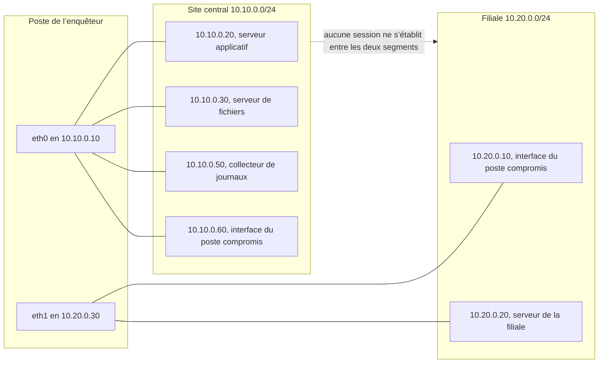
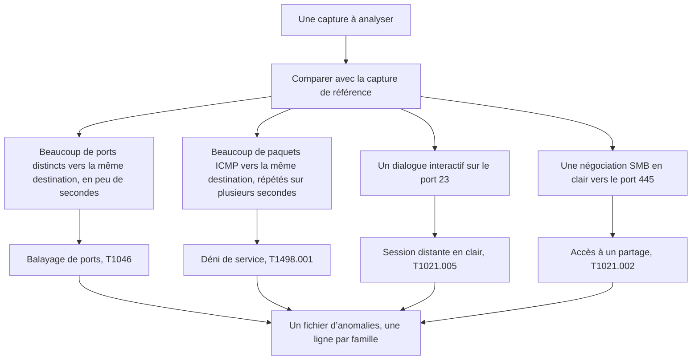

# Forensique réseau — JOUR 2

## Les traces de l’incident (13/10/2026)

---

## Comment lire ce support

Chaque chapitre se lit dans le même ordre, et cet ordre n’est jamais modifié : le préambule pose d’abord le problème en langage courant, sans aucune notion technique.
Le vocabulaire en clair traduit ensuite chaque terme avant son premier emploi, afin qu’aucun mot du cours ne reste nu.
Le contenu du chapitre expose les notions et les démontre par une commande, un tableau ou un résultat de laboratoire.
Les techniques, pas à pas expliquent chaque commande avant de la donner, en précisant ce qu’elle mesure, ce que sa sortie prouve et ce qu’elle ne prouve pas.
Le LAB et ses exercices produisent enfin un livrable nommé, que le chapitre suivant consomme.

Cette journée comporte deux chapitres de trois heures, l’un le matin et l’autre l’après-midi. La pause déjeuner de 12h00 à 13h00 les sépare.
Les deux chapitres forment une chaîne : le premier lit les preuves produites la veille et en extrait un fichier d’anomalies, le second rapproche ce fichier des journaux que le collecteur reçoit sur le port 514.

## Objectifs du Jour

À l’issue de cette journée, chaque participant est capable de :

- Établir une ligne de base à partir d’une capture de référence, et expliquer pourquoi elle conditionne toute conclusion ultérieure.
- Isoler une anomalie par un filtre BPF, puis la compter par `tshark` et en citer la preuve.
- Reconnaître quatre familles d’anomalies : le balayage de ports, le déni de service par flot de paquets, la session distante en clair et l’accès à un partage.
- Mesurer un volume de trafic par unité de temps, et le comparer à la ligne de base sans confondre volume et débit.
- Sceller une capture par son empreinte, puis rédiger le fichier d’anomalies que le chapitre suivant consomme.

## Planning du Jour

| Chapitre | Créneaux | Module et thème | Volume |
|----------|----------|-----------------|--------|
| C3 | 9h00–12h00 | M3 — Analyse des paquets et détection des anomalies | 3h |
| C4 | 13h00–16h00 | M4 — Utilisation des journaux et des outils d’analyse réseau | 3h |
| — | 12h00–13h00 | Pause déjeuner | 1h |

Volume pédagogique : 6 h de formation (3 h et 3 h), 1 h de pause déjeuner.

## Le fil du jour

Les deux chapitres de la journée se relient sans rupture. Le chapitre 3 ne produit rien de nouveau sur le plan matériel : il relit les preuves du premier jour, en produit une seconde à partir d’un trafic maîtrisé, et en extrait un fichier rédigé. Le chapitre 4 reprend ce fichier tel quel et le rapproche des journaux écrits par les machines, qui voient le trafic depuis leur propre point de vue. Un constat établi par une capture et un constat établi par un journal se confortent mutuellement, et c’est leur concordance qui fera la démonstration au chapitre 5.

| Chapitre | Livrable produit | Consommé par |
|----------|------------------|--------------|
| C3 | `~/enquete/anomalies.pcap`, son empreinte `~/enquete/anomalies.pcap.sha256`, et le fichier rédigé `~/enquete/anomalies.md` | C4, qui le relit et le rapproche des journaux du collecteur |
| C4 | `~/enquete/alertes-suricata.txt`, complété par le journal des acquisitions | C5, qui en tire la chronologie de l’incident |

---

## Chapitre 3 — M3 : Analyse des paquets et détection des anomalies (9h00–12h00)

Ce chapitre couvre le module 3 du programme imposé par le client. Le module se présente dans cet ordre : le flux légitime confronté à l’anomalie, puis le balayage de ports, l’attaque par déni de service et l’intrusion. Le chapitre suit exactement cet ordre. La première partie construit la ligne de base, les parties 2 et 3 traitent le balayage et le déni de service, la quatrième traite les intrusions.

### Préambule — reconnaître un intrus dans le bruit d’un réseau

Un médecin de garde reçoit un appel à trois heures du matin : un patient a de la fièvre. Il ne se lève pas pour annoncer une fièvre. Il mesure d’abord la température ordinaire du patient, il la compare à ce qu’il trouve, et il vérifie que l’écart ne vient pas du thermomètre. Sans cette première mesure, le mot fièvre ne veut rien dire : sur un patient qui court, la température de trente-huit degrés est normale.

Un réseau fonctionne de la même manière. Le laboratoire ressemble à un service hospitalier qui n’a tenu aucun dossier. L’un de ses postes se met, à intervalles réguliers, à faire des choses qu’il ne faisait pas la veille : il interroge des ports que personne ne lui a demandé d’interroger, il engage une conversation avec un serveur distant en tapant ses identifiants sans aucune protection, il lit un partage, il envoie de petits paquets en rafale vers un serveur qui n’a rien demandé. Personne n’a rien vu, parce que personne ne savait à quoi ressemblait le fonctionnement normal de ces machines.

Le premier jour a produit ce dossier. La capture de référence montre le trafic obtenu à la demande, la mesure de débit vers le port 5201 du serveur applicatif ; l’inventaire montre les ports que chaque machine a acceptés de déclarer. Ces deux documents ne sont pas une distraction : ce sont les constantes du problème. Sans eux, la capture de ce matin serait une suite de paquets sans signification, comme une photo d’une chambre prise dans le noir.

Reste une difficulté, et elle est la plus importante du métier. L’enquêteur ne peut pas attendre, matin après matin, qu’un incident se produise sous ses yeux. Il provoque donc lui-même, depuis son propre poste, chacune des anomalies qu’il prétend reconnaître. Il balaye les ports, il ouvre une session en clair, il lit le partage, il produit un flot de paquets. Il recommence, et cette fois la capture contient exactement ce qu’il cherchait, avec une heure connue et une signature que n’importe quel autre enquêteur retrouvera le même jour.

La différence entre ce trafic et le trafic de l’incident est l’adresse qui l’émet. La reproduction vient du poste de l’enquêteur, et l’incident vient d’une autre machine. La nature des paquets, leur ordre et leur signature sont les mêmes : seule l’origine change, et cette différence se dit en toutes lettres dans le constat.

### Le vocabulaire en clair

| Terme | En clair | Dans ce chapitre |
|-------|----------|------------------|
| Flux légitime | Un dialogue qui correspond à l’usage prévu d’un service, et qui se répète de la même façon d’une fois à l’autre | Partie 1 |
| Ligne de base | La mesure du fonctionnement ordinaire, prise avant que l’anomalie n’apparaisse, et qui sert de point de comparaison | Partie 1 |
| Anomalie | Un écart mesurable entre le trafic observé et la ligne de base | Partie 1 |
| Balayage de ports | Une machine qui essaie un grand nombre de ports de la même destination en quelques secondes, sans aucun service légitime à lui rendre | Partie 2 |
| Reconnaissance | Le travail qui consiste à cartographier un réseau avant de l’attaquer ; la base de données MITRE ATT&CK le nomme Network Service Scanning, identifiant T1046 | Partie 2 |
| Segment d’ouverture | Le premier paquet d’une connexion TCP, qui porte l’indicateur SYN ; il demande l’ouverture et attend un accusé | Partie 2 |
| Déni de service | Une attaque dont le but est de rendre un service indisponible en consommant une ressource ; le sigle DDoS, pour Distributed Denial of Service, en désigne la variante où plusieurs machines frappent ensemble | Partie 3 |
| ICMP | Le protocole de contrôle des messages Internet, décrit par la RFC 792, qui transporte notamment les demandes d’écho utilisées pour vérifier qu’une machine répond | Partie 3 |
| Flot de paquets | Un grand nombre de paquets du même type, envoyés vers la même destination en très peu de temps | Partie 3 |
| Intrusion | L’usage d’un accès réel par quelqu’un qui n’y était pas autorisé | Partie 4 |
| Telnet | Un protocole de session distante qui ne chiffre rien : ni l’identifiant ni le mot de passe ne sont protégés sur le réseau | Partie 4 |
| SMB | Le protocole de partage de fichiers de Microsoft, identifié par les ports 139 et 445 ; il porte les dialogues d’établissement et les échanges de noms de fichiers | Partie 4 |
| NetBIOS | La couche de session du partage de fichiers, qui préfixe chaque message SMB d’un en-tête de quatre octets | Partie 4 |
| BPF | Le langage de filtre de `tcpdump`, qui ne retient que les paquets conformes à une condition écrite en une ligne | Technique 4 et LAB |
| `tshark` | L’outil qui relit une capture en ligne de commande et en extrait des champs, des filtres ou des comptages | Techniques 1, 4 et 5 |
| `capinfos` | L’outil qui donne les métadonnées d’un fichier de capture : nombre de paquets, taille, durée, première et dernière heure | Technique 6 |
| PCAP | Le format de fichier dans lequel une capture est enregistrée, que tous les outils du cours savent lire | LAB |
| Empreinte | Une valeur de contrôle calculée sur un fichier ; elle change dès qu’un seul octet du fichier change | Techniques 6 et 7 |

### Objectifs du chapitre

À la fin du chapitre 3, chaque participant est capable de :

- Expliquer pourquoi une anomalie ne peut être établie sans une ligne de base mesurée auparavant.
- Citer les éléments qui distinguent un flux légitime d’une connexion anormale, et les vérifier dans une capture.
- Reconnaître un balayage de ports dans une capture et écrire le filtre BPF qui l’isole.
- Mesurer un flot de paquets par unité de temps et le comparer à la ligne de base.
- Identifier une session Telnet et un accès à un partage dans une capture, et nommer ce qu’ils révèlent.
- Sceller une capture par son empreinte et rédiger le fichier d’anomalies que le chapitre 4 consomme.

### Répartition du temps

| Partie | Durée |
|---|---|
| Préambule, vocabulaire et objectifs | 12 min |
| Contenu du chapitre | 58 min |
| Techniques, pas à pas | 40 min |
| LAB | 50 min |
| Exercices | 20 min |

### Contenu du chapitre (58min)

#### 1. La ligne de base, et ce qui rend un flux anormal (15min)

Une anomalie n’est pas un objet que l’on rencontre : c’est un écart entre deux mesures. Le trafic qui suit est suspect, le trafic d’hier ne l’était pas, et seule la comparaison des deux permet de dire ce qui a changé. Une capture sans point de comparaison se lit comme une liste de noms propres : elle est exacte et elle est muette.

Le premier jour a produit le point de comparaison. La capture `~/enquete/capture-reference.pcap` contient trois cents paquets de mesure de débit vers le port 5201 du serveur applicatif, et l’inventaire `~/enquete/inventaire-hotes.txt` décrit ce que chaque machine a accepté de déclarer. Les deux fichiers sont des mesures, pas des intentions, et c’est cette différence qui les rend utilisables.

| Ce que la capture de référence établit | Ce qu’elle n’établit pas |
|--------------------------------------|------------------------|
| Le fonctionnement ordinaire du segment du site central, à l’heure où la capture a été prise | Le fonctionnement ordinaire à toute autre heure, ni celui du segment de la filiale |
| Un volume connu, une destination connue et un intervalle connu | Que ce volume était le maximum possible, ni qu’il était courant |
| Une absence de trafic ICMP, de session Telnet et de dialogue SMB pendant la durée de la capture | Qu’aucune de ces activités n’a jamais eu lieu, ni qu’elles ne se produisent pas ailleurs |
| Qu’aucun paquet ne porte l’adresse 10.10.0.60, celle du poste compromis sur le segment du site central | Ce que ce poste fait lorsqu’il parle : ce qu’il a fait le premier jour ne renseigne pas sur son activité présente |

L’absence constatée ici est une absence de mesure, non une absence de fait. Elle s’explique par une raison connue et vérifiable : la capture a été obtenue le premier jour, à la demande, par une production de trafic volontaire et maîtrisée, donc en dehors du cycle de l’incident. C’est ce qui rend la capture de référence utilisable comme ligne de base : elle a été prise dans des conditions connues.

Le point d’observation décide de ce qui est comparable. La capture du premier jour a été prise sur `eth0`, l’interface du site central. Depuis cette interface, l’enquêteur voit ce que le poste compromis adresse au site central, parce que ce poste porte une seconde adresse sur ce segment. Il ne voit pas ce que ce poste adresse à ses voisins de la filiale.



**Fig 1 — Le point d’observation du chapitre 3, et la double appartenance du poste compromis.**

Le trait en pointillé entre les deux segments n’est pas un lien : il rappelle qu’aucune session ne s’établit de l’un à l’autre. La capture de ce chapitre ne portera donc que sur `eth0`, et elle verra le trafic que le poste compromis adresse au site central, jamais celui qu’il adresse à sa propre filiale.

> **Concept clé — une anomalie se mesure contre une référence ; sans référence, il n’y a qu’une impression.**
>
> La capture de référence n’est pas une politesse de méthode : c’est la seule chose qui permette de distinguer, dans le même fichier, un volume qui a toujours existé d’un volume qui vient d’apparaître.

#### 2. Le balayage de ports : une main qui compte les portes (15min)

Un balayage de ports consiste à essayer, sur une même machine, un grand nombre de ports en quelques secondes. Aucun service légitime ne le fait : un serveur reçoit des connexions sur les ports qu’il a ouverts, par exemple le port 22 ou le port 80, et il ne demande pas au client d’essayer quinze autres numéros avant de répondre. Le balayage n’a donc aucune fonction utile : il sert à dresser la liste de ce qui est ouvert chez une cible, et cette liste précède presque toujours une intrusion. La base de données MITRE ATT&CK en fait une technique à part entière, Network Service Scanning, identifiant T1046.

Il existe trois familles de balayage, et chacune laisse une trace différente dans une capture.

| Famille | Ce que l’outil fait | Ce que la capture montre | Ce que la trace ne prouve pas |
|---------|----------------------|--------------------------|-----------------------------|
| Balayage SYN | Il envoie un segment d’ouverture sur chaque port et ne poursuit pas | Un segment d’ouverture par port, et une absence de suite du dialogue pour les ports fermés | Que la tentative a abouti, ni qu’un service répond |
| Balayage connecté | Il ouvre une connexion complète sur chaque port, puis la referme | Un segment d’ouverture, un accusé du serveur et un acquittement du client, par port | Que le port est réellement exploitable, et encore moins que la cible est vulnérable |
| Balayage en UDP | Il envoie un datagramme et attend une réponse qui peut ne jamais venir | Un datagramme par port, et presque toujours aucune réponse | Qu’un port est fermé : en UDP, le silence ne distingue pas un port fermé d’un port filtré |

Le laboratoire produit la deuxième famille, le balayage connecté, parce qu’elle est la plus parlante à lire dans une capture. Le port 3389 du serveur de fichiers est fermé : une tentative de connexion y produit un segment d’ouverture, puis un acquittement négatif immédiat du serveur. Un segment d’ouverture vers un port fermé est donc une trace d’essai, pas la preuve d’un service.

Trois éléments font la signature d’un balayage, et il faut les réunir tous les trois. Le nombre de ports distincts visés sur une même destination, qui n’a pas de précédent sur un segment ordinaire. Le délai pendant lequel ces ports sont visés, qui n’a rien à voir avec la distance entre deux machines d’un même segment. Et l’absence de raison métier : aucun logiciel du laboratoire n’a besoin d’interroger quinze ports d’un serveur de fichiers, et aucun ne le fait de façon méthodique pour vérifier que la machine répond.

L’indicateur qui porte la demande d’ouverture est l’indicateur SYN. Un segment qui porte cet indicateur, sans porter l’indicateur d’acquittement, demande l’ouverture d’un dialogue ; un segment qui porte les deux est un acquittement. Cette distinction se décrit en une ligne de filtre, et c’est la ligne que le LAB fera compiler :

```bash
tcpdump -d -y EN10MB 'src host 10.10.0.10 and dst host 10.10.0.30 and tcp[tcpflags] & (tcp-syn) != 0 and tcp[tcpflags] & (tcp-ack) == 0'
```

Chaque terme de cette ligne a un rôle. Le mot `src host` et le mot `dst host` désignent les deux extrémités du dialogue. Le mot `and` exige que les deux conditions soient vraies. L’expression `tcp[tcpflags]` désigne l’octet du segment TCP qui réunit les indicateurs. Le mot `tcp-syn` isole l’indicateur d’ouverture, et le mot `tcp-ack` isole l’indicateur d’acquittement. La fin de la ligne exige un segment qui porte le premier indicateur et pas le second, c’est-à-dire une demande d’ouverture.

La liste des ports sondés n’est pas arbitraire. Elle réunit les cinq ports de service du laboratoire, 22, 23, 80, 443 et 445, et les dix ports que la règle de détection du chapitre 4 surveille parce qu’ils sont inhabituels sur un serveur de fichiers : 21, 25, 53, 110, 139, 143, 3306, 3389, 993 et 995. Un inventaire honnête se lit toujours avec la commande qui l’a produit sous les yeux, et cette liste de quinze ports est celle que le LAB exécutera.

> **Piège — le nombre de segments d’ouverture ne dit pas le nombre de machines.**
>
> Une machine qui balaie quinze ports produit quinze segments d’ouverture vers la même adresse. Une machine qui ouvre deux sessions de travail produit deux segments d’ouverture. Inversement, un port fermé produit lui aussi un segment d’ouverture, avec un acquittement négatif en retour. Le compte seul ne prouve rien : il faut la variété des ports et la répétabilité du rythme.

#### 3. Le déni de service : le volume qui écrase le temps (14min)

Une attaque par déni de service ne cherche pas à lire une donnée ni à obtenir un accès. Elle cherche à épuiser une ressource : la bande passante d’un lien, la capacité de traitement d’un serveur, la file d’attente d’un équipement. La variante volumétrique, que la base de données MITRE ATT&CK nomme Direct Network Flood, sous l’identifiant T1498.001, envoie un grand nombre de paquets vers une même destination ; le coût du traitement retombe sur la cible, et non sur l’expéditeur.

Le laboratoire produit cette variante avec le paquet le plus simple qui soit : des demandes d’écho ICMP, envoyées l’une après l’autre vers le serveur applicatif, à raison de vingt par seconde pendant dix secondes. Le protocole est décrit par la RFC 792, et il a un avantage pédagogique décisif : une demande d’écho n’a aucun contenu utile, elle ne demande qu’une réponse, et elle est donc facile à produire, à compter et à reconnaître.

Le scénario qui rejoue l’incident en boucle ne produit pas toujours le même nombre de paquets : d’un tour à l’autre, le volume varie. Cette variation est un avertissement utile, car elle oblige à juger une anomalie sur sa signature et non sur un total. Un nombre exact n’est pas une signature ; une répétition vers la même destination, elle, en est une.

Une difficulté mérite d’être traitée de front, parce qu’elle invalide le raccourci habituel. Le débit brut ne suffit pas à caractériser un flot. La capture de référence contient trois cents paquets de plus d’un millier d’octets reçus en quelques centièmes de seconde, et ce volume est parfaitement légitime : c’est une mesure de débit demandée, non une attaque. Un comptage naïf classerait cette capture comme l’anomalie la plus violente du réseau.

La même ambiguïté apparaît sur l’incident, et elle est la raison pour laquelle le chapitre 4 exige des journaux en plus des captures : deux sources qui disent la même chose valent mieux qu’une source qui dit beaucoup de choses.

| Mesure | Ce qu’elle compte | Ce qu’elle ne dit pas |
|--------|-------------------|----------------------|
| Total des paquets | Combien de paquets la capture contient pour cette condition | Combien de temps cela a duré, donc si le volume était concentré ou étalé |
| Total des paquets ICMP | Combien de paquets ICMP la capture contient | Si le flot visait la même destination, ou si la capture est restée muette pendant dix minutes |
| Paquets par seconde | Combien de paquets la capture a vus dans chaque tranche d’une seconde | Ce qui rend ces paquets anormaux : un segment peut être demandé par un service légitime |
| Destination et ports visés | La machine visée et les services sollicités | Si la machine visée était ou non hors d’atteinte de la demande |
| Présence dans la ligne de base | Ce que le même comptage rend dans la capture de référence | Rien par elle-même : une capture de référence muette ne prouve pas l’absence |

Le volume par unité de temps est la mesure qui décide, et elle n’a de sens que comparée à la ligne de base. Sur la capture de référence, le comptage des paquets ICMP rend zéro, sur toute la durée de la capture. Sur la capture de ce chapitre, le même comptage rend près de quatre cents paquets ICMP, répartis sur une dizaine de tranches consécutives d’une seconde. Ce n’est pas le nombre qui est anormal : c’est l’existence d’un volume répété là où la ligne de base n’en contient aucun, et la répétition sur plusieurs secondes.

Un détail de comptage mérite d’être annoncé ici, car il change le résultat affiché et qu’il n’est pas une erreur. Chaque demande d’écho reçoit une réponse, et les deux paquets sont capturés sur la même interface : le compteur voit donc deux paquets pour une seule demande. Deux cents demandes et leurs réponses donnent près de quatre cents paquets comptés, et environ quarante paquets par tranche d’une seconde au lieu des vingt attendues. Ce facteur deux se retrouve dans toutes les mesures de ce type, et il faut l’avoir compris avant de comparer deux chiffres.

> **Bon à savoir — un laboratoire n’abat pas un service pour le démontrer.**
>
> Près de quatre cents paquets, dont deux cents demandes d’écho et leurs réponses, ne saturent aucun lien et n’ont jamais interrompu le serveur applicatif. Le cours étudie la signature du flot et la manière de le mesurer ; il ne simule pas une coupure de service, et un enquêteur qui interromprait le service qu’il analyse perdrait sa preuve.

#### 4. Les intrusions : une session en clair et un partage en clair (14min)

Une intrusion ne se distingue pas du trafic légitime par la quantité, mais par l’usage : c’est un accès réel, ouvert et parfaitement fonctionnel, employé par quelqu’un qui n’y était pas autorisé. Les deux intrusions du laboratoire passent par des services qui fonctionnent exactement comme prévu, et c’est ce qui les rend difficiles à voir.

La première utilise le port 23, qui porte le protocole Telnet. Ce protocole, dont la spécification date de 1981 sous la référence RFC 854, ne chiffre rien : ce qui est tapé au clavier part en clair, et ce qui est affiché revient en clair. La référence de la base de données MITRE ATT&CK est Remote Services: Telnet, identifiant T1021.005.

Un détail de cette intrusion a été mesuré sur ce laboratoire, et il explique pourquoi une règle de détection peut être correctement écrite et rester muette. Sur un dialogue Telnet, l’invite est émise par le serveur : elle part du port 23 vers un port élevé attribué au client. Le texte de l’invite ne porte donc jamais le port 23 en destination. Une règle qui attend une arrivée sur le port 23 ne le verra jamais passer ; en revanche, elle verra l’identifiant et le mot de passe que le client envoie vers ce port, ce qui est un autre contenu, dans l’autre sens. La règle du chapitre 4 est donc écrite à l’endroit exact où le fait se produit : elle surveille les paquets dont le port d’origine est 23 et qui contiennent le mot de l’invite. C’est le genre de détail qui se décide en lisant une capture, et non dans une documentation.

Un second détail sépare deux faits que l’on confond souvent. Le laboratoire produit deux tentatives de session, l’une après l’autre, séparées de quelques dizaines de secondes : ce n’est pas une attaque par force brute, que la base de données ATT&CK identifie par T1110, et qui suppose de nombreuses tentatives sur une même cible dans un délai court. Deux tentatives rapprochées mais peu nombreuses sont deux traces d’un accès qui échoue, et l’enquêteur doit les décrire comme telles.

La seconde intrusion utilise les ports 139 et 445, qui portent le protocole SMB. Chaque message SMB est précédé d’un en-tête de service de session NetBIOS de quatre octets, puis commence par une marque de quatre octets, `FE 53 4D 42`, c’est-à-dire l’octet de valeur 253 suivi des trois lettres de SMB. Cette marque se lit dans la charge utile d’une capture, en clair, et sa présence prouve qu’une négociation de protocole est en train de se faire. La référence correspondante dans la base de données ATT&CK est Remote Services: SMB/Windows Admin Shares, identifiant T1021.002.

| Élément observé dans la capture | Ce qu’il prouve | Ce qu’il ne prouve pas |
|--------------------------------|------------------|------------------------|
| Un segment d’ouverture vers le port 23 | Qu’une session distante a été demandée vers ce port | Qu’un compte a été ouvert, ni que le mot de passe a été accepté |
| L’invite émise depuis le port 23 vers un port élevé | Qu’un service en clair attend un identifiant | Que le client qui parle est le poste qui a ouvert la session |
| Un nom d’utilisateur et un mot de passe en clair dans la charge utile | Qu’un compte a été soumis sur ce lien, et que le protocole ne protège rien | Que le compte existe, ni que la tentative a réussi |
| Une marque `FE 53 4D 42` dans une charge utile vers le port 445 | Qu’une négociation SMB est engagée en clair | Que l’accès au partage a été accordé |
| Une liste de fichiers après la négociation | Qu’un accès en lecture a abouti, et sur quels fichiers | Ni que les fichiers lus aient été modifiés, ni ce que le dossier contient par ailleurs |

Les quatre familles se tiennent côte à côte, et chacune possède son filtre. C’est ce tableau de correspondance qui constitue le résultat central du chapitre.

| Famille | Ce qui la caractérise dans la capture | Référence ATT&CK | Filtre qui l’isole |
|---------|--------------------------------------|------------------|--------------------|
| Balayage de ports | Plusieurs segments d’ouverture vers des ports distincts de la même destination, en quelques secondes | T1046 | `src host A and dst host B and tcp[tcpflags] & (tcp-syn) != 0 and tcp[tcpflags] & (tcp-ack) == 0` |
| Déni de service | Un volume de paquets ICMP répété pendant plusieurs secondes vers la même destination, là où la ligne de base n’en contient aucun | T1498 et T1498.001 | `icmp and dst host 10.10.0.20` |
| Session en clair | Un dialogue interactif sur le port 23, dont la charge utile porte l’identifiant et le mot de passe | T1021.005 | `tcp port 23` |
| Accès à un partage | Une négociation SMB en clair vers le port 445, puis un dialogue d’établissement | T1021.002 | `tcp port 445 or tcp port 139` |



**Fig 2 — Les quatre familles d’anomalies du laboratoire, et le chemin qui mène de la capture au livrable.**

> **Règle de conservation — une capture qui contient un mot de passe en clair est une preuve sensible.**
>
> Dès que la capture de ce chapitre existe, elle contient des identifiants en clair. Elle reste dans le dossier `~/enquete`, elle ne sort pas du périmètre écrit dans `~/enquete/cadre-enquete.md`, et son empreinte est posée dès la fin de la capture. Aucun extrait brut d’identifiant ne figure dans un rapport : seul le fait qu’il y en ait un, et l’heure à laquelle il a été observé, sont consignés.

### Les techniques, pas à pas

Sept techniques composent le travail de ce chapitre. Aucune ne se suffit à elle-même : les trois premières produisent la matière, les quatre suivantes la rendent lisible et vérifiable.

| Technique | Ce qu’elle fait | Durée |
|-----------|------------------|-------|
| 1 — Reprendre la capture de référence | Établir la ligne de base et mesurer ce que le trafic ordinaire contient | 8 min |
| 2 — Ouvrir une capture d’anomalies | Produire un fichier sans filtre, en arrière-plan, avant toute action | 6 min |
| 3 — Provoquer les quatre anomalies | Recréer sur son poste le balayage, la session en clair, le partage et le flot de paquets | 8 min |
| 4 — Isoler chaque famille | Écrire un filtre par famille et le relire dans la capture | 8 min |
| 5 — Compter par unité de temps | Mesurer un volume de paquets par tranche d’une seconde, puis comparer | 4 min |
| 6 — Sceller la capture | Poser l’empreinte et relever les métadonnées du fichier | 3 min |
| 7 — Comparer avec l’inventaire | Opposer les constats du jour aux ports déclarés la veille | 3 min |

**Technique 1 — Reprendre la capture de référence et établir la ligne de base**

Ce qu’elle mesure : le contenu de la capture obtenue le premier jour, et la quantité d’activité de chaque famille d’anomalie qu’elle contient.

```bash
capinfos -t -c -s -d -l -a -e ~/enquete/capture-reference.pcap
tshark -r ~/enquete/capture-reference.pcap -q -z io,phs
tshark -r ~/enquete/capture-reference.pcap -Y 'icmp or tcp.port == 23 or tcp.port == 445' -T fields -e frame.number | wc -l
tshark -r ~/enquete/capture-reference.pcap -Y 'ip.addr == 10.10.0.60' -T fields -e frame.number | wc -l
```

La première commande lit les métadonnées du fichier. La deuxième range les paquets par protocole, du plus général au plus précis, et l’option `-q` lui demande de n’afficher que cette synthèse au lieu du détail des paquets. Les deux dernières comptent des paquets. L’option `-Y` pose un filtre d’affichage, qui ne retire rien au fichier et ne s’applique qu’à la lecture ; l’option `-T fields` demande une extraction de champs, l’option `-e frame.number` désigne le champ numéro de paquet parmi ceux retenus, et la commande `wc -l` compte les lignes rendues.

Ce que la sortie prouve : que la capture de référence ne contient aucun paquet ICMP, aucune session sur le port 23 et aucun dialogue sur le port 445, et qu’aucun de ses paquets ne porte l’adresse 10.10.0.60. Elle fixe donc une ligne de base chiffrée, sur toute la durée du fichier, pour les trois familles que le chapitre cherche ensuite.

Ce qu’elle ne prouve pas : que ces activités n’aient jamais eu lieu sur ce segment. Une capture ne couvre que l’intervalle qu’elle enregistre, et elle ne voit que ce qui passe devant son point d’observation. La raison de l’absence constatée ici est connue et vérifiable : la capture a été obtenue le premier jour, par une production de trafic volontaire, donc en dehors du cycle de l’incident.

**Technique 2 — Ouvrir une capture d’anomalies, sans filtre, en arrière-plan**

Ce qu’elle produit : un fichier qui enregistre tout le trafic de l’interface choisie. Cette technique ne mesure rien ; elle crée la matière des cinq suivantes.

```bash
sudo tcpdump -i eth0 -w ~/enquete/anomalies.pcap -s 0 -n -U &
sleep 2
ip -brief address show
```

Les options sont celles de la capture de référence, avec une différence volontaire et importante : le compteur de paquets a disparu. La capture de référence s’arrêtait à trois cents paquets, donc à un instant connu d’avance ; ici personne ne sait à l’avance combien de paquets seront capturés, et c’est l’enquêteur qui décide de l’arrêter. Une capture dont la fin est imprévisible doit être arrêtée à la main, et c’est un motif supplémentaire de la sceller sans tarder.

La pause de deux secondes laisse à la capture le temps de s’installer avant que le trafic ne parte, et la dernière commande vérifie que l’interface porte bien l’adresse attendue. Cette capture s’ouvre avant toute action : une anomalie produite avant l’ouverture de la capture est une anomalie perdue, et cette perte ne se rattrape pas.

Ce que la sortie prouve : que la capture est ouverte et que l’interface est active. Ce qu’elle ne prouve pas : rien sur le contenu du fichier, qui est encore vide. Le fichier produit s’appelle `~/enquete/anomalies.pcap`.

**Technique 3 — Provoquer soi-même chaque anomalie, depuis le poste de l’enquêteur**

Ce qu’elle produit : les quatre familles d’anomalies, avec une heure connue, une origine connue et une signature que l’on peut comparer à celle de l’incident.

```bash
nmap -n -Pn -sT --max-retries 1 --host-timeout 20s -p 21,22,23,25,53,80,110,139,143,443,445,993,995,3306,3389 10.10.0.30
printf 'root\r\nadmin2026\r\n' | timeout 8 nc 10.10.0.30 23 > /dev/null
smbclient //10.10.0.30/partage -U 'enquete%lab-2026' -c 'ls'
sudo ping -c 200 -i 0.05 10.10.0.20
```

Quatre commandes, quatre familles, dans l’ordre du programme du module. Chacune se lit ainsi.

La première produit le balayage de ports. L’option `-n` interdit la résolution des noms, l’option `-Pn` dispense de tester d’abord si la machine répond, et l’option `-sT` impose une connexion complète sur chaque port : c’est le balayage connecté, seule famille qui laisse dans la capture des segments d’ouverture, des accusés de serveur et des acquittements de client. Les deux options de temporisation limitent le temps d’attente, pour qu’aucune reprise ne vienne gonfler le compte. La liste de ports est celle de la partie 2.

La deuxième produit la session en clair. La commande `printf` écrit deux lignes terminées par les deux caractères de fin de ligne du réseau, un retour chariot suivi d’une fin de ligne ; la commande `nc` envoie cette suite au port 23 et lit ce que le serveur renvoie ; la commande `timeout` met fin à l’opération au bout de huit secondes, car le service en clair du laboratoire ne ferme pas la session de lui-même. La redirection vers `/dev/null` évite d’afficher l’invite à l’écran : l’invite est dans la capture, et c’est là qu’elle doit être observée. Cette commande est exécutée deux fois de suite, comme le fait le scénario de l’incident, et les deux valeurs envoyées sont des valeurs de laboratoire, jamais celles d’un système réel.

La troisième produit l’accès à un partage. L’option `-U` transmet le compte et le mot de passe du partage, séparés par un caractère pourcent ; l’option `-c` donne la commande à exécuter sur le partage, ici une simple liste. Le compte et le mot de passe sont ceux du laboratoire, décrits dans le tableau d’environnement.

La quatrième produit le flot de paquets. L’option `-c` fixe le nombre de demandes d’écho, l’option `-i` l’intervalle entre deux demandes, et le préfixe `sudo` accorde les privilèges que certaines versions de l’outil exigent pour un intervalle inférieur à un cinquième de seconde. Deux cents demandes à vingt par seconde pendant dix secondes donnent un volume que l’on peut compter sans approximation.

Ce que ces commandes produisent : quatre familles d’anomalies, toutes horodatées et toutes issues de la même adresse, 10.10.0.10, celle du poste de l’enquêteur. Ce qu’elles ne prouvent pas : que l’incident vienne de ce poste. Il n’en vient pas. La différence porte sur la seule adresse source, et elle est réelle mais secondaire : le nombre de ports visés, leur ordre, les ports concernés, les protocoles employés et le rythme sont identiques. C’est ce qui permet d’apprendre la signature aujourd’hui et de la retrouver demain sur une autre adresse.

**Technique 4 — Isoler chaque famille par un filtre BPF**

Ce qu’elle mesure : les paquets qui appartiennent à une famille, et les ports sur lesquels portent les segments d’ouverture.

```bash
tcpdump -d -y EN10MB 'src host 10.10.0.10 and dst host 10.10.0.30 and tcp[tcpflags] & (tcp-syn) != 0 and tcp[tcpflags] & (tcp-ack) == 0'
tcpdump -r ~/enquete/anomalies.pcap -n -c 4 'src host 10.10.0.10 and dst host 10.10.0.30 and tcp[tcpflags] & (tcp-syn) != 0 and tcp[tcpflags] & (tcp-ack) == 0'
tshark -r ~/enquete/anomalies.pcap -Y 'ip.src == 10.10.0.10 and ip.dst == 10.10.0.30 and tcp.flags.syn == 1 and tcp.flags.ack == 0' -T fields -e tcp.dstport | sort -n | uniq -c | sort -rn
tcpdump -r ~/enquete/anomalies.pcap -n -c 4 'tcp port 23'
tshark -r ~/enquete/anomalies.pcap -Y 'icmp and dst host 10.10.0.20' -T fields -e frame.time -e ip.src | head -3
```

La première commande ne lit aucun fichier : elle compile le filtre et affiche le petit programme que la machine exécute ensuite pour trier les paquets. Les commandes suivantes relisent la capture. La troisième mérite une attention particulière : elle ne compte pas des paquets mais des ports de destination, et c’est la seule mesure qui caractérise un balayage.

Ce que la sortie prouve : que la capture contient des paquets de chacune des familles, que quinze ports distincts ont été visés par des segments d’ouverture, et que le dialogue sur le port 23 est émis par le serveur : le port 23 y apparaît comme port d’origine, et le client y porte un port élevé. Un filtre qui ne rend aucun paquet sur une capture de plusieurs centaines de paquets ne prouve pas que l’activité est absente : il prouve que la condition écrite ne correspond à rien dans le fichier, et l’erreur est souvent dans le filtre lui-même.

**Technique 5 — Mesurer le volume de trafic par unité de temps**

Ce qu’elle mesure : combien de paquets la capture contient par tranche d’une seconde.

```bash
tshark -r ~/enquete/anomalies.pcap -Y 'icmp' -T fields -e frame.time_epoch | cut -d. -f1 | uniq -c
tshark -r ~/enquete/anomalies.pcap -q -z io,stat,1,'icmp'
```

La première commande extrait le nombre de secondes écoulées depuis 1970 que chaque paquet porte dans son en-tête, ne garde que la partie entière, puis regroupe les valeurs identiques. Elle rend une ligne par tranche d’une seconde, avec le nombre de paquets observés sur cette tranche. La seconde demande la même répartition à `tshark`, mais sous forme de tableau : l’option `-z` demande un rapport et l’intervalle `1` fixe la durée de chaque ligne du tableau. Les deux rendus doivent montrer la même concentration.

Ce que la sortie prouve : que le flot n’est pas un pic isolé, mais une répétition sur plusieurs tranches consécutives, de l’ordre de quarante paquets par seconde là où la ligne de base ne contenait aucun paquet ICMP. C’est le débit, et non le total, qui caractérise le flot. Le tableau rend aussi des tranches vides en tête et en fin de capture : c’est normal, et c’est même utile, car ces trous donnent les limites exactes de la fenêtre pendant laquelle l’activité a eu lieu.

**Technique 6 — Sceller la capture par son empreinte**

Ce qu’elle mesure : l’identité numérique du fichier, qui garantit qu’il ne sera plus modifié.

```bash
sha256sum ~/enquete/anomalies.pcap
capinfos ~/enquete/anomalies.pcap
```

Ce que la sortie prouve : qu’une empreinte existe et que le fichier est complet. Ce qu’elle ne prouve pas : que le fichier est authentique. Une empreinte atteste qu’un fichier est identique à celui qui a été scellé ; elle ne dit pas d’où il vient. Cette nuance est réservée au chapitre 6.

**Technique 7 — Comparer avec l’inventaire du premier jour**

Ce qu’elle mesure : l’écart entre ce que le réseau faisait hier et ce qu’il fait aujourd’hui.

```bash
cat ~/enquete/inventaire-hotes.txt
```

Un écart entre l’inventaire et la capture est un constat d’enquête, pas une erreur de l’outil. Le tableau de la partie 1 en donne trois exemples : le port 23 est ouvert alors qu’aucune connexion n’était attendue ; le port 3389 est fermé, donc une tentative d’ouverture n’est pas une intrusion ; le port 445 porte un dialogue SMB alors que le protocole attendu serait SMB sur TCP 445 avec chiffrement.

### LAB — Mesurer, isoler et consigner les quatre anomalies du laboratoire

#### Prérequis

Ce LAB ne se lance pas tout seul. Il consomme trois fichiers produits le premier jour, et il est important de comprendre pourquoi il en a besoin : ces trois fichiers ne sont pas des données de confort, ce sont les trois sources de vérité du laboratoire. La capture de référence donne la mesure ordinaire, l’inventaire donne la déclaration de service, le cadre d’enquête donne le périmètre.

```bash
ls -l ~/enquete/
sha256sum -c ~/enquete/capture-reference.pcap.sha256
```

Si l’un des trois fichiers manque, ou si l’empreinte ne correspond plus, il faut suspendre le LAB. Le chapitre commence à comparer, et une comparaison sans référence ne produit qu’une impression.

#### Environnement

| Élément | Valeur |
|---------|--------|
| Poste de l’enquêteur | `10.10.0.10` (site central), `10.20.0.30` (filiale) |
| Interface d’observation | `eth0`, segment `10.10.0.0/24` |
| Serveur de fichiers | `10.10.0.30` — port 23 en clair, ports 139 et 445 ouverts |
| Serveur applicatif | `10.10.0.20` — ports 22, 80, 443 |
| Collecteur de journaux | `10.10.0.50` — syslog sur 514 |
| Poste compromis | `10.20.0.10` (filiale), `10.10.0.60` (site central) |
| Serveur de la filiale | `10.20.0.20` — ports 22 et 80 |
| Outil de capture | `tcpdump`, compte ordinaire `enqueteur` avec `sudo` |
| Outil de lecture | `tshark` et `capinfos` |
| Dossier de travail | `~/enquete/` |
| Durée totale | 50 minutes |

#### Étapes du LAB

| Étape | Intitulé | Durée |
|-------|-----------|-------|
| 1 | Vérifier les livrables du premier jour | 6 min |
| 2 | Établir la ligne de base sur la capture de référence | 7 min |
| 3 | Ouvrir la capture d’anomalies | 4 min |
| 4 | Reproduire le balayage de ports | 4 min |
| 5 | Reproduire la session en clair sur le port 23 | 3 min |
| 6 | Reproduire l’accès au partage SMB | 3 min |
| 7 | Reproduire le flot de paquets ICMP | 3 min |
| 8 | Arrêter la capture et isoler le balayage | 4 min |
| 9 | Isoler la session en clair, le partage et le flot | 5 min |
| 10 | Sceller la capture et comparer avec l’inventaire | 5 min |
| 11 | Rédiger le fichier d’anomalies | 6 min |

**Étape 1 — Vérifier les livrables du premier jour (6min)**

Ce que cette étape vérifie : que les trois fichiers de référence existent, que l’empreinte de la capture correspond, et que le périmètre de l’enquête couvre le site central.

```bash
ls -l ~/enquete/
sha256sum -c ~/enquete/capture-reference.pcap.sha256
cat ~/enquete/cadre-enquete.md
```

Le résultat attendu est un fichier `capture-reference.pcap.sha256` qui se termine par la mention `OK`, et un cadre d’enquête qui nomme le réseau `10.10.0.0/24` comme périmètre observé.

Ce que la sortie prouve : que le point de comparaison est intact. Si l’empreinte ne correspond pas, la capture a été modifiée depuis sa création, et le LAB s’arrête là.

**Étape 2 — Établir la ligne de base sur la capture de référence (7min)**

Ce que cette étape mesure : ce que contient la capture de référence pour les trois familles cherchées.

```bash
capinfos -t -c -s -d -l -a -e ~/enquete/capture-reference.pcap
tshark -r ~/enquete/capture-reference.pcap -q -z io,phs
tshark -r ~/enquete/capture-reference.pcap -Y 'icmp or tcp.port == 23 or tcp.port == 445' -T fields -e frame.number | wc -l
tshark -r ~/enquete/capture-reference.pcap -Y 'ip.addr == 10.10.0.60' -T fields -e frame.number | wc -l
```

Le résultat attendu : la capture contient environ trois cents paquets de mesure de débit ; la hiérarchie de protocoles ne fait apparaître aucun ICMP, aucun port 23 ni aucun port 445 ; les deux dénombrements rendent zéro.

Une valeur différente de zéro n’est pas une erreur : c’est un constat. Il faut alors relire le fichier cadre-enquête et vérifier ce qui a été produit le premier jour.

**Étape 3 — Ouvrir la capture d’anomalies (4min)**

Ce que cette étape produit : le fichier `~/enquete/anomalies.pcap`, qui enregistrera tout le trafic des étapes suivantes.

```bash
sudo tcpdump -i eth0 -w ~/enquete/anomalies.pcap -s 0 -n -U &
sleep 2
ip -brief address show
```

Le résultat attendu : la commande `ip` affiche `eth0` avec l’adresse `10.10.0.10/24`, et le fichier `anomalies.pcap` existe déjà, réduit pour l’instant à son en-tête, sa taille croissant à mesure que le trafic arrive.

Si le fichier n’apparaît pas, l’interface est peut-être nommée autrement. La commande `ip -brief link` liste les noms réels des interfaces.

**Étape 4 — Reproduire le balayage de ports (4min)**

Ce que cette étape produit : quinze segments d’ouverture vers `10.10.0.30`, dont douze vers des ports fermés.

```bash
nmap -n -Pn -sT --max-retries 1 --host-timeout 20s -p 21,22,23,25,53,80,110,139,143,443,445,993,995,3306,3389 10.10.0.30
```

Le résultat attendu : `nmap` rend une liste de quinze ports, dont `23/tcp`, `139/tcp` et `445/tcp` en `open`, et `3389/tcp` en `closed`.

Ce que la sortie prouve : que le serveur de fichiers expose le port 23 en clair, et que douze des quinze ports sondés ne répondent pas. Ce qu’elle ne prouve pas : que quiconque s’en soit servi. La capture va le dire.

**Étape 5 — Reproduire la session en clair sur le port 23 (3min)**

Ce que cette étape produit : deux tentatives de session, avec un identifiant et un mot de passe en clair dans la charge utile.

```bash
printf 'root\r\nadmin2026\r\n' | timeout 8 nc 10.10.0.30 23 > /dev/null
printf 'root\r\nadmin2026\r\n' | timeout 8 nc 10.10.0.30 23 > /dev/null
```

Le résultat attendu : chaque commande rend la main après huit secondes, sans afficher rien à l’écran. Tout ce qui a été échangé est dans la capture, pas au terminal. Les deux tentatives reproduisent le nombre de tentatives de l’incident, qui est de deux.

Si une commande ne rend pas la main, vérifier que l’option `timeout 8` est bien présente : sans elle, la session en clair resterait ouverte indéfiniment. Un service qui ne répond jamais n’est pas un indice, c’est un outil mal écrit.

**Étape 6 — Reproduire l’accès au partage SMB (3min)**

Ce que cette étape produit : une négociation SMB suivie d’une liste de fichiers.

```bash
smbclient //10.10.0.30/partage -U 'enquete%lab-2026' -c 'ls'
```

Le résultat attendu : la commande rend la liste des fichiers du partage, dont `lisezmoi.txt`.

Si le partage est refusé, vérifier que le compte du tableau d’environnement est bien `enquete` et que le mot de passe est `lab-2026`. Un refus d’authentification est un constat d’enquête, pas un échec du LAB : il se note et se poursuit.

**Étape 7 — Reproduire le flot de paquets ICMP (3min)**

Ce que cette étape produit : deux cents demandes d’écho vers le serveur applicatif, à raison de vingt par seconde.

```bash
sudo ping -c 200 -i 0.05 10.10.0.20
```

Le résultat attendu : la commande rend deux cents réponses reçues, avec un taux de perte nul et un temps aller-retour moyen inférieur à une milliseconde, les deux machines étant sur le même segment.

Ce que la sortie prouve : que le serveur applicatif répond. Ce qu’elle ne prouve pas : que le flot est anormal. Il ne l’est que comparé à la ligne de base, ce qui se fera à l’étape 9.

**Étape 8 — Arrêter la capture et isoler le balayage (4min)**

Ce que cette étape produit : la capture fermée proprement, puis la liste des ports visés par des segments d’ouverture.

```bash
sudo pkill -INT -x tcpdump
sleep 3
ls -l ~/enquete/anomalies.pcap
capinfos -c ~/enquete/anomalies.pcap
tcpdump -d -y EN10MB 'src host 10.10.0.10 and dst host 10.10.0.30 and tcp[tcpflags] & (tcp-syn) != 0 and tcp[tcpflags] & (tcp-ack) == 0'
tcpdump -r ~/enquete/anomalies.pcap -n -c 4 'src host 10.10.0.10 and dst host 10.10.0.30 and tcp[tcpflags] & (tcp-syn) != 0 and tcp[tcpflags] & (tcp-ack) == 0'
tshark -r ~/enquete/anomalies.pcap -Y 'ip.src == 10.10.0.10 and ip.dst == 10.10.0.30 and tcp.flags.syn == 1 and tcp.flags.ack == 0' -T fields -e tcp.dstport | sort -n | uniq -c | sort -rn
```

L’option `-INT` de la commande `pkill` envoie le signal d’interruption, que `tcpdump` traite comme une demande d’arrêt propre : le fichier est fermé et son compteur est écrit. L’option `-x` impose la correspondance exacte du nom de processus, pour ne pas arrêter un autre outil qui contiendrait la même chaîne. Un arrêt brutal, obtenu par exemple en tuant le processus sans attendre, laisse au contraire un fichier dont le dernier paquet est tronqué, et `capinfos` refuse alors de le lire.

Le filtre BPF est d’abord compilé par `-d`, puis relu dans le fichier par `-r`. La dernière commande, elle, ne compte pas des paquets mais des ports : elle range les ports de destination par ordre, puis en affiche le nombre d’occurrences.

Le résultat attendu : le fichier existe, il pèse quelques centaines de kilo-octets, et `capinfos` rend le nombre total de paquets. Le filtre compilé s’affiche sur seize instructions numérotées de 000 à 015, et il vaut la peine de les lire : l’instruction 000 charge les deux octets qui suivent l’adresse du matériel, l’instruction 001 les compare à `0x800`, la valeur qui annonce le protocole IP ; les instructions 003 et 005 comparent ensuite les deux adresses, écrites `0xa0a000a` et `0xa0a001e`, c’est-à-dire 10.10.0.10 et 10.10.0.30 rangées à l’envers, comme le veut la lecture réseau ; l’instruction 007 exige le protocole `0x6`, qui est TCP ; l’instruction 012 teste la valeur `0x2`, le bit d’ouverture ; l’instruction 013 rejette le paquet si le bit d’acquittement est présent. La dernière instruction acceptée rend `262144`, la valeur que le noyau attend lorsqu’un paquet passe le filtre. La relecture affiche ensuite des segments d’ouverture vers les ports de la liste, et le décompte par port rend quinze ports distincts, dont le port 23 et le port 445 comptés deux fois.

Ce double comptage n’est pas une anomalie du décompte, c’est le rappel d’un fait établi plus haut : les étapes 5 et 6 ont elles aussi ouvert des connexions vers ce serveur, sur les ports 23 et 445. Un compte global de segments d’ouverture n’aurait donc aucun sens ; c’est la variété des ports qui porte la signature, et c’est elle que la dernière commande mesure.

**Étape 9 — Isoler la session en clair, le partage et le flot (5min)**

Ce que cette étape mesure : le sens du dialogue sur le port 23, la présence d’une négociation SMB, et la répartition du flot ICMP par tranche d’une seconde.

```bash
tcpdump -r ~/enquete/anomalies.pcap -n -c 4 'tcp port 23'
tshark -r ~/enquete/anomalies.pcap -Y 'tcp.port == 23' -T fields -e frame.time -e ip.src -e ip.dst -e tcp.srcport -e tcp.dstport | head -6
tcpdump -r ~/enquete/anomalies.pcap -n -c 4 'tcp port 445 or tcp port 139'
tshark -r ~/enquete/anomalies.pcap -Y 'icmp' -T fields -e frame.time_epoch | cut -d. -f1 | uniq -c
```

Le résultat attendu : la relecture du port 23 montre les trois paquets successifs d’une connexion, ouverture, accusé du serveur, acquittement du client. L’extraction de champs montre ensuite une ligne où le serveur `10.10.0.30` porte le port 23 en port d’origine et où le client porte un port élevé : c’est le serveur qui parle le premier, ce qui confirme qu’une règle qui cherche le texte de l’invite doit surveiller le port 23 comme port d’origine, et non comme port de destination. La négociation SMB est visible sur le port 445. Enfin, le comptage par tranche rend une dizaine de lignes consécutives, chacune de l’ordre de quarante paquets, pour un total proche de quatre cents paquets comptés, demandes et réponses réunies.

Un comptage qui rendrait une seule tranche de plusieurs centaines de paquets signifierait que le regroupement par seconde n’a pas fonctionné. Vérifier alors que la commande `cut` porte bien un point décimal et non un autre séparateur.

**Étape 10 — Sceller la capture et comparer avec l’inventaire (5min)**

Ce que cette étape produit : l’empreinte du fichier, ses métadonnées, et le tableau de comparaison.

```bash
sha256sum ~/enquete/anomalies.pcap | tee ~/enquete/anomalies.pcap.sha256
capinfos ~/enquete/anomalies.pcap
cat ~/enquete/inventaire-hotes.txt
```

Le résultat attendu : une ligne d’empreinte dans le fichier `.sha256`, et trois écarts entre l’inventaire et le constat du jour.

| Port | Ce que l’inventaire déclare | Ce que la capture montre | Conclusion |
|------|---------------------------|--------------------------|------------|
| 23 | Service en clair déclaré, aucun usage attendu | Session interactive avec identifiants en clair | Anomalie confirmée |
| 3389 | Port non déclaré | Segment d’ouverture, acquittement négatif | Trace d’essai, pas une intrusion |
| 445 | Port déclaré, protocole attendu en clair | Négociation SMB en clair, puis liste de fichiers | Anomalie confirmée |

**Étape 11 — Rédiger le fichier d’anomalies (6min)**

Ce que cette étape produit : `~/enquete/anomalies.md`, le livrable que le chapitre 4 consommera.

Ouvrir un éditeur et produire le fichier selon le gabarit suivant, en reprenant les horaires réels des étapes 4 à 7 et les nombres réellement comptés aux étapes 8 et 9. Les valeurs ne doivent pas être reprises d’un exemple : elles doivent venir des sorties obtenues.

```markdown
# Anomalies observées — laboratoire Forensique réseau

Capturé sur : eth0 (10.10.0.10)
Fenêtre : <heure de début> à <heure de fin>, heure locale
Référence : capture-reference.pcap, <nombre de paquets> paquets

## A1 — Balayage de ports (T1046)
Ports distincts visés sur 10.10.0.30 : <liste>
Ports sans réponse parmi eux : 21, 22, 25, 53, 80, 110, 143, 443, 993, 995, 3306, 3389
Filtre : src host 10.10.0.10 and dst host 10.10.0.30 and tcp[tcpflags] & (tcp-syn) != 0 and tcp[tcpflags] & (tcp-ack) == 0

## A2 — Session en clair sur le port 23 (T1021.005)
Nombre de tentatives : 2
Port 23 observé en port d'origine : oui
Identifiant en clair observé : oui
Mot de passe en clair observé : oui
Filtre : tcp port 23

## A3 — Accès au partage SMB (T1021.002)
Port : 445
Négociation en clair : oui
Fichier listé : lisezmoi.txt
Filtre : tcp port 445 or tcp port 139

## A4 — Flot de paquets ICMP (T1498.001)
Destination : 10.10.0.20
Paquets ICMP comptés, demandes et réponses : <nombre>
Tranches d'une seconde concernées : <nombre>
Paquets ICMP dans la capture de référence : 0
Filtre : icmp and dst host 10.10.0.20

## Limites de ces constats
- Les anomalies ont été produites depuis 10.10.0.10, et non depuis 10.10.0.60.
- Une capture ne couvre que sa fenêtre de temps.
- Le port 23 est en clair : les identifiants figurent dans la capture et ne doivent pas être reproduits dans un rapport.
```

Puis sceller le fichier rédigé lui-même, puisqu’il fait partie de la chaîne de conservation :

```bash
sha256sum ~/enquete/anomalies.md | tee ~/enquete/anomalies.md.sha256
cat ~/enquete/anomalies.md.sha256 ~/enquete/anomalies.pcap.sha256
```

Le résultat attendu : deux lignes d’empreinte, une pour la capture, une pour le fichier rédigé.

> **Règle de conservation — l’empreinte se pose sur les deux objets.**
>
> La capture `anomalies.pcap` est la donnée brute ; le fichier `anomalies.md` est l’interprétation qui sera lue au chapitre 4. Sceller les deux, et dans cet ordre, garantit que l’interprétation n’a pas pu être réécrite après coup sans que l’écart soit visible.

### Ce que ce LAB produit

| Fichier | Nature | Consommé par |
|---------|--------|--------------|
| `~/enquete/anomalies.pcap` | Capture brute des quatre anomalies, scellée | Chapitre 4, puis chapitre 5 |
| `~/enquete/anomalies.pcap.sha256` | Empreinte de la capture | Chapitre 4, pour vérifier l’intégrité |
| `~/enquete/anomalies.md` | Fichier rédigé des quatre anomalies, avec filtres et identifiants ATT&CK | Chapitre 4, qui le rapproche des journaux du collecteur |
| `~/enquete/anomalies.md.sha256` | Empreinte du fichier rédigé | Chapitre 4 |

### Exercices — Chapitre 3

Quatre exercices de cinq minutes chacun, soit les vingt minutes prévues par la répartition du temps. Chacun se répond par écrit, en quelques lignes, sans nouvelle capture.

**Exercice 1 — Expliquer une absence (5min)**

Sur la capture de référence, le comptage des paquets ICMP rend zéro. En quatre lignes, expliquer pourquoi ce résultat ne prouve pas qu’aucun flot de paquets n’a jamais circulé sur le segment, et citer deux raisons qui rendent cette absence attendue.

**Exercice 2 — Réécrire un filtre (5min)**

Le filtre du balayage est écrit du point de vue du poste qui sonde. Le réécrire du point de vue de la cible, c’est-à-dire en ne gardant que les segments qui vont vers `10.10.0.30`, puis vérifier que le filtre recompilé reste valide :

```bash
tcpdump -d -y EN10MB 'dst host 10.10.0.30 and src host 10.10.0.10 and tcp[tcpflags] & (tcp-syn) != 0 and tcp[tcpflags] & (tcp-ack) == 0'
```

En une phrase, dire ce que ce changement apporte à l’enquêteur qui travaille sur la machine visée plutôt que sur la machine qui sonde.

**Exercice 3 — Séparer volume et débit (5min)**

La capture d’anomalies contient près de quatre cents paquets ICMP ; la capture de référence contient trois cents paquets de plus d’un millier d’octets reçus en quelques centièmes de seconde. En quatre lignes, dire lequel des deux volumes est le plus grand, lequel des deux est le plus dangereux, et quelle mesure tranche entre les deux.

**Exercice 4 — Qualifier un constat (5min)**

Le fichier `anomalies.md` consigne qu’une session a été ouverte sur le port 23, avec un mot de passe circulant en clair. Rédiger la formulation exacte qu’un rapport devrait employer pour dire la même chose sans reproduire le mot de passe, puis justifier ce choix en une phrase.