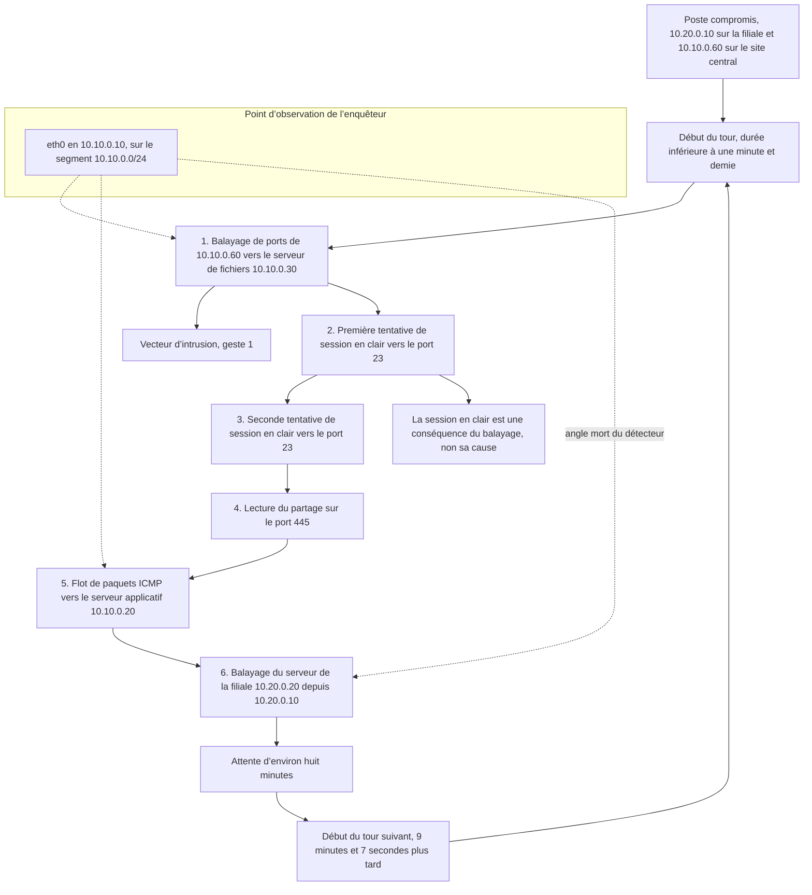
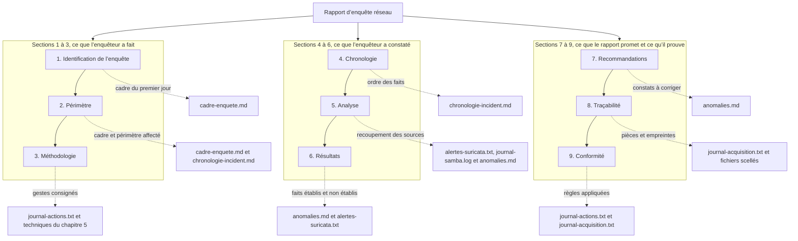

# Forensique réseau — JOUR 3

## Répondre à l’incident et rédiger le rapport d’enquête (14/10/2026)

---

## Comment lire ce support

Chaque chapitre se lit dans le même ordre, et cet ordre n’est jamais modifié : le préambule pose d’abord le problème en langage courant, sans aucune notion technique.
Le vocabulaire en clair traduit ensuite chaque terme avant son premier emploi, afin qu’aucun mot du cours ne reste nu.
Le contenu du chapitre expose les notions et les démontre par une commande, un tableau ou un résultat de laboratoire.
Les techniques, pas à pas expliquent chaque commande avant de la donner, en précisant ce qu’elle mesure, ce que sa sortie prouve et ce qu’elle ne prouve pas.
Le LAB et ses exercices produisent enfin un livrable nommé, que le chapitre suivant consomme.

Cette journée comporte deux chapitres de trois heures, l’un le matin et l’autre l’après-midi ; la pause déjeuner de 12h00 à 13h00 les sépare.
Les deux chapitres forment une chaîne : le premier transforme les anomalies et les alertes produites la veille en une chronologie datée, le second transforme cette chronologie en un rapport d’enquête.

## Objectifs du Jour

À l’issue de cette journée, chaque participant est capable de :

- Isoler une machine compromise sans arrêter son fonctionnement, et dire ce que chaque mesure d’isolement préserve et ce qu’elle détruit.
- Collecter les preuves dans l’ordre de leur disparition, du plus fugitif au plus durable, et appliquer la règle de la copie de travail.
- Tenir un journal des gestes où chaque acte de l’enquêteur figure avec son instant, son auteur et son effet observable.
- Reconstituer le vecteur d’intrusion en remontant des alertes et des journaux jusqu’au premier geste de l’intrus.
- Mesurer la réserve de précision d’une chronologie, en confrontant deux sources indépendantes sur un même événement.
- Rédiger la chronologie de l’incident, la sceller et l’inscrire au journal des acquisitions.

## Planning du Jour

| Chapitre | Créneaux | Module et thème | Volume |
|----------|----------|-----------------|--------|
| C5 | 9h00–12h00 | M5 — Répondre à un incident de sécurité réseau | 3h |
| C6 | 13h00–16h00 | M6 — Rédaction du rapport d’enquête réseau | 3h |
| — | 12h00–13h00 | Pause déjeuner | 1h |

Volume pédagogique : 6 h de formation (3 h et 3 h), 1 h de pause déjeuner.

## Le fil du jour

Cette journée ne part pas de zéro : elle consomme les deux livrables de la journée précédente, le fichier d’anomalies `~/enquete/anomalies.md` et le fichier d’alertes `~/enquete/alertes-suricata.txt`. Ces deux fichiers ont été saisis au clavier par l’enquêteur (aucun outil ne les a produits) à partir des constats établis au jour 2 ; ils proviennent de sources différentes et n’ont encore jamais été réunis dans un même tableau. Le chapitre 5 fait exactement cette réunion, en rangeant les événements par ordre de survenue et en indiquant pour chacun la source qui l’établit et la pièce qui le prouve. Le chapitre 6 ne fera plus que mettre cette chronologie en forme pour un destinataire qui n’a pas participé à l’enquête. Aucun livrable de la journée n’est annoncé sans commande ni saisie : la chronologie du chapitre 5 est saisie au clavier par l’enquêteur à partir d’un gabarit affiché, et le rapport du chapitre 6 est écrit par les blocs de commandes du LAB, qui transcrivent mot pour mot ce que l’enquêteur dicte. Dans les deux cas, aucun outil ne mesure et n’invente le contenu : la mise en ordre reste une responsabilité de l’enquêteur.

| Chapitre | Livrable produit | Consommé par |
|----------|------------------|--------------|
| C5 | `~/enquete/chronologie-incident.md`, complété par son empreinte `~/enquete/chronologie-incident.md.sha256`, par le journal des gestes `~/enquete/journal-actions.txt` et par une ligne de plus dans `~/enquete/journal-acquisition.txt` | C6, qui en tire le rapport d’enquête réseau |
| C6 | `~/enquete/rapport-enquete.md`, complété par son empreinte et par une ligne de plus dans le journal des acquisitions | Restitution de fin de formation |

---

## Chapitre 5 — M5 : Répondre à un incident de sécurité réseau (9h00–12h00)

Ce chapitre couvre le module 5 du programme imposé par le client. Le module énonce quatre décisions : isoler la machine compromise, collecter les preuves, tenir un journal des actions de l’enquêteur, et retracer l’attaque ainsi que son vecteur. Le chapitre suit exactement cet ordre. Les deux premières parties traitent de l’isolement et de la collecte, la troisième du suivi des actions, et la quatrième de la reconstitution du vecteur.

### Préambule — ce qui se joue entre l’alerte et le rapport

Un service hospitalier reçoit un patient qui présente une fièvre. Le médecin ne se lève pas pour annoncer une fièvre : il isole d’abord le malade, parce qu’une fièvre peut se transmettre ; il note ensuite qui est entré dans la chambre et qui a touché quoi ; il vérifie enfin d’où vient l’infection. Trois gestes, dans cet ordre, et le premier n’est jamais d’allumer la centrifugeuse.

L’erreur classique, celle qui condamne une enquête, consiste à faire les gestes dans le désordre. Si l’on éteint le moniteur cardiaque avant d’avoir lu son tracé, on a arrêté la contagion et on a perdu la preuve : la mémoire de l’appareil ne se rallume pas. Sur un réseau, l’équivalent existe et il est quotidien. Un administrateur inquiet coupe le câble de la machine compromise ; ce geste arrête peut-être l’intrus, mais il emporte avec lui tout ce qui n’avait pas encore été mis à l’abri, et il laisse un trou de plusieurs minutes dans l’enquête.

Le réseau ajoute une difficulté propre à l’informatique. Le scénario qui rejoue l’incident dans ce laboratoire revient environ toutes les neuf minutes et sept secondes (9 min 07 s), et il recommencera demain sans demander l’autorisation. L’enquêteur travaille donc sur une scène qui bouge, comme un répondant qui travaille sur un incident qui n’attend pas. Il ne peut pas tout voir ; il doit choisir ce qu’il garde, et il doit écrire ce qu’il a choisi.

Reste une question à laquelle presque personne ne répond vite : qui a fait quoi, et quand. Un geste non écrit est un geste qui n’a pas eu lieu. C’est pour cela que ce chapitre ne commence pas par une commande de capture, mais par une décision écrite, et par un fichier où chaque acte de la journée sera consigné avec son instant et son auteur. Ce fichier sera relu au chapitre suivant, et il y figurera des gestes que l’enquêteur préférera ne pas avoir faits.

### Le vocabulaire en clair

| Terme | En clair | Dans ce chapitre |
|-------|----------|------------------|
| Incident de sécurité | Un événement qui compromet la sécurité d’un système et qui appelle une réponse organisée, avec des décisions prises dans un ordre connu | Le scénario que le poste compromis rejoue toutes les neuf minutes environ |
| Isolement | La coupure du dialogue entre une machine compromise et le reste du réseau, sans arrêter la machine elle-même | La désactivation puis la réactivation de l’interface `eth0` du poste de l’enquêteur |
| Quarantaine | L’état d’une machine dont on a coupé les accès mais que l’on laisse fonctionner, précisément pour que ses traces continuent de se former | Le poste compromis, laissé en service pendant toute la phase de réponse |
| Mémoire volatile | La mémoire de la machine en marche, qui disparaît à l’extinction et qui contient l’essentiel de ce qui était en cours | Le trafic en cours d’enregistrement et les processus ouverts |
| Ordre de volatilité | Le classement des données de la plus fugitive à la plus durable, qui impose l’ordre dans lequel on les collecte | Les cinq catégories du tableau de la partie 2 |
| Journal des gestes | Le texte que l’enquêteur écrit pour tracer chacun de ses actes, avec son instant et son auteur | `~/enquete/journal-actions.txt`, créé par ce chapitre |
| Journal des acquisitions | Le texte qui récapitule les pièces entrées au dossier, avec l’instant, l’auteur, l’objet et l’empreinte | `~/enquete/journal-acquisition.txt`, repris du premier jour |
| Copie de travail | Le duplicata sur lequel l’enquêteur analyse, et sur lequel il ne s’interdit rien ; le fichier d’origine ne s’ouvre jamais | `~/enquete/copie-incident.pcap` |
| Vecteur d’intrusion | Le premier geste posé par l’intrus, qui ouvre la voie ; les gestes suivants n’en sont que les conséquences | Le balayage de ports depuis `10.10.0.60` vers le serveur de fichiers `10.10.0.30` |
| Chaîne d’événements | L’ordre dans lequel des faits datés se succèdent, chacun expliquant le suivant | Les six gestes d’un tour de l’incident |
| Chronologie | Le tableau des événements rangés par instant, chacun avec sa source et la pièce qui le prouve | `~/enquete/chronologie-incident.md` |
| Réserve de précision | La mention qui indique à quelle granularité une chronologie peut réellement être tenue | La note d’horodatage à la seconde |
| Point d’observation | L’endroit précis où la copie du trafic est prise, qui détermine ce que l’on voit et ce que l’on ne voit pas | L’interface `eth0` du poste de l’enquêteur |
| Fenêtre d’observation | L’intervalle pendant lequel la collecte a été active, et pendant lequel rien d’autre n’a été enregistré | Les quelques minutes du LAB |
| Dérive de l’horloge | Le décalage entre l’heure d’une machine et l’heure de référence, qui fausse toute chronologie dès qu’il n’est pas mesuré | L’écart mesuré entre le journal et l’alerte |
| Rappel de réinitialisation | Le redémarrage d’une machine, qui efface sa mémoire volatile en une seconde | Le geste que l’enquêteur s’interdit, et qu’il doit pouvoir justifier |

### Objectifs du chapitre

À la fin du chapitre 5, chaque participant est capable de :

- Énoncer les trois mesures d’isolement, les ranger de la moins destructive à la plus destructive, et justifier ce classement.
- Expliquer pourquoi la fermeture de la capture précède l’arrêt de la machine, et quel en est le risque exact.
- Appliquer la règle de la copie de travail et montrer par deux empreintes successives qu’une copie prise pendant l’écriture n’est plus la source.
- Écrire une ligne de journal des gestes qui décrit un acte réellement accompli, et distinguer l’instant de la décision de l’instant du geste.
- Reconstituer le vecteur d’intrusion à partir des six gestes d’un tour, en indiquant pour chacun la source et la preuve.
- Mesurer l’écart entre deux sources sur un même événement et l’inscrire sous forme de réserve de précision.
- Rédiger, sceller et consigner la chronologie de l’incident, qui devient la matière du rapport du chapitre suivant.

### Répartition du temps

| Partie | Durée |
|---|---|
| Préambule, vocabulaire et objectifs | 12min |
| Contenu du chapitre | 56min |
| Techniques, pas à pas | 34min |
| LAB | 48min |
| Exercices | 30min |

**Total :** 180min.

### Contenu du chapitre (56min)

#### 1. L’isolement : couper le contact sans éteindre la machine (15min)

Isoler, ce n’est pas éteindre. L’isolement consiste à empêcher une machine compromise de dialoguer avec les autres, tout en la laissant fonctionner. La machine qui fonctionne continue d’écrire ses journaux, continue de répondre, et continue donc de produire des traces : c’est la condition pour que l’enquête puisse remonter à son origine. Une machine éteinte, elle, a produit sa dernière ligne et s’est tue.

Trois mesures sont possibles, et elles ne se valent pas. Un enquêteur pressé choisit souvent la troisième, parce qu’elle est la plus rapide et la plus spectaculaire : elle arrête tout, y compris la preuve. Un enquêteur formé choisit la première quand il le peut, et il n’en vient à la deuxième que lorsque la première ne suffit plus.

| Mesure | Ce qu’elle coupe | Ce qu’elle détruit | Ce qu’elle laisse en place |
|--------|------------------|---------------------|-----------------------------|
| Fermeture des comptes et révocation des accès | L’usage des identifiants par l’intrus | Rien : les journaux restent intacts | La machine continue de tourner, donc les traces continuent de se former |
| Isolement réseau du poste | Tout dialogue entre le poste et les autres machines | Le trafic qui va et vient, donc les prochaines observations | La mémoire de la machine, et la possibilité de l’interroger par la suite |
| Arrêt de la machine | Le dialogue, comme la mesure précédente | La mémoire volatile : processus ouverts, sessions établies, clés en mémoire | Les seuls fichiers écrits sur le disque |

Le passage de la première ligne à la deuxième se décide sur un critère simple : l’intrus change-t-il d’accès ou change-t-il de machine ? S’il reste sur le poste et cherche d’autres comptes, la fermeture des comptes suffit. S’il cherche d’autres machines, il faut couper le dialogue, et le poste doit sortir du réseau.

L’isolement a un coût que peu de gens énoncent : il crée un angle mort. Une machine isolée ne parle plus, donc elle ne montre plus rien. L’enquêteur perd la vue au moment précis où il en a le plus besoin, et il doit donc avoir collecté avant d’isoler, jamais après. Cet ordre n’est pas une préférence : c’est une condition de travail.

| Ce qui est en jeu | Fermeture des comptes | Isolement réseau | Arrêt de la machine |
|------------------|------------------------|------------------|----------------------|
| Les fichiers écrits sur le disque | Préservés | Préservés | Préservés |
| La mémoire de la machine | Préservée | Préservée | Perdue |
| Le trafic à venir | Interrompu pour les comptes révoqués | Interrompu | Interrompu |
| La possibilité de remonter au vecteur | Conservée | Conservée | Conservée, mais l’instant de la coupure disparaît |
| La qualité du dossier | Intacte | Diminuée | Détruite si la collecte n’est pas achevée |

L’anomalie de segmentation du laboratoire appartient à cette partie, et non à une autre. Le poste compromis porte deux adresses : `10.20.0.10` sur le segment de la filiale et `10.10.0.60` sur le segment du site central. Une machine de la filiale ne devrait pas joindre directement les serveurs du site central. Cette double appartenance est la raison pour laquelle l’intrus, parti de la filiale, a pu atteindre le serveur de fichiers et le serveur applicatif du site central sans passer par aucune passerelle. Corriger cette faiblesse de conception ne fait pas partie de la réponse immédiate, mais la signaler fait partie du rapport : une récidive est prévisible tant que la porte reste ouverte.

Un enquêteur ne fait pas lui-même ce travail de correction. Il n’administre pas le poste compromis, il ne dispose d’aucun droit sur lui, et il ne doit surtout pas l’ouvrir. Dans le laboratoire, la seule machine dont il a la charge est son propre poste ; c’est donc là qu’il applique la mesure, et il vérifie sur elle ce que le module demande de vérifier : que le contact est coupé, que l’acquis est intact, et que la remise en service est effective.

```bash
ping -c 2 -W 1 10.10.0.60 > /dev/null && printf 'contact établi\n'
sudo ip link set eth0 down
ip -brief link show eth0
ping -c 1 -W 1 10.10.0.60 > /dev/null 2>&1 || printf 'contact coupé\n'
sudo ip link set eth0 up
sleep 2
ping -c 2 -W 1 10.10.0.60 > /dev/null && printf 'contact rétabli\n'
```

> **Résultat attendu :** quatre lignes, dans cet ordre. La première annonce que le contact est établi, la deuxième est l’état de l’interface, qui affiche `DOWN` entre crochets, la troisième annonce que le contact est coupé, et la quatrième annonce qu’il est rétabli. Les trois dernières commandes doivent être exécutées ensemble : si le poste était laissé déconnecté par une interruption, il le resterait jusqu’à la remise en service manuelle.
>
> Ce que la démonstration prouve, et c’est ce que le module demande : une coupure de contact est réversible, elle ne demande pas d’arrêter la machine, et elle n’efface rien de ce qui a déjà été observé. Ce qu’elle ne prouve pas : que le poste compromis lui-même a été isolé. L’enquêteur n’a pas ce pouvoir, et il doit l’écrire dans son dossier plutôt que de le laisser croire.

#### 2. La collecte : ce qui se conserve, dans quel ordre, avec quelle horodatation (14min)

Une donnée réseau ne se garde pas toute seule. Elle s’efface : les journaux tournent, les connexions se referment, la mémoire disparaît à l’extinction. La collecte consiste donc à choisir, et le choix se fait dans un ordre imposé par la nature des données. Cet ordre s’appelle l’ordre de volatilité, et il va du plus fugitif au plus durable.

| Rang | Ce qui se collecte | Pourquoi avant le reste | Où la copie de travail reste |
|------|--------------------|--------------------------|------------------------------|
| 1 | Le trafic en cours, tel qu’il passe au point d’observation | Il n’existe qu’en mémoire et ne se rejoue pas | `~/enquete/incident.pcap` |
| 2 | L’état des processus ouverts et des connexions établies | Il change à chaque instant et ne se reconstitue pas | Fichiers d’état, sur le poste de l’enquêteur |
| 3 | Les journaux déjà écrits par les machines | Ils sont bornés en taille et peuvent être remplacés | `~/journal/journal-reseau.log`, `~/journal/journal-samba.log`, `~/suricata/eve.json` |
| 4 | Les fichiers du dossier de travail | Ils ne changent que si l’on y touche | `~/enquete/anomalies.md`, `~/enquete/alertes-suricata.txt` |
| 5 | La configuration réseau et les règles de détection | Elles changent rarement et se sauvegardent seules | `~/enquete/inventaire-hotes.txt`, `~/enquete/regle-essai.rules` |

Chaque collecte porte trois exigences, et elles ne sont pas négociables. D’abord une copie, jamais le fichier lui-même. Ensuite un horodatage, parce qu’une donnée sans heure n’a pas de place dans une chronologie. Enfin une empreinte, calculée sur la copie et jamais inscrite dedans.

La règle de la copie a une conséquence que beaucoup découvrent trop tard : le fichier d’origine ne s’ouvre pas. Il se relit, il se compare, il se duplique ; il ne s’édite pas. L’analyse se fait sur la copie de travail, sur laquelle l’enquêteur peut tout, y compris se tromper, parce que l’original reste intact et que son empreinte le prouve. Deux empreintes prises à deux moments différents sur l’original donnent la même valeur tant que personne n’y touche : c’est la démonstration la plus simple qu’aucune lecture ne l’a modifié.

```bash
ls -lt --time-style=full-iso ~/enquete
cat ~/enquete/journal-acquisition.txt
cp --preserve=timestamps ~/enquete/anomalies.pcap ~/enquete/copie-anomalies.pcap
sha256sum ~/enquete/anomalies.pcap ~/enquete/copie-anomalies.pcap
sha256sum -c ~/enquete/anomalies.pcap.sha256
rm -f ~/enquete/copie-anomalies.pcap
```

> **Résultat attendu :** la première commande rend les pièces du dossier avec leur date et leur heure à la seconde, et ces heures sont décroissantes de la première ligne à la dernière : la liste présente donc les pièces de la plus récente à la plus ancienne, et l’ordre réel du scellement se lit en remontant la liste. La deuxième rend les lignes du journal des acquisitions, qui sont au contraire dans l’ordre chronologique, de la plus ancienne à la plus récente. Les deux lectures ne se contredisent pas : elles donnent le même dossier dans deux sens de lecture, et c’est cette confrontation qui prouve que le journal a bien été tenu dans l’ordre des acquisitions. Les deux empreintes calculées ensuite sont identiques, et la commande de vérification répond que le fichier d’origine est conforme à son sceau. La dernière commande efface la copie jetable.
>
> Ce que la démonstration prouve : que l’ordre de collecte n’est pas une théorie, qu’il est lisible dans le dossier et dans le journal. Ce qu’elle ne prouve pas : que le dossier soit complet. Le journal des acquisitions ne recense que quatre objets, alors que le dossier en contient davantage : cet écart est lui-même un constat, et le chapitre le reprend dans la partie suivante.

Un piège mérite d’être montré parce qu’il revient dans tous les dossiers. Une copie prise pendant que le fichier source s’écrit n’est plus la source : elle est figée à l’instant de la copie, et l’original continue de grossir. Les deux empreintes divergeaient alors, non parce que la copie était fausse, mais parce qu’elles ne décrivent pas le même instant. Le LAB montre ce cas à l’étape 4, puis montre l’ordre correct.

> **Règle de conservation — une preuve n’est jamais reinterpretée après coup.**
>
> Toute reprise de l’interprétation d’une pièce se fait sur la copie de travail, et toute correction du fichier d’origine se traduit par une nouvelle ligne du journal des acquisitions, qui porte l’instant, l’auteur, l’objet et la nouvelle empreinte. Le sceau initial reste dans le dossier : c’est lui qui prouve que la pièce existait déjà sous cette forme.

#### 3. Le suivi des actions : tenir le journal des gestes (14min)

Un dossier d’enquête tient sur deux journaux, et il faut les distinguer. Le journal des acquisitions recense les pièces : il dit ce qui est entré au dossier et sous quelle empreinte. Le journal des gestes recense les actes : il dit ce que l’enquêteur a fait, quand, et ce que son geste a produit comme effet. Le premier est une liste d’objets ; le second est un récit. Une enquête sans le second est un inventaire, et un inventaire ne dit jamais ce que l’enquêteur a fait de son temps.

Le journal des gestes se tient en trois champs : l’instant, l’auteur, le geste. L’instant s’écrit en temps universel et à la seconde, comme tout le reste du dossier. L’auteur porte le compte qui a agi, et non le service qui aurait dû agir. Le geste se formule au passé, parce qu’il décrit un fait accompli, et jamais au futur, parce qu’un projet n’est pas un fait.

| Ce que le journal note | Ce qu’il ne note pas | Pourquoi cette limite |
|------------------------|----------------------|------------------------|
| L’instant exact du geste, à la seconde | La durée du geste | Une durée dépend de l’outil qui la mesure, et l’outil change |
| L’auteur du geste | L’intention de l’auteur | Une intention ne se prouve pas, et l’écrire engage la personne qui le signe |
| L’effet observable du geste | L’interprétation de cet effet | L’interprétation appartient à l’analyse, qui vient plus tard et se corrige |
| La décision prise avant le geste | Le raisonnement qui l’a motivée | Le raisonnement se défend oralement ; la décision, elle, se vérifie sur pièces |

La règle qui gouverne ce journal tient en une phrase : la décision s’écrit avant, le geste s’écrit après. Avant, parce qu’une décision non écrite est une décision que personne ne pourra discuter. Après, parce qu’un geste consigné avant d’être accompli décrit une intention, et qu’une intention devient un faux dès qu’elle échoue. Cette asymétrie est la même que celle du procès-verbal : on note l’ordre avant de l’exécuter, on note le résultat après l’avoir obtenu.

Un écart mérite d’être relevé dès ce matin. Le dossier de travail contient plus de pièces que le journal des acquisitions n’en recense, parce que les chapitres du jour 2 ont scellé leurs livrables sans tous les inscrire au journal. Rien n’est perdu, et aucune preuve n’est compromise : les empreintes existent et se vérifient. Mais le journal des acquisitions ne peut pas être tenu comme une description complète du dossier, et le rapport devra le dire plutôt que de le laisser entendre.

> **Concept clé — un geste non écrit est un geste qui n’a pas eu lieu.**
>
> Trois heures après les faits, un enquêteur qui n’a rien écrit ne peut plus démontrer que son ordre de travail était le bon. Il peut le raconter, et ce qu’il raconte n’a plus de valeur probante. Le journal des gestes ne sert pas à surveiller l’enquêteur : il sert à rendre son travail contestable, ce qui est la seule garantie qu’il ait été sérieux.

```bash
printf '%s | %s | %s\n' "$(date -u +%Y-%m-%dT%H:%M:%SZ)" "enqueteur" "ouverture du journal des gestes de l’enquêteur" >> ~/enquete/journal-actions.txt
cat ~/enquete/journal-actions.txt
```

> **Résultat attendu :** le fichier `~/enquete/journal-actions.txt` n’existait pas ; après la première commande, il tient sur une seule ligne de trois champs séparés par une barre verticale, le premier étant un instant en temps universel, le second le compte `enqueteur`, le troisième la formulation du geste. Une seconde exécution ajoute une seconde ligne et n’écrase jamais la première : c’est la différence entre un journal et un fichier réécrit.
>
> Ce que la démonstration prouve : que le journal s’ajoute, se lit et se conserve. Ce qu’elle ne prouve pas : que les gestes notés sont exacts. Cette exactitude est la responsabilité de l’enquêteur, et c’est précisément pourquoi la formulation au passé est une règle et non une habitude.

#### 4. Le vecteur d’intrusion : remonter de l’alerte à la cause (13min)

Le vecteur d’intrusion est le chemin par lequel l’intrus est entré. Le trouver, c’est identifier le premier geste qu’il a posé, et non le geste le plus spectaculaire. Dans ce laboratoire, le scénario rejoue six gestes dans un ordre constant : un balayage de ports depuis `10.10.0.60` vers le serveur de fichiers `10.10.0.30`, deux tentatives de session en clair vers le port 23 de ce même serveur, une lecture du partage sur le port 445, un flot de paquets ICMP vers le serveur applicatif `10.10.0.20`, et enfin un balayage du serveur de la filiale `10.20.0.20` depuis l’interface `10.20.0.10` du poste compromis.

Le premier de ces gestes est le vecteur. Le second ne l’est pas, et cette distinction doit être écrite noir sur blanc : une tentative de session en clair prouve qu’un service était demandé, elle ne prouve pas que c’est par lui que l’intrus est entré. Le seul moyen de trancher est l’ordre : si la tentative vient après le balayage qui a découvert le port, elle en est la conséquence, non la cause.

| Geste du tour | Source qui l’établit | Pièce qui le prouve | Ce qu’il ne prouve pas |
|---------------|----------------------|---------------------|------------------------|
| Balayage de ports vers `10.10.0.30` depuis `10.10.0.60` | Journal d’actions du poste compromis | `~/journal/journal-reseau.log` | Que le port visé était ouvert, ni que le balayage ait réussi |
| Deux tentatives de session en clair sur le port 23 | Journal d’actions et alertes de la règle 9000002 | `~/journal/journal-reseau.log`, `~/suricata/eve.json` | Que le compte a été ouvert, ni que ce service est le vecteur |
| Lecture du partage sur le port 445 | Journal d’accès du serveur de fichiers | `~/journal/journal-samba.log` | L’adresse de la machine : le journal ne nomme qu’un nom NetBIOS |
| Flot de paquets ICMP vers `10.10.0.20` | Journal d’actions et alertes de la règle 9000004 | `~/journal/journal-reseau.log`, `~/suricata/eve.json` | Un accès obtenu : ce geste consomme une ressource, il n’en ouvre aucune |
| Balayage vers `10.20.0.20` depuis `10.20.0.10` | Journal d’actions du poste compromis | `~/journal/journal-reseau.log` | Qu’il ait été observé : aucune alerte ne porte d’adresse de la filiale |

Une difficulté de lecture guette la reconstruction, et elle a déjà été rencontrée la veille. Sur les alertes de session en clair, l’adresse d’origine est celle du serveur de fichiers et l’adresse de destination est celle du poste compromis : le sens du flux est inversé par rapport à l’intrusion, parce que c’est le serveur qui émet l’invite. Un lecteur qui ne ferait pas attention conclurait que le serveur attaque le poste. La règle est simple et elle s’applique à toutes les alertes : on lit d’abord le sens, ensuite seulement on conclu.

Une seconde difficulté tient à la précision. Les journaux enregistrent l’heure à la seconde, et les alertes portent une fraction de seconde que le journal ne conserve pas. Confronter les deux sources sur un même événement donne donc un écart, dont la mesure borne la finesse de la chronologie. Cet écart se mesure, il ne se devine pas.

```bash
grep 'poste-compromis' ~/journal/journal-reseau.log | grep -vE 'démarré|tour terminé' | head -n 6
jq -r 'select(.event_type=="alert") | [.timestamp, .alert.signature_id, .src_ip, .dest_ip, .dest_port] | @tsv' ~/suricata/eve.json | grep -v '10\.10\.0\.10' | head -n 8
```

> **Résultat attendu :** la première commande rend six lignes, qui sont exactement les six gestes d’un tour, dans l’ordre : le balayage depuis `10.10.0.60`, les deux tentatives en clair vers le port 23, la lecture du partage, le flot de paquets, puis le balayage de la filiale depuis `10.20.0.10`. Les six appartiennent au même tour et les six portent un instant. La seconde commande rend les premières alertes utiles : cinq alertes de la règle 9000001 portant l’adresse `10.10.0.60`, puis des alertes de la règle 9000002 dont l’adresse d’origine est `10.10.0.30`, celle du serveur de fichiers, ce qui inverse le sens apparent du dialogue. Le filtre sur l’adresse de l’enquêteur écarte les alertes qui lui appartiennent et qui viennent des reproductions faites au chapitre précédent.
>
> Ce que la démonstration prouve : que les deux sources racontent le même tour et qu’elles concordent sur l’ordre. Ce qu’elle ne prouve pas : que les six gestes se suivent sur une seule machine. Le journal les attribue au poste compromis par son étiquette, et c’est cette attribution, non leur proximité dans le temps, qui fait la liaison.

> **Piège — le vecteur est le premier geste, jamais le plus lourd.**
>
> La règle 9000004, celle du flot de paquets, produit l’immense majorité des alertes de ce laboratoire. Un dossier qui suit le volume conduit donc à lire le déni de service et à passer à côté du balayage, qui est le geste d’ouverture. Une chronologie se construit sur l’ordre, et le volume n’y joue aucun rôle.

Les quatre parties de ce chapitre décrivent toutes le même tour : leur ordre fait seul le sens. La figure ci-dessous rassemble cet ordre et situe le point d’observation de l’enquêteur par rapport aux six gestes. Le schéma se lit de haut en bas pour la chronologie des gestes, puis se relit de bas en haut pour la boucle qui ramène au tour suivant ; les trois traits en pointillés, eux, se lisent du nœud de gauche vers les gestes, et répondent à une autre question, celle de ce que le poste de l’enquêteur voit réellement.



**Fig 1 — Les six gestes d’un tour de l’incident, et ce que le point d’observation de l’enquêteur en voit.**

Ce que la figure ne montre pas : ni la durée de chaque geste, ni la seconde exacte de son exécution, que seuls les journaux d’actions donnent. Elle ne montre pas les huit minutes d’attente autrement que par une case sans aucun geste. Enfin, elle désigne le vecteur au geste 1 ; le geste 2 n’en est pas la cause, il en est la conséquence, et le trait qui les relie dit précisément cela.

### Les techniques, pas à pas

Six techniques composent le travail de ce chapitre. Les deux premières ouvrent l’enquête et la maintiennent ouverte, les deux suivantes la rendent vérifiable, les deux dernières la rendent communicable.

| Technique | Ce qu’elle fait | Durée |
|-----------|------------------|-------|
| 1 — Inventorier les pièces et vérifier leur intégrité | Constater ce que le dossier contient et prouver que rien n’a été réécrit | 6min |
| 2 — Ouvrir la capture d’incident avant tout geste | Créer la pièce qui ne se rejoue pas, et l’ouvrir avant toute action | 6min |
| 3 — Copier la preuve sans la modifier | Appliquer la règle de la copie de travail et montrer le cas de la copie prise pendant l’écriture | 6min |
| 4 — Mesurer une mise en quarantaine | Couper le contact, vérifier l’effet, vérifier que l’acquis est intact, rétablir | 6min |
| 5 — Extraire le vecteur | Reconstituer la suite des gestes d’un tour et identifier le premier | 5min |
| 6 — Mesurer l’écart entre deux sources | Borner la précision de la chronologie en confrontant le journal et l’alerte | 5min |

**Technique 1 — Inventorier les pièces et vérifier leur intégrité (6min)**

Ce qu’elle mesure : la composition du dossier de travail, et le fait que chaque pièce est identique à celle qui a été scellée.

```bash
ls -lt --time-style=full-iso ~/enquete
sha256sum -c ~/enquete/*.sha256
cat ~/enquete/journal-acquisition.txt
```

La première commande liste les pièces avec leur taille et l’instant de leur dernière écriture ; l’option `-t` demande le tri par date de la plus récente à la plus ancienne, et l’option `--time-style=full-iso` demande la date et l’heure complètes plutôt qu’une date seule. Sans `-t`, la commande trierait les pièces par nom et l’ordre du dossier ne dirait rien de l’ordre de collecte. La deuxième demande à chaque fichier d’empreinte de recalculer la valeur de son objet et de la comparer à celle qu’il contient ; le modèle `*.sha256` désigne tous les fichiers de sceau du dossier. La troisième lit le journal des acquisitions.

Ce que la sortie prouve : que les pièces produites les deux premiers jours sont intactes, et que leurs heures d’écriture sont croissantes. Ce qu’elle ne prouve pas : que ces pièces ont été produites correctement, ni qu’elles sont complètes. Une empreinte atteste qu’un fichier n’a pas bougé ; elle ne dit pas d’où il vient.

**Technique 2 — Ouvrir la capture d’incident avant tout geste (6min)**

Ce qu’elle produit : la pièce la plus fugitive du dossier, celle qui n’existera plus dans les mêmes conditions.

```bash
sudo tcpdump -i eth0 -w ~/enquete/incident.pcap -s 0 -n -U &
sleep 2
ip -brief address show
ls -l ~/enquete/incident.pcap
capinfos -c ~/enquete/incident.pcap
sudo pkill -INT -x tcpdump
sleep 3
sudo rm -f ~/enquete/incident.pcap
```

L’option `-i eth0` désigne l’interface d’observation, `-w` écrit dans un fichier au lieu d’afficher, `-s 0` enregistre la trame entière, `-n` interdit la résolution des noms, et `-U` écrit chaque paquet sans attendre le tampon : la capture reste lisible pendant qu’elle s’écrit, ce qui permet de vérifier l’acquisition à tout instant. La pause de deux secondes laisse à la capture le temps de s’installer, et la commande de métadonnées relit le fichier pendant qu’il grossit. Les trois dernières commandes referment la démonstration et effacent son fichier : une capture laissée ouverte, puis rouverte sur le même nom par le LAB, produirait deux processus écrivant dans le même fichier, et la capture scellée deviendrait illisible. Un fichier de capture n’admet qu’un seul rédacteur à la fois.

Ce que la sortie prouve : que l’enregistrement est ouvert sur le segment du site central, que le fichier existe, et qu’il se referme proprement sur commande. Ce qu’elle ne prouve pas : que le fichier contienne l’incident. Le scénario ne produit un tour que toutes les neuf minutes environ, et une capture de quelques minutes contient surtout les échanges de l’enquêteur ; c’est un résultat, et non un échec.

**Dépannage :** si la commande de métadonnées affiche `appears to be damaged or corrupt` ou `cut short in the middle of a packet`, elle a lu le fichier au moment exact où l’en-tête du paquet suivant était écrit mais pas encore son contenu. Elle s’arrête alors sur ce paquet et rend un code de sortie non nul. Ce message décrit une lecture interrompue, pas une capture perdue : attendre une seconde et relancer la commande. Ce n’est qu’à la fermeture que la lecture est fiable, et c’est pourquoi le LAB ne mesure le contenu de la capture qu’à l’étape 4.

**Technique 3 — Copier la preuve sans la modifier (6min)**

Ce qu’elle mesure : si une copie est fidèle à sa source, et ce que devient la comparaison quand la source est encore en train de s’écrire.

```bash
sudo tcpdump -i eth0 -w ~/enquete/essai.pcap -s 0 -n -U &
sleep 2
cp ~/enquete/essai.pcap ~/enquete/essai-fige.pcap
sudo ping -c 4 -i 0.3 -W 1 10.10.0.30 > /dev/null
sleep 2
sha256sum ~/enquete/essai.pcap ~/enquete/essai-fige.pcap
sudo pkill -INT -x tcpdump
sleep 3
sudo chown enqueteur:enqueteur ~/enquete/essai.pcap
cp --preserve=timestamps ~/enquete/essai.pcap ~/enquete/essai-final.pcap
sha256sum ~/enquete/essai.pcap ~/enquete/essai-final.pcap
sudo rm -f ~/enquete/essai.pcap ~/enquete/essai-fige.pcap ~/enquete/essai-final.pcap
```

Les six premières commandes montrent le cas à éviter : la copie est prise alors que l’enregistrement continue, puis quatre échanges sont produits, et les deux empreintes diffèrent. Les trois suivantes montrent l’ordre correct : on ferme la capture, on remet le fichier à l’enquêteur, on copie avec l’option `--preserve=timestamps` qui conserve la date de la source, et les deux empreintes coïncident. L’option `-INT` de la commande d’arrêt demande l’arrêt propre, qui écrit le dernier paquet et rend le fichier lisible par tous les outils.

Ce que la sortie prouve : qu’une copie n’est fidèle qu’à un instant précis, et que cet instant doit être postérieur à la fermeture de la source. Ce qu’elle ne prouve pas : que la copie ait été tronquée. Dans le premier cas, la copie est complète à l’instant où elle a été prise ; c’est la source qui a continué.

**Technique 4 — Mesurer une mise en quarantaine (6min)**

Ce qu’elle mesure : l’effet d’une coupure de contact sur la joignabilité, sur la continuité de l’enregistrement et sur l’intégrité de ce qui est déjà acquis.

```bash
sudo tcpdump -i eth0 -w ~/enquete/incident.pcap -s 0 -n -U &
sleep 2
sudo ping -c 4 -i 0.3 -W 1 10.10.0.30 > /dev/null
sleep 1
capinfos -c ~/enquete/incident.pcap
ping -c 2 -W 1 10.10.0.60 > /dev/null && printf 'contact établi\n'
sudo ip link set eth0 down
ip -brief link show eth0
ping -c 1 -W 1 10.10.0.60 > /dev/null 2>&1 || printf 'contact coupé\n'
sleep 2
capinfos -c ~/enquete/incident.pcap
sudo ip link set eth0 up
sleep 2
ip -brief address show
ping -c 2 -W 1 10.10.0.60 > /dev/null && printf 'contact rétabli\n'
sudo ping -c 4 -i 0.3 -W 1 10.10.0.30 > /dev/null
sleep 1
capinfos -c ~/enquete/incident.pcap
sha256sum ~/enquete/incident.pcap
sudo pkill -INT -x tcpdump
sleep 3
sudo chown enqueteur:enqueteur ~/enquete/incident.pcap
sudo rm -f ~/enquete/incident.pcap
```

La coupure et la remise en service se font sur l’interface `eth0`, celle qui porte le trafic du site central et celle sur laquelle l’enregistrement est ouvert. Cette mesure n’a de sens que sur un enregistrement en cours : la démonstration ouvre donc sa propre capture, la referme à la fin et efface son fichier, exactement comme la technique précédente. Les trois commandes de métadonnées encadrent la manipulation : elles donnent le nombre de paquets avant, pendant et après. L’empreinte affichée à la fin n’a pas, à elle seule, valeur de contrôle : elle est la valeur de référence que le LAB scellera à l’étape 4, et c’est en la comparant à l’empreinte scellée que l’on saura si le fichier a été réécrit depuis.

Ce que la sortie prouve : que le contact est effectivement coupé pendant la mesure et qu’il est rétabli après, et que l’enregistrement a continué pendant la coupure, puisque les trois mesures montrent un fichier alimenté. Ce qu’elle ne prouve pas, à elle seule : que le fichier n’a pas été modifié. Cette preuve appartient à l’étape 4 du LAB, qui scelle la capture puis en vérifie l’empreinte.

Une réserve s’impose sur le nombre de paquets affiché. Ces trois mesures se font sur un fichier que le moteur d’acquisition est en train d’écrire, et la commande de métadonnées peut alors s’arrêter sur un paquet dont l’en-tête est écrit et le contenu pas encore : elle affiche un avertissement de fichier tronqué et rend un nombre inférieur au nombre réel. Un nombre qui semble reculer d’une mesure à l’autre n’est donc pas la preuve d’une perte : c’est la trace d’une lecture interrompue. C’est une distinction que l’enquêteur doit écrire telle quelle dans son dossier : une mesure incertaine ne se remplace pas par une affirmation.

Ce qu’elle ne prouve pas : que le poste compromis ait été isolé. Cette mesure est appliquée au poste de l’enquêteur, la seule machine dont il a la charge. Elle illustre la mesure ; elle ne la déclare pas exécutée sur la machine compromise, et le dossier doit distinguer les deux.

**Technique 5 — Extraire le vecteur d’intrusion (5min)**

Ce qu’elle mesure : la suite des gestes d’un tour, et l’ordre dans lequel ils se produisent.

```bash
grep 'poste-compromis' ~/journal/journal-reseau.log | grep -vE 'démarré|tour terminé' | head -n 6
jq -r 'select(.event_type=="alert") | [.timestamp, .alert.signature_id, .src_ip, .dest_ip, .dest_port] | @tsv' ~/suricata/eve.json | grep -v '10\.10\.0\.10' | head -n 8
```

La première commande isole les lignes du journal d’actions du poste compromis, écarte les deux messages de bord qui ouvrent et ferment le tour, et affiche les six gestes restants. La seconde isole les alertes, en retire les cinq champs utiles et écarte les alertes dont une extrémité porte l’adresse du poste de l’enquêteur : elles viennent des reproductions du chapitre précédent et ne sont pas de l’incident.

Ce que la sortie prouve : que le vecteur est le balayage de ports, et qu’il est suivi d’une exploitation d’un service découvert. Ce qu’elle ne prouve pas : que ce service ait été exploité avec succès. Deux tentatives de session en clair ne sont pas une attaque par force brute, et le dossier doit le dire.

**Technique 6 — Mesurer l’écart entre deux sources sur un même événement (5min)**

Ce qu’elle mesure : la dérive entre l’heure d’un journal et l’heure d’une alerte pour un événement que les deux sources décrivent.

```bash
j=$(grep -m1 'tentative Telnet 1' ~/journal/journal-reseau.log | awk '{print $4}')
js=$(date -d "$j" +%s)
a=$(jq -r 'select(.event_type=="alert" and .alert.signature_id==9000002) | .timestamp' ~/suricata/eve.json | while read -r t; do if [ "$(date -d "$t" +%s)" -ge "$js" ]; then echo "$t"; break; fi; done)
printf 'journal : %s\nalerte : %s\n' "$j" "$a"
printf 'écart en secondes entières : %s\n' "$(( $(date -d "$a" +%s) - $(date -d "$j" +%s) ))"
```

La première commande isole la première tentative de session en clair du journal et en extrait le quatrième champ, qui porte l’instant propre au message. La deuxième convertit cet instant en un nombre de secondes écoulées depuis 1970. La troisième parcourt les alertes de la règle 9000002 et retient la première qui est postérieure ou égale à cet instant : l’appariement se fait donc sur le temps, et non sur l’ordre d’arrivée dans le fichier.

Cet appariement est indispensable, et voici pourquoi. La règle 9000002 se déclenche sur le mot `login` que le serveur en clair renvoie à toute connexion reçue sur le port 23. Or le balayage de ports du scénario utilise une connexion complète sur le port 23 : il produit donc lui aussi une alerte de cette règle, avant la première tentative de session. Prendre la première alerte du fichier — et c’est le raccourcit que l’on écrit spontanément — apparierait la ligne du journal sur l’alerte du balayage, et afficherait un écart de l’ordre de neuf secondes, sans aucun rapport avec la dérive des deux horloges. Un écart ainsi obtenu ne mesurerait pas la fiabilité des sources : il mesurerait une erreur d’appariement. Vérifier ce que l’on compare est la première qualité d’un enquêteur.

Ce que la sortie prouve : que les deux sources placent le même événement dans la même seconde, ou dans deux secondes consécutives. Ce qu’elle ne prouve pas : que l’écart est nul. Le journal n’enregistre pas la fraction de seconde, donc la mesure donne une borne, pas une valeur : l’écart réel est au plus d’une seconde et demie. C’est cette borne qui doit être écrite dans la chronologie.

> **Résultat attendu :** cinq lignes de texte. Les deux premières affichent l’instant du journal et l’instant de l’alerte appariée ; l’instant de l’alerte porte une fraction de seconde que le journal ne conserve pas. La dernière ligne donne l’écart en secondes entières, qui vaut zéro ou un. Un écart de neuf secondes, ou plus, ne signale pas une dérive d’horloge : il signale que les deux lignes ne décrivent pas le même événement, et il faut alors reprendre l’appariement.

### LAB — Répondre à l’incident et produire la chronologie (48min)

#### Prérequis

Ce LAB est le point de convergence des deux premiers jours. Il ne peut pas commencer tant que les deux livrables de la veille ne sont pas disponibles et intacts : `~/enquete/anomalies.md`, qui porte les quatre anomalies et leurs filtres, et `~/enquete/alertes-suricata.txt`, qui porte la répartition des alertes par règle, leur croisement avec les adresses d’origine et l’angle mort du détecteur sur la filiale. Le fichier `~/enquete/journal-acquisition.txt`, créé le premier jour, doit contenir au moins une ligne.

```bash
sha256sum -c ~/enquete/anomalies.md.sha256
sha256sum -c ~/enquete/alertes-suricata.txt.sha256
ls -l ~/enquete/
```

Si l’une des deux empreintes ne se vérifie plus, le LAB s’arrête : une chronologie bâtie sur une pièce réécrite n’a aucune valeur, et l’écart doit être constaté et consigné avant toute autre chose. Si une pièce manque, le laboratoire n’a pas été monté dans son état normal et le formateur remet le laboratoire en place.

#### Environnement

| Élément | Valeur |
|---------|--------|
| Poste de l’enquêteur | Compte ordinaire `enqueteur`, adresses `10.10.0.10` sur le site central et `10.20.0.30` sur la filiale |
| Interface d’observation | `eth0`, segment `10.10.0.0/24` |
| Point d’isolement du LAB | `eth0` du poste de l’enquêteur, seule machine dont il a la charge |
| Poste compromis | `10.20.0.10` sur la filiale, également joignable en `10.10.0.60` sur le site central |
| Serveur de fichiers | `10.10.0.30` — port 23 en clair, ports 139 et 445 |
| Serveur applicatif | `10.10.0.20` — ports 22, 80 et 443 |
| Serveur de la filiale | `10.20.0.20` — ports 22 et 80 |
| Sources de journaux | `~/journal/journal-reseau.log`, `~/journal/journal-samba.log`, `~/suricata/eve.json`, en lecture seule |
| Outils du LAB | `tcpdump`, `capinfos`, `jq`, `grep`, `awk`, `ip`, `ping`, `sha256sum`, `date` |
| Durée totale | 48 minutes |

#### Étapes du LAB

**Étape 1 — Faire l’inventaire des pièces et ouvrir le journal des gestes (8min)**

L’enquêteur ne commence jamais par une action : il commence par savoir ce qu’il a, et par ouvrir le registre où il notera ce qu’il fera.

```bash
ls -lt --time-style=full-iso ~/enquete
sha256sum -c ~/enquete/*.sha256
cat ~/enquete/journal-acquisition.txt
printf '%s | %s | %s\n' "$(date -u +%Y-%m-%dT%H:%M:%SZ)" "enqueteur" "inventaire des pièces, ouverture du journal des gestes" >> ~/enquete/journal-actions.txt
cat ~/enquete/journal-actions.txt
```

> **Résultat attendu :** la première commande rend les pièces du dossier avec leur date et leur heure, dans un ordre chronologique croissant. La deuxième rend une ligne par fichier de sceau, chacune terminée par la mention `OK` ; le laboratoire en compte six à l’issue du jour 2, et davantage si un livrable a été scellé plusieurs fois. La troisième rend les lignes du journal des acquisitions, quatre au moins, chacune terminée par une empreinte. Les deux dernières commandes créent `~/enquete/journal-actions.txt`, qui tient alors sur une ligne de trois champs, et l’affichent. Le dossier ne contient encore aucun fichier de sceau nommé `journal-actions.txt.sha256` : c’est normal, un journal de gestes se scelle à la fin de la journée, pas geste par geste.

**Dépannage :** si une ligne se termine par `FAILED` plutôt que par `OK`, la pièce a été modifiée après son scellement : ne pas poursuivre, recalculer l’empreinte et inscrire la modification au journal des acquisitions. Si le fichier `~/enquete/journal-actions.txt` existe déjà, deux cas sont possibles : soit la démonstration de la partie 3 l’a créé, ce qui est normal et sans conséquence, soit le LAB a été commencé deux fois. Le seul indice qui distingue les deux est la répétition d’une même ligne d’inventaire dans le fichier. Dans les deux cas, le fichier s’ajoute ligne par ligne et il ne faut pas l’effacer, car il est le journal des gestes de la journée.

**Étape 2 — Ouvrir la capture d’incident avant tout geste (8min)**

La capture s’ouvre avant toute action : ce qu’il n’y aura pas été au moment de l’ouverture ne se rattrape pas.

```bash
sudo tcpdump -i eth0 -w ~/enquete/incident.pcap -s 0 -n -U &
sleep 2
ip -brief address show
ls -l ~/enquete/incident.pcap
capinfos -c ~/enquete/incident.pcap
printf '%s | %s | %s\n' "$(date -u +%Y-%m-%dT%H:%M:%SZ)" "enqueteur" "ouverture de la capture d’incident sur eth0" >> ~/enquete/journal-actions.txt
```

> **Résultat attendu :** la commande d’adresse rend une ligne par interface, et celle de `eth0` porte `10.10.0.10/24`. Le point d’observation est l’interface `eth0` du poste de l’enquêteur, qui se trouve sur le segment `10.10.0.0/24` (site central) et non sur le segment du poste compromis. Par conséquent, la capture prise sur `eth0` n’enregistre pas directement le trafic émis depuis le segment de la filiale : elle n’observe que ce qui atteint le site central. Le fichier `~/enquete/incident.pcap` existe déjà et sa taille augmente dès que du trafic passe sur ce segment ; le nombre de paquets rendu par la commande de métadonnées peut être nul à l’ouverture, quand aucun paquet n’est encore passé sur le segment, puis croître à mesure que le trafic s’accumule ; il dépend du moment où la commande est exécutée. Cette lecture se fait sur un fichier en cours d’écriture : si elle rencontre un paquet dont l’en-tête est écrit et le contenu pas encore, elle affiche un avertissement de fichier tronqué et s’arrête sur ce paquet. Ce message n’est pas une panne : il décrit une lecture interrompue. Seule la mesure faite sur une capture fermée est fiable, et c’est pourquoi l’étape 4 la refait. Le scénario ne produit un tour complet que toutes les neuf minutes environ : une capture ouverte moins de neuf minutes ne peut pas contenir un tour complet, et c’est un résultat attendu. La dernière commande ajoute une deuxième ligne au journal des gestes.

**Dépannage :** si le fichier n’apparaît pas dans le dossier, l’interface n’est pas nommée `eth0` : la commande `ip -brief link` liste les noms réels des interfaces. Si le nombre de paquets reste nul, aucun trafic ne passe encore sur le segment : attendre quelques secondes et relancer la commande de métadonnées. Si la commande de métadonnées signale un fichier tronqué, attendre une seconde et la relancer. Si une capture antérieure est encore ouverte, elle écrirait dans le même fichier et la capture scellée deviendrait illisible : la commande `pgrep -a tcpdump` liste les enregistrements en cours, et il faut les arrêter avant d’ouvrir celle-ci. Le fichier appartient au compte `tcpdump`, que le processus adopte après avoir ouvert l’interface : l’enquêteur ne peut pas l’écrire, mais il peut le renommer et le supprimer, parce qu’il est propriétaire du dossier qui le contient. Cette distinction n’a aucune conséquence tant que la capture est ouverte ; elle compte à l’étape 4, où le fichier doit être remis à l’enquêteur.

**Étape 3 — Couper le contact sans éteindre la machine (8min)**

L’isolement s’applique ici à la seule machine que l’enquêteur administre, et il se mesure en trois temps : avant, pendant, après. Les trois blocs doivent être exécutés d’une traite.

```bash
sudo ping -c 4 -i 0.3 -W 1 10.10.0.30 > /dev/null
sleep 1
capinfos -c ~/enquete/incident.pcap
ping -c 2 -W 1 10.10.0.60 > /dev/null && printf 'contact établi\n'
sudo ip link set eth0 down
ip -brief link show eth0
ping -c 1 -W 1 10.10.0.60 > /dev/null 2>&1 || printf 'contact coupé\n'
sleep 2
capinfos -c ~/enquete/incident.pcap
sudo ip link set eth0 up
sleep 2
ip -brief address show
ping -c 2 -W 1 10.10.0.60 > /dev/null && printf 'contact rétabli\n'
sudo ping -c 4 -i 0.3 -W 1 10.10.0.30 > /dev/null
sleep 1
capinfos -c ~/enquete/incident.pcap
printf '%s | %s | %s\n' "$(date -u +%Y-%m-%dT%H:%M:%SZ)" "enqueteur" "coupe du contact sur eth0, puis rétablissement, capture restée ouverte" >> ~/enquete/journal-actions.txt
```

> **Résultat attendu :** chacune des trois mesures de métadonnées donne un nombre de paquets, et chacune peut afficher un avertissement de fichier tronqué si elle rencontre un paquet en cours d’écriture ; le nombre rendu est alors inférieur au nombre réel, et l’avertissement l’indique. Il ne faut donc pas lire une progression des trois nombres comme une mesure fiable. Entre elles, la commande d’état affiche l’interface `eth0` avec la mention `DOWN`, la commande de joignabilité annonce que le contact est coupé, puis la commande d’adresse montre de nouveau l’interface active avec `10.10.0.10/24`, et la commande de joignabilité annonce que le contact est rétabli. Ce qui est établi sans réserve, c’est que la machine est déconnectée sans être arrêtée et que la capture n’a pas été interrompue : la preuve en est donnée par l’étape 4, sur le fichier fermé. Ne jamais laisser le poste déconnecté à la fin d’une étape, et écrire dans le journal des gestes la réserve sur la mesure des paquets.

**Dépannage :** si le poste reste sans réponse après la manipulation, l’interface n’a pas été remise en service : exécuter `sudo ip link set eth0 up`, puis `ip -brief address show` pour le vérifier. Si l’adresse IP affichée par la commande d’adresse diffère de `10.10.0.10/24`, l’interface n’a pas repris son adresse et il faut signaler le laboratoire plutôt que de poursuivre.

**Étape 4 — Fermer la capture dans l’ordre, puis copier la preuve (8min)**

L’ordre est le sujet de cette étape : on ferme la source, on copie, et seulement ensuite on compare.

```bash
cp ~/enquete/incident.pcap ~/enquete/copie-sans-attente.pcap
sudo ping -c 4 -i 0.3 -W 1 10.10.0.30 > /dev/null
sleep 2
sha256sum ~/enquete/incident.pcap ~/enquete/copie-sans-attente.pcap
sudo pkill -INT -x tcpdump
sleep 3
sudo chown enqueteur:enqueteur ~/enquete/incident.pcap
cp --preserve=timestamps ~/enquete/incident.pcap ~/enquete/copie-incident.pcap
sha256sum ~/enquete/incident.pcap ~/enquete/copie-incident.pcap
capinfos -c -u -a -e ~/enquete/incident.pcap
rm -f ~/enquete/copie-sans-attente.pcap
sha256sum ~/enquete/incident.pcap > ~/enquete/incident.pcap.sha256
sha256sum -c ~/enquete/incident.pcap.sha256
printf '%s | %s | %s\n' "$(date -u +%Y-%m-%dT%H:%M:%SZ)" "enqueteur" "fermeture de la capture et copie de travail scellée" >> ~/enquete/journal-actions.txt
```

> **Résultat attendu :** les deux premières empreintes sont différentes : la copie a été prise alors que l’enregistrement continuait, et les deux fichiers ne décrivent pas le même instant. C’est le piège démontré, et c’est pourquoi la copie définitive n’est pas celle-là. Après l’arrêt propre et la copie de travail, les deux empreintes sont au contraire identiques, et la commande de métadonnées donne le nombre de paquets, puis la durée de la capture, puis les deux extrémités de la fenêtre enregistrée. L’option `-u` demande la durée, l’option `-a` le premier paquet, l’option `-e` le dernier. La commande de vérification répond que le fichier est conforme. Le fichier `~/enquete/copie-incident.pcap` est la copie sur laquelle toute analyse se fera ; `~/enquete/incident.pcap` est la pièce scellée.

**Dépannage :** si la commande d’arrêt ne rend pas la main, une autre capture est peut-être ouverte : la commande `pgrep -a tcpdump` liste les enregistrements en cours, et il faut les arrêter un par un. Si la copie de travail n’a pas la même empreinte que la source, la source a encore été modifiée après l’arrêt : recommencer la copie, et vérifier d’abord que l’arrêt a bien rendu la main. Si la remise de propriété échoue, le compte n’a pas le droit d’administrer le processus qui a écrit la capture : le LAB est alors exécuté dans un contexte restreint, et cette limite doit être consignée dans le journal des gestes. Si la commande de métadonnées signale un fichier `damaged or corrupt` et annonce un paquet de taille aberrante, deux captures ont écrit dans le même fichier : la commande d’arrêt de la technique 2 a été oubliée avant l’étape 2. Il faut alors supprimer le fichier, vérifier par `pgrep -a tcpdump` qu’aucune capture ne reste ouverte, et recommencer l’étape 2.

**Étape 5 — Extraire le vecteur et mesurer l’écart entre les sources (8min)**

L’enquêteur rassemble maintenant les deux sources de la veille et mesure ce qu’elles peuvent prétendre de leur précision commune.

```bash
grep 'poste-compromis' ~/journal/journal-reseau.log | grep -vE 'démarré|tour terminé' | head -n 6
jq -r 'select(.event_type=="alert") | [.timestamp, .alert.signature_id, .src_ip, .dest_ip, .dest_port] | @tsv' ~/suricata/eve.json | grep -v '10\.10\.0\.10' | head -n 8
j=$(grep -m1 'tentative Telnet 1' ~/journal/journal-reseau.log | awk '{print $4}')
js=$(date -d "$j" +%s)
a=$(jq -r 'select(.event_type=="alert" and .alert.signature_id==9000002) | .timestamp' ~/suricata/eve.json | while read -r t; do if [ "$(date -d "$t" +%s)" -ge "$js" ]; then echo "$t"; break; fi; done)
printf 'journal : %s\nalerte : %s\n' "$j" "$a"
printf 'écart en secondes entières : %s\n' "$(( $(date -d "$a" +%s) - $(date -d "$j" +%s) ))"
```

> **Résultat attendu :** six lignes pour la première commande, qui sont les six gestes d’un même tour, dans l’ordre : le balayage depuis `10.10.0.60`, les deux tentatives en clair vers le port 23, la lecture du partage, le flot de paquets vers `10.10.0.20`, puis le balayage de la filiale depuis `10.20.0.10`. Huit lignes pour la seconde, qui commencent par cinq alertes de la règle 9000001 portant l’adresse `10.10.0.60`, puis par des alertes de la règle 9000002 dont l’adresse d’origine est celle du serveur de fichiers : le sens du flux y est inversé par rapport à l’intrusion, et il faut le lire ainsi. Les trois dernières commandes affichent les deux instants du même événement et leur différence, qui vaut zéro ou une seconde entière. Les valeurs exactes dépendent du tour lu, et c’est la borne qui compte : elle ne dépasse pas une seconde et demie, parce que le journal enregistre l’heure à la seconde.

**Dépannage :** si la première commande rend moins de six lignes, le motif d’exclusion a probablement supprimé un geste : vérifier que le filtre porte bien sur les deux messages de bord. Si le filtre rend tout, y compris les messages de bord, c’est que le fichier est encodé avec des accents décomposés, où la lettre et son accent occupent deux caractères : la commande `file -i ~/journal/journal-reseau.log` indique l’encodage, et il faut alors recopier le motif depuis le fichier lui-même plutôt que depuis cette page. Si la seconde ne rend rien, le moteur de détection écrit peut-être encore une ligne incomplète : relancer après quelques secondes. Si la commande de calcul affiche un écart de neuf secondes ou davantage, les deux instants ne décrivent pas le même événement : la règle 9000002 se déclenche aussi sur la connexion que le balayage ouvre sur le port 23, et c’est l’appariement par le temps, effectué par la troisième commande, qui évite cette confusion. Si la commande refuse la valeur d’un instant, c’est que l’alerte n’a pas encore été écrite dans le fichier : attendre la fin du tour en cours.

**Étape 6 — Rédiger la chronologie, la sceller et la consigner (8min)**

Le livrable est un fichier rédigé par l’enquêteur, au clavier, à partir du gabarit ci-dessous. Aucune commande ne le produit : c’est le seul livrable des trois jours qui ne puisse pas être obtenu par un outil, parce qu’il est une mise en ordre des constats et non une mesure. Les instants, les machines et les preuves viennent des étapes 1 à 5 ; aucun champ entre chevrons ne doit subsister.

```bash
nano ~/enquete/chronologie-incident.md
```

L’éditeur crée le fichier s’il n’existe pas encore. Le gabarit ci-dessous sert de plan : chaque ligne entre chevrons est à remplacer par une valeur réellement lue aux étapes précédentes.

```markdown
# Chronologie de l’incident — laboratoire Forensique réseau

Établie le : <date et heure de rédaction, heure locale>
Par : enqueteur
Périmètre : site central 10.10.0.0/24 et filiale 10.20.0.0/24
Fenêtre couverte : <instant de début> à <instant de fin>, heure locale
Sources : journal d’actions, journal d’accès du serveur de fichiers, alertes du moteur de détection

## Les six gestes d’un tour, dans l’ordre

| Instant | Hôte ou machine | Action observée | Source | Preuve |
|-----------|-----------------|----------------|--------|--------|
| <hh:mm:ss> | poste compromis, 10.10.0.60 | balayage de quinze ports vers 10.10.0.30 | journal d’actions du poste compromis | ~/journal/journal-reseau.log, étiquette poste-compromis |
| <hh:mm:ss> | poste compromis, 10.10.0.60 | première tentative de session en clair vers le port 23 | journal d’actions et alerte 9000002 | ~/journal/journal-reseau.log et ~/suricata/eve.json |
| <hh:mm:ss> | poste compromis, 10.10.0.60 | seconde tentative de session en clair vers le port 23 | journal d’actions et alerte 9000002 | ~/journal/journal-reseau.log et ~/suricata/eve.json |
| <hh:mm:ss> | poste compromis, 10.10.0.60 | lecture du partage sur le port 445 | journal d’accès du serveur de fichiers | ~/journal/journal-samba.log, nom NetBIOS LAB-COMPROMIS |
| <hh:mm:ss> | poste compromis, 10.10.0.60 | flot de paquets ICMP vers 10.10.0.20 | journal d’actions et alerte 9000004 | ~/journal/journal-reseau.log et ~/suricata/eve.json |
| <hh:mm:ss> | poste compromis, 10.20.0.10 | balayage du serveur de la filiale 10.20.0.20 | journal d’actions du poste compromis | ~/journal/journal-reseau.log, étiquette poste-compromis |

## Vecteur d’intrusion
<une phrase : par quel service l’intrus est entré, et pourquoi ce service est le premier et non un autre>

## Périmètre affecté
<une phrase : quelles machines, quels services, et ce qui n’est pas atteint>

## Réserve de précision
<les horodatages du journal sont enregistrés à la seconde ; l’écart mesuré à l’étape 5
ne dépasse pas une seconde et demie ; deux événements de la même seconde restent indiscernables>

## Gestes de l’enquêteur
| Instant | Geste | Effet observable |
|-----------|-------|------------------|
| <hh:mm:ss> | ouverture de la capture d’incident sur eth0 | fichier ~/enquete/incident.pcap créé et alimenté |
| <hh:mm:ss> | coupure du contact sur eth0, puis rétablissement | contact coupé puis rétabli, capture restée ouverte |
| <hh:mm:ss> | fermeture de la capture et copie de travail | copie ~/enquete/copie-incident.pcap, empreinte identique à celle de la source |

## Limites de cette chronologie
- Un tour de l’incident dure moins d’une minute et demie et se répète environ toutes les 9 minutes et 7 secondes : les horaires retenus sont ceux d’un seul tour.
- Le moteur de détection n’observe que le site central : le balayage de la filiale n’y figure par aucune alerte.
- Le journal d’accès nomme les machines par leur nom NetBIOS et ne donne aucune adresse.
- Quelques alertes portent l’adresse 10.10.0.10 : ce sont les reproductions faites par l’enquêteur lui-même, pas l’intrusion.
- Aucun identifiant ni mot de passe en clair n’est reproduit ici.
```

Une fois le fichier rédigé et enregistré sous le nom `~/enquete/chronologie-incident.md`, l’enquêteur scelle le livrable et l’inscrit. L’ordre des quatre commandes compte : l’empreinte est calculée une fois, sur le fichier définitif, et l’écriture au journal des acquisitions vient après.

```bash
test -f ~/enquete/chronologie-incident.md && echo "Fichier présent : chronologie-incident.md" || echo "ABSENT : enregistrez le fichier rédigé sous ~/enquete/chronologie-incident.md avant de poursuivre."
sha256sum ~/enquete/chronologie-incident.md > ~/enquete/chronologie-incident.md.sha256
sha256sum -c ~/enquete/chronologie-incident.md.sha256
printf '%s | %s | %s | %s\n' "$(date -u +%Y-%m-%dT%H:%M:%SZ)" "enqueteur" "chronologie-incident.md" "$(cut -c1-64 ~/enquete/chronologie-incident.md.sha256)" >> ~/enquete/journal-acquisition.txt
tail -n 2 ~/enquete/journal-acquisition.txt
cat ~/enquete/journal-actions.txt
```

> **Résultat attendu :** la commande de vérification répond que le fichier est conforme. Le livrable ne contient aucune ligne d’empreinte : un fichier ne peut pas contenir sa propre empreinte, et l’ajouter après le scellement rendrait le sceau faux. Le journal des acquisitions se termine par une ligne de quatre champs, dont le dernier est l’empreinte du livrable. La dernière commande rend le journal des gestes, qui tient alors sur quatre lignes : l’inventaire des pièces, l’ouverture de la capture, la coupure de contact, puis la fermeture de la capture. Quatre lignes, et non cinq, parce que la rédaction de la chronologie elle-même ne figure pas dans le journal des gestes : elle figure dans le journal des acquisitions, où elle est scellée. Si la démonstration de la partie 3 a été exécutée avant le LAB, le fichier portait déjà sa ligne d’ouverture du journal, et le compte est alors de cinq : c’est le même journal, non un doublon.

**Dépannage :** si le bloc affiche `ABSENT`, le fichier `chronologie-incident.md` n’est pas encore enregistré sous ce nom ; l’enregistrer dans `~/enquete/`, puis relancer le bloc. Si la vérification échoue ensuite, le fichier a été modifié après son scellement : il faut recalculer l’empreinte, la consigner de nouveau, et inscrire la modification au journal des acquisitions. Si le journal des gestes ne contient pas la ligne attendue, le bloc de commandes n’a pas été exécuté jusqu’au bout : le refaire. Si une même ligne d’inventaire apparaît deux fois, le LAB a été commencé deux fois ; c’est le seul indice qui le distingue d’une démonstration préalable, et il ne faut pas effacer le fichier, car il est le journal des gestes de la journée. Si un champ entre chevrons subsiste dans le livrable, la rédaction n’est pas terminée : le sceller reviendrait à sceller un modèle, non un constat.

### Ce que ce LAB produit

Sept fichiers sont produits ou complétés dans le dossier de travail, et tous sont vérifiés avant la fin du LAB : `~/enquete/incident.pcap`, la capture ouverte avant tout geste et fermée à l’étape 4 ; `~/enquete/incident.pcap.sha256`, son empreinte ; `~/enquete/copie-incident.pcap`, la copie de travail sur laquelle toute analyse se fera ; `~/enquete/journal-actions.txt`, le journal des gestes, créé à l’étape 1 et complété à chaque étape ; `~/enquete/chronologie-incident.md`, la chronologie rédigée au clavier à l’étape 6 ; `~/enquete/chronologie-incident.md.sha256`, son empreinte ; et `~/enquete/journal-acquisition.txt`, le journal des acquisitions complété d’une ligne qui scelle cette chronologie.

| Fichier | Nature | Consommé par |
|---------|--------|--------------|
| `~/enquete/chronologie-incident.md` | Chronologie rédigée au clavier : six gestes d’un tour, vecteur d’intrusion, périmètre affecté, réserve de précision, gestes de l’enquêteur et limites | Chapitre 6, qui en tire le rapport d’enquête réseau |
| `~/enquete/chronologie-incident.md.sha256` | Empreinte de la chronologie, calculée après sa rédaction définitive et vérifiée | Chapitre 6, pour contrôler que le fichier n’a pas été réécrit |
| `~/enquete/incident.pcap` | Capture ouverte avant tout geste, fermée à l’étape 4, scellée à cette même étape | Chapitre 6, en annexe du dossier |
| `~/enquete/incident.pcap.sha256` | Empreinte de la capture d’incident | Chapitre 6, pour contrôler son intégrité |
| `~/enquete/copie-incident.pcap` | Copie de travail, destinée à l’analyse et non à la conservation | Chapitre 6, qui rappelle qu’elle ne remplace pas la pièce scellée |
| `~/enquete/journal-actions.txt` | Journal des gestes, une ligne par acte, au fil des six étapes | Chapitre 6, qui en tire la partie traçabilité du rapport |
| `~/enquete/journal-acquisition.txt` | Journal des acquisitions, complété d’une ligne pour la chronologie | Chapitre 6, qui le complète à son tour |

Le fichier `~/enquete/chronologie-incident.md` est le seul livrable des trois jours qui se saisit au clavier et qu’aucune commande ne peut produire à la place de l’enquêteur. C’est normal : il ne contient pas une mesure mais un ordre, et l’ordre est une responsabilité. Le chapitre suivant le consommera tel quel, sans le refaire.

### Exercices — Chapitre 5

Six exercices de cinq minutes chacun, soit les trente minutes prévues par la répartition du temps. Chacun se répond par écrit, en quelques lignes, sans nouvelle capture.

**Exercice 1 — Choisir entre deux mesures (5min)**

Le poste compromis tente cent mots de passe contre le serveur de fichiers en une minute. Deux mesures sont possibles : révoquer les comptes concernés par le serveur de fichiers, ou déconnecter le poste du réseau. Dire laquelle est la moins destructive, ce qu’elle laisse en place, et ce qu’elle fait perdre. Justifier le choix en deux phrases.

**Exercice 2 — Remplir la réserve de précision (5min)**

La mesure de l’étape 5 donne un écart de zéro ou d’une seconde entière entre le journal et l’alerte pour la première tentative de session en clair, selon le tour lu. En trois phrases, dire pourquoi cet écart ne permet pas d’écrire que les deux sources sont synchronisées à la milliseconde, et quelle mention de réserve de précision un rapport doit employer.

**Exercice 3 — Séparer la décision du geste (5min)**

Un enquêteur hésite pendant deux heures devant un serveur de fichiers compromis, puis décide de le laisser allumé pour ne rien perdre. Rédiger les deux lignes de journal qu’il doit écrire : l’une avant la décision, l’autre après le geste, en respectant les trois champs du journal des gestes. Préciser laquelle des deux lignes portera l’effet observable.

**Exercice 4 — Qualifier le vecteur (5min)**

Le journal annonce, dans l’ordre, un balayage, deux tentatives de session en clair, une lecture de partage et un flot de paquets. Écrire la phrase exacte qui désigne le vecteur d’intrusion, puis une phrase qui explique pourquoi les deux tentatives de session ne peuvent pas être qualifiées de force brute.

**Exercice 5 — Comparer deux sources sur la même machine (5min)**

Le journal d’accès du serveur de fichiers écrit `[LAB-COMPROMIS]` et ne donne aucune adresse ; le journal d’actions écrit `10.10.0.60` sans nom de machine. En trois phrases, dire comment l’enquêteur établit que ces deux écritures concernent la même machine, et ce qu’il doit écrire s’il ne parvient pas à l’établir.

**Exercice 6 — Justifier la fenêtre de la chronologie (5min)**

La capture `~/enquete/incident.pcap` a été ouverte pendant seize minutes et contient quelques dizaines de paquets, alors que le dossier contient une capture de quelques centaines de paquets produite au chapitre 3. En trois phrases, expliquer pourquoi ce volume n’est pas un défaut, et ce que l’enquêteur doit écrire dans la chronologie pour que cette fenêtre soit comprise par un tiers.
---

## Chapitre 6 — M6 : Rédiger le rapport d’enquête réseau (13h00–16h00)

### Préambule — transformer une chronologie en un rapport qui peut être lu par un tiers

Un médecin qui vient de soigner un patient ne se contente pas d’écrire « il a eu de la fièvre ». Il rédige un compte rendu à destination de ses collègues : il indique qui il a examiné, quand il l’a examiné, ce qu’il a observé, ce qu’il en conclut et ce qu’il recommande. Ce compte rendu doit permettre à un autre médecin, qui n’était pas présent, de comprendre la situation et de poursuivre le soin sans avoir à deviner.

La même exigence s’applique à une enquête numérique. La chronologie produite au chapitre 5 est un document de travail : elle ordonne les faits, elle nomme les sources et elle précise la réserve de précision. Elle n’est pas encore un rapport d’enquête. Un rapport d’enquête s’adresse à un destinataire qui n’a pas participé aux gestes : il doit exposer le périmètre, la méthodologie, l’analyse, les résultats, les recommandations, la traçabilité et la conformité. Il ne doit pas supposer que le lecteur connaît le laboratoire.

Le chapitre 6 transforme donc la chronologie `~/enquete/chronologie-incident.md` en un rapport d’enquête complet, dont l’enquêteur dicte le contenu et dont les blocs de commandes du LAB assurent la transcription. Ce rapport ne produit aucune nouvelle mesure : il organise des faits déjà prouvés, déjà scellés et déjà inscrits dans les journaux. Il respecte la chaîne de conservation en ne réécrivant jamais les pièces originales, et il cite toujours les chemins des fichiers qui les prouvent.

### Le vocabulaire en clair

| Terme | En clair | Dans ce chapitre |
|---|---|---|
| Rapport d’enquête | Compte rendu écrit qui explique une situation à un tiers, avec preuves à l’appui | Structure du document produit |
| Méthodologie | Façon de procéder, expliquée clairement pour qu’on puisse la vérifier | Section du rapport |
| Périmètre | Ce qui est examiné et ce qui n’est pas examiné | Délimitation de l’enquête |
| Chronologie | Ordre des événements dans le temps | Base du rapport |
| Traçabilité | Capacité à suivre chaque geste et chaque pièce, du début à la fin | Journaux et empreintes |
| Conformité | Respect des règles de conservation des preuves | Contrôle du rapport |
| Empreinte | Valeur unique qui prouve qu’un fichier n’a pas été modifié | Sceau des livrables |
| Copie de travail | Copie utilisée pour analyser, distincte de la pièce originale | Rappel de bonne pratique |
| Annexe | Pièces justificatives jointes à un rapport | Dossier de preuves |
| Destinataire | Personne à qui le rapport s’adresse | Précision sur le niveau d’explication |

### Objectifs du chapitre

À l’issue de ce chapitre, chaque participant est capable de :

- Identifier les sections obligatoires d’un rapport d’enquête réseau.
- Transformer une chronologie en un rapport structuré, sans inventer de faits.
- Expliquer la méthodologie suivie, de l’isolement à la rédaction.
- Rédiger les résultats et les recommandations à partir de faits démontrés.
- Assurer la traçabilité en citant les chemins des livrables et leurs empreintes.
- Contrôler la conformité du rapport par une vérification automatique des sections attendues.

### Répartition du temps

| Partie | Durée |
|---|---|
| Préambule, vocabulaire et objectifs | 12min |
| Contenu du chapitre | 56min |
| Techniques, pas à pas | 32min |
| LAB | 50min |
| Exercices | 30min |

**Total :** 180min.

### Contenu du chapitre (56min)

#### 1. De la chronologie au rapport (15min)

Le rapport d’enquête réseau répond à une question simple : « Que s’est-il passé, comment l’a-t-on établi, et que faut-il faire ? ». Il ne répond pas à d’autres questions. Pour rester honnête, il distingue les faits constatés, les hypothèses écartées et les limites.

Trois principes guident cette transformation. Le premier est la fidélité aux pièces : aucun fait n’est ajouté qui ne figure pas dans `~/enquete/chronologie-incident.md`, dans les journaux ou dans les captures scellées. Le second est la clarté pour un tiers : chaque terme technique utilisé est expliqué ou renvoyé au vocabulaire. Le troisième est la traçabilité : chaque affirmation importante renvoie au fichier qui la prouve, par son chemin complet.

Le périmètre de l’enquête est déjà défini dans le cadre d’enquête produit au jour 1. Le chapitre 5 a précisé le périmètre affecté pour ce tour d’incident : le poste compromis `10.20.0.10` et son interface côté site central `10.10.0.60`, le serveur de fichiers `10.10.0.30` (port 23 en clair et port 445), et le serveur applicatif `10.10.0.20` visé par le flot de paquets ICMP. Ce périmètre est repris tel quel, sans l’élargir.

#### 2. Structure d’un rapport d’enquête (14min)

Un rapport d’enquête réseau se structure en sections obligatoires. Chacune a un rôle précis et ne doit pas être confondue avec une autre.

| Section | Rôle | Contenu attendu |
|---|---|---|
| Identification de l’enquête | Situer l’enquête | Titre, date, auteur, contexte |
| Périmètre | Délimiter | Ce qui est examiné, ce qui ne l’est pas, justifications |
| Méthodologie | Expliquer la procédure | Isolement, collecte, suivi des gestes, analyse |
| Chronologie | Ordonner les faits | Événements datés, sources, réserve de précision |
| Analyse | Interpréter les faits | Vecteur d’intrusion, recoupement des sources, limites |
| Résultats | Synthétiser les constats | Faits établis, faits non établis |
| Recommandations | Proposer des actions | Mesures correctrices, préventives, réalisables |
| Traçabilité | Prouver la chaîne | Liste des livrables, empreintes, journaux |
| Conformité | Attester le respect | Règles appliquées, contrôle effectué |

Cette structure est imposée par le syllabus (M6). Elle est respectée strictement dans le LAB.

La figure ci-dessous montre les neuf sections dans l’ordre du rapport et, pour chacune, la pièce dont les faits sont tirés. Le schéma se lit de haut en bas, par groupes de trois sections : chaque groupe répond à une question, et le nœud relié en pointillés à droite d’une section nomme le fichier qui l’alimente.



**Fig 2 — Les neuf sections du rapport d’enquête, et la pièce qui alimente chacune d’elles.**

Ce que la figure ne montre pas : ni la longueur de chaque section, ni le nombre de lignes qu’elle occupe dans le fichier rédigé, qui dépendent de la formulation de l’enquêteur et ne constituent pas une contrainte. Elle ne montre pas l’ordre des événements : l’ordre des sections est celui du raisonnement, non celui de la chronologie. Elle ne montre pas davantage la réserve de précision, qui figure au sein de la section 4 et non dans une section à part entière.

#### 3. Analyse et résultats (14min)

L’analyse part des faits établis au chapitre 5. Le vecteur d’intrusion retenu est le suivant : balayage de ports depuis `10.10.0.60` vers `10.10.0.30`, suivi d’une session en clair sur le port 23, puis d’une lecture de partage, puis d’un flot de paquets ICMP vers `10.10.0.20`. Ce vecteur est prouvé par le recoupement entre les alertes Suricata et le journal d’accès du serveur de fichiers.

Deux points d’attention doivent apparaître dans l’analyse. Le premier est l’angle mort du détecteur : aucune alerte n’a pour adresse d’origine une adresse de la filiale, alors que le journal annonce un balayage à chaque tour, parce que Suricata n’observe que l’interface du site central. Le second est le bruit d’enquête : certaines alertes portent l’adresse `10.10.0.10`. Ces alertes correspondent aux reproductions de l’enquêteur lui-même (chapitre 3), et non à l’intrusion. Le rapport doit les écarter explicitement.

Les résultats ne doivent contenir que des faits démontrables. Les faits non établis (par exemple l’identification exacte du compte utilisé au-delà du nom NetBIOS) sont mentionnés comme non établis, avec la raison.

#### 4. Recommandations et conformité (13min)

Les recommandations découlent directement des constats. Elles sont concrètes, réalisables dans l’environnement décrit, et ne proposent jamais d’actions irréversibles sans avoir cité les preuves. Trois axes sont attendus : mesures correctrices (limiter l’accès au port 23, segmenter le réseau pour supprimer la double appartenance du poste compromis), mesures de détection (étendre l’observation au segment de la filiale), mesures préventives (désactiver les services en clair quand cela est possible).

La conformité porte sur la conservation des preuves. Le rapport doit rappeler que chaque livrable a été scellé par son empreinte, que les journaux (gestes et acquisitions) ont été tenus au fil de l’enquête, que la copie de travail n’a jamais remplacé la pièce originale, et que l’intégrité a été vérifiée. Cette attestation est écrite dans la section « Conformité ».

### Les techniques, pas à pas

**Technique 1 — Structurer un rapport à partir d’un gabarit (6min)**

*Ce qu’elle mesure :* la complétude du document (présence de toutes les sections obligatoires).

*Commande :* afficher un gabarit de rapport dans le support, pour que l’enquêteur le recopie au clavier.

*Bloc de commandes :*
```bash
cat > /tmp/gabarit-rapport.txt << 'EOF'
# Rapport d’enquête réseau — Incident du réseau de laboratoire

## 1. Identification de l’enquête
- Titre :
- Date : 14/10/2026
- Auteur : enqueteur
- Contexte :
EOF
cat /tmp/gabarit-rapport.txt | head -5
```

*Ce que la sortie prouve :* le gabarit existe et peut être utilisé comme canevas.
*Ce qu’elle ne prouve pas :* le contenu du rapport ; celui-ci doit être rédigé au clavier à partir des faits.

**Technique 2 — Extraire les faits de la chronologie (6min)**

*Ce qu’elle mesure :* la capacité à extraire les éléments utiles sans les déformer.

*Commande :* lire les sections clés de la chronologie pour les réutiliser.

*Bloc de commandes :*
```bash
test -f ~/enquete/chronologie-incident.md && echo "Fichier présent : chronologie-incident.md" || echo "ABSENT : enregistrez le fichier rédigé sous ~/enquete/chronologie-incident.md avant de poursuivre."
head -60 ~/enquete/chronologie-incident.md
grep -n "Vecteur\|Périmètre affecté\|Réserve de précision" ~/enquete/chronologie-incident.md
```

*Ce que la sortie prouve :* les faits sont accessibles et non perdus.
*Ce qu’elle ne prouve pas :* leur bonne transcription ; la relecture est nécessaire.

> **Note technique — une apostrophe n’est pas une lettre.**
>
> Le motif de recherche s’arrête délibérément au mot `Vecteur` et ne reprend pas la suite du titre. La raison vaut pour tout le cours : le laboratoire travaille dans une locale POSIX, où l’apostrophe typographique occupe trois octets et l’apostrophe droite en occupe un. Un motif qui chercherait `d’intrusion` avec l’une des deux formes ne trouverait donc rien avec l’autre, sans aucun message d’erreur : la commande répond simplement « aucun résultat ». Un motif sans apostrophe reste valable quelle que soit la forme saisie au clavier. Cette prudence vaut pour toutes les recherches du cours.

**Technique 3 — Vérifier les empreintes des pièces citées (6min)**

*Ce qu’elle mesure :* l’intégrité des fichiers sur lesquels le rapport s’appuie.

*Commande :* vérifier les empreintes des livrables déjà scellés.

*Bloc de commandes :*
```bash
sha256sum -c ~/enquete/chronologie-incident.md.sha256 2>&1 | tail -1
sha256sum -c ~/enquete/incident.pcap.sha256 2>&1 | tail -1
sha256sum -c ~/enquete/anomalies.md.sha256 2>&1 | tail -1
sha256sum -c ~/enquete/alertes-suricata.txt.sha256 2>&1 | tail -1
```

*Ce que la sortie prouve :* les pièces citées sont intactes au moment de la rédaction.
*Ce qu’elle ne prouve pas :* que le rapport lui-même est intègre (il sera scellé plus tard).

**Technique 4 — Consulter les journaux pour la traçabilité (7min)**

*Ce qu’elle mesure :* la traçabilité complète des gestes et des acquisitions.

*Commande :* lire les journaux pour les citer dans le rapport.

*Bloc de commandes :*
```bash
wc -l ~/enquete/journal-actions.txt && echo "---" && cat ~/enquete/journal-actions.txt
echo "---"
wc -l ~/enquete/journal-acquisition.txt && echo "---" && tail -n 5 ~/enquete/journal-acquisition.txt
```

*Ce que la sortie prouve :* chaque geste est tracé, chaque acquisition est scellée.
*Ce qu’elle ne prouve pas :* la complétude des sections du rapport.

**Technique 5 — Définir le contrôle de conformité (7min)**

*Ce qu’elle mesure :* la présence automatique des sections obligatoires dans le rapport rédigé.

*Commande :* rechercher les titres attendus dans le fichier du rapport (après sa rédaction).

*Bloc de commandes :*
```bash
for t in "## 1. Identification" "## 2. Périmètre" "## 3. Méthodologie" "## 4. Chronologie" "## 5. Analyse" "## 6. Résultats" "## 7. Recommandations" "## 8. Traçabilité" "## 9. Conformité"; do
  echo "Vérifier : $t"
done
```

*Ce que la sortie prouve :* la liste de contrôle est définie à l’avance.
*Ce qu’elle ne prouve pas :* que chaque section est effectivement présente et complète ; ce contrôle sera appliqué sur le fichier produit.

*Pourquoi des motifs sans apostrophe :* le premier titre du rapport porte une apostrophe, droite ou typographique selon la forme saisie au clavier. Or le laboratoire travaille dans une locale POSIX, où l’apostrophe typographique occupe trois octets alors qu’un motif n’en couvre qu’un : un motif qui la reproduirait à l’identique ne trouverait pas la section. Les neuf motifs retenus sont donc les titres numérotés, qui ne portent aucune apostrophe et qui contrôlent à la fois le numéro et l’intitulé de chaque section.

### LAB — Rédiger le rapport d’enquête réseau (50min)

#### Prérequis

- Le chapitre 5 est terminé et ses livrables existent : `~/enquete/chronologie-incident.md`, son empreinte, `~/enquete/journal-actions.txt`, `~/enquete/journal-acquisition.txt`, `~/enquete/incident.pcap` et son empreinte.
- Les livrables des jours précédents sont présents et intègres : `~/enquete/cadre-enquete.md`, `~/enquete/capture-reference.pcap`, `~/enquete/inventaire-hotes.txt`, `~/enquete/anomalies.md`, `~/enquete/anomalies.pcap`, `~/enquete/alertes-suricata.txt`, `~/enquete/regle-essai.rules`.
- Le dossier `~/enquete/` est accessible en écriture pour l’utilisateur `enqueteur`.

#### Environnement

| Élément | Valeur |
|---|---|
| Poste de l’enquêteur | `enqueteur`@`10.10.0.10` |
| Réseau du site central | `10.10.0.0/24` |
| Réseau de la filiale | `10.20.0.0/24` |
| Serveur applicatif | `10.10.0.20` (ports 22, 80, 443) |
| Serveur de fichiers | `10.10.0.30` (port 23 en clair, port 445) |
| Collecteur de journaux | `10.10.0.50` |
| Poste compromis | `10.20.0.10` et `10.10.0.60` |
| Serveur de la filiale | `10.20.0.20` (ports 22, 80) |

#### Étapes du LAB

**Étape 1 — Préparer le gabarit du rapport (8min)**

L’enquêteur affiche le gabarit des neuf sections obligatoires et s’assure qu’il dispose de toutes les pièces citées. Il vérifie également l’intégrité des fichiers sur lesquels il va s’appuyer.

*Explication :* le rapport est écrit à partir des faits établis par l’enquêteur, et les blocs de commandes ne font que les transcrire. Le gabarit sert uniquement à garantir la complétude des sections.

*Bloc de commandes :*
```bash
cat > /tmp/rapport-gabarit.md << 'EOF'
# Rapport d’enquête réseau — Incident du réseau de laboratoire

## 1. Identification de l’enquête
- Titre : Incident sur le réseau de laboratoire (site central et filiale)
- Date : 14/10/2026
- Auteur : enqueteur
- Contexte : Réponse à un incident de sécurité réseau observé dans l’environnement de formation

## 2. Périmètre
- Périmètre examiné :
- Périmètre non examiné :
EOF
echo "Gabarit prêt"
sha256sum -c ~/enquete/chronologie-incident.md.sha256 2>&1 | tail -1
sha256sum -c ~/enquete/incident.pcap.sha256 2>&1 | tail -1
```

> **Résultat attendu :** le gabarit est créé. Les deux vérifications d’empreinte répondent que les fichiers sont conformes.

**Dépannage :** si une vérification échoue, ne pas rédiger le rapport : recalculer l’empreinte du fichier concerné ou vérifier qu’il n’a pas été modifié. Refaire la vérification jusqu’à obtenir une réponse conforme.

**Étape 2 — Rédiger l’identification, le périmètre et la méthodologie (8min)**

L’enquêteur recopie le gabarit dans le fichier définitif `~/enquete/rapport-enquete.md` et remplit les trois premières sections à partir du cadre d’enquête et des gestes effectués. Le bloc de commandes ci-dessous transcrit ces trois sections : l’enquêteur dicte le texte, la commande l’écrit.

*Explication :* ces sections expliquent au tiers ce qui a été fait, dans quel ordre, et sur quoi. Elles ne décrivent pas encore les événements.

*Bloc de commandes :*
```bash
cat > ~/enquete/rapport-enquete.md << 'EOF'
# Rapport d’enquête réseau — Incident du réseau de laboratoire

## 1. Identification de l’enquête
- Titre : Incident sur le réseau de laboratoire (site central et filiale)
- Date : 14/10/2026
- Auteur : enqueteur
- Contexte : Réponse à un incident de sécurité réseau observé dans l’environnement de formation Forensique réseau.

## 2. Périmètre
- Périmètre examiné : réseau du site central 10.10.0.0/24, réseau de la filiale 10.20.0.0/24, avec une attention particulière sur le poste compromis (10.20.0.10 et 10.10.0.60), le serveur de fichiers 10.10.0.30 (ports 23 en clair et 445), le serveur applicatif 10.10.0.20 (ports 22, 80, 443).
- Périmètre non examiné : autres hôtes non cités, trafic hors de la fenêtre d’observation.

## 3. Méthodologie
- Isolement : coupure réversible du contact par abaissement puis réactivation de l’interface d’observation, l’enregistrement n’ayant jamais été arrêté.
- Collecte : ouverture d’une capture avant tout geste, copie de travail distincte de la pièce originale, scellement par empreinte.
- Suivi des gestes : tenue d’un journal des gestes (une ligne par acte, avec instant, auteur, effet observable).
- Analyse : recoupement entre alertes Suricata, journal d’accès du serveur de fichiers, inventaire des hôtes et chronologie.
EOF
wc -l ~/enquete/rapport-enquete.md
head -40 ~/enquete/rapport-enquete.md
```

> **Résultat attendu :** le fichier contient dix-sept lignes. Les trois sections sont présentes.

**Dépannage :** si le fichier est vide, vérifier les droits d’écriture dans `~/enquete/`. Recréer le fichier avec le même contenu.

**Étape 3 — Ajouter la chronologie et l’analyse (8min)**

L’enquêteur complète le rapport avec la chronologie (extraite de `~/enquete/chronologie-incident.md`) et l’analyse (vecteur, angle mort du détecteur, bruit d’enquête).

*Explication :* cette étape réutilise les faits sans les inventer. Les limites sont citées explicitement.

*Bloc de commandes :*
```bash
cat >> ~/enquete/rapport-enquete.md << 'EOF'

## 4. Chronologie
Les événements ci-dessous sont extraits de la chronologie scellée ~/enquete/chronologie-incident.md. Ils correspondent à un tour de l’incident (répétition toutes les 9 minutes environ). La réserve de précision est indiquée dans ce document.

- Ouverture de la capture d’incident avant tout geste.
- Coupure de contact sur l’interface d’observation, puis rétablissement, sans interrompre la capture.
- Fermeture de la capture et création d’une copie de travail scellée.
- Balayage de ports depuis 10.10.0.60 vers 10.10.0.30 (observé par les alertes et recoupé avec le journal).
- Tentatives de session en clair sur le port 23 du serveur de fichiers 10.10.0.30.
- Lecture de partage depuis le poste compromis vers le serveur de fichiers.
- Flot de paquets ICMP vers 10.10.0.20.

## 5. Analyse
- Vecteur d’intrusion : balayage de ports depuis 10.10.0.60 vers 10.10.0.30, suivi d’une session en clair sur le port 23, puis d’une lecture de partage, puis d’un flot de paquets ICMP vers 10.10.0.20.
- Angle mort du détecteur : aucune alerte n’a pour adresse d’origine une adresse de la filiale, alors que le journal annonce un balayage à chaque tour, car Suricata n’observe que l’interface du site central.
- Bruit d’enquête : certaines alertes portent l’adresse 10.10.0.10 ; elles correspondent aux reproductions de l’enquêteur lui-même et non à l’intrusion.
- Limites : horodatage à la seconde (réserve de précision), machines nommées par NetBIOS dans certains journaux sans adresse IP, fenêtre d’observation limitée à un tour.
EOF
wc -l ~/enquete/rapport-enquete.md
```

> **Résultat attendu :** le fichier s’allonge et passe à trente-quatre lignes. Les sections 4 et 5 sont présentes.

**Dépannage :** si une section est manquante, ajouter les blocs manquants sans réécrire l’ensemble du fichier.

**Étape 4 — Rédiger les résultats et les recommandations (8min)**

L’enquêteur synthétise les faits établis et propose des recommandations concrètes, sans inventer de faits non prouvés.

*Explication :* les recommandations doivent découler directement des constats (angle mort, service en clair, double appartenance).

*Bloc de commandes :*
```bash
cat >> ~/enquete/rapport-enquete.md << 'EOF'

## 6. Résultats
- Faits établis : existence d’un balayage depuis 10.10.0.60 vers 10.10.0.30, tentatives de session en clair sur le port 23, lecture de partage, flot ICMP vers 10.10.0.20. Ces faits sont prouvés par les alertes Suricata et le journal d’accès du serveur de fichiers, recoupés dans la chronologie scellée.
- Faits non établis : identification précise du compte utilisé au-delà des éléments fournis par les journaux (noms NetBIOS). Cette information n’est pas établie dans les pièces disponibles.

## 7. Recommandations
- Correctrices : restreindre l’accès au port 23 (service en clair) du serveur de fichiers, et revoir la segmentation pour supprimer la double appartenance du poste compromis 10.20.0.10 et 10.10.0.60.
- Détection : étendre l’observation au segment de la filiale (10.20.0.0/24) afin de lever l’angle mort constaté.
- Préventives : privilégier des services chiffrés lorsque cela est possible, renforcer le contrôle des flux entre segments et documenter les fenêtres d’observation dans les procédures d’enquête.
EOF
wc -l ~/enquete/rapport-enquete.md
```

> **Résultat attendu :** le fichier passe à quarante-trois lignes. Les sections 6 et 7 sont présentes.

**Dépannage :** s’assurer que les recommandations ne contredisent pas les faits (pas de suggestion d’outils absents). Zeek et Splunk ne sont pas mentionnés.

**Étape 5 — Ajouter la traçabilité et la conformité (9min)**

L’enquêteur complète les deux dernières sections obligatoires : il cite tous les livrables utilisés, leurs empreintes, les journaux, et il atteste de la conformité.

*Explication :* cette section rend le rapport vérifiable par un tiers. Chaque fichier cité doit exister.

*Bloc de commandes :*
```bash
cat >> ~/enquete/rapport-enquete.md << 'EOF'

## 8. Traçabilité
Les pièces suivantes sont citées dans ce rapport et sont conservées dans ~/enquete/ :

| Fichier | Rôle | Empreinte (sha256) |
|---|---|---|
| cadre-enquete.md | Cadre d’enquête (périmètre, types de données, chaîne de conservation) | Vérifiée (empreinte conservée dans le dossier) |
| capture-reference.pcap | Capture de référence | Vérifiée |
| inventaire-hotes.txt | Inventaire des hôtes et services | Vérifié |
| anomalies.md / anomalies.pcap | Anomalies constatées et pièces justificatives | Vérifiées |
| alertes-suricata.txt | Alertes du moteur de détection | Vérifiée |
| chronologie-incident.md | Chronologie des événements (scellée) | Vérifiée via chronologie-incident.md.sha256 |
| incident.pcap | Capture d’incident (scellée) | Vérifiée via incident.pcap.sha256 |
| journal-actions.txt | Journal des gestes de l’enquêteur | Conservé |
| journal-acquisition.txt | Journal des acquisitions (avec lignes de scellement) | Conservé |
| rapport-enquete.md | Présent rapport | Sera scellé ci-après |

## 9. Conformité
- Chaque livrable manipulant une preuve a été scellé par son empreinte sha256 avant d’être inscrit au journal des acquisitions.
- La copie de travail (copie-incident.pcap) n’a jamais remplacé la pièce originale (incident.pcap).
- Les journaux des gestes et des acquisitions ont été tenus au fil de l’enquête, sans ajout rétroactif non justifié.
- L’intégrité des pièces citées a été vérifiée au moment de la rédaction du présent rapport.
- Aucune valeur magique n’a été inventée : toutes les adresses, ports et fenêtres temporelles proviennent de l’environnement décrit ou des pièces scellées.
EOF
wc -l ~/enquete/rapport-enquete.md
```

> **Résultat attendu :** le fichier contient soixante-six lignes lorsque la saisie reprend exactement les blocs des étapes précédentes. Un rapport rédigé avec des phrases plus longues, ou complété d’un contexte que l’enquêteur juge utile, compte alors davantage de lignes : ce nombre n’est pas une contrainte, la présence des neuf sections en est une. Les neuf sections sont présentes.

**Dépannage :** si le tableau de traçabilité est tronqué, vérifier le nombre de colonnes (3 colonnes) sur toutes les lignes.

**Étape 6 — Sceller le rapport et contrôler sa conformité (9min)**

L’enquêteur scelle le rapport d’enquête en calculant son empreinte, la vérifie, l’ajoute au journal des acquisitions, puis effectue un contrôle automatique de présence des sections obligatoires.

*Explication :* le rapport est lui-même un livrable scellé. Le contrôle de conformité vérifie que toutes les neuf sections attendues sont bien présentes dans le fichier rédigé.

*Bloc de commandes :*
```bash
test -f ~/enquete/rapport-enquete.md && echo "Fichier présent : rapport-enquete.md" || echo "ABSENT : enregistrez le fichier rédigé sous ~/enquete/rapport-enquete.md avant de poursuivre."
sha256sum ~/enquete/rapport-enquete.md > ~/enquete/rapport-enquete.md.sha256
sha256sum -c ~/enquete/rapport-enquete.md.sha256
printf '%s | %s | %s | %s\n' "$(date -u +%Y-%m-%dT%H:%M:%SZ)" "enqueteur" "rapport-enquete.md" "$(cut -c1-64 ~/enquete/rapport-enquete.md.sha256)" >> ~/enquete/journal-acquisition.txt
tail -n 2 ~/enquete/journal-acquisition.txt
echo "---"
for t in "## 1. Identification" "## 2. Périmètre" "## 3. Méthodologie" "## 4. Chronologie" "## 5. Analyse" "## 6. Résultats" "## 7. Recommandations" "## 8. Traçabilité" "## 9. Conformité"; do
  if grep -q "$t" ~/enquete/rapport-enquete.md; then
    echo "OK : $t"
  else
    echo "MANQUANT : $t"
  fi
done
```

> **Résultat attendu :** la vérification de l’empreinte répond que le fichier est conforme. Le journal des acquisitions se termine par une nouvelle ligne avec quatre champs. Le contrôle de conformité affiche « OK » pour les neuf sections.

**Dépannage :** si une section est signalée comme manquante, relire le fichier et corriger (ajouter la section manquante) avant de resceller. Si l’empreinte échoue après modification, recalculer impérativement l’empreinte et la consigner à nouveau.

### Ce que ce LAB produit

Le LAB produit trois fichiers, tous vérifiés avant la fin : `~/enquete/rapport-enquete.md`, le rapport d’enquête complet, écrit par les blocs de commandes de ce LAB à partir de ce que l’enquêteur dicte ; `~/enquete/rapport-enquete.md.sha256`, son empreinte ; et `~/enquete/journal-acquisition.txt`, le journal des acquisitions complété d’une ligne qui scelle ce rapport. Le rapport est la restitution finale de la formation : aucun chapitre ne le consomme, c’est le lecteur qui le reçoit.

| Fichier | Nature | Consommé par |
|---|---|---|
| `~/enquete/rapport-enquete.md` | Rapport d’enquête réseau en neuf sections, transcrit par les blocs de commandes à partir des faits établis, citant les pièces scellées | Restitution de fin de formation (présentation du dossier d’enquête) |
| `~/enquete/rapport-enquete.md.sha256` | Empreinte du rapport, calculée après sa rédaction définitive et vérifiée | Contrôle d’intégrité du rapport |
| `~/enquete/journal-acquisition.txt` | Journal des acquisitions complété d’une ligne pour `rapport-enquete.md` | Traçabilité finale du dossier d’enquête |

Le fichier `~/enquete/rapport-enquete.md` est écrit par les blocs de commandes du LAB, mais aucun outil n’en produit le contenu : les quatre blocs se contentent de transcrire les faits que l’enquêteur a établis aux chapitres précédents, et un texte absent d’un de ces blocs ne comble aucun vide. C’est une responsabilité de rédaction, pas une mesure. Son empreinte est calculée une seule fois, sur le fichier définitif.

### Exercices — Chapitre 6

Six exercices de cinq minutes chacun, soit les trente minutes prévues par la répartition du temps. Chacun se répond par écrit, en quelques lignes.

**Exercice 1 — Différencier chronologie et rapport (5min)**

En deux phrases, expliquer pourquoi la chronologie produite au chapitre 5 ne suffit pas comme rapport d’enquête, et quelle section du rapport comble ce manque pour un tiers.

**Exercice 2 — Justifier les recommandations (5min)**

Les recommandations du rapport citent l’angle mort du détecteur. En trois phrases, expliquer pourquoi cette recommandation découle directement des faits et non d’une hypothèse, en s’appuyant sur les pièces scellées.

**Exercice 3 — Écarter le bruit d’enquête (5min)**

Certaines alertes portent l’adresse `10.10.0.10`. En deux phrases, dire pourquoi le rapport doit les écarter explicitement, et dans quelle section il convient de le faire.

**Exercice 4 — Traçabilité versus intégrité (5min)**

En trois phrases, expliquer la différence entre « citer un fichier dans la traçabilité » et « vérifier son empreinte ». Donner un exemple concret tiré du LAB.

**Exercice 5 — Faits établis et faits non établis (5min)**

Le rapport distingue les faits établis des faits non établis. En deux phrases, expliquer pourquoi cette distinction est nécessaire pour la crédibilité du rapport, et donner un exemple utilisé dans le LAB.

**Exercice 6 — Contrôle de conformité (5min)**

Le contrôle automatique recherche neuf titres dans le rapport. En trois phrases, expliquer ce que ce contrôle prouve, ce qu’il ne prouve pas, et pourquoi il doit être fait avant de sceller le rapport.

---

## Synthèse

### Couverture Jour 3

| Chapitre | Module | Thème |
|---|---|---|
| C5 | M5 | Répondre à un incident de sécurité réseau : isolement, collecte des preuves, suivi des gestes, reconstitution du vecteur d’intrusion |
| C6 | M6 | Rédaction du rapport d’enquête réseau : méthodologie, analyse, résultats, recommandations, traçabilité et conformité légale |

Le jour 3 clôt la chaîne des trois journées. Le chapitre 5 a transformé les anomalies (jour 2, C3) et les alertes (jour 2, C4) en une chronologie datée et scellée, en appliquant les règles d’isolement et de conservation héritées du cadre d’enquête (jour 1, C1). Le chapitre 6 a transformé cette chronologie en un rapport d’enquête complet, prêt pour la restitution finale. Ainsi, les livrables produits jour après jour s’enchaînent sans rupture : de la capture de référence (jour 1) à l’inventaire, aux anomalies, aux alertes, à la chronologie, jusqu’au rapport final. Cette continuité est la démonstration concrète de la méthodologie de forensique réseau enseignée tout au long de la formation.

### Mémo — commandes essentielles

| Commande | Ce qu’elle prouve |
|---|---|
| `tcpdump -i eth0 -w ~/enquete/incident.pcap` | Ouvre une capture avant tout geste (préservation de la preuve la plus fugitive). |
| `sha256sum ~/enquete/incident.pcap > ~/enquete/incident.pcap.sha256` | Scelle la capture d’incident par son empreinte. |
| `sha256sum -c ~/enquete/incident.pcap.sha256` | Vérifie l’intégrité de la capture scellée. |
| `cp ~/enquete/incident.pcap ~/enquete/copie-incident.pcap` | Crée une copie de travail distincte de la pièce originale. |
| `printf '%s\n' "$(date -u +%Y-%m-%dT%H:%M:%SZ) enqueteur ouverture-capture incident.pcap" >> ~/enquete/journal-actions.txt` | Inscrit un geste dans le journal des gestes. |
| `tshark -r ~/enquete/copie-incident.pcap -Y "ip.addr==10.10.0.30" -T fields -e frame.time -e ip.src -e ip.dst -e tcp.dstport 2>&1  \| head -5` | Isole, dans la copie de travail, les paquets qui concernent le serveur de fichiers, pour les confronter au journal. |
| `jq -r 'select(.event_type=="alert" and .alert.signature_id==9000001) \| [.timestamp, .src_ip, .dest_ip, .dest_port] \| @tsv' ~/suricata/eve.json \| head -5` | Les alertes de la règle du balayage de ports, qui portent le vecteur d’intrusion, avec leur instant et leurs deux extrémités. |
| `sha256sum ~/enquete/chronologie-incident.md > ~/enquete/chronologie-incident.md.sha256` | Scelle la chronologie rédigée au clavier. |
| `sha256sum -c ~/enquete/chronologie-incident.md.sha256` | Vérifie l’intégrité de la chronologie. |
| `printf '%s\n' "$(date -u +%Y-%m-%dT%H:%M:%SZ) enqueteur chronologie-incident.md $(cut -c1-64 ~/enquete/chronologie-incident.md.sha256)" >> ~/enquete/journal-acquisition.txt` | Inscrit le livrable scellé au journal des acquisitions. |
| `sha256sum ~/enquete/rapport-enquete.md > ~/enquete/rapport-enquete.md.sha256` | Scelle le rapport d’enquête. |
| `sha256sum -c ~/enquete/rapport-enquete.md.sha256` | Vérifie l’intégrité du rapport d’enquête. |
| `for t in "## 1. Identification" "## 2. Périmètre" "## 3. Méthodologie" "## 4. Chronologie" "## 5. Analyse" "## 6. Résultats" "## 7. Recommandations" "## 8. Traçabilité" "## 9. Conformité"; do grep -q "$t" ~/enquete/rapport-enquete.md && echo "OK : $t"; done` | Contrôle automatique de la complétude des sections du rapport. |

## Ressources supplémentaires

### Outils utilisés

| Outil | Rôle | Présence dans l’image |
|---|---|---|
| `tcpdump` | Capture réseau avant tout geste, préservation des preuves | oui |
| `tshark` | Analyse en ligne de commande des captures pour recoupement des événements | oui |
| `capinfos` | Informations sur les captures (durée, paquets) | oui |
| `wireshark` | Analyse visuelle des captures (à titre de vérification) | oui |
| `nmap` | Découverte et états de ports (contexte des anomalies) | oui |
| `iperf3` | Génération de trafic connu pour des captures propres | oui |
| `suricata` | Moteur de détection (alertes EVE), repli exécutable | oui (8.0.3) |
| `rsyslogd` | Collecte des journaux | oui (`/usr/sbin/rsyslogd`) |
| `jq` | Traitement des journaux JSON | oui |
| `sha256sum` | Scellement et vérification d’intégrité des livrables | oui |

Zeek et Splunk sont absents de l’image et ne peuvent pas être installés dans cet environnement. Le cours utilise les journaux EVE de Suricata comme repli exécutable.

### Références

| Référence | Lien | Remarque |
|---|---|---|
| RFC 5424 — Protocole syslog | https://datatracker.ietf.org/doc/html/rfc5424 | Format des journaux syslog, utilisé pour la traçabilité |
| MITRE ATT&CK | https://attack.mitre.org/ | Techniques d’attaque (référence pour le vecteur d’intrusion) |
| ANSSI — Gestion des preuves numériques | https://cyber.gouv.fr/ | Bonnes pratiques de conservation des preuves |
| Suricata User Guide | https://docs.suricata.io/ | Alertes EVE, règles et journalisation |
| NIST SP 800-86 — Guide to Integrating Forensic Techniques into Incident Response | https://csrc.nist.gov/publications/detail/sp/800-86/final | Méthodologie d’investigation et traçabilité |
